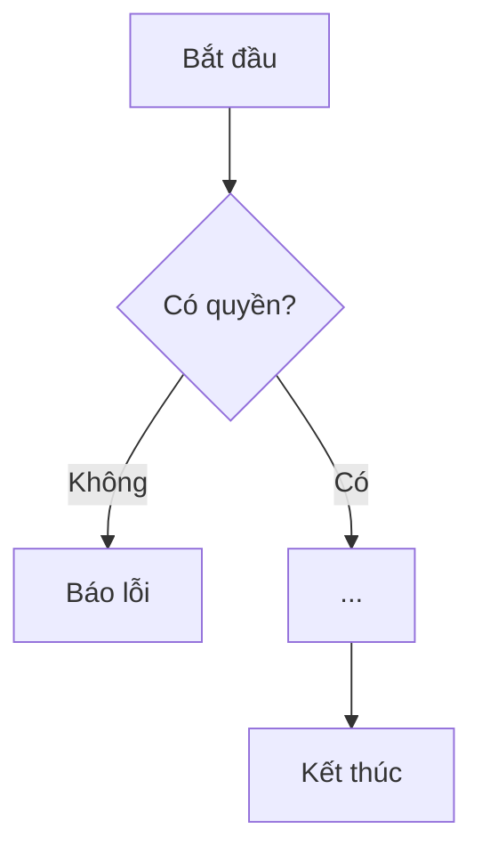

# /business-flow - Business Process Spec Generator

> **Trigger**: `/business-flow <requirement text | path to filled form | "form">`
> **Goal**: Turn a plain-language request from a non-technical person into a standard business process spec that devs, testers and other AIs can follow.
> **Scope**: Any project, any stack. The command learns the project vocabulary itself.
> **Output language**: ALWAYS Vietnamese (file content, questions to the user, final reply). Only code identifiers (role keys, entity names, API paths) stay as-is.

---

## Modes

| Input | Mode | What to do |
|-------|------|------------|
| `form` or empty | **Form** | Write the blank intake form (Template A) to `<docs-dir>/flows/_phieu-yeu-cau.md`, reply with how to fill it. Stop. |
| Path to a `.md` file | **From form** | Read the filled form, then run Steps 1-5 |
| Free text | **From text** | Treat the text as the answers to the form, then run Steps 1-5 |
| `existing <feature>` | **Reverse** | Trace the feature from code (not from a request) and document the as-is flow. Mark mismatches with ⚠ |

---

## Step 1 - Learn the project (silent, do not print findings)

Build a private project dictionary. Read on demand, cheapest first, stop when enough:
1. `CLAUDE.md`, `README*`, `docs/README.md` index, existing `docs/03-san-pham/flows/*` (reuse their codes and style).
2. Data model: `db/*.sql` (hand-run migrations) and the `*.repository.js` / `san-pham.mapper.js` row mappers.
3. Roles and permissions: permission lists in `server/components/*/*.routes.js` (`public` / `actor` / `admin` / `super`), `...Gated` functions in `*.service.js`, `users.perms`.
4. Existing features: `server/components/<domain>/`, the matching tab file in `public/`, existing flows.
5. Cross-cutting behavior: no realtime; notifications = in-app `notifications` table + Lark webhooks; audit = `server/components/thong-bao/audit.js`; background job = `bao-cao.job.js`.

Produce internally:
- **Glossary**: everyday word -> system term (e.g. "thẻ" -> `Card`).
- **Role table**: role key, rank, what it may do.
- **Existing features list**: to label parts of the request as "Đã có" or "Mới".
- **Conventions**: how errors, audit, realtime, notifications work here.

If there is no code (e.g. used outside a repo), skip reading and ask the user for the role list and main objects in Step 2.
Use a subagent (Explore) when learning needs more than 3 searches.

## Step 2 - Gap check (ask before writing)

Required: **who acts**, **what starts it**, **what the result is**. Also check: permissions, failure cases, who gets notified.

If any required item is missing or ambiguous, ask with `AskUserQuestion`:
- Max 5 questions, Vietnamese, plain words, no jargon.
- Offer concrete options derived from the project (real role names, real screens).
- Put the recommended option first with "(Khuyến nghị)".

Do not ask about things the code already answers. Anything still unknown after asking becomes an assumption `GD-xx`.

## Step 3 - Write the spec

Fill **Template B** exactly. Rules:
1. **No invention.** Facts not in the request or code go to `GD-xx` (assumption) or `Q-xx` (open question).
2. **Use project terms** from the glossary. Never invent role names.
3. **One action per step**: who - does what - system responds how.
4. **Always include failure paths**: no permission, invalid data, not found, duplicate, expired, plus domain-specific ones.
5. **Server decides permissions.** Hiding a button is UX, not security.
6. If the project has realtime / notifications / audit, state for every mutation whether it emits, who is notified, and whether it is audited.
7. Mark each part **Đã có** or **Mới** against the existing features list.
8. Sections 1-4 of the output: no programming jargon, short sentences.
9. Acceptance criteria use **Cho / Khi / Thì** and include at least one permission-failure case.
10. Section 15 (dev notes) may reference real files as `path:line`, only if verified.
11. Mermaid: use ASCII node ids, Vietnamese labels in brackets.

## Step 4 - Save

- Docs dir: in this repo `<docs-dir>` = `docs/03-san-pham` (per `.claude/rules/docs/docs-placement.md`); create it if missing.
- Path: `<docs-dir>/flows/QT-<nn>-<slug>.md`. `nn` = next free number from existing files. `slug` = kebab-case ASCII without Vietnamese diacritics (e.g. `QT-03-nhac-han-card.md`).
- Add one line for the new file to the index in `docs/README.md` (create the index if missing).
- Never overwrite an existing spec. For an update, bump "Phiên bản" and add a row to "Lịch sử thay đổi".

## Step 5 - Reply (Vietnamese, <= 6 lines)

- File path as a markdown link.
- Counts: số bước, số luồng lỗi, số giả định, số câu hỏi mở.
- List open questions `Q-xx` that the requester must answer.
- No summary of the spec content.

---

## Template A - Phiếu yêu cầu (cho người không chuyên)

````markdown
# Phiếu yêu cầu tính năng

> Viết như đang kể cho đồng nghiệp. Chỗ nào không biết ghi `Chưa rõ`, đừng bỏ trống.
> Điền xong, gõ: `/business-flow <đường dẫn file này>`

**1. Tên tính năng / việc cần làm:**
...

**2. Vì sao cần? (vấn đề đang gặp)**
...

**3. Ai dùng?** (liệt kê vai trò, có thể nhiều)
...

**4. Khi nào việc này bắt đầu?** (bấm nút gì, ở màn hình nào, hoặc tự chạy lúc nào)
...

**5. Các bước bạn hình dung** (theo thứ tự)
- ...

**6. Kết quả mong muốn khi xong**
...

**7. Luật / điều kiện** (ai được làm, ai không, giới hạn, thời hạn...)
- ...

**8. Trường hợp đặc biệt / có thể sai** (nhập sai, đã tồn tại, hết hạn, không có quyền, mất mạng...)
- ...

**9. Ai cần được báo?** (trong app, email, tin nhắn, lúc nào)
...

**10. Thông tin cần lưu / hiển thị**
...

**11. Ví dụ thực tế** (1-2 câu chuyện có tên người, số liệu)
...

**12. Mức ưu tiên:** Gấp / Bình thường / Để sau

**13. Câu hỏi bạn còn phân vân**
...
````

---

## Template B - Quy trình nghiệp vụ (đầu ra, luôn tiếng Việt)

````markdown
# [QT-nn] Tên quy trình

| Mục | Giá trị |
|-----|---------|
| Dự án | ... |
| Phiên bản | 1.0 - YYYY-MM-DD |
| Người yêu cầu | ... |
| Ưu tiên | Gấp / Bình thường / Để sau |
| Loại | Mới / Sửa tính năng có sẵn / Mô tả hiện trạng |

## 1. Tóm tắt
2-3 câu: ai, làm gì, để được gì.

## 2. Tác nhân & quyền
| Tác nhân | Vai trò hệ thống | Được làm gì trong quy trình |
|----------|-----------------|-----------------------------|

## 3. Điều kiện trước
- ...

## 4. Luồng chính
| Bước | Ai | Hành động | Hệ thống xử lý | Kết quả người dùng thấy | Đã có / Mới |
|------|----|-----------|----------------|--------------------------|-------------|
| 1 | | | | | |

## 5. Sơ đồ


## 6. Luồng phụ & lỗi
| Mã | Tình huống | Hệ thống phản hồi | Thông báo cho người dùng |
|----|-----------|-------------------|--------------------------|
| E1 | Không có quyền | | |
| E2 | Không tìm thấy | | |
| E3 | Dữ liệu không hợp lệ | | |

## 7. Trạng thái (bỏ mục này nếu không có vòng đời)

| Từ | Sang | Khi nào | Ai được làm |
|----|------|---------|-------------|

## 8. Quy tắc nghiệp vụ
| Mã | Quy tắc |
|----|---------|
| BR-01 | |

## 9. Thông báo, realtime & nhật ký
| Sự kiện | Ai nhận | Kênh | Nội dung | Ghi audit? |
|---------|---------|------|----------|:----------:|

## 10. Dữ liệu
| Thông tin | Bắt buộc | Ràng buộc | Ví dụ |
|-----------|----------|-----------|-------|

## 11. Màn hình liên quan
- ...

## 12. Tiêu chí nghiệm thu
- **AC-01**: Cho ... / Khi ... / Thì ...
- **AC-02**: Cho người không có quyền / Khi ... / Thì bị từ chối ...

## 13. Ảnh hưởng tới phần có sẵn
- ...

## 14. Giả định & câu hỏi mở
| Mã | Nội dung | Cần ai trả lời |
|----|----------|----------------|
| GD-01 | | |
| Q-01 | | |

## 15. Ghi chú kỹ thuật cho dev
- API, bảng dữ liệu, sự kiện realtime, job nền, file liên quan (`path:line`).

## Lịch sử thay đổi
| Phiên bản | Ngày | Thay đổi |
|-----------|------|----------|
| 1.0 | YYYY-MM-DD | Tạo mới |
````

---

## Self-check before saving

- [ ] Whole file is Vietnamese (except code identifiers)
- [ ] Who / trigger / result are clear
- [ ] One action per step
- [ ] >= 3 failure paths (permission, not found, invalid data)
- [ ] Role names match the project exactly
- [ ] Notification / realtime / audit stated for every mutation (if the project has them)
- [ ] Acceptance criteria in Cho / Khi / Thì, incl. a permission-failure case
- [ ] Every unknown is a `GD-xx` or `Q-xx`, nothing invented
- [ ] Every `path:line` in section 15 was verified
