# ERD - mô hình quan hệ dữ liệu

> **Cập nhật 2026-10-12:** đề xuất này ĐÃ được triển khai trên database local `qspro_en2`, có điều chỉnh. Cấu trúc đang chạy: [schema-hien-hanh.md](schema-hien-hanh.md). Những gì đã làm và khác gì so với bản dưới đây: [ket-qua-trien-khai.md](ket-qua-trien-khai.md). Nội dung bên dưới là bản đề xuất gốc, giữ lại để tra lý do.
>
> **Cập nhật 2026-10-15 (migration 0009-0011, không đổi quan hệ / khoá ngoại):** `purchase_orders` + `resolver_name`, `resolved_at` (người và lúc duyệt / từ chối đơn, M15.1); `delete_requests` + `resolution_note` (lý do từ chối, M15.2), `note` = lý do xoá do người gửi nhập (thôi DEPRECATED); `projects` + `current_condition` (hiện trạng in ở tờ bìa, M8.3). Chi tiết cột: [data-dictionary.md](data-dictionary.md).
>
> **Cập nhật 2026-10-15 (migration 0014, thêm 1 quan hệ):** bảng mới `user_sessions` (phiên đăng nhập, M1.2) - `users ||--o{ user_sessions : "user_id CASCADE"`; không có `company_id` (bảng hệ thống xuyên công ty). Chi tiết: [schema-hien-hanh.md](schema-hien-hanh.md), [data-dictionary.md](data-dictionary.md).

- Sơ đồ 1 vẽ từ catalog thật của `qspro_en` ngày 2026-10-12 (25 khoá ngoại trong `pg_constraint`) cộng các quan hệ logic đã xác minh trong code nhưng chưa có khoá ngoại.
- Sơ đồ 2 là schema **đề xuất** ([proposed-schema.md](proposed-schema.md)), chưa tồn tại.
- Quy ước: đường liền = có khoá ngoại trong database; đường đứt = tham chiếu mềm (không khoá ngoại). Nhãn ghi cột tham chiếu và hành vi khi xoá.
- Mọi bảng trừ `companies` còn có `company_id -> companies.id` (ON DELETE CASCADE), trừ `audit_logs` (không khoá ngoại). Các đường này được lược bỏ khỏi hình cho dễ đọc, chỉ giữ ở vài bảng chính.

## 1. Hiện tại

```mermaid
erDiagram
    companies ||--o{ users : "company_id CASCADE"
    companies ||--o{ products : "company_id CASCADE"
    companies ||--o{ projects : "company_id CASCADE"
    companies ||--o{ work_items : "company_id CASCADE"

    users ||..o{ audit_logs : "user_id (mem)"
    users ||..o{ notifications : "user_id (mem)"
    users ||..o{ delete_requests : "requester_id (mem)"
    users ||..o{ purchase_orders : "requester_id (mem)"
    users ||--o{ purchase_proposals : "requester_id SET NULL"
    users ||--o{ product_histories : "changed_by_id SET NULL"
    users ||--o{ work_item_histories : "changed_by_id SET NULL"

    products ||--o{ product_combos : "product_id CASCADE"
    products ||--o{ product_combos : "companion_product_id CASCADE"
    products ||..o{ favorite_products : "product_id (mem)"
    products ||..o{ product_histories : "product_code (mem, khong duy nhat)"
    products ||..o{ quotation_lines : "product_code (ban chup)"
    products ||..o{ purchase_order_items : "product_code (ban chup)"

    projects ||..o{ quotation_lines : "project_code (mem)"
    projects ||--o{ cost_estimate_lines : "project_code CASCADE"
    projects ||..o{ project_data_entries : "project_code (mem, co ma gia __cty)"
    projects ||..o{ purchase_orders : "project_code (mem, don song sot)"
    projects ||..o{ purchase_proposals : "project_code (mem)"

    purchase_orders ||--o{ purchase_order_items : "order_code CASCADE"
    purchase_proposals ||--o{ purchase_proposal_items : "proposal_code CASCADE"

    work_items ||..o{ work_item_histories : "work_item_id (mem, ghi sau khi xoa)"

    companies {
        uuid id PK
        text code UK
        text features "danh sach noi chuoi"
        date expiry_date
    }
    users {
        uuid id PK
        uuid company_id FK
        text username "unique theo cong ty"
        text role
        text permissions "danh sach noi chuoi"
    }
    products {
        bigint id PK
        uuid company_id FK
        text product_code "khong duy nhat"
        text sector
        numeric retail_price
        numeric dealer_price "dan xuat"
        boolean is_approved
    }
    projects {
        bigint id PK
        uuid company_id FK
        text project_code UK
        text project_name "khoa gom nhom ngam"
        text status
    }
    quotation_lines {
        bigint id PK
        uuid company_id FK
        text project_code
        text product_code "ban chup"
        numeric quantity
        numeric selling_price
        numeric amount "dan xuat"
    }
    cost_estimate_lines {
        bigint id PK
        text project_code FK
        text item_no "ma phan cap"
        numeric cost
    }
    project_data_entries {
        text project_code PK
        text data_key PK
        jsonb data_value
    }
    purchase_orders {
        bigint id PK
        text order_code UK
        text project_code
        text status
        numeric total_amount "tong luu san"
    }
    purchase_order_items {
        bigint id PK
        text order_code FK
        text product_code "ban chup"
    }
    purchase_proposals {
        bigint id PK
        text proposal_code UK
        text proposal_type "ck | tt"
        text status
    }
    purchase_proposal_items {
        bigint id PK
        text proposal_code FK
        numeric rate_pct "da nghia"
    }
    work_items {
        uuid id PK
        uuid company_id FK
        text quotation_type
        boolean is_approved
    }
```

Bảng không nối với bảng nghiệp vụ nào ngoài `companies` / `users`: `audit_logs`, `notifications` (cột `ref_id` trỏ đa hình tới phiếu xoá, mã đơn hoặc mã đề xuất), `delete_requests` (danh sách sản phẩm nằm trong JSON `items`).

## 2. Đề xuất (sau đợt 2)

Khác biệt so với sơ đồ 1: đường đứt thành đường liền ở các quan hệ sở hữu; khoá kép theo công ty (ghi `KEP`); thêm `company_settings`; tách thông số sản phẩm và dòng đề xuất.

```mermaid
erDiagram
    companies ||--o{ users : "company_id CASCADE"
    companies ||--o{ company_settings : "company_id CASCADE"
    companies ||--o{ products : "company_id CASCADE"
    companies ||--o{ projects : "company_id CASCADE"
    companies ||--o{ work_items : "company_id CASCADE"

    users ||..o{ audit_logs : "user_id (mem, co chu y)"
    users ||--o{ notifications : "user_id CASCADE"
    users ||--o{ delete_requests : "requester_id SET NULL"
    users ||--o{ purchase_orders : "requester_id SET NULL"
    users ||--o{ purchase_proposals : "requester_id SET NULL"
    users ||--o{ product_histories : "changed_by_id SET NULL"
    users ||--o{ work_item_histories : "changed_by_id SET NULL"

    products ||--o| product_lighting_specs : "product_id CASCADE"
    products ||--o| product_sanitary_specs : "product_id CASCADE"
    products ||--o| product_paint_specs : "product_id CASCADE"
    products ||--o| product_switch_socket_specs : "product_id CASCADE"
    products ||--o{ product_combos : "KEP company_id+product_id CASCADE"
    products ||--o{ product_combos : "companion_product_id CASCADE (duoc tro sang Dezon)"
    products ||--o{ favorite_products : "product_id CASCADE (duoc tro sang Dezon)"
    products ||..o{ product_histories : "product_code (mem, co chu y)"
    products ||..o{ quotation_lines : "product_code (ban chup)"
    products ||..o{ purchase_order_items : "product_code (ban chup)"

    projects ||--o{ quotation_lines : "KEP company_id+project_code CASCADE"
    projects ||--o{ cost_estimate_lines : "KEP CASCADE"
    projects ||--o{ project_data_entries : "KEP CASCADE"
    projects ||..o{ purchase_orders : "project_code (mem, don song sot)"
    projects ||..o{ purchase_proposals : "project_code (mem)"

    purchase_orders ||--o{ purchase_order_items : "KEP company_id+order_code CASCADE"
    purchase_proposals ||--o{ proposal_discount_items : "KEP CASCADE (loai ck)"
    purchase_proposals ||--o{ proposal_payment_installments : "KEP CASCADE (loai tt)"

    work_items ||..o{ work_item_histories : "work_item_id (mem, co chu y)"

    company_settings {
        uuid company_id PK
        text setting_key PK
        jsonb setting_value
    }
    products {
        bigint id PK
        uuid company_id FK
        text product_code
        text sector
        text color_temperature_k "truc bien the"
        text power_w "truc bien the"
        text beam_angle_deg "truc bien the"
        text color "truc bien the"
        text size "truc bien the"
        numeric dealer_price "GENERATED"
    }
    product_lighting_specs {
        bigint product_id PK
        text cri
        text luminous_flux_lm
    }
    product_sanitary_specs {
        bigint product_id PK
        text flush_system
    }
    product_paint_specs {
        bigint product_id PK
        text coverage
    }
    product_switch_socket_specs {
        bigint product_id PK
        text socket_count
    }
    proposal_discount_items {
        bigint id PK
        text proposal_code FK
        numeric original_unit_price
        numeric rate_pct "phan tram chiet khau"
    }
    proposal_payment_installments {
        bigint id PK
        text proposal_code FK
        numeric rate_pct "phan tram dot"
        date due_date
    }
```

## 3. Quan hệ đặc biệt cần nhớ

| Quan hệ | Loại | Ghi chú |
|---|---|---|
| Sản phẩm <-> sản phẩm đi kèm | N-N qua `product_combos` | Có hướng và số lượng; có thể tồn tại cả A->B và B->A; đọc theo cả hai chiều |
| Công ty <-> sản phẩm yêu thích | N-N qua `favorite_products` | Theo công ty, không theo user |
| Biến thể | Ngầm | Cùng `product_code` trong một công ty; hoặc cùng `variant_group` (`BT-<id>`) |
| "Dự án" <-> bản nháp | Ngầm | Các dòng `projects` cùng `lower(trim(project_name))` |
| Tờ bìa <-> dòng bóc tách | Ngầm | `cost_estimate_lines.item_no` là tiền tố của `quotation_lines.takeoff_group` |
| Tầng | Theo tên | `quotation_lines.floor` khớp phần tử của `projects.custom_floors` |
| Công tác -> dự án | Sao chép | Chép vào JSON `phanTho` hoặc thành dòng bóc tách; không giữ id |
| Kho sản phẩm chung | Chéo công ty, chỉ đọc | Công ty có `has_dezon_catalog_access` đọc sản phẩm của công ty `code = 'dezon'` |
