# Schema hiện hành

> Sinh tự động từ catalog của database `qspro_en2` ngày 2026-10-12 sau khi chạy 8 migration trong `infra/db/migrations/`. Không gõ tay.
> Cập nhật 2026-10-15: thêm các cột của migration 0009-0011 theo catalog của `qspro_gotest` sau `go run ./cmd/migrate`:
> `purchase_orders.resolver_name` / `resolved_at` (người và lúc duyệt / từ chối đơn), `delete_requests.resolution_note`
> (lý do admin từ chối), `projects.current_condition` (hiện trạng, in ở tờ bìa). `delete_requests.note` thôi DEPRECATED
> (0010): là lý do xoá do người gửi nhập. Số dòng của các bảng vẫn là số đếm trên `qspro_en2` ngày 2026-10-12.
> Cập nhật 2026-10-15 (0012, chỉ chú thích): `companies.last_reminder_date` / `reminder_milestone` thôi DEPRECATED, dùng cho
> nhắc gia hạn trong ứng dụng (M17.3, giả định): mốc đã nhắc trong {30,14,7,3,1,0}, giá trị ngoài tập coi như chưa nhắc; không CHECK.
> Cập nhật 2026-10-15 (0013, chỉ chú thích): `product_combos.note` thôi DEPRECATED (ghi chú liên kết sản phẩm đi kèm, M10.2);
> `purchase_orders.send_result` ghi rõ `pending` / `ok` / `loi` (M9.1).
> Cập nhật 2026-10-15 (0014): bảng mới `user_sessions` (`phien_dang_nhap`) - phiên đăng nhập lưu phía máy chủ, đăng xuất thu hồi
> token ngay (M1.2). Theo catalog của `qspro_gotest`; số dòng ghi 0 (bảng mới, `qspro_en2` chưa chạy 0014).
> Ý nghĩa từng cột: chú thích cột trong [infra/db/schema.sql](../../../infra/db/schema.sql).
> Đây là tài liệu mô tả cấu trúc ĐANG CHẠY. Bối cảnh và lý do: [ket-qua-trien-khai.md](ket-qua-trien-khai.md), [decisions.md](decisions.md).

## 1. Bảng và nhiệm vụ

| Module | Bảng (tên trong code) | Nhiệm vụ | Dòng | Thuộc công ty nào |
|---|---|---|---:|---|
| Công ty, tài khoản | `companies` (`cong_ty`) | Công ty (tenant) và gói dịch vụ | 3 | - |
| Công ty, tài khoản | `company_settings` (`cai_dat_cong_ty`) | Tài liệu cấu hình theo công ty (ptInfo, bgOrg) | 0 | trực tiếp: `company_id` -> `companies` |
| Công ty, tài khoản | `users` (`users`) | Tài khoản, vai trò, quyền | 8 | trực tiếp: `company_id` -> `companies` |
| Công ty, tài khoản | `user_sessions` (`phien_dang_nhap`) | Phiên đăng nhập: 1 dòng / lần đăng nhập, token mang id (M1.2) | 0 | xuyên công ty (chỉ truy cập noScope); công ty = công ty của `users` |
| Nhật ký, thông báo | `audit_logs` (`audit_log`) | Nhật ký thao tác (chỉ thêm) | 2933 | `company_id` (tham chiếu mềm, không khoá ngoại) |
| Nhật ký, thông báo | `notifications` (`notifications`) | Thông báo cho từng user | 24 | trực tiếp: `company_id` -> `companies` |
| Danh mục sản phẩm | `products` (`db_san_pham`) | Sản phẩm / biến thể: định danh, giá, 5 trục biến thể, thuộc tính dùng chung, duyệt | 1093 | trực tiếp: `company_id` -> `companies` |
| Danh mục sản phẩm | `product_lighting_specs` | Thông số riêng ngành ĐÈN (1-1 với products) | 661 | qua bảng cha: `product_id` -> `products` |
| Danh mục sản phẩm | `product_sanitary_specs` | Thông số riêng ngành THIẾT BỊ VỆ SINH (1-1) | 172 | qua bảng cha: `product_id` -> `products` |
| Danh mục sản phẩm | `product_paint_specs` | Thông số riêng ngành SƠN (1-1) | 149 | qua bảng cha: `product_id` -> `products` |
| Danh mục sản phẩm | `product_switch_socket_specs` | Thông số riêng ngành CÔNG TẮC - Ổ CẮM (1-1) | 0 | qua bảng cha: `product_id` -> `products` |
| Danh mục sản phẩm | `product_histories` (`db_san_pham_history`) | Lịch sử thay đổi sản phẩm (chỉ thêm) | 3002 | trực tiếp: `company_id` -> `companies` |
| Danh mục sản phẩm | `product_combos` (`sp_combo`) | Sản phẩm đi kèm (N-N giữa 2 sản phẩm) | 85 | qua bảng cha: `product_id` -> `products` |
| Danh mục sản phẩm | `favorite_products` (`sp_yeu_thich`) | Sản phẩm yêu thích của công ty (N-N công ty - sản phẩm) | 14 | trực tiếp: `company_id` -> `companies` |
| Danh mục sản phẩm | `delete_requests` (`delete_requests`) | Phiếu xin xoá sản phẩm | 1 | trực tiếp: `company_id` -> `companies` |
| Dự án, bóc tách, báo giá | `projects` (`du_an`) | Bản nháp dự án | 30 | trực tiếp: `company_id` -> `companies` |
| Dự án, bóc tách, báo giá | `quotation_lines` (`db_bao_gia`) | Dòng bóc tách / báo giá của dự án | 529 | qua bảng cha: `project_code` -> `projects` |
| Dự án, bóc tách, báo giá | `cost_estimate_lines` (`khai_toan`) | Dòng tờ bìa / khái toán của dự án | 104 | qua bảng cha: `project_code` -> `projects` |
| Dự án, bóc tách, báo giá | `project_data_entries` (`du_an_data`) | Tài liệu JSON theo dự án (phần thô, cấu hình báo giá, lịch sử phiên bản...) | 23 | qua bảng cha: `project_code` -> `projects` |
| Thư viện công tác | `work_items` (`cong_tac`) | Thư viện công tác của công ty | 217 | trực tiếp: `company_id` -> `companies` |
| Thư viện công tác | `work_item_histories` (`cong_tac_history`) | Lịch sử thay đổi công tác (chỉ thêm) | 1 | trực tiếp: `company_id` -> `companies` |
| Mua hàng | `purchase_orders` (`don_mua_hang`) | Đơn mua hàng | 65 | trực tiếp: `company_id` -> `companies` |
| Mua hàng | `purchase_order_items` (`chi_tiet_mua_hang`) | Dòng hàng của đơn mua (bản chụp) | 160 | qua bảng cha: `order_code` -> `purchase_orders` |
| Mua hàng | `purchase_proposals` (`de_xuat`) | Phiếu đề xuất (ck / tt) | 2 | trực tiếp: `company_id` -> `companies` |
| Mua hàng | `proposal_discount_items` (`chi_tiet_de_xuat_ck`) | Dòng sản phẩm của phiếu xin chiết khấu (ck) | 0 | qua bảng cha: `proposal_code` -> `purchase_proposals` |
| Mua hàng | `proposal_payment_installments` (`chi_tiet_de_xuat_tt`) | Đợt thanh toán của phiếu đề xuất thanh toán (tt) | 0 | qua bảng cha: `proposal_code` -> `purchase_proposals` |
| Hệ thống | `schema_migrations` | Sổ ghi migration đã chạy | 8 | - |

View: `product_catalog` = `products` nối trái 4 bảng `product_*_specs`, trả đủ 141 cột; code đọc `db_san_pham` qua view này và ghi vào các bảng gốc.

**Quy tắc liên kết:** bảng con chỉ nối với bảng cha bằng khoá ngoại và không lặp lại `company_id`; công ty của dòng con là công ty của dòng cha. `company_id` chỉ có ở bảng gốc của công ty (khoá ngoại trực tiếp tới `companies`) và ở 3 bảng nhật ký / lịch sử phải sống lâu hơn bản ghi gốc.

## 2. Sơ đồ quan hệ (mọi khoá ngoại trong database)

```mermaid
erDiagram
    companies ||--o{ company_settings : "company_id CASCADE"
    projects ||--o{ cost_estimate_lines : "project_code CASCADE"
    companies ||--o{ delete_requests : "company_id CASCADE"
    users ||--o{ delete_requests : "requester_id SET NULL"
    companies ||--o{ favorite_products : "company_id CASCADE"
    products ||--o{ favorite_products : "product_id CASCADE"
    companies ||--o{ notifications : "company_id CASCADE"
    users ||--o{ notifications : "user_id CASCADE"
    users ||--o{ user_sessions : "user_id CASCADE"
    products ||--o{ product_combos : "companion_product_id CASCADE"
    products ||--o{ product_combos : "product_id CASCADE"
    users ||--o{ product_histories : "changed_by_id SET NULL"
    companies ||--o{ product_histories : "company_id CASCADE"
    products ||--o| product_lighting_specs : "product_id CASCADE"
    products ||--o| product_paint_specs : "product_id CASCADE"
    products ||--o| product_sanitary_specs : "product_id CASCADE"
    products ||--o| product_switch_socket_specs : "product_id CASCADE"
    companies ||--o{ products : "company_id CASCADE"
    projects ||--o{ project_data_entries : "project_code CASCADE"
    companies ||--o{ projects : "company_id CASCADE"
    purchase_proposals ||--o{ proposal_discount_items : "proposal_code CASCADE"
    purchase_proposals ||--o{ proposal_payment_installments : "proposal_code CASCADE"
    purchase_orders ||--o{ purchase_order_items : "order_code CASCADE"
    companies ||--o{ purchase_orders : "company_id CASCADE"
    users ||--o{ purchase_orders : "requester_id SET NULL"
    companies ||--o{ purchase_proposals : "company_id CASCADE"
    users ||--o{ purchase_proposals : "requester_id SET NULL"
    projects ||--o{ quotation_lines : "project_code CASCADE"
    companies ||--o{ users : "company_id CASCADE"
    users ||--o{ work_item_histories : "changed_by_id SET NULL"
    companies ||--o{ work_item_histories : "company_id CASCADE"
    companies ||--o{ work_items : "company_id CASCADE"
```

Tham chiếu mềm (cố ý không có khoá ngoại): `purchase_orders.project_code`, `purchase_proposals.project_code`, mọi `product_code` trên dòng báo giá / mua hàng / lịch sử, `audit_logs.user_id`, `audit_logs.company_id`, `work_item_histories.work_item_id`, `notifications.ref_id`. Lý do ghi trong chú thích cột và ở [decisions.md](decisions.md) D-04.

## 3. Chi tiết từng bảng

### `companies` (`cong_ty`)

Công ty (tenant) và gói dịch vụ. 3 dòng.

- CHECK `ck_companies_user_limit`: `CHECK ((user_limit >= 0))`
- PK `pk_companies`: `PRIMARY KEY (id)`
- UNIQUE `uq_companies_code`: `UNIQUE (code)`

| Cột | Kiểu | NULL | Mặc định |
|---|---|---|---|
| `id` | uuid | không | gen_random_uuid() |
| `name` | text | không |  |
| `code` | text | có |  |
| `logo_url` | text | có |  |
| `primary_color` | text | có |  |
| `features` | text | có | ''::text |
| `user_limit` | integer | có | 10 |
| `is_active` | boolean | có | true |
| `expiry_date` | date | có |  |
| `note` | text | có |  |
| `created_at` | timestamp with time zone | có | now() |
| `email` | text | có |  |
| `phone` | text | có |  |
| `last_reminder_date` | date | có |  |
| `reminder_milestone` | integer | có |  |
| `has_dezon_catalog_access` | boolean | có | false |

### `company_settings` (`cai_dat_cong_ty`)

Tài liệu cấu hình theo công ty (ptInfo, bgOrg). 0 dòng.

- CHECK `ck_company_settings_setting_key`: `CHECK ((setting_key <> ''::text))`
- FK `fk_company_settings_company_id`: `FOREIGN KEY (company_id) REFERENCES companies(id) ON DELETE CASCADE`
- PK `pk_company_settings`: `PRIMARY KEY (id)`
- UNIQUE `uq_company_settings_company_id_setting_key`: `UNIQUE NULLS NOT DISTINCT (company_id, setting_key)`

| Cột | Kiểu | NULL | Mặc định |
|---|---|---|---|
| `id` | bigint identity | không |  |
| `company_id` | uuid | có |  |
| `setting_key` | text | không |  |
| `setting_value` | jsonb | có |  |
| `updated_at` | timestamp with time zone | không | now() |
| `updated_by` | text | có |  |

### `users` (`users`)

Tài khoản, vai trò, quyền. 8 dòng.

- CHECK `ck_users_role`: `CHECK ((role = ANY (ARRAY['super'::text, 'admin'::text, 'staff'::text])))`
- CHECK `ck_users_username`: `CHECK ((username = lower(username)))`
- FK `fk_users_company_id`: `FOREIGN KEY (company_id) REFERENCES companies(id) ON DELETE CASCADE`
- PK `pk_users`: `PRIMARY KEY (id)`
- INDEX `INDEX idx_users_username (username)`
- INDEX `UNIQUE INDEX uq_users_company_id_username (company_id, username)`
- INDEX `UNIQUE INDEX uq_users_lower_username (lower(username))`

| Cột | Kiểu | NULL | Mặc định |
|---|---|---|---|
| `id` | uuid | không | gen_random_uuid() |
| `username` | text | không |  |
| `full_name` | text | có | ''::text |
| `password_hash` | text | không |  |
| `role` | text | không | 'staff'::text |
| `is_active` | boolean | không | true |
| `created_at` | timestamp with time zone | không | now() |
| `last_login_at` | timestamp with time zone | có |  |
| `permissions` | text | có | ''::text |
| `company_id` | uuid | có |  |
| `email` | text | có |  |
| `department` | text | có |  |
| `ui_preferences` | jsonb | không | '{}'::jsonb |

### `user_sessions` (`phien_dang_nhap`)

Phiên đăng nhập lưu phía máy chủ (M1.2): 1 dòng / lần đăng nhập, token mang `id` (khoá `sid`); đăng xuất xoá dòng. 0 dòng.

- CHECK `ck_user_sessions_expires_at`: `CHECK ((expires_at > created_at))`
- FK `fk_user_sessions_user_id`: `FOREIGN KEY (user_id) REFERENCES users(id) ON DELETE CASCADE`
- PK `pk_user_sessions`: `PRIMARY KEY (id)`
- INDEX `INDEX idx_user_sessions_user_id (user_id)`

| Cột | Kiểu | NULL | Mặc định |
|---|---|---|---|
| `id` | uuid | không | gen_random_uuid() |
| `user_id` | uuid | không |  |
| `created_at` | timestamp with time zone | không | now() |
| `expires_at` | timestamp with time zone | không |  |

### `audit_logs` (`audit_log`)

Nhật ký thao tác (chỉ thêm). 2933 dòng.

- PK `pk_audit_logs`: `PRIMARY KEY (id)`
- INDEX `INDEX idx_audit_logs_action_id (action, id)`
- INDEX `INDEX idx_audit_logs_company_id_created_at_desc (company_id, created_at DESC)`
- INDEX `INDEX idx_audit_logs_created_at_desc (created_at DESC)`
- INDEX `INDEX idx_audit_logs_user_id (user_id)`

| Cột | Kiểu | NULL | Mặc định |
|---|---|---|---|
| `id` | bigint identity | không |  |
| `user_id` | uuid | có |  |
| `username` | text | có |  |
| `action` | text | có |  |
| `detail` | text | có |  |
| `created_at` | timestamp with time zone | không | now() |
| `company_id` | uuid | có |  |

### `notifications` (`notifications`)

Thông báo cho từng user. 24 dòng.

- FK `fk_notifications_company_id`: `FOREIGN KEY (company_id) REFERENCES companies(id) ON DELETE CASCADE`
- FK `fk_notifications_user_id`: `FOREIGN KEY (user_id) REFERENCES users(id) ON DELETE CASCADE`
- PK `pk_notifications`: `PRIMARY KEY (id)`
- INDEX `INDEX idx_notifications_company_id (company_id)`
- INDEX `INDEX idx_notifications_user_id_is_read_created_at_desc (user_id, is_read, created_at DESC)`

| Cột | Kiểu | NULL | Mặc định |
|---|---|---|---|
| `id` | bigint identity | không |  |
| `user_id` | uuid | có |  |
| `kind` | text | có |  |
| `title` | text | có |  |
| `body` | text | có |  |
| `ref_id` | text | có |  |
| `is_read` | boolean | không | false |
| `created_at` | timestamp with time zone | không | now() |
| `company_id` | uuid | có |  |

### `products` (`db_san_pham`)

Sản phẩm / biến thể: định danh, giá, 5 trục biến thể, thuộc tính dùng chung, duyệt. 1093 dòng.

- CHECK `ck_products_dealer_discount_pct`: `CHECK (((dealer_discount_pct >= (0)::numeric) AND (dealer_discount_pct <= (100)::numeric)))`
- CHECK `ck_products_dealer_price`: `CHECK ((dealer_price >= (0)::numeric))`
- CHECK `ck_products_product_name`: `CHECK ((btrim(product_name) <> ''::text))`
- CHECK `ck_products_retail_price`: `CHECK ((retail_price >= (0)::numeric))`
- CHECK `ck_products_warranty_years`: `CHECK ((warranty_years >= (0)::numeric))`
- FK `fk_products_company_id`: `FOREIGN KEY (company_id) REFERENCES companies(id) ON DELETE CASCADE`
- PK `pk_products`: `PRIMARY KEY (id)`
- INDEX `INDEX idx_products_created_at (created_at)`
- INDEX `INDEX idx_products_product_code (product_code)`
- INDEX `INDEX idx_products_variant_group_part (variant_group) WHERE (variant_group IS NOT NULL)`
- INDEX `UNIQUE INDEX uq_products_company_id_product_code_coalesce_color_temp_2a8f830 (company_id, product_code, COALESCE(color_temperature_k, ''::text), COALESCE(power_w, ''::text), COALESCE(beam_angle_deg, ''::text), COALESCE(color, ''::text), COALESCE(size, ''::text))`

| Cột | Kiểu | NULL | Mặc định |
|---|---|---|---|
| `id` | bigint identity | không |  |
| `product_code` | text | có |  |
| `product_name` | text | không |  |
| `product_line` | text | có |  |
| `category` | text | có |  |
| `product_group` | text | có |  |
| `brand` | text | có |  |
| `supplier_name` | text | có |  |
| `power_w` | text | có |  |
| `color_temperature_k` | text | có |  |
| `beam_angle_deg` | text | có |  |
| `color` | text | có |  |
| `material` | text | có |  |
| `ip_rating` | text | có |  |
| `warranty_years` | numeric | có |  |
| `unit` | text | có |  |
| `retail_price` | numeric | có |  |
| `dealer_discount_pct` | numeric | có |  |
| `image_urls` | text | có |  |
| `datasheet_url` | text | có |  |
| `status` | text | có |  |
| `note` | text | có |  |
| `updated_at` | timestamp with time zone | có | now() |
| `company_id` | uuid | có |  |
| `is_approved` | boolean | có | false |
| `approved_by` | text | có |  |
| `approved_at` | timestamp with time zone | có |  |
| `created_by` | text | có |  |
| `created_at` | timestamp with time zone | có | now() |
| `updated_by` | text | có |  |
| `variant_group` | text | có |  |
| `sector` | text | có |  |
| `size` | text | có |  |
| `caution` | text | có |  |
| `features` | text | có |  |
| `installation_type` | text | có |  |
| `surface_finish` | text | có |  |
| `spec_sheet_url` | text | có |  |
| `installation_guide_url` | text | có |  |
| `drawing_file_url` | text | có |  |
| `dealer_price` | numeric GENERATED | có | (tự tính) |

### `product_lighting_specs`

Thông số riêng ngành ĐÈN (1-1 với products). 661 dòng.

- CHECK `ck_product_lighting_specs_diameter_mm`: `CHECK ((diameter_mm >= (0)::numeric))`
- CHECK `ck_product_lighting_specs_driver_price`: `CHECK ((driver_price >= (0)::numeric))`
- CHECK `ck_product_lighting_specs_luminous_efficacy_lm_w`: `CHECK ((luminous_efficacy_lm_w >= (0)::numeric))`
- CHECK `ck_product_lighting_specs_luminous_flux_lm`: `CHECK ((luminous_flux_lm >= (0)::numeric))`
- CHECK `ck_product_lighting_specs_max_output_current_ma`: `CHECK ((max_output_current_ma >= (0)::numeric))`
- FK `fk_product_lighting_specs_product_id`: `FOREIGN KEY (product_id) REFERENCES products(id) ON DELETE CASCADE`
- PK `pk_product_lighting_specs`: `PRIMARY KEY (product_id)`

| Cột | Kiểu | NULL | Mặc định |
|---|---|---|---|
| `product_id` | bigint | không |  |
| `luminous_flux_lm` | numeric | có |  |
| `tilt_angle_deg` | text | có |  |
| `height_mm` | numeric | có |  |
| `diameter_mm` | numeric | có |  |
| `cutout_mm` | text | có |  |
| `cri` | text | có |  |
| `luminous_efficacy_lm_w` | numeric | có |  |
| `ugr` | text | có |  |
| `sdcm` | text | có |  |
| `coi` | text | có |  |
| `lifespan` | text | có |  |
| `led_chip_type` | text | có |  |
| `protection_class` | text | có |  |
| `has_separate_driver` | boolean | có |  |
| `driver_name` | text | có |  |
| `driver_code` | text | có |  |
| `driver_brand` | text | có |  |
| `driver_mounting_position` | text | có |  |
| `control_compatibility` | text | có |  |
| `max_output_current_ma` | numeric | có |  |
| `led_chip_name` | text | có |  |
| `driver_price` | numeric | có |  |

### `product_sanitary_specs`

Thông số riêng ngành THIẾT BỊ VỆ SINH (1-1). 172 dòng.

- FK `fk_product_sanitary_specs_product_id`: `FOREIGN KEY (product_id) REFERENCES products(id) ON DELETE CASCADE`
- PK `pk_product_sanitary_specs`: `PRIMARY KEY (product_id)`

| Cột | Kiểu | NULL | Mặc định |
|---|---|---|---|
| `product_id` | bigint | không |  |
| `flush_system` | text | có |  |
| `flush_volume` | text | có |  |
| `design` | text | có |  |
| `rough_in_distance` | text | có |  |
| `water_pressure` | text | có |  |
| `lid_type` | text | có |  |
| `faucet_type` | text | có |  |
| `shower_type` | text | có |  |
| `control_type` | text | có |  |
| `massage_function` | text | có |  |
| `bowl_count` | text | có |  |
| `flow_rate` | text | có |  |
| `valve_cartridge` | text | có |  |
| `shower_head_size` | text | có |  |
| `spray_modes` | text | có |  |
| `faucet_hole_count` | text | có |  |
| `overflow_hole` | text | có |  |
| `capacity` | text | có |  |
| `power_supply` | text | có |  |
| `compatible_toilet` | text | có |  |
| `thickness` | text | có |  |

### `product_paint_specs`

Thông số riêng ngành SƠN (1-1). 149 dòng.

- FK `fk_product_paint_specs_product_id`: `FOREIGN KEY (product_id) REFERENCES products(id) ON DELETE CASCADE`
- PK `pk_product_paint_specs`: `PRIMARY KEY (product_id)`

| Cột | Kiểu | NULL | Mặc định |
|---|---|---|---|
| `product_id` | bigint | không |  |
| `coverage` | text | có |  |
| `drying_time` | text | có |  |
| `coat_count` | text | có |  |
| `physical_state` | text | có |  |
| `odor` | text | có |  |
| `odor_threshold` | text | có |  |
| `ph_value` | text | có |  |
| `melting_freezing_point` | text | có |  |
| `boiling_point` | text | có |  |
| `flash_point` | text | có |  |
| `flammability` | text | có |  |
| `explosive_limits` | text | có |  |
| `vapor_pressure` | text | có |  |
| `vapor_density` | text | có |  |
| `water_solubility` | text | có |  |
| `viscosity` | text | có |  |
| `particle_characteristics` | text | có |  |
| `relative_density` | text | có |  |

### `product_switch_socket_specs`

Thông số riêng ngành CÔNG TẮC - Ổ CẮM (1-1). 0 dòng.

- FK `fk_product_switch_socket_specs_product_id`: `FOREIGN KEY (product_id) REFERENCES products(id) ON DELETE CASCADE`
- PK `pk_product_switch_socket_specs`: `PRIMARY KEY (product_id)`

| Cột | Kiểu | NULL | Mặc định |
|---|---|---|---|
| `product_id` | bigint | không |  |
| `component_type` | text | có |  |
| `socket_count` | text | có |  |
| `plug_type` | text | có |  |
| `gang_count` | text | có |  |
| `circuit_type` | text | có |  |
| `operation_type` | text | có |  |
| `indicator_light` | text | có |  |
| `safety_shutter` | text | có |  |
| `pack_quantity` | text | có |  |
| `rated_current_a` | text | có |  |
| `rated_voltage_v` | text | có |  |
| `max_power_w` | text | có |  |
| `max_load_power_w` | text | có |  |
| `min_load_power_w` | text | có |  |
| `load_type` | text | có |  |
| `operation_cycles` | text | có |  |
| `frequency_hz` | text | có |  |
| `contact_material` | text | có |  |
| `flame_resistance` | text | có |  |
| `standards` | text | có |  |
| `certifications` | text | có |  |
| `usb_a_port_count` | text | có |  |
| `usb_c_port_count` | text | có |  |
| `usb_charging_power_w` | text | có |  |
| `usb_output` | text | có |  |
| `signal_connector_type` | text | có |  |
| `smart_integration` | text | có |  |
| `connectivity_protocol` | text | có |  |
| `compatible_ecosystem` | text | có |  |
| `neutral_wire` | text | có |  |
| `sensor_type` | text | có |  |
| `smart_features` | text | có |  |
| `module_count` | text | có |  |
| `face_width_mm` | text | có |  |
| `face_height_mm` | text | có |  |
| `face_depth_mm` | text | có |  |
| `mounting_box_type` | text | có |  |
| `min_box_depth_mm` | text | có |  |
| `max_wire_cross_section` | text | có |  |

### `product_histories` (`db_san_pham_history`)

Lịch sử thay đổi sản phẩm (chỉ thêm). 3002 dòng.

- FK `fk_product_histories_changed_by_id`: `FOREIGN KEY (changed_by_id) REFERENCES users(id) ON DELETE SET NULL`
- FK `fk_product_histories_company_id`: `FOREIGN KEY (company_id) REFERENCES companies(id) ON DELETE CASCADE`
- PK `pk_product_histories`: `PRIMARY KEY (id)`
- INDEX `INDEX idx_product_histories_changed_by_id (changed_by_id)`
- INDEX `INDEX idx_product_histories_company_id_product_code_changed_at_desc (company_id, product_code, changed_at DESC)`

| Cột | Kiểu | NULL | Mặc định |
|---|---|---|---|
| `id` | bigint identity | không |  |
| `product_code` | text | có |  |
| `field` | text | có |  |
| `old_value` | text | có |  |
| `new_value` | text | có |  |
| `changed_by_id` | uuid | có |  |
| `changed_by_name` | text | có |  |
| `changed_at` | timestamp with time zone | không | now() |
| `company_id` | uuid | có |  |

### `product_combos` (`sp_combo`)

Sản phẩm đi kèm (N-N giữa 2 sản phẩm). 85 dòng.

- CHECK `ck_product_combos_product_id`: `CHECK ((product_id <> companion_product_id))`
- CHECK `ck_product_combos_quantity`: `CHECK ((quantity > (0)::numeric))`
- CHECK `ck_product_combos_sort_order`: `CHECK ((sort_order >= 0))`
- FK `fk_product_combos_companion_product_id`: `FOREIGN KEY (companion_product_id) REFERENCES products(id) ON DELETE CASCADE`
- FK `fk_product_combos_product_id`: `FOREIGN KEY (product_id) REFERENCES products(id) ON DELETE CASCADE`
- PK `pk_product_combos`: `PRIMARY KEY (id)`
- INDEX `INDEX idx_product_combos_companion_product_id (companion_product_id)`
- INDEX `UNIQUE INDEX uq_product_combos_product_id_companion_product_id (product_id, companion_product_id)`

| Cột | Kiểu | NULL | Mặc định |
|---|---|---|---|
| `id` | bigint identity | không |  |
| `product_id` | bigint | không |  |
| `companion_product_id` | bigint | không |  |
| `quantity` | numeric | có | 1 |
| `note` | text | có |  |
| `sort_order` | integer | có | 0 |
| `created_at` | timestamp with time zone | không | now() |

### `favorite_products` (`sp_yeu_thich`)

Sản phẩm yêu thích của công ty (N-N công ty - sản phẩm). 14 dòng.

- FK `fk_favorite_products_company_id`: `FOREIGN KEY (company_id) REFERENCES companies(id) ON DELETE CASCADE`
- FK `fk_favorite_products_product_id`: `FOREIGN KEY (product_id) REFERENCES products(id) ON DELETE CASCADE`
- PK `pk_favorite_products`: `PRIMARY KEY (id)`
- INDEX `INDEX idx_favorite_products_product_id (product_id)`
- INDEX `UNIQUE INDEX uq_favorite_products_company_id_product_id (company_id, product_id)`

| Cột | Kiểu | NULL | Mặc định |
|---|---|---|---|
| `id` | bigint identity | không |  |
| `company_id` | uuid | có |  |
| `product_id` | bigint | không |  |
| `product_code` | text | có |  |
| `created_by` | text | có |  |
| `created_at` | timestamp with time zone | không | now() |

### `delete_requests` (`delete_requests`)

Phiếu xin xoá sản phẩm. 1 dòng.

- CHECK `ck_delete_requests_status`: `CHECK ((status = ANY (ARRAY['pending'::text, 'approved'::text, 'rejected'::text])))`
- FK `fk_delete_requests_company_id`: `FOREIGN KEY (company_id) REFERENCES companies(id) ON DELETE CASCADE`
- FK `fk_delete_requests_requester_id`: `FOREIGN KEY (requester_id) REFERENCES users(id) ON DELETE SET NULL`
- PK `pk_delete_requests`: `PRIMARY KEY (id)`
- INDEX `INDEX idx_delete_requests_company_id_created_at_desc (company_id, created_at DESC)`
- INDEX `INDEX idx_delete_requests_requester_id (requester_id)`

| Cột | Kiểu | NULL | Mặc định |
|---|---|---|---|
| `id` | bigint identity | không |  |
| `requester_id` | uuid | có |  |
| `requester_name` | text | có |  |
| `items` | text | có |  |
| `status` | text | không | 'pending'::text |
| `note` | text | có |  |
| `resolver_name` | text | có |  |
| `resolved_at` | timestamp with time zone | có |  |
| `created_at` | timestamp with time zone | không | now() |
| `company_id` | uuid | có |  |
| `resolution_note` | text | có |  |

### `projects` (`du_an`)

Bản nháp dự án. 30 dòng.

- CHECK `ck_projects_progress_pct`: `CHECK (((progress_pct >= (0)::numeric) AND (progress_pct <= (100)::numeric)))`
- CHECK `ck_projects_project_code`: `CHECK ((project_code <> ''::text))`
- CHECK `ck_projects_status`: `CHECK ((status = ANY (ARRAY['Bản nháp'::text, 'Đang thực hiện'::text, 'Hoàn thành'::text])))`
- CHECK `ck_projects_vat_pct`: `CHECK (((vat_pct >= (0)::numeric) AND (vat_pct <= (100)::numeric)))`
- FK `fk_projects_company_id`: `FOREIGN KEY (company_id) REFERENCES companies(id) ON DELETE CASCADE`
- PK `pk_projects`: `PRIMARY KEY (id)`
- UNIQUE `uq_projects_project_code`: `UNIQUE (project_code)`
- INDEX `INDEX idx_projects_company_id_created_at (company_id, created_at)`

| Cột | Kiểu | NULL | Mặc định |
|---|---|---|---|
| `id` | bigint identity | không |  |
| `project_code` | text | có |  |
| `project_name` | text | có |  |
| `customer_name` | text | có |  |
| `address` | text | có |  |
| `phone` | text | có |  |
| `status` | text | có |  |
| `vat_pct` | numeric | có | 0 |
| `progress_pct` | numeric | có | 0 |
| `note` | text | có |  |
| `project_scale` | text | có |  |
| `total_area` | text | có |  |
| `quoted_area` | text | có |  |
| `requirements` | text | có |  |
| `segment` | text | có |  |
| `quotation_code` | text | có |  |
| `custom_groups` | text | có |  |
| `custom_floors` | text | có |  |
| `created_at` | timestamp with time zone | có | now() |
| `updated_at` | timestamp with time zone | có | now() |
| `draft_name` | text | có |  |
| `company_id` | uuid | có |  |
| `dezon_url` | text | có |  |
| `current_condition` | text | có |  |

### `quotation_lines` (`db_bao_gia`)

Dòng bóc tách / báo giá của dự án. 529 dòng.

- CHECK `ck_quotation_lines_amount`: `CHECK ((amount >= (0)::numeric))`
- CHECK `ck_quotation_lines_amount_formula`: `CHECK ((abs((amount - (quantity * unit_price))) <= GREATEST((1)::numeric, (abs((quantity * unit_price)) * 0.000000001))))`
- CHECK `ck_quotation_lines_customer_discount_pct`: `CHECK (((customer_discount_pct >= (0)::numeric) AND (customer_discount_pct <= (100)::numeric)))`
- CHECK `ck_quotation_lines_dealer_discount_pct`: `CHECK (((dealer_discount_pct >= (0)::numeric) AND (dealer_discount_pct <= (100)::numeric)))`
- CHECK `ck_quotation_lines_dealer_price`: `CHECK ((dealer_price >= (0)::numeric))`
- CHECK `ck_quotation_lines_dealer_price_formula`: `CHECK ((abs((dealer_price - (retail_price * ((1)::numeric - (dealer_discount_pct / 100.0))))) <= GREATEST((1)::numeric, (abs(retail_price) * 0.000000001))))`
- CHECK `ck_quotation_lines_is_manual_entry`: `CHECK ((is_manual_entry = ANY (ARRAY[(0)::bigint, (1)::bigint])))`
- CHECK `ck_quotation_lines_is_saved_to_catalog`: `CHECK ((is_saved_to_catalog = ANY (ARRAY[(0)::bigint, (1)::bigint])))`
- CHECK `ck_quotation_lines_project_code`: `CHECK ((project_code <> ''::text))`
- CHECK `ck_quotation_lines_quantity`: `CHECK ((quantity >= (0)::numeric))`
- CHECK `ck_quotation_lines_retail_price`: `CHECK ((retail_price >= (0)::numeric))`
- CHECK `ck_quotation_lines_selling_price`: `CHECK ((selling_price >= (0)::numeric))`
- CHECK `ck_quotation_lines_supplier_discount_pct`: `CHECK (((supplier_discount_pct >= (0)::numeric) AND (supplier_discount_pct <= (100)::numeric)))`
- CHECK `ck_quotation_lines_unit_price`: `CHECK ((unit_price >= (0)::numeric))`
- CHECK `ck_quotation_lines_unit_price_formula`: `CHECK ((abs((unit_price - (selling_price * ((1)::numeric - (customer_discount_pct / 100.0))))) <= GREATEST((1)::numeric, (abs(selling_price) * 0.000000001))))`
- FK `fk_quotation_lines_project_code`: `FOREIGN KEY (project_code) REFERENCES projects(project_code) ON DELETE CASCADE`
- PK `pk_quotation_lines`: `PRIMARY KEY (id)`
- INDEX `INDEX idx_quotation_lines_project_code_sort_order (project_code, sort_order)`

| Cột | Kiểu | NULL | Mặc định |
|---|---|---|---|
| `id` | bigint identity | không |  |
| `project_code` | text | có |  |
| `line_no` | text | có |  |
| `zone` | text | có |  |
| `room` | text | có |  |
| `drawing_code` | text | có |  |
| `product_code` | text | có |  |
| `product_name` | text | có |  |
| `brand` | text | có |  |
| `unit` | text | có |  |
| `quantity` | numeric | có | 0 |
| `dealer_price` | numeric | có | 0 |
| `profit_pct` | numeric | có | 0 |
| `selling_price` | numeric | có | 0 |
| `customer_discount_pct` | numeric | có | 0 |
| `unit_price` | numeric | có | 0 |
| `amount` | numeric | có | 0 |
| `markup_pct` | numeric | có | 0 |
| `margin_pct` | numeric | có | 0 |
| `profit_amount` | numeric | có | 0 |
| `status` | text | có |  |
| `note` | text | có |  |
| `sort_order` | numeric | có | 0 |
| `created_at` | timestamp with time zone | có | now() |
| `group_code` | text | có |  |
| `category` | text | có |  |
| `floor` | text | có |  |
| `supplier_name` | text | có |  |
| `description` | text | có |  |
| `size` | text | có |  |
| `image_urls` | text | có |  |
| `retail_price` | numeric | có |  |
| `dealer_discount_pct` | numeric | có |  |
| `is_manual_entry` | bigint | có |  |
| `is_saved_to_catalog` | bigint | có |  |
| `extra` | jsonb | có |  |
| `supplier_discount_pct` | numeric | có |  |

### `cost_estimate_lines` (`khai_toan`)

Dòng tờ bìa / khái toán của dự án. 104 dòng.

- CHECK `ck_cost_estimate_lines_cost`: `CHECK ((cost >= (0)::numeric))`
- CHECK `ck_cost_estimate_lines_project_code`: `CHECK ((project_code <> ''::text))`
- CHECK `ck_cost_estimate_lines_sort_order`: `CHECK ((sort_order >= (0)::numeric))`
- FK `fk_cost_estimate_lines_project_code`: `FOREIGN KEY (project_code) REFERENCES projects(project_code) ON DELETE CASCADE`
- PK `pk_cost_estimate_lines`: `PRIMARY KEY (id)`
- INDEX `INDEX idx_cost_estimate_lines_project_code_sort_order (project_code, sort_order)`

| Cột | Kiểu | NULL | Mặc định |
|---|---|---|---|
| `id` | bigint identity | không |  |
| `project_code` | text | có |  |
| `item_no` | text | có |  |
| `item_name` | text | có |  |
| `description` | text | có |  |
| `cost` | numeric | có | 0 |
| `sort_order` | numeric | có | 0 |

### `project_data_entries` (`du_an_data`)

Tài liệu JSON theo dự án (phần thô, cấu hình báo giá, lịch sử phiên bản...). 23 dòng.

- CHECK `ck_project_data_entries_project_code`: `CHECK ((project_code <> ''::text))`
- FK `fk_project_data_entries_project_code`: `FOREIGN KEY (project_code) REFERENCES projects(project_code) ON DELETE CASCADE`
- PK `pk_project_data_entries`: `PRIMARY KEY (project_code, data_key)`

| Cột | Kiểu | NULL | Mặc định |
|---|---|---|---|
| `project_code` | text | không |  |
| `data_key` | text | không |  |
| `data_value` | jsonb | có |  |
| `updated_at` | timestamp with time zone | không | now() |
| `updated_by` | text | có |  |

### `work_items` (`cong_tac`)

Thư viện công tác của công ty. 217 dòng.

- CHECK `ck_work_items_area`: `CHECK ((area >= (0)::numeric))`
- CHECK `ck_work_items_calculation_mode`: `CHECK ((calculation_mode = ANY (ARRAY['item'::text, 'area'::text, 'area0'::text, 'none'::text])))`
- CHECK `ck_work_items_coefficient`: `CHECK ((coefficient >= (0)::numeric))`
- CHECK `ck_work_items_contractor_unit_price`: `CHECK ((contractor_unit_price >= (0)::numeric))`
- CHECK `ck_work_items_name`: `CHECK ((name <> ''::text))`
- CHECK `ck_work_items_quantity`: `CHECK ((quantity >= (0)::numeric))`
- CHECK `ck_work_items_quotation_type`: `CHECK ((quotation_type = ANY (ARRAY['kt_chitiet'::text, 'kt_sobo'::text, 'dt_nhancong'::text, 'dt_vattu'::text])))`
- CHECK `ck_work_items_sort_order`: `CHECK ((sort_order >= 0))`
- CHECK `ck_work_items_unit_price`: `CHECK ((unit_price >= (0)::numeric))`
- FK `fk_work_items_company_id`: `FOREIGN KEY (company_id) REFERENCES companies(id) ON DELETE CASCADE`
- PK `pk_work_items`: `PRIMARY KEY (id)`
- INDEX `INDEX idx_work_items_company_id_quotation_type_sort_order_created_at (company_id, quotation_type, sort_order, created_at)`

| Cột | Kiểu | NULL | Mặc định |
|---|---|---|---|
| `id` | uuid | không | gen_random_uuid() |
| `company_id` | uuid | có |  |
| `quotation_type` | text | không | 'kt_chitiet'::text |
| `calculation_mode` | text | không | 'item'::text |
| `group_code` | text | có |  |
| `category` | text | không | ''::text |
| `name` | text | không | ''::text |
| `unit` | text | có |  |
| `quantity` | numeric | có |  |
| `area` | numeric | có |  |
| `coefficient` | numeric | có |  |
| `contractor_unit_price` | numeric | có |  |
| `unit_price` | numeric | có |  |
| `note` | text | có |  |
| `image_urls` | text | có |  |
| `specifications` | text | có |  |
| `scope` | text | có |  |
| `document_url` | text | có |  |
| `is_approved` | boolean | không | false |
| `approved_by` | text | có |  |
| `approved_at` | timestamp with time zone | có |  |
| `created_by` | text | có |  |
| `created_at` | timestamp with time zone | không | now() |
| `updated_by` | text | có |  |
| `updated_at` | timestamp with time zone | có |  |
| `sort_order` | integer | không | 0 |
| `supplier_name` | text | có |  |
| `is_favorite` | boolean | không | false |
| `takeoff_section` | text | có |  |

### `work_item_histories` (`cong_tac_history`)

Lịch sử thay đổi công tác (chỉ thêm). 1 dòng.

- FK `fk_work_item_histories_changed_by_id`: `FOREIGN KEY (changed_by_id) REFERENCES users(id) ON DELETE SET NULL`
- FK `fk_work_item_histories_company_id`: `FOREIGN KEY (company_id) REFERENCES companies(id) ON DELETE CASCADE`
- PK `pk_work_item_histories`: `PRIMARY KEY (id)`
- INDEX `INDEX idx_work_item_histories_changed_by_id (changed_by_id)`
- INDEX `INDEX idx_work_item_histories_company_id (company_id)`
- INDEX `INDEX idx_work_item_histories_work_item_id_changed_at (work_item_id, changed_at)`

| Cột | Kiểu | NULL | Mặc định |
|---|---|---|---|
| `id` | bigint identity | không |  |
| `work_item_id` | uuid | không |  |
| `field` | text | có |  |
| `old_value` | text | có |  |
| `new_value` | text | có |  |
| `changed_by_id` | uuid | có |  |
| `changed_by_name` | text | có |  |
| `changed_at` | timestamp with time zone | có | now() |
| `company_id` | uuid | có |  |

### `purchase_orders` (`don_mua_hang`)

Đơn mua hàng. 65 dòng.

- CHECK `ck_purchase_orders_order_code`: `CHECK ((order_code <> ''::text))`
- CHECK `ck_purchase_orders_product_count`: `CHECK ((product_count >= 0))`
- CHECK `ck_purchase_orders_status`: `CHECK ((status = ANY (ARRAY['Chờ duyệt'::text, 'Đã duyệt'::text, 'Từ chối'::text, 'Đã đặt hàng'::text, 'Đã nhận hàng'::text, 'Đã gửi'::text])))`
- CHECK `ck_purchase_orders_subtotal_before_vat`: `CHECK ((subtotal_before_vat >= (0)::numeric))`
- CHECK `ck_purchase_orders_total_amount`: `CHECK ((total_amount >= (0)::numeric))`
- CHECK `ck_purchase_orders_total_formula`: `CHECK ((abs((total_amount - (subtotal_before_vat + vat_amount))) <= GREATEST((1)::numeric, (abs(total_amount) * 0.000000001))))`
- CHECK `ck_purchase_orders_vat_amount`: `CHECK ((vat_amount >= (0)::numeric))`
- CHECK `ck_purchase_orders_vat_pct`: `CHECK (((vat_pct >= (0)::numeric) AND (vat_pct <= (100)::numeric)))`
- FK `fk_purchase_orders_company_id`: `FOREIGN KEY (company_id) REFERENCES companies(id) ON DELETE CASCADE`
- FK `fk_purchase_orders_requester_id`: `FOREIGN KEY (requester_id) REFERENCES users(id) ON DELETE SET NULL`
- PK `pk_purchase_orders`: `PRIMARY KEY (id)`
- UNIQUE `uq_purchase_orders_order_code`: `UNIQUE (order_code)`
- INDEX `INDEX idx_purchase_orders_company_id_sent_at (company_id, sent_at)`
- INDEX `INDEX idx_purchase_orders_project_code (project_code)`
- INDEX `INDEX idx_purchase_orders_requester_id (requester_id)`

| Cột | Kiểu | NULL | Mặc định |
|---|---|---|---|
| `id` | bigint identity | không |  |
| `order_code` | text | có |  |
| `project_code` | text | có |  |
| `project_name` | text | có |  |
| `category` | text | có |  |
| `supplier_name` | text | có |  |
| `product_count` | integer | có | 0 |
| `subtotal_before_vat` | numeric | có | 0 |
| `vat_pct` | numeric | có | 0 |
| `vat_amount` | numeric | có | 0 |
| `total_amount` | numeric | có | 0 |
| `status` | text | có | 'Đã gửi'::text |
| `send_channel` | text | có | 'Lark'::text |
| `send_result` | text | có |  |
| `sender_name` | text | có |  |
| `department` | text | có |  |
| `note` | text | có |  |
| `sent_at` | timestamp with time zone | có | now() |
| `requester_id` | uuid | có |  |
| `company_id` | uuid | có |  |
| `resolver_name` | text | có |  |
| `resolved_at` | timestamp with time zone | có |  |

### `purchase_order_items` (`chi_tiet_mua_hang`)

Dòng hàng của đơn mua (bản chụp). 160 dòng.

- CHECK `ck_purchase_order_items_amount`: `CHECK ((amount >= (0)::numeric))`
- CHECK `ck_purchase_order_items_amount_formula`: `CHECK ((abs((amount - (quantity * unit_price))) <= GREATEST((1)::numeric, (abs((quantity * unit_price)) * 0.000000001))))`
- CHECK `ck_purchase_order_items_quantity`: `CHECK ((quantity >= (0)::numeric))`
- CHECK `ck_purchase_order_items_sort_order`: `CHECK ((sort_order >= 0))`
- CHECK `ck_purchase_order_items_unit_price`: `CHECK ((unit_price >= (0)::numeric))`
- FK `fk_purchase_order_items_order_code`: `FOREIGN KEY (order_code) REFERENCES purchase_orders(order_code) ON DELETE CASCADE`
- PK `pk_purchase_order_items`: `PRIMARY KEY (id)`
- INDEX `INDEX idx_purchase_order_items_order_code_sort_order (order_code, sort_order)`

| Cột | Kiểu | NULL | Mặc định |
|---|---|---|---|
| `id` | bigint identity | không |  |
| `order_code` | text | có |  |
| `product_code` | text | có |  |
| `product_name` | text | có |  |
| `brand` | text | có |  |
| `room` | text | có |  |
| `unit` | text | có |  |
| `quantity` | numeric | có | 0 |
| `unit_price` | numeric | có | 0 |
| `amount` | numeric | có | 0 |
| `image_urls` | text | có |  |
| `sort_order` | integer | có | 0 |

### `purchase_proposals` (`de_xuat`)

Phiếu đề xuất (ck / tt). 2 dòng.

- CHECK `ck_purchase_proposals_discount_amount`: `CHECK ((discount_amount >= (0)::numeric))`
- CHECK `ck_purchase_proposals_line_count`: `CHECK ((line_count >= 0))`
- CHECK `ck_purchase_proposals_original_total`: `CHECK ((original_total >= (0)::numeric))`
- CHECK `ck_purchase_proposals_proposal_code`: `CHECK ((proposal_code <> ''::text))`
- CHECK `ck_purchase_proposals_proposal_type`: `CHECK ((proposal_type = ANY (ARRAY['ck'::text, 'tt'::text])))`
- CHECK `ck_purchase_proposals_proposed_total`: `CHECK ((proposed_total >= (0)::numeric))`
- CHECK `ck_purchase_proposals_status`: `CHECK ((status = ANY (ARRAY['Chờ duyệt'::text, 'Đã duyệt'::text, 'Từ chối'::text])))`
- CHECK `ck_purchase_proposals_total_amount`: `CHECK ((total_amount >= (0)::numeric))`
- CHECK `ck_purchase_proposals_vat_amount`: `CHECK ((vat_amount >= (0)::numeric))`
- CHECK `ck_purchase_proposals_vat_pct`: `CHECK (((vat_pct >= (0)::numeric) AND (vat_pct <= (100)::numeric)))`
- FK `fk_purchase_proposals_company_id`: `FOREIGN KEY (company_id) REFERENCES companies(id) ON DELETE CASCADE`
- FK `fk_purchase_proposals_requester_id`: `FOREIGN KEY (requester_id) REFERENCES users(id) ON DELETE SET NULL`
- PK `pk_purchase_proposals`: `PRIMARY KEY (id)`
- UNIQUE `uq_purchase_proposals_proposal_code`: `UNIQUE (proposal_code)`
- INDEX `INDEX idx_purchase_proposals_company_id_sent_at (company_id, sent_at)`
- INDEX `INDEX idx_purchase_proposals_project_code (project_code)`
- INDEX `INDEX idx_purchase_proposals_requester_id (requester_id)`

| Cột | Kiểu | NULL | Mặc định |
|---|---|---|---|
| `id` | bigint identity | không |  |
| `proposal_code` | text | không |  |
| `proposal_type` | text | không | 'ck'::text |
| `project_code` | text | có |  |
| `project_name` | text | có |  |
| `category` | text | có |  |
| `supplier_name` | text | có |  |
| `line_count` | integer | có | 0 |
| `original_total` | numeric | có | 0 |
| `proposed_total` | numeric | có | 0 |
| `discount_amount` | numeric | có | 0 |
| `vat_pct` | numeric | có | 0 |
| `vat_amount` | numeric | có | 0 |
| `total_amount` | numeric | có | 0 |
| `status` | text | có | 'Chờ duyệt'::text |
| `sender_name` | text | có |  |
| `department` | text | có |  |
| `note` | text | có |  |
| `resolver_name` | text | có |  |
| `resolved_at` | timestamp with time zone | có |  |
| `requester_id` | uuid | có |  |
| `company_id` | uuid | có |  |
| `sent_at` | timestamp with time zone | có | now() |

### `proposal_discount_items` (`chi_tiet_de_xuat_ck`)

Dòng sản phẩm của phiếu xin chiết khấu (ck). 0 dòng.

- CHECK `ck_proposal_discount_items_amount`: `CHECK ((amount >= (0)::numeric))`
- CHECK `ck_proposal_discount_items_original_unit_price`: `CHECK ((original_unit_price >= (0)::numeric))`
- CHECK `ck_proposal_discount_items_quantity`: `CHECK ((quantity >= (0)::numeric))`
- CHECK `ck_proposal_discount_items_sort_order`: `CHECK ((sort_order >= 0))`
- CHECK `ck_proposal_discount_items_unit_price`: `CHECK ((unit_price >= (0)::numeric))`
- FK `fk_proposal_discount_items_proposal_code`: `FOREIGN KEY (proposal_code) REFERENCES purchase_proposals(proposal_code) ON DELETE CASCADE`
- PK `pk_proposal_discount_items`: `PRIMARY KEY (id)`
- INDEX `INDEX idx_proposal_discount_items_proposal_code_sort_order (proposal_code, sort_order)`

| Cột | Kiểu | NULL | Mặc định |
|---|---|---|---|
| `id` | bigint identity | không |  |
| `proposal_code` | text | không |  |
| `sort_order` | integer | có | 0 |
| `product_code` | text | có |  |
| `product_name` | text | có |  |
| `brand` | text | có |  |
| `room` | text | có |  |
| `unit` | text | có |  |
| `quantity` | numeric | có | 0 |
| `original_unit_price` | numeric | có | 0 |
| `rate_pct` | numeric | có | 0 |
| `unit_price` | numeric | có | 0 |
| `amount` | numeric | có | 0 |
| `image_urls` | text | có |  |

### `proposal_payment_installments` (`chi_tiet_de_xuat_tt`)

Đợt thanh toán của phiếu đề xuất thanh toán (tt). 0 dòng.

- CHECK `ck_proposal_payment_installments_amount`: `CHECK ((amount >= (0)::numeric))`
- CHECK `ck_proposal_payment_installments_sort_order`: `CHECK ((sort_order >= 0))`
- FK `fk_proposal_payment_installments_proposal_code`: `FOREIGN KEY (proposal_code) REFERENCES purchase_proposals(proposal_code) ON DELETE CASCADE`
- PK `pk_proposal_payment_installments`: `PRIMARY KEY (id)`
- INDEX `INDEX idx_proposal_payment_installments_proposal_code_sort_order (proposal_code, sort_order)`

| Cột | Kiểu | NULL | Mặc định |
|---|---|---|---|
| `id` | bigint identity | không |  |
| `proposal_code` | text | không |  |
| `sort_order` | integer | có | 0 |
| `label` | text | có |  |
| `rate_pct` | numeric | có | 0 |
| `amount` | numeric | có | 0 |
| `due_date` | date | có |  |
| `note` | text | có |  |

### `schema_migrations`

Sổ ghi migration đã chạy. 8 dòng trên `qspro_en2` (0001-0008, số đếm như bảng tổng ở đầu file); sau migration 0011 là 11 dòng (0001-0011).

- PK `schema_migrations_pkey`: `PRIMARY KEY (version)`

| Cột | Kiểu | NULL | Mặc định |
|---|---|---|---|
| `version` | text | không |  |
| `name` | text | không |  |
| `checksum` | text | không |  |
| `applied_at` | timestamp with time zone | không | now() |

