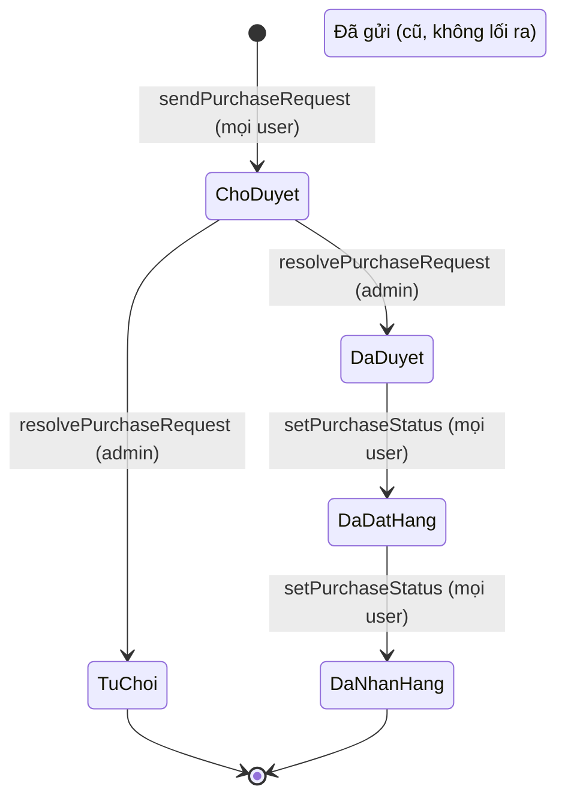

# Mô hình trạng thái

> **Cập nhật 2026-10-12:** tài liệu này mô tả database `qspro_en` TRƯỚC refactor (mốc audit). Cấu trúc đang chạy: [schema-hien-hanh.md](schema-hien-hanh.md); kết quả triển khai: [ket-qua-trien-khai.md](ket-qua-trien-khai.md).

- Xác minh từ code commit `83d264e` và dữ liệu `qspro_en` ngày 2026-10-12. Số trong ngoặc là số dòng thực tế.
- Giá trị trạng thái là **chuỗi tiếng Việt so sánh trực tiếp** ở cả server và client. Không đổi chuỗi khi chưa sửa đồng thời hai phía.
- Tài liệu này mô tả hiện trạng; không đề xuất thay đổi máy trạng thái nào.

## 1. Đơn mua hàng - `purchase_orders.status` (`don_mua_hang.trang_thai`)

| Giá trị | Nguồn gốc | Dòng |
|---|---|---:|
| `Chờ duyệt` | Đặt khi tạo đơn (`store_supa.js:1156`) | 30 |
| `Đã duyệt` | Admin duyệt | 4 |
| `Từ chối` | Admin từ chối | 0 |
| `Đã đặt hàng` | Bước theo dõi | 0 |
| `Đã nhận hàng` | Bước theo dõi, kết thúc | 0 |
| `Đã gửi` | **Giá trị cũ** (mặc định của DDL gốc). Không code nào ghi, không chuyển đi đâu được | 31 |

- **Chốt chặn:** mọi chuyển trạng thái là `UPDATE ... WHERE ma_don = X AND trang_thai = <trạng thái trước>`; 0 dòng bị ảnh hưởng thì báo "Đơn đã được xử lý" (`auth.js:648-649, 662-663`).
- **Tác dụng phụ:** thông báo cho admin khi tạo, cho người gửi khi duyệt/từ chối; dòng `audit_log`; thẻ Lark khi tạo.
- **Không có:** huỷ đơn, quay lui, cột người duyệt (chỉ có trong `audit_log`).
- **CHECK hiện có trong `qspro_en`:** cho phép đúng 6 giá trị trên.

## 2. Phiếu đề xuất - `purchase_proposals.status` (`de_xuat.trang_thai`)

| Giá trị | Nguồn gốc | Dòng |
|---|---|---:|
| `Chờ duyệt` | Đặt khi tạo | 2 |
| `Đã duyệt` | Admin | 0 |
| `Từ chối` | Admin | 0 |

- `Chờ duyệt -> Đã duyệt | Từ chối` qua `resolveDeXuat` (admin), cùng kiểu cập nhật có điều kiện; ghi `nguoi_duyet` (tên), `ngay_duyet`.
- Hai kết quả đều là trạng thái kết thúc. **Duyệt không kéo theo hành động nào khác** (không cập nhật giá, không tạo đơn).
- `proposal_type` (`loai`): `ck` = xin chiết khấu nhà cung cấp, `tt` = đề xuất thanh toán theo đợt. Giá trị khác `tt` bị ép về `ck`.

## 3. Phiếu yêu cầu xoá sản phẩm - `delete_requests.status`

| Giá trị | Dòng |
|---|---:|
| `pending` (mặc định) | 0 |
| `approved` | 0 |
| `rejected` | 1 |

- `pending -> approved | rejected` qua `resolveDeleteRequest` (admin), cập nhật có điều kiện `status = pending`.
- Khi duyệt: xoá từng sản phẩm trong `items`; lỗi từng món chỉ được đếm, trạng thái vẫn là `approved`.

## 4. Duyệt sản phẩm - `products.is_approved` (`da_duyet`)

Boolean, kèm `approved_by` (username) và `approved_at`. Dữ liệu: 417 đã duyệt, 676 chưa.

| Chuyển | Hàm | Ai | Ghi chú |
|---|---|---|---|
| chưa -> đã duyệt | `setSpDuyet` | quyền `sp_duyet`, admin, super | Truyền mã SP thì duyệt mọi biến thể cùng mã |
| đã -> chưa duyệt | `setSpDuyet` | như trên | Xoá `approved_by`, `approved_at` |
| đã -> chưa duyệt (tự động) | `updateDbProductTracked`, `saveDbProduct` | người sửa | Khi nội dung SP thay đổi |

Không đổi khi sửa combo hoặc nhóm biến thể. Sản phẩm dùng chung của Dezon không duyệt được từ công ty khác.

Cùng mô hình cho công tác: `work_items.is_approved`, đổi qua `ctDuyet`; mọi `ctUpdate` đưa về chưa duyệt.

## 5. Dự án - `projects.status` (`du_an.trang_thai`)

- Giá trị giao diện cho chọn: `Bản nháp`, `Đang thực hiện`, `Hoàn thành`. Dữ liệu: 30/30 là `Bản nháp`.
- **Không có quy trình:** người dùng chọn tự do trong form; server không kiểm. `duplicateProject` chép nguyên trạng thái.
- CHECK hiện có trong `qspro_en` giới hạn 3 giá trị trên.

## 6. Trường trạng thái khác

| Cột | Giá trị | Ghi chú |
|---|---|---|
| `users.role` | `super` (1), `admin` (1), `staff` (7) | Có CHECK. Chỉ super cấp được `super`; luôn giữ ít nhất một admin mỗi công ty |
| `users.is_active`, `companies.is_active` | boolean | Kiểm khi đăng nhập và mỗi request |
| `products.status` (`trang_thai`) | `Đang kinh doanh` (1.092), rỗng (1) | Chữ tự do; nhập hàng loạt mặc định `Đang kinh doanh` |
| `products.sector` (`nganh`) | `den` (677), `vs` (267), `son` (149); code có thêm `ct` | Không CHECK (đã bỏ để thêm ngành không phải sửa database) |
| `quotation_lines.status` (`trang_thai`) | chưa dòng nào có giá trị | Cột chữ tự do người dùng gõ trong bảng |
| `quotation_lines.is_manual_entry`, `is_saved_to_catalog` | luôn 0 | Không code nào dùng |
| `work_items.quotation_type` (`loai`) | `kt_chitiet`, `kt_sobo`, `dt_nhancong`, `dt_vattu` | Có CHECK |
| `work_items.calculation_mode` (`che_do`) | `item`, `area`, `area0`, `none` | Có CHECK |
| `notifications.kind` | `purchase_request` (21), `purchase_approved` (3), `delete_request` (1), `delete_rejected` (1); code còn tạo `purchase_rejected`, `delete_approved`, `de_xuat`, `de_xuat_approved`, `de_xuat_rejected` | Không CHECK |
| `purchase_orders.send_result` (`ket_qua_gui`) | `ok` (36), `pending` (29); từ M9.1 thêm `loi` | Lưu đơn ghi `pending` (hoặc `ketQua` client gửi); sau khi gửi thẻ Lark, server Go ghi `ok` / `loi` bằng lệnh riêng (M9.1). GIẢ ĐỊNH: 36 dòng `ok` có sẵn là giá trị mặc định lúc lưu cũ, không phải xác nhận đã tới Lark. Giao diện: `ok` = Đã gửi, `loi` = Lỗi gửi Lark, khác (kể cả `pending`) = Chưa rõ |

## 7. Vấn đề cần người quyết định

1. 31 đơn `Đã gửi`: chuyển về trạng thái nào, hay giữ nguyên làm dữ liệu lịch sử. Hiện trang admin hiện nút Duyệt cho các đơn này nhưng server từ chối.
2. 2 phiếu đề xuất `Chờ duyệt` không có dòng chi tiết (di chứng lỗi ngày 2026-09-16): giữ hay xoá.
