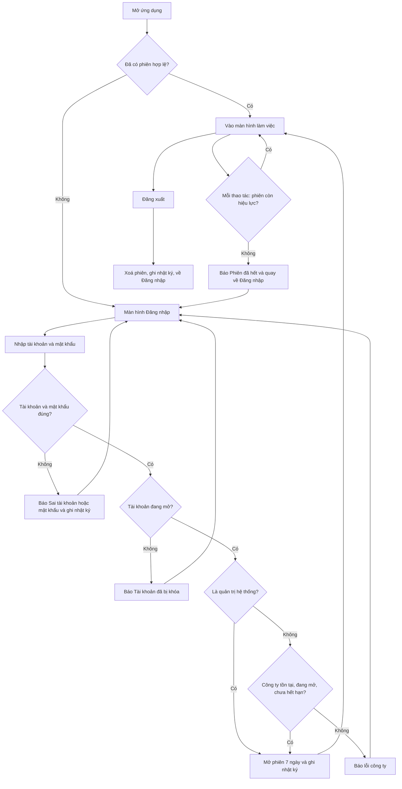
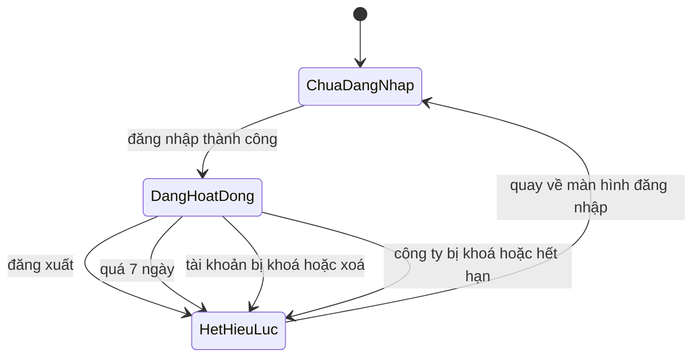

# [QT-01] Đăng nhập, phiên làm việc và cài đặt cá nhân

| Mục | Giá trị |
|-----|---------|
| Dự án | QS Pro |
| Phiên bản | 1.0 - 2026-10-07 |
| Người yêu cầu | — |
| Ưu tiên | Bình thường |
| Loại | Mô tả hiện trạng |

## 1. Tóm tắt
Người dùng của một công ty (hoặc quản trị hệ thống) đăng nhập bằng tên đăng nhập hoặc email cùng mật khẩu để vào QS Pro. Sau khi đăng nhập, hệ thống giữ phiên làm việc trong 7 ngày, kiểm tra lại tài khoản và công ty ở mỗi thao tác, cho phép tự đổi mật khẩu, lưu cách hiển thị cột theo tài khoản và đăng xuất. Khi công ty bị khoá hoặc hết hạn, người dùng của công ty đó không vào được nữa.

## 2. Tác nhân & quyền
| Tác nhân | Vai trò hệ thống | Được làm gì trong quy trình |
|----------|-----------------|-----------------------------|
| Quản trị hệ thống | `super` | Đăng nhập, đổi mật khẩu của mình, lưu cài đặt giao diện, đăng xuất. Không bị chặn khi công ty bị khoá hoặc hết hạn. |
| Admin công ty | `admin` | Đăng nhập, đổi mật khẩu của mình, lưu cài đặt giao diện, đăng xuất. Bị chặn khi công ty bị khoá hoặc hết hạn. |
| Nhân viên | `staff` | Như admin công ty; sau khi vào chỉ thấy các mục được cấp. |
| Người chưa đăng nhập | — | Chỉ thấy màn hình đăng nhập và được gửi yêu cầu đăng nhập. |

## 3. Điều kiện trước
- Tài khoản đã được tạo (xem QT-03) và đang ở trạng thái hoạt động.
- Với `admin` và `staff`: tài khoản đã thuộc một công ty; công ty đang hoạt động và chưa quá hạn dùng (xem QT-02).
- Trình duyệt cho phép lưu cookie của trang.

## 4. Luồng chính
| Bước | Ai | Hành động | Hệ thống xử lý | Kết quả người dùng thấy | Đã có / Mới |
|------|----|-----------|----------------|--------------------------|-------------|
| 1 | Người dùng | Mở địa chỉ ứng dụng | Hỏi máy chủ xem trình duyệt này đã có phiên hợp lệ chưa | Có phiên: vào thẳng ứng dụng. Chưa có: hiện màn hình "Đăng nhập", không báo lỗi | Đã có |
| 2 | Người dùng | Nhập tên đăng nhập (hoặc email) và mật khẩu, bấm "Đăng nhập" hoặc nhấn Enter | Kiểm tra hai ô không được trống; khoá nút trong lúc chờ | Nút đổi thành "Đang đăng nhập…" | Đã có |
| 3 | Hệ thống | — | Tìm tài khoản theo tên đăng nhập (không phân biệt hoa thường). Không thấy và chuỗi có ký tự @ thì tìm theo email. So mật khẩu. Nếu có nhiều tài khoản trùng thì ưu tiên tài khoản đang mở và đã thuộc công ty | — | Đã có |
| 4 | Hệ thống | — | Kiểm tra tài khoản không bị khoá. Với `admin` và `staff`: kiểm tra đã thuộc công ty, công ty đang hoạt động, hạn dùng chưa qua (tính theo ngày Việt Nam; ngày hạn dùng vẫn dùng được) | — | Đã có |
| 5 | Hệ thống | — | Ghi thời điểm đăng nhập gần nhất. Nếu mật khẩu đang lưu dạng chữ thường thì tự chuyển sang dạng đã mã hoá. Ghi nhật ký "Đăng nhập". Mở một phiên 7 ngày và gắn vào trình duyệt | — | Đã có |
| 6 | Hệ thống | — | Ẩn màn hình đăng nhập; hiện tên, vai trò, tên công ty; đổi logo và tên trang theo công ty; ẩn các tab không được dùng; hiện chuông thông báo; bật lại bộ cột đã lưu của tài khoản; tải dự án và danh mục sản phẩm | Màn hình làm việc. Nếu tab đang mở không được phép thì chuyển sang tab đầu tiên được phép | Đã có |
| 7 | Người dùng | Thao tác bất kỳ trong ứng dụng | Ở mỗi thao tác, kiểm tra phiên còn hạn, chưa đăng xuất, tài khoản còn mở, công ty còn mở và chưa hết hạn (kết quả kiểm tra được dùng lại tối đa 30 giây) | Thao tác chạy bình thường | Đã có |
| 8 | Người dùng | Chọn lưu bộ cột đang hiện làm bộ "Của tôi" ở một bảng | Kiểm tra dữ liệu bộ cột; lưu vào tài khoản (và lưu thêm một bản trên máy đang dùng). Không ghi nhật ký, không gửi thông báo | Thông báo "Đã lưu N cột làm mặc định của tài khoản …"; lần đăng nhập sau ở máy khác vẫn giữ | Đã có |
| 9 | Người dùng | Chọn xoá bộ cột "Của tôi", xác nhận | Xoá bộ cột của bảng đó khỏi tài khoản và khỏi máy. Không ghi nhật ký | Thông báo "Đã xoá bộ cột của tôi"; lần sau dùng bộ mặc định | Đã có |
| 10 | Người dùng | Bấm vào tên mình ở góc phải, chọn "Đổi mật khẩu" | Hiện hộp nhập "Mật khẩu hiện tại" và "Mật khẩu mới (≥4 ký tự)" | Hộp nhập | Đã có |
| 11 | Người dùng | Nhập hai mật khẩu, bấm "Đổi mật khẩu" | Kiểm tra mật khẩu hiện tại đúng, mật khẩu mới từ 4 ký tự; lưu mật khẩu mới dạng đã mã hoá; ghi nhật ký "Tự đổi mật khẩu". Không gửi thông báo cho ai | Thông báo "Đã đổi mật khẩu" | Đã có |
| 12 | Hệ thống | — | Mỗi phản hồi của máy chủ kèm mã phiên bản đang chạy. Trang nhớ mã đầu tiên; khi thấy mã khác thì hiện dải nhắc | Dải "Đã có bản cập nhật mới của Dezon Pro." với nút "Tải lại" và nút ✕ (để sau) | Đã có |
| 13 | Người dùng | Bấm vào tên mình, chọn "Đăng xuất" | Xoá phiên trên máy chủ (phiên hết hiệu lực ngay), ghi nhật ký "Đăng xuất", gỡ phiên khỏi trình duyệt, tải lại trang | Màn hình "Đăng nhập" | Đã có |

## 5. Sơ đồ

## 6. Luồng phụ & lỗi
| Mã | Tình huống | Hệ thống phản hồi | Thông báo cho người dùng |
|----|-----------|-------------------|--------------------------|
| E1 | Bỏ trống tên đăng nhập hoặc mật khẩu | Không gửi lên máy chủ | "Nhập tên đăng nhập và mật khẩu" |
| E2 | Không tìm thấy tài khoản hoặc sai mật khẩu | Từ chối; ghi nhật ký `login_fail` | "Sai tài khoản hoặc mật khẩu" |
| E3 | Mật khẩu đúng nhưng tài khoản bị khoá | Từ chối; ⚠ không ghi nhật ký | "Tài khoản đã bị khóa" |
| E4 | Tài khoản `admin`/`staff` chưa thuộc công ty nào (hoặc công ty đã bị xoá) | Từ chối; ⚠ không ghi nhật ký | "Tài khoản chưa được gán công ty — liên hệ quản trị hệ thống" |
| E5 | Công ty đang bị tạm khoá | Từ chối; ⚠ không ghi nhật ký | "Công ty "<tên công ty>" đang bị tạm khoá" |
| E6 | Công ty đã quá hạn dùng | Từ chối; ⚠ không ghi nhật ký | "Gói dịch vụ của "<tên công ty>" đã hết hạn ngày <hạn dùng>" |
| E7 | Chưa đăng nhập, phiên quá 7 ngày, đã đăng xuất, tài khoản bị khoá/xoá, công ty bị khoá/hết hạn giữa chừng | Trả mã 401 kèm `code: NOAUTH`; gỡ phiên khỏi trình duyệt | Màn hình đăng nhập hiện "Phiên đã hết, mời đăng nhập lại." (lần mở trang đầu tiên thì không hiện câu này) |
| E8 | Không có quyền: `staff` gọi chức năng chỉ dành cho admin | Trả mã 403 | "Không có quyền (chỉ Admin)" |
| E9 | Không có quyền: không phải `super` gọi chức năng của quản trị hệ thống | Trả mã 403 | "Chỉ quản trị hệ thống" |
| E10 | Không tìm thấy: gọi một chức năng không tồn tại | Trả mã 404 | "Không hỗ trợ hàm: <tên>" |
| E11 | Phiên còn nhưng tài khoản không còn hoặc đã khoá lúc trang hỏi thông tin của mình | Từ chối | "Phiên không hợp lệ" (trang hiện màn hình đăng nhập) |
| E12 | Đổi mật khẩu: mật khẩu hiện tại sai | Từ chối, không đổi | "Lỗi: Mật khẩu hiện tại không đúng" |
| E13 | Đổi mật khẩu: mật khẩu mới dưới 4 ký tự | Trang chặn trước; máy chủ cũng chặn | Trang: "Mật khẩu mới phải từ 4 ký tự"; máy chủ: "Mật khẩu mới tối thiểu 4 ký tự" |
| E14 | Lưu cài đặt giao diện với tên cài đặt lạ | Từ chối | "Khoá cài đặt không hợp lệ" |
| E15 | Lưu bộ cột sai dạng (không phải danh sách, quá 60 cột, tên cột từ 40 ký tự) | Từ chối | "Bộ cột không hợp lệ" |
| E16 | Lưu các bảng cột đặt tên sai dạng (quá 30 bảng, tên trống hoặc quá 60 ký tự, quá 60 cột) | Từ chối | "Bảng cột không hợp lệ" |
| E17 | Lưu cài đặt giao diện khi máy chủ lỗi | Bản trên máy vẫn được lưu | "Đã lưu trên máy này. Lưu theo tài khoản lỗi: <lý do>" |
| E18 | Cơ sở dữ liệu chưa có cột lưu cài đặt giao diện | Từ chối | "Cơ sở dữ liệu chưa có cột "ui_prefs". Vào Supabase → SQL Editor chạy file db/user_ui_prefs.sql rồi thử lại." |
| E19 | Người đã đăng nhập không phải `super` nhưng tài khoản không còn công ty | Chặn mọi đọc/ghi dữ liệu thuộc công ty | "Tài khoản chưa gắn với công ty nào" |
| E20 | Cơ sở dữ liệu chưa có bảng lưu phiên | Vẫn đăng nhập được; đăng xuất chỉ gỡ phiên ở trình duyệt, phiên cũ tự hết sau 7 ngày | Không có thông báo (chỉ cảnh báo trong nhật ký máy chủ) |
| E21 | Yêu cầu gửi từ một trang web khác (nguồn gốc khác địa chỉ ứng dụng) | Coi như chưa đăng nhập | Như E7 |
| E22 | Lỗi khác ở máy chủ | Trả mã 500 kèm lý do | "<lý do>" hoặc "Lỗi máy chủ"; ở màn hình đăng nhập mặc định "Đăng nhập thất bại" |

## 7. Trạng thái

| Từ | Sang | Khi nào | Ai được làm |
|----|------|---------|-------------|
| Chưa đăng nhập | Đang hoạt động | Đăng nhập đúng, tài khoản mở, công ty hợp lệ | Mọi tài khoản |
| Đang hoạt động | Hết hiệu lực | Bấm "Đăng xuất" | Chính người dùng |
| Đang hoạt động | Hết hiệu lực | Quá 7 ngày kể từ lúc đăng nhập | Hệ thống |
| Đang hoạt động | Hết hiệu lực | Tài khoản bị khoá hoặc xoá | `admin`, `super` (QT-03) |
| Đang hoạt động | Hết hiệu lực | Công ty bị tạm khoá, bị xoá hoặc quá hạn dùng | `super` (QT-02) hoặc hệ thống theo ngày |

## 8. Quy tắc nghiệp vụ
| Mã | Quy tắc |
|----|---------|
| BR-01 | Đăng nhập được bằng tên đăng nhập hoặc bằng email. Chỉ tìm theo email khi không có tài khoản nào trùng tên đăng nhập và chuỗi nhập có ký tự @, không chứa ký tự `*`, `%`, `\`. |
| BR-02 | Tên đăng nhập được so sánh ở dạng chữ thường, đã bỏ khoảng trắng hai đầu. |
| BR-03 | Khi có nhiều tài khoản trùng, hệ thống thử lần lượt theo thứ tự ưu tiên: đang mở, rồi đã thuộc công ty; lấy tài khoản đầu tiên khớp mật khẩu. |
| BR-04 | `super` không bị kiểm tra công ty khi đăng nhập và trong suốt phiên. |
| BR-05 | Công ty hết hạn khi ngày hạn dùng nhỏ hơn ngày hôm nay theo giờ Việt Nam. Để trống hạn dùng nghĩa là không giới hạn. |
| BR-06 | Phiên có hạn 7 ngày tính từ lúc đăng nhập, không tự gia hạn khi đang dùng. |
| BR-07 | Phiên chỉ nằm trong cookie mà mã của trang không đọc được; không lưu ở nơi khác trên trình duyệt. |
| BR-08 | Mỗi lần đăng nhập tạo một phiên riêng; một tài khoản có thể có nhiều phiên cùng lúc. Lúc đăng nhập, hệ thống dọn các phiên đã quá hạn của chính tài khoản đó. |
| BR-09 | Vai trò và công ty của người dùng trong mỗi thao tác lấy theo dữ liệu hiện tại của tài khoản (không theo lúc đăng nhập); thay đổi có hiệu lực chậm nhất sau 30 giây. |
| BR-10 | Mật khẩu mới tối thiểu 4 ký tự. Muốn tự đổi mật khẩu phải nhập đúng mật khẩu hiện tại. |
| BR-11 | Mật khẩu lưu dạng đã mã hoá. Mật khẩu chữ thường nhập tay trong cơ sở dữ liệu vẫn đăng nhập được một lần và được tự mã hoá ngay lần đó. |
| BR-12 | Cài đặt giao diện chỉ nhận 5 loại: bộ cột của bảng Bóc tách/Xuất báo giá (`tkCols`), Chi phí (`cpCols`), Dự án (`daCols`), Danh sách sản phẩm (`spCols`) và các bảng cột đặt tên của Bóc tách (`tkColSets`). Gửi giá trị rỗng nghĩa là xoá cài đặt đó. |
| BR-13 | Mỗi người chỉ đọc và sửa được cài đặt giao diện của chính mình. |
| BR-14 | Dải nhắc bản mới chỉ hiện một lần cho tới khi người dùng tải lại hoặc đóng dải. |

## 9. Thông báo, realtime & nhật ký
Hệ thống không có realtime. Không hành động nào trong quy trình này gửi thông báo trong ứng dụng hay tin nhắn Lark.

| Sự kiện | Ai nhận | Kênh | Nội dung | Ghi audit? |
|---------|---------|------|----------|:----------:|
| Đăng nhập thành công | — | — | — | Có (`login`: "Đăng nhập", thêm " (tự băm mật khẩu)" nếu vừa mã hoá lại) |
| Sai tài khoản hoặc mật khẩu | — | — | — | Có (`login_fail`: "Sai tài khoản hoặc mật khẩu") |
| Đăng nhập bị từ chối vì tài khoản khoá, chưa có công ty, công ty khoá, công ty hết hạn | — | — | — | Không ⚠ |
| Đăng xuất | — | — | — | Có (`logout`: "Đăng xuất") |
| Tự đổi mật khẩu | — | — | — | Có (`change_password`: "Tự đổi mật khẩu") |
| Lưu hoặc xoá cài đặt giao diện | — | — | — | Không |
| Phiên bị từ chối (E7) | — | — | — | Không |
| Có bản mới của ứng dụng | Người đang mở trang | Dải nhắc trên trang | "Đã có bản cập nhật mới của Dezon Pro." | Không |

## 10. Dữ liệu
| Thông tin | Bắt buộc | Ràng buộc | Ví dụ |
|-----------|----------|-----------|-------|
| Tên đăng nhập hoặc email | Có | Không trống; so sánh dạng chữ thường | `nguyenvana` |
| Mật khẩu | Có | Không trống | `****` |
| Mật khẩu hiện tại (khi đổi) | Có | Phải khớp mật khẩu đang lưu | `****` |
| Mật khẩu mới | Có | Từ 4 ký tự | `abcd1234` |
| Loại cài đặt giao diện | Có | Một trong `tkCols`, `cpCols`, `daCols`, `spCols`, `tkColSets` | `tkCols` |
| Bộ cột | Không | Danh sách tối đa 60 tên cột, mỗi tên dưới 40 ký tự | `["stt","ten","sl"]` |
| Bảng cột đặt tên | Không | Tối đa 30 bảng; tên 1–60 ký tự; mỗi bảng tối đa 60 cột | `[{"ten":"Gửi khách","cols":["stt","ten"]}]` |
| Thời điểm đăng nhập gần nhất | Tự ghi | Cập nhật mỗi lần đăng nhập thành công | `2026-10-07T02:15:00Z` |
| Phiên đăng nhập | Tự ghi | Mã phiên ngẫu nhiên, tài khoản, thời điểm hết hạn (sau 7 ngày) | — |

## 11. Màn hình liên quan
- Màn hình "Đăng nhập" (ô "Tên đăng nhập", ô "Mật khẩu" có nút hiện/ẩn, nút "Đăng nhập", dòng báo lỗi).
- Ô tên người dùng ở góc phải thanh trên: hiện họ tên, vai trò ("Quản trị hệ thống" / "Quản trị công ty" / "Nhân viên"), tên công ty (hoặc "Toàn hệ thống" với `super`), mục "Đổi mật khẩu", mục "Đăng xuất".
- Hộp "Đổi mật khẩu".
- Bảng chọn cột ở các bảng Bóc tách, Chi phí, Dự án, Danh sách sản phẩm (phần bộ cột "Của tôi").
- Dải nhắc "Đã có bản cập nhật mới của Dezon Pro.".
- Màn hình chờ lúc mở trang ("Đang xác thực tài khoản…").

## 12. Tiêu chí nghiệm thu
- **AC-01**: Cho tài khoản `staff` đang hoạt động thuộc công ty đang mở và còn hạn / Khi nhập đúng tên đăng nhập và mật khẩu rồi bấm "Đăng nhập" / Thì vào được màn hình làm việc, chỉ thấy các tab được cấp, và nhật ký có dòng "Đăng nhập".
- **AC-02**: Cho một tài khoản bất kỳ / Khi nhập sai mật khẩu / Thì thấy "Sai tài khoản hoặc mật khẩu", không vào được, và nhật ký có dòng `login_fail`.
- **AC-03**: Cho tài khoản đã bị khoá / Khi nhập đúng mật khẩu / Thì thấy "Tài khoản đã bị khóa".
- **AC-04**: Cho công ty có hạn dùng là hôm qua (giờ Việt Nam) / Khi `admin` của công ty đó đăng nhập / Thì thấy "Gói dịch vụ của "<tên>" đã hết hạn ngày <hạn dùng>"; còn `super` vẫn đăng nhập bình thường.
- **AC-05**: Cho công ty bị chuyển sang "Tạm khoá" trong lúc nhân viên đang dùng / Khi nhân viên thao tác tiếp sau tối đa 30 giây / Thì bị đưa về màn hình đăng nhập với câu "Phiên đã hết, mời đăng nhập lại.".
- **AC-06**: Cho người chưa đăng nhập / Khi gọi bất kỳ chức năng nào ngoài đăng nhập / Thì bị từ chối với mã 401 "Chưa đăng nhập".
- **AC-07**: Cho người không có quyền (tài khoản `staff`) / Khi gọi một chức năng chỉ dành cho admin, ví dụ xem danh sách tài khoản / Thì bị từ chối với mã 403 "Không có quyền (chỉ Admin)".
- **AC-08**: Cho người đang đăng nhập / Khi đổi mật khẩu với mật khẩu hiện tại sai / Thì thấy "Lỗi: Mật khẩu hiện tại không đúng" và mật khẩu không đổi.
- **AC-09**: Cho người đang đăng nhập / Khi đổi mật khẩu hợp lệ / Thì thấy "Đã đổi mật khẩu", đăng nhập lại được bằng mật khẩu mới, nhật ký có dòng "Tự đổi mật khẩu".
- **AC-10**: Cho người đã lưu bộ cột "Của tôi" ở bảng Bóc tách / Khi đăng nhập trên máy khác / Thì bảng Bóc tách tự bật đúng bộ cột đó.
- **AC-11**: Cho người đang đăng nhập / Khi bấm "Đăng xuất" / Thì về màn hình đăng nhập, nhật ký có dòng "Đăng xuất", và phiên cũ không dùng lại được.
- **AC-12**: Cho trang đang mở từ trước khi máy chủ được cập nhật / Khi thực hiện một thao tác sau khi máy chủ chạy bản mới / Thì thấy dải "Đã có bản cập nhật mới của Dezon Pro." với nút "Tải lại".

## 13. Ảnh hưởng tới phần có sẵn
- Mọi chức năng khác đều dựa vào phiên này để biết ai đang thao tác và thuộc công ty nào (lọc dữ liệu theo công ty).
- Khoá/xoá tài khoản (QT-03) và khoá/hết hạn công ty (QT-02) làm phiên mất hiệu lực.
- Nhật ký đăng nhập, đăng xuất, đổi mật khẩu hiện ở tab Admin (QT-04).
- Cài đặt bộ cột ảnh hưởng tới cách hiển thị các bảng Bóc tách, Xuất báo giá, Chi phí, Dự án, Danh sách sản phẩm.

## 14. Giả định & câu hỏi mở
| Mã | Nội dung | Cần ai trả lời |
|----|----------|----------------|
| GD-01 | Mức ưu tiên ghi "Bình thường" vì đây là tài liệu mô tả hiện trạng, không có người yêu cầu. | Chủ sản phẩm |
| GD-02 | Cơ sở dữ liệu đang chạy đã có bảng lưu phiên (`phien_dang_nhap`) và cột `ui_prefs`. Không kiểm tra được vì không được kết nối cơ sở dữ liệu thật. Nếu chưa có thì xảy ra E18, E20. | Dev |
| GD-03 | Trên môi trường chạy thật có biến `RENDER_GIT_COMMIT` nên mã phiên bản chỉ đổi khi triển khai bản mới. | Dev |
| Q-01 | Không có giới hạn số lần đăng nhập sai và không tạm khoá sau nhiều lần sai (chỉ ghi nhật ký `login_fail`). Có cần giới hạn không? | Chủ sản phẩm |
| Q-02 | ⚠ Đăng nhập bị từ chối vì tài khoản khoá, chưa có công ty, công ty khoá hoặc hết hạn thì không ghi nhật ký; chỉ trường hợp sai mật khẩu mới ghi. Có cần ghi đủ không? | Chủ sản phẩm |
| Q-03 | ⚠ Tự đổi mật khẩu (và admin đặt lại mật khẩu ở QT-03) không làm mất hiệu lực các phiên đang mở ở máy khác. Có cần buộc đăng nhập lại không? | Chủ sản phẩm |
| Q-04 | ⚠ Nếu chưa đặt biến `AUTH_SECRET`, hệ thống dùng khoá ký phiên mặc định viết sẵn trong mã (`server/components/auth/session.js`). Môi trường thật đã đặt biến này chưa? | Dev / vận hành |
| Q-05 | Phiên hết đúng sau 7 ngày kể từ lúc đăng nhập dù người dùng đang dùng liên tục. Có muốn tự gia hạn khi còn hoạt động không? | Chủ sản phẩm |
| Q-06 | Mật khẩu chỉ yêu cầu tối thiểu 4 ký tự, không yêu cầu chữ số hay ký tự đặc biệt. Có đúng chính sách mong muốn không? | Chủ sản phẩm |
| Q-07 | ⚠ Email không bị buộc duy nhất. Nếu nhiều tài khoản trùng email, hệ thống lấy tài khoản đầu tiên khớp mật khẩu. Có cần buộc email duy nhất không? | Chủ sản phẩm |
| Q-08 | ⚠ Khi không có `RENDER_GIT_COMMIT`, mã phiên bản là thời điểm máy chủ khởi động, nên mỗi lần máy chủ khởi động lại người dùng đều thấy dải "bản cập nhật mới" dù mã không đổi. Có chấp nhận không? | Dev |
| Q-09 | ⚠ File `db/auth.sql` tạo sẵn tài khoản `admin` với mật khẩu mặc định ghi ngay trong file (sau đó `db/multitenant.sql` nâng thành `super`). Mật khẩu này trên môi trường thật đã được đổi chưa? | Vận hành |
| Q-10 | ⚠ Người bị mất phiên vì công ty bị khoá/hết hạn chỉ thấy câu chung "Phiên đã hết, mời đăng nhập lại."; phải đăng nhập lại mới thấy lý do thật. Có cần báo đúng lý do ngay không? | Chủ sản phẩm |

## 15. Ghi chú kỹ thuật cho dev
- API (đều `POST /api/<fn>`, body `{args:[...]}`): `login` (public), `me`, `setMyPref`, `logout`, `changePassword` (nhận actor) — `server/components/auth/auth.routes.js:5-13`.
- Đăng nhập: `server/components/auth/auth.service.js:20-54` (so mật khẩu `:15-19`, thứ tự ưu tiên tài khoản `:25-29`, `login_fail` `:34`, kiểm công ty `:43-49`, tự băm `:40`, audit `login` `:51`).
- `me` `auth.service.js:55-62`; `setMyPref` `:68-90` (danh sách khoá `PREF_KEYS` `:68`); `logout` `:92`; `changePassword` `:93-100`.
- Tìm tài khoản theo tên/email: `server/components/users/users.repository.js:11-24`.
- Token và phiên: `server/components/auth/session.js` — hạn 7 ngày `:12`, khoá ký mặc định `:11`, tạo/kiểm token `:17-32`, cache 30 giây `:35-36`, mở phiên `:50-64`, đóng phiên `:66-71`, kiểm phiên còn sống `:72-86`, ngày Việt Nam và hết hạn `:88-89`, đối chiếu tài khoản + công ty `:90-105`, cookie `qs_sess` (HttpOnly, SameSite=Lax, Secure khi HTTPS) `:108-123`, kiểm Origin `:125-129`.
- Cổng RPC: `server/libraries/rpc.js` — `x-app-ver` `:42,46`; 404 `:49-51`; 401 `NOAUTH` + dọn cookie `:54-58`; 403 `:60-62`; đổi `_sessionToken` thành cookie `:73-76`; lỗi 500 `:78-81`.
- Chặn tài khoản không có công ty: `server/libraries/supa.js:28-31`.
- Bảng dữ liệu: `users` (`password_hash`, `last_login`, `ui_prefs`, `active`, `role`, `cong_ty_id`), `phien_dang_nhap` (`db/phien_dang_nhap.sql`), `cong_ty` (`active`, `han_dung`), `audit_log`. Cột `ui_prefs`: `db/user_ui_prefs.sql`.
- Client: `public/app.js` — `authLogout_` `:9-12`; `banMoi_` `:31-39`; `api()` và xử lý `NOAUTH` `:56-63`; `authStart_` `:2532-2537`; `showLogin_` `:2538-2543`; `doLogin_` `:2544-2555`; `onAuthed_` `:2557-2563`; `applyRoleUI_` `:2598-2618`; `openChangePw` `:2684-2691`; lưu/xoá bộ cột `csMySave_`/`csMyClear_` `:1759-1775`; `tkBoGhi_` (gọi `setMyPref('tkColSets')`) `:1861-1867`.
- Màn hình đăng nhập và ô người dùng: `public/index.html:6584-6591`, `:6596-6620`.
- Khởi động: `public/main.js:8` gọi `authStart_()`.
- Không có job nền, không có realtime trong quy trình này.

## Lịch sử thay đổi
| Phiên bản | Ngày | Thay đổi |
|-----------|------|----------|
| 1.0 | 2026-10-07 | Tạo mới |
