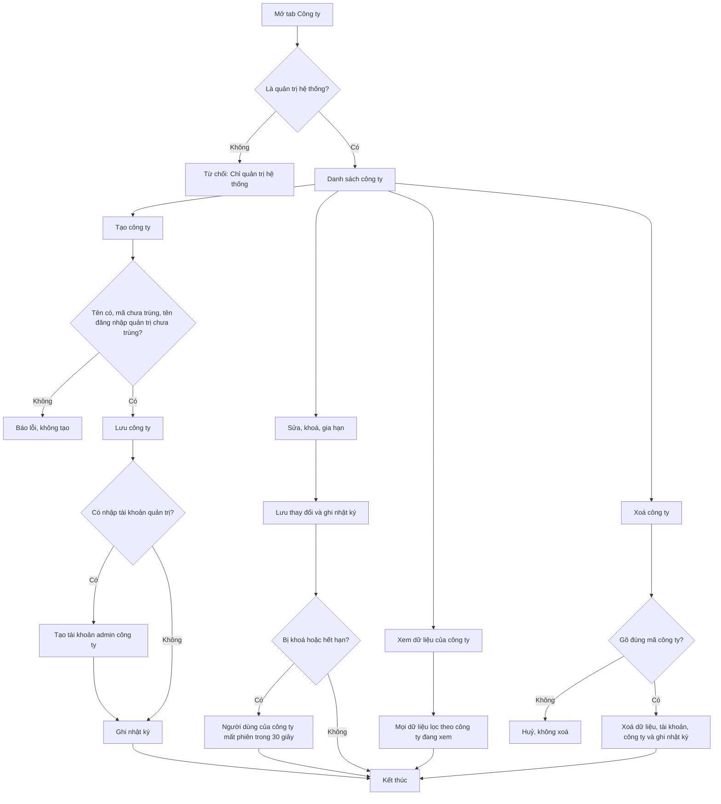
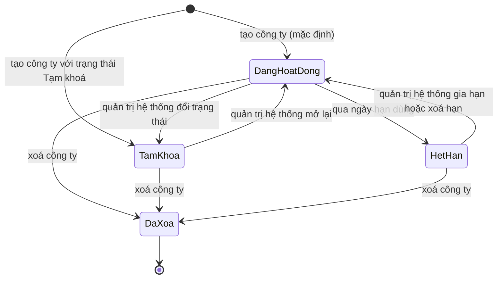

# [QT-02] Quản lý công ty

| Mục | Giá trị |
|-----|---------|
| Dự án | QS Pro |
| Phiên bản | 1.0 - 2026-10-07 |
| Người yêu cầu | — |
| Ưu tiên | Bình thường |
| Loại | Mô tả hiện trạng |

## 1. Tóm tắt
Quản trị hệ thống tạo, sửa, khoá, gia hạn và xoá các công ty dùng QS Pro; đặt số tài khoản tối đa, các tính năng được dùng và tạo tài khoản cho công ty. Quản trị hệ thống cũng có thể "xem như" một công ty để nhìn đúng dữ liệu của công ty đó. Nhờ vậy mỗi công ty chỉ thấy dữ liệu của mình và chỉ dùng được trong thời hạn đã cấp.

## 2. Tác nhân & quyền
| Tác nhân | Vai trò hệ thống | Được làm gì trong quy trình |
|----------|-----------------|-----------------------------|
| Quản trị hệ thống | `super` | Xem danh sách công ty; tạo, sửa mọi thông tin, khoá/mở, gia hạn, xoá công ty; xem và tạo tài khoản của một công ty; "xem như" một công ty. |
| Admin công ty | `admin` | Máy chủ cho phép sửa tên, logo, màu chính, email, điện thoại của chính công ty mình. ⚠ Hiện không có màn hình nào để làm việc này (xem Q-01). Không xem được danh sách công ty. |
| Nhân viên | `staff` | Không được làm gì trong quy trình này. |

## 3. Điều kiện trước
- Người thao tác đã đăng nhập (QT-01).
- Tab "Công ty" chỉ hiện với `super`.
- Muốn bật "Cho dùng danh sách sản phẩm của Dezon": cơ sở dữ liệu đã có cột tương ứng (chạy `db/share_catalog.sql`).

## 4. Luồng chính
| Bước | Ai | Hành động | Hệ thống xử lý | Kết quả người dùng thấy | Đã có / Mới |
|------|----|-----------|----------------|--------------------------|-------------|
| 1 | Quản trị hệ thống | Bấm tab "Công ty" | Lấy tối đa 500 công ty (mới tạo trước) và đếm số tài khoản của từng công ty | Bốn ô thống kê (Công ty, Đang hoạt động, Sắp hết hạn 30 ngày, Tổng người dùng) và một thẻ cho mỗi công ty: tên, mã, trạng thái, số người dùng/giới hạn, số tính năng, hạn dùng | Đã có |
| 2 | Quản trị hệ thống | Bấm "Tạo công ty" | Mở biểu mẫu ba phần: "Thông tin", "Gói & tính năng", "Tài khoản quản trị"; mặc định bật hết 8 tính năng, 10 người dùng, trạng thái đang hoạt động | Biểu mẫu "Tạo công ty mới" | Đã có |
| 3 | Quản trị hệ thống | Nhập tên công ty, mã (có thể bỏ trống), email, điện thoại | — | Các ô đã điền | Đã có |
| 4 | Quản trị hệ thống | Chọn logo: bấm hoặc kéo thả ảnh, hoặc dán đường dẫn ảnh rồi bấm "Dùng link" | Ảnh tải lên được thu nhỏ còn tối đa 512 điểm ảnh rồi lưu vào kho ảnh | "Đã tải logo lên" hoặc "Đã dùng link ảnh làm logo"; hiện ảnh xem trước | Đã có |
| 5 | Quản trị hệ thống | Ở phần "Gói & tính năng": nhập số người dùng tối đa, hạn dùng (trống = không giới hạn), trạng thái, ghi chú; bật/tắt "Cho dùng danh sách sản phẩm của Dezon"; tích các tính năng | — | Các lựa chọn đã đặt | Đã có |
| 6 | Quản trị hệ thống | (Tuỳ chọn) Ở phần "Tài khoản quản trị": nhập tên đăng nhập, email, họ tên, mật khẩu | — | Các ô đã điền | Đã có |
| 7 | Quản trị hệ thống | Bấm "Tạo công ty" | Kiểm tra có tên, có ít nhất 1 tính năng, mật khẩu quản trị từ 4 ký tự (nếu có nhập tên đăng nhập). Máy chủ kiểm tra quyền, tạo mã từ mã nhập hoặc từ tên (chữ thường không dấu, nối bằng gạch ngang, tối đa 32 ký tự), kiểm tra mã chưa có, kiểm tra tên đăng nhập quản trị chưa có ai dùng, rồi lưu công ty | Nút đổi thành "Đang lưu…" | Đã có |
| 8 | Hệ thống | — | Nếu có đủ tên đăng nhập và mật khẩu quản trị: tạo luôn một tài khoản `admin` cho công ty (ghi nhật ký tạo tài khoản). Ghi nhật ký "Tạo công ty <tên>". Không gửi thông báo cho ai | "Đã tạo "<tên>" — đăng nhập: <tên đăng nhập>"; biểu mẫu đóng; danh sách tải lại | Đã có |
| 9 | Quản trị hệ thống | Bấm "Phân quyền" trên thẻ một công ty | Mở biểu mẫu với dữ liệu hiện tại; ô mã chỉ đọc; phần thứ ba là "Người dùng" | Biểu mẫu mang tên công ty | Đã có |
| 10 | Quản trị hệ thống | Sửa thông tin, gói, tính năng, hạn dùng hoặc trạng thái rồi bấm "Lưu thay đổi" | Kiểm tra có tên và ít nhất 1 tính năng; máy chủ kiểm tra quyền rồi lưu; ghi nhật ký "Cập nhật công ty <tên>". Không gửi thông báo cho ai | "Đã cập nhật công ty"; danh sách tải lại | Đã có |
| 11 | Hệ thống | — | Khi công ty bị chuyển sang "Tạm khoá" hoặc hạn dùng đã qua: `admin` và `staff` của công ty đó bị mất phiên trong vòng tối đa 30 giây và không đăng nhập lại được (QT-01) | Thẻ công ty hiện nhãn "Tạm khoá" hoặc "Hết hạn" | Đã có |
| 12 | Quản trị hệ thống | Trong biểu mẫu sửa, mở phần "Người dùng" | Lấy tối đa 500 tài khoản của công ty đó | Bảng: đăng nhập, họ tên, vai trò, quyền, trạng thái; dòng "<số> / <giới hạn> tài khoản" | Đã có |
| 13 | Quản trị hệ thống | Bấm "Thêm tài khoản", nhập tên đăng nhập, email, họ tên, mật khẩu, bấm "Tạo tài khoản" | Kiểm tra có tên đăng nhập và mật khẩu từ 4 ký tự; máy chủ tạo tài khoản `staff` chưa có quyền nào cho đúng công ty đó, áp dụng mọi kiểm tra của việc tạo tài khoản (QT-03); ghi nhật ký tạo tài khoản | "Đã tạo tài khoản <tên đăng nhập>"; bảng người dùng và danh sách công ty tải lại | Đã có |
| 14 | Quản trị hệ thống | Bấm "Xem dữ liệu" trên thẻ một công ty | Ghi nhớ công ty đang xem trên trình duyệt; từ đó mọi yêu cầu (kể cả tải file xuất) kèm mã công ty này; máy chủ lọc và ghi dữ liệu theo công ty đó; tải lại dự án và sản phẩm | "Đang xem dữ liệu công ty đã chọn"; thanh "Đang xem dữ liệu của <tên>" với nút "Thoát chế độ xem" | Đã có |
| 15 | Quản trị hệ thống | Bấm "Thoát chế độ xem" | Bỏ ghi nhớ công ty đang xem; tải lại dữ liệu toàn hệ thống | "Đã thoát chế độ xem" | Đã có |
| 16 | Quản trị hệ thống | Bấm biểu tượng thùng rác trên thẻ công ty | Hiện hộp cảnh báo xoá vĩnh viễn, yêu cầu gõ đúng mã công ty | Hộp "Xoá công ty" | Đã có |
| 17 | Quản trị hệ thống | Gõ mã công ty, bấm "Xoá vĩnh viễn" | So mã gõ với mã công ty. Máy chủ kiểm tra quyền, kiểm tra công ty tồn tại, xoá dữ liệu của công ty trong mọi bảng thuộc công ty, sau cùng xoá tài khoản rồi xoá công ty; ghi nhật ký "Xoá công ty <tên> và toàn bộ dữ liệu". Không gửi thông báo cho ai | "Đã xoá công ty "<tên>""; danh sách tải lại | Đã có |
| 18 | Admin công ty | Gửi yêu cầu sửa tên, logo, màu chính, email, điện thoại của công ty mình | Máy chủ chỉ nhận 5 thông tin này và chỉ với đúng công ty của người gửi; ghi nhật ký "Cập nhật công ty <tên>" | ⚠ Không có màn hình; chỉ có ở phía máy chủ | Đã có |

## 5. Sơ đồ

## 6. Luồng phụ & lỗi
| Mã | Tình huống | Hệ thống phản hồi | Thông báo cho người dùng |
|----|-----------|-------------------|--------------------------|
| E1 | Không có quyền: không phải `super` gọi xem danh sách, tạo, xoá công ty, xem hoặc tạo tài khoản của công ty | Trả mã 403 ngay ở cổng vào | "Chỉ quản trị hệ thống" |
| E2 | Không có quyền (lớp kiểm tra thứ hai bên trong từng chức năng) | Từ chối | "Chỉ quản trị hệ thống mới xem được" / "Chỉ quản trị hệ thống mới tạo được công ty" / "Chỉ quản trị hệ thống mới xoá được công ty" / "Chỉ quản trị hệ thống" |
| E3 | Không có quyền: `staff` gọi sửa công ty | Trả mã 403 | "Không có quyền (chỉ Admin)" |
| E4 | Không có quyền: `admin` sửa công ty không phải của mình | Từ chối | "Chỉ sửa được công ty của bạn" |
| E5 | `admin` gửi kèm các thông tin về gói (tính năng, giới hạn người dùng, trạng thái, hạn dùng, ghi chú, kho sản phẩm Dezon) | Lặng lẽ bỏ qua các thông tin đó, chỉ lưu 5 thông tin được phép | Không có thông báo |
| E6 | Chưa đăng nhập | Trả mã 401 | "Phiên đã hết, mời đăng nhập lại." |
| E7 | Dữ liệu không hợp lệ: chưa nhập tên công ty | Trang chặn và chuyển về phần "Thông tin"; máy chủ cũng chặn khi tạo | "Chưa nhập tên công ty" |
| E8 | Dữ liệu không hợp lệ: không tích tính năng nào | Trang chặn và chuyển về phần "Gói & tính năng" | "Chọn ít nhất 1 tính năng cho công ty" |
| E9 | Trùng: mã công ty đã có | Từ chối, không tạo | "Lỗi: Mã công ty "<mã>" đã tồn tại" |
| E10 | Trùng: tên đăng nhập quản trị đã có người dùng | Từ chối trước khi tạo công ty | "Lỗi: Tên đăng nhập "<tên>" đã có người dùng — chọn tên khác" |
| E11 | Mật khẩu quản trị dưới 4 ký tự (khi có nhập tên đăng nhập quản trị) | Trang chặn, chuyển về phần "Tài khoản quản trị" | "Mật khẩu quản trị tối thiểu 4 ký tự" |
| E12 | ⚠ Tên đăng nhập quản trị sai dạng (dưới 3 ký tự hoặc có ký tự ngoài chữ thường, số, `.`, `_`, `-`) | Công ty ĐÃ được lưu, sau đó việc tạo tài khoản quản trị mới báo lỗi; nhật ký "Tạo công ty" không được ghi; biểu mẫu vẫn mở, bấm lại sẽ gặp E9 | "Lỗi: Tên đăng nhập ≥3 ký tự (chữ thường, số, . _ -)" |
| E13 | Bật kho sản phẩm Dezon khi cơ sở dữ liệu chưa có cột | Từ chối | "Chưa bật được kho SP chung: cơ sở dữ liệu thiếu cột dung_sp_dezon. Hãy chạy db/share_catalog.sql trong Supabase rồi thử lại." |
| E14 | Không tìm thấy: xoá công ty không tồn tại | Từ chối | "Lỗi: Không tìm thấy công ty" |
| E15 | ⚠ Không tìm thấy: sửa công ty không tồn tại | Không báo lỗi; vẫn ghi nhật ký "Cập nhật công ty"; trả kết quả rỗng | Trang vẫn báo "Đã cập nhật công ty" |
| E16 | Gõ sai mã xác nhận khi xoá | Không gọi máy chủ | "Mã xác nhận không đúng — đã huỷ" |
| E17 | Đóng hộp xác nhận xoá | Không làm gì | Không có thông báo |
| E18 | Thêm tài khoản cho công ty: thiếu tên đăng nhập hoặc mật khẩu dưới 4 ký tự | Trang chặn | "Cần tên đăng nhập và mật khẩu ≥4 ký tự" |
| E19 | Thêm tài khoản khi công ty đã đủ số tài khoản | Từ chối | "Lỗi: Đã đạt giới hạn <số> tài khoản của gói. Liên hệ để nâng gói." |
| E20 | Thêm tài khoản: tên đăng nhập sai dạng hoặc đã có | Từ chối | "Lỗi: Tên đăng nhập ≥3 ký tự (chữ thường, số, . _ -)" / "Lỗi: Tên đăng nhập "<tên>" đã có người dùng — chọn tên khác" |
| E21 | Ảnh logo không đọc được | Giữ logo cũ | "Không đọc được ảnh — thử PNG/JPG khác" |
| E22 | Tải logo lên lỗi | Giữ logo cũ | "Lỗi tải logo: <lý do>" |
| E23 | Tải dữ liệu lỗi khi chuyển sang "xem như" | Lựa chọn công ty vẫn được ghi nhớ | "Lỗi tải dữ liệu công ty: <lý do>" |
| E24 | Tải danh sách công ty hoặc danh sách người dùng lỗi | — | Hiện lý do ngay trong vùng danh sách ("Lỗi: <lý do>") |
| E25 | Khi xoá công ty, một bảng dữ liệu xoá lỗi | ⚠ Bỏ qua lỗi của bảng đó, tiếp tục xoá các bảng khác | Vẫn báo "Đã xoá công ty" nếu bước xoá công ty cuối cùng thành công |

## 7. Trạng thái

| Từ | Sang | Khi nào | Ai được làm |
|----|------|---------|-------------|
| (chưa có) | Đang hoạt động / Tạm khoá | Tạo công ty | `super` |
| Đang hoạt động | Tạm khoá | Đổi "Trạng thái" thành "Tạm khoá" rồi lưu | `super` |
| Tạm khoá | Đang hoạt động | Đổi "Trạng thái" thành "Đang hoạt động" rồi lưu | `super` |
| Đang hoạt động | Hết hạn | Ngày hạn dùng nhỏ hơn hôm nay (giờ Việt Nam) | Hệ thống (tự tính, không lưu thành trạng thái) |
| Hết hạn | Đang hoạt động | Sửa hạn dùng sang ngày chưa qua hoặc để trống | `super` |
| Bất kỳ | Đã xoá | Xoá công ty có xác nhận mã | `super` |

Ghi chú: trên thẻ công ty, "Tạm khoá" được ưu tiên hiển thị hơn "Hết hạn" khi công ty vừa khoá vừa hết hạn.

## 8. Quy tắc nghiệp vụ
| Mã | Quy tắc |
|----|---------|
| BR-01 | Chỉ `super` được xem danh sách, tạo, xoá công ty, xem và tạo tài khoản của một công ty bất kỳ. |
| BR-02 | `super` sửa được mọi thông tin của mọi công ty. `admin` chỉ sửa được tên, logo, màu chính, email, điện thoại của công ty mình; các thông tin về gói do `super` quyết định. |
| BR-03 | Mã công ty là duy nhất, tạo một lần và không sửa được ở biểu mẫu. Bỏ trống thì tạo từ tên. |
| BR-04 | Tên công ty là bắt buộc khi tạo. |
| BR-05 | Giới hạn người dùng: khi tạo, bỏ trống hoặc 0 thì lấy 10. Giá trị 0 lưu trong hệ thống nghĩa là không giới hạn (thẻ hiện "∞"). |
| BR-06 | Hạn dùng để trống nghĩa là không giới hạn. Công ty hết hạn khi ngày hạn dùng đã qua (ngày hạn dùng vẫn dùng được). |
| BR-07 | Công ty bị tạm khoá hoặc hết hạn: `admin` và `staff` của công ty không đăng nhập được và bị mất phiên trong vòng 30 giây. `super` không bị ảnh hưởng. |
| BR-08 | Tài khoản quản trị chỉ được tạo kèm khi có đủ cả tên đăng nhập lẫn mật khẩu; họ tên bỏ trống thì lấy "Quản trị <tên công ty>"; email bỏ trống thì lấy email công ty. |
| BR-09 | Tài khoản tạo từ phần "Người dùng" của công ty luôn là `staff` và chưa có quyền nào. |
| BR-10 | Số tài khoản của công ty không được vượt giới hạn người dùng (đếm mọi tài khoản của công ty, kể cả đang khoá). |
| BR-11 | Xoá công ty là xoá vĩnh viễn toàn bộ dữ liệu thuộc công ty: dự án, bóc tách, khái toán, sản phẩm và lịch sử sản phẩm, đơn mua hàng, đề xuất, công tác, thông báo, yêu cầu xoá, nhật ký, sản phẩm đi kèm, yêu thích, dữ liệu rời của dự án và mọi tài khoản. Phải gõ đúng mã công ty mới xoá được. |
| BR-12 | "Xem như" chỉ có tác dụng với `super`; với vai trò khác máy chủ bỏ qua. Khi đang xem như một công ty, dữ liệu đọc ra và dữ liệu mới tạo đều thuộc công ty đó. |
| BR-13 | Lựa chọn "xem như" được nhớ trên trình duyệt và giữ qua các lần tải lại trang. |
| BR-14 | Tính năng của công ty quyết định những tab mà người dùng công ty đó nhìn thấy. Danh sách tính năng trống được coi là mở hết. `super` luôn thấy mọi tab. |
| BR-15 | Thẻ thống kê "Sắp hết hạn" đếm công ty còn từ 0 đến 30 ngày; "Đang hoạt động" đếm công ty đang mở và chưa hết hạn. |

## 9. Thông báo, realtime & nhật ký
Hệ thống không có realtime. Không hành động nào trong quy trình này gửi thông báo trong ứng dụng hay tin nhắn Lark; công ty không được báo trước khi sắp hết hạn.

| Sự kiện | Ai nhận | Kênh | Nội dung | Ghi audit? |
|---------|---------|------|----------|:----------:|
| Tạo công ty | — | — | — | Có (`create_company`: "Tạo công ty <tên>") |
| Tạo kèm tài khoản quản trị | — | — | — | Có (`create_user`: "Tạo tài khoản <tên> (admin)") |
| Sửa công ty (kể cả khoá, mở, gia hạn, đổi logo) | — | — | — | Có (`update_company`: "Cập nhật công ty <tên>"; không ghi chi tiết thay đổi gì) |
| Thêm tài khoản cho công ty | — | — | — | Có (`create_user`: "Tạo tài khoản <tên> (staff)") |
| Xoá công ty | — | — | — | Có (`delete_company`: "Xoá công ty <tên> và toàn bộ dữ liệu") |
| Bật hoặc thoát "xem như" | — | — | — | Không |
| Xem danh sách công ty, xem tài khoản của công ty | — | — | — | Không |
| Tải logo lên | — | — | — | Không |

## 10. Dữ liệu
| Thông tin | Bắt buộc | Ràng buộc | Ví dụ |
|-----------|----------|-----------|-------|
| Tên công ty | Có | Không trống | Nội thất An Phát |
| Mã công ty | Không | Duy nhất; chữ thường không dấu, số, gạch ngang; tối đa 32 ký tự; không sửa sau khi tạo | `noi-that-an-phat` |
| Email liên hệ | Không | Không kiểm tra định dạng ở máy chủ | ketoan@congty.vn |
| Điện thoại | Không | — | 0901 234 567 |
| Logo | Không | Ảnh tải lên hoặc đường dẫn ảnh | — |
| Màu chính | Không | Chỉ nhận qua máy chủ; biểu mẫu không có ô nhập | `#1d4ed8` |
| Số người dùng tối đa | Không | Số; mặc định 10; 0 = không giới hạn | 10 |
| Hạn dùng | Không | Ngày; trống = không giới hạn | 2026-12-31 |
| Trạng thái | Có | Đang hoạt động / Tạm khoá | Đang hoạt động |
| Ghi chú | Không | — | Gói năm, hợp đồng số 12 |
| Cho dùng danh sách sản phẩm của Dezon | Không | Bật / tắt; mặc định tắt | Tắt |
| Tính năng được dùng | Có (ít nhất 1 ở biểu mẫu) | Trong 8 mục: `dash`, `boc`, `chiphi`, `export`, `muahang`, `duan`, `sanpham`, `import` | `boc,export,sanpham` |
| Tài khoản quản trị: tên đăng nhập | Không | Từ 3 ký tự; chữ thường, số, `.`, `_`, `-`; duy nhất toàn hệ thống | `anphat.admin` |
| Tài khoản quản trị: mật khẩu | Có nếu nhập tên đăng nhập | Từ 4 ký tự | `****` |
| Tài khoản quản trị: họ tên, email | Không | — | Nguyễn Văn A |
| Ngày tạo công ty | Tự ghi | — | 2026-10-07 |
| Công ty đang "xem như" | Không | Lưu trên trình duyệt của `super` | (mã định danh công ty) |

## 11. Màn hình liên quan
- Tab "Công ty" (chỉ `super`): thống kê, lưới thẻ công ty, nút "Tạo công ty", thanh "Đang xem dữ liệu của …".
- Biểu mẫu công ty: phần "Thông tin", "Gói & tính năng", "Tài khoản quản trị" (khi tạo) hoặc "Người dùng" (khi sửa).
- Hộp "Thêm tài khoản cho <công ty>".
- Hộp "Xoá công ty" (gõ mã xác nhận).
- Tab "Admin": khi là `super` có thêm cột "Công ty" và ô chọn công ty trong biểu mẫu tài khoản (QT-03).
- Thanh trên cùng: logo và tên trang đổi theo công ty của người đăng nhập.

## 12. Tiêu chí nghiệm thu
- **AC-01**: Cho `super` đã đăng nhập / Khi tạo công ty với tên "An Phát", bỏ trống mã, có tên đăng nhập và mật khẩu quản trị hợp lệ / Thì công ty được tạo với mã `an-phat`, có một tài khoản `admin` thuộc công ty đó, thấy "Đã tạo "An Phát" — đăng nhập: <tên đăng nhập>", nhật ký có `create_company` và `create_user`.
- **AC-02**: Cho đã có công ty mã `an-phat` / Khi `super` tạo công ty khác cùng mã / Thì thấy "Lỗi: Mã công ty "an-phat" đã tồn tại" và không có công ty mới.
- **AC-03**: Cho người không có quyền (tài khoản `admin` công ty) / Khi gọi xem danh sách công ty, tạo hoặc xoá công ty / Thì bị từ chối với mã 403 "Chỉ quản trị hệ thống".
- **AC-04**: Cho người không có quyền (tài khoản `staff`) / Khi gọi sửa công ty / Thì bị từ chối với mã 403 "Không có quyền (chỉ Admin)".
- **AC-05**: Cho `admin` của công ty A / Khi gửi yêu cầu sửa công ty B / Thì bị từ chối với "Chỉ sửa được công ty của bạn".
- **AC-06**: Cho `admin` của công ty A / Khi gửi yêu cầu sửa công ty A kèm tên mới và hạn dùng mới / Thì tên được đổi còn hạn dùng giữ nguyên.
- **AC-07**: Cho công ty đang có người dùng đăng nhập / Khi `super` đổi trạng thái thành "Tạm khoá" và lưu / Thì sau tối đa 30 giây người dùng đó bị đưa về màn hình đăng nhập, và đăng nhập lại thấy "Công ty "<tên>" đang bị tạm khoá".
- **AC-08**: Cho công ty có giới hạn 3 người dùng và đã có 3 tài khoản / Khi `super` thêm tài khoản thứ 4 / Thì thấy "Lỗi: Đã đạt giới hạn 3 tài khoản của gói. Liên hệ để nâng gói.".
- **AC-09**: Cho `super` đang ở tab "Công ty" / Khi bấm "Xem dữ liệu" của công ty A / Thì danh sách dự án và sản phẩm chỉ còn của công ty A và có thanh "Đang xem dữ liệu của A"; bấm "Thoát chế độ xem" thì thấy lại toàn hệ thống.
- **AC-10**: Cho `super` bấm xoá công ty mã `an-phat` / Khi gõ sai mã / Thì thấy "Mã xác nhận không đúng — đã huỷ" và công ty còn nguyên.
- **AC-11**: Cho `super` bấm xoá công ty mã `an-phat` / Khi gõ đúng mã và bấm "Xoá vĩnh viễn" / Thì công ty, tài khoản và dữ liệu của công ty bị xoá, thấy "Đã xoá công ty "<tên>"", nhật ký có `delete_company`.
- **AC-12**: Cho biểu mẫu công ty / Khi bỏ hết các tính năng rồi lưu / Thì thấy "Chọn ít nhất 1 tính năng cho công ty" và không lưu.

## 13. Ảnh hưởng tới phần có sẵn
- Đăng nhập và phiên (QT-01): trạng thái và hạn dùng của công ty quyết định người dùng có vào được hay không.
- Tài khoản (QT-03): giới hạn người dùng chặn việc tạo tài khoản; xoá công ty xoá luôn tài khoản.
- Toàn bộ dữ liệu nghiệp vụ (dự án, sản phẩm, mua hàng…): được tách theo công ty; "xem như" đổi phạm vi dữ liệu mà `super` đọc và ghi.
- Nhật ký và thông báo (QT-04): xoá công ty xoá luôn nhật ký và thông báo của công ty đó.
- Giao diện: tính năng của công ty quyết định các tab hiển thị; logo, màu chính, tên công ty đổi thương hiệu trên thanh trên cùng.
- Danh mục sản phẩm: bật "Cho dùng danh sách sản phẩm của Dezon" cho công ty thấy thêm kho sản phẩm mẫu (chi tiết ngoài phạm vi tài liệu này).

## 14. Giả định & câu hỏi mở
| Mã | Nội dung | Cần ai trả lời |
|----|----------|----------------|
| GD-01 | Mức ưu tiên ghi "Bình thường" vì đây là tài liệu mô tả hiện trạng, không có người yêu cầu. | Chủ sản phẩm |
| GD-02 | Mã công ty là duy nhất ở cả cơ sở dữ liệu (theo `db/multitenant.sql`), không chỉ nhờ bước kiểm tra trước khi tạo. Không kiểm tra được trên cơ sở dữ liệu thật. | Dev |
| GD-03 | Cách kho sản phẩm Dezon hiển thị cho công ty được chia sẻ không được dò trong tài liệu này. | Dev |
| Q-01 | ⚠ Ghi chú trong mã nói "Chủ công ty đổi logo/tên công ty mình" và máy chủ cho phép, nhưng không có màn hình nào cho `admin` công ty làm việc này (chức năng sửa công ty chỉ được gọi từ tab "Công ty" vốn chỉ `super` thấy). Có cần màn hình cho admin công ty không? | Chủ sản phẩm |
| Q-02 | ⚠ Tính năng của công ty (và quyền tab của nhân viên) chỉ dùng để ẩn/hiện tab ở giao diện; máy chủ không kiểm tra khi nhận yêu cầu. Công ty không được cấp tính năng vẫn gọi được chức năng đó nếu gửi yêu cầu trực tiếp. Có cần chặn ở máy chủ không? | Chủ sản phẩm / Dev |
| Q-03 | ⚠ Ghi chú trong mã nói "kiểm tra trước để không tạo công ty mồ côi" nhưng chỉ kiểm tra trùng tên đăng nhập. Nếu tên đăng nhập quản trị sai dạng (ví dụ 2 ký tự, có dấu cách), công ty vẫn được tạo rồi mới báo lỗi tài khoản, không có nhật ký "Tạo công ty", và bấm lại thì báo trùng mã. Có sửa không? | Dev |
| Q-04 | ⚠ Khi xoá công ty, lỗi xoá ở từng bảng bị bỏ qua (ghi chú: "bỏ qua bảng chưa có cột") và việc xoá không chạy trong một giao dịch, nên có thể còn sót dữ liệu mà vẫn báo thành công. Ảnh và tài liệu đã tải lên kho lưu trữ không bị xoá. Có chấp nhận không? | Dev / Chủ sản phẩm |
| Q-05 | ⚠ Mã công ty gửi kèm khi "xem như" không được máy chủ kiểm tra có tồn tại hay không; nếu công ty đã bị xoá mà trình duyệt còn nhớ, `super` sẽ thấy dữ liệu trống. Đăng xuất cũng không xoá lựa chọn này. Có cần tự thoát chế độ xem không? | Dev |
| Q-06 | ⚠ Khi đang "xem như", ô người dùng ở góc phải vẫn ghi "Toàn hệ thống" và thông tin công ty trên giao diện không đổi theo công ty đang xem; ở biểu mẫu tài khoản (tab Admin) có dòng "Mặc định là công ty bạn đang làm việc" nhưng ô chọn lại hiện "— Chọn công ty —" (máy chủ thì vẫn lấy công ty đang xem). Có cần đồng bộ giao diện không? | Chủ sản phẩm |
| Q-07 | ⚠ Nhật ký về công ty được gắn theo phạm vi đang làm việc: `super` không "xem như" thì dòng nhật ký không thuộc công ty nào (chỉ `super` thấy); `super` đang "xem như" công ty A mà tạo/sửa/xoá công ty B thì dòng nhật ký lại gắn vào công ty A và admin công ty A nhìn thấy. Có đúng mong muốn không? | Chủ sản phẩm |
| Q-08 | ⚠ Giới hạn người dùng không nhất quán: khi tạo, 0 thành 10; khi sửa qua máy chủ, 0 là không giới hạn; biểu mẫu sửa hiện 10 khi giá trị đang là 0 nên bấm lưu sẽ đổi thành 10. Ý nghĩa mong muốn của 0 là gì? | Chủ sản phẩm |
| Q-09 | ⚠ Sửa một công ty không tồn tại không báo lỗi mà vẫn ghi nhật ký và báo "Đã cập nhật công ty". Có cần báo "Không tìm thấy công ty" không? | Dev |
| Q-10 | Màu chính của công ty được máy chủ lưu và giao diện áp dụng, nhưng biểu mẫu không có ô nhập. Có cần ô chọn màu không? | Chủ sản phẩm |
| Q-11 | ⚠ File `db/expiry_notice.sql` thêm hai cột để nhắc gia hạn (ngày nhắc gần nhất, mốc đã nhắc 30/14/7/3/1/0) nhưng không có đoạn mã nào dùng tới; hiện không có nhắc trước khi hết hạn. Tính năng này đã bỏ hay chưa làm? | Chủ sản phẩm |
| Q-12 | ⚠ Nhãn hạn dùng trên thẻ công ty tính theo ngày giờ máy người xem, còn máy chủ tính theo giờ Việt Nam; quanh nửa đêm hoặc khi xem từ múi giờ khác có thể lệch một ngày. Có chấp nhận không? | Dev |
| Q-13 | Tài khoản tạo từ phần "Người dùng" của công ty là nhân viên chưa có quyền vào tab nào; phải vào tab Admin cấp quyền thì mới dùng được. Có đúng mong muốn không, hay cần chọn vai trò và quyền ngay lúc tạo? | Chủ sản phẩm |
| Q-14 | Tên công ty có thể bị sửa thành rỗng nếu gửi yêu cầu trực tiếp (máy chủ chỉ bắt buộc tên khi tạo; biểu mẫu thì có chặn). Có cần chặn ở máy chủ không? | Dev |

## 15. Ghi chú kỹ thuật cho dev
- API (`POST /api/<fn>`): `listCongTy`, `createCongTy`, `updateCongTy`, `deleteCongTy`, `listCongTyUsers`, `createCongTyUser`; `updateCongTy` thuộc nhóm `admin`, các hàm còn lại thuộc nhóm `super` — `server/components/cong-ty/cong-ty.routes.js:5-15`.
- `listCongTy` `server/components/cong-ty/cong-ty.service.js:9-18`; `createCongTy` `:19-51` (sinh mã `:24-25`, trùng mã `:26-27`, kho SP Dezon `:33-36`, kiểm trùng tên đăng nhập `:37-41`, tạo admin `:45-48`, audit `:49`); `listCongTyUsers` `:53-58`; `createCongTyUser` `:60-64`; `updateCongTy` `:65-94` (quyền `:67-71`, trường chỉ super sửa `:79-89`, audit `:92`); `deleteCongTy` `:95-107` (vòng xoá nuốt lỗi `:100-103`, audit `:105`).
- Ánh xạ dòng công ty và `getCongTy`: `server/components/cong-ty/cong-ty.repository.js:12-23`; dò cột `dung_sp_dezon` `:6-11`.
- Tạo tài khoản dùng chung: `adminCreateUser` — `server/components/users/users.service.js:31-74` (giới hạn người dùng `:51-58`).
- "Xem như": header `x-view-company` chỉ đọc khi vai trò là `super` — `server/libraries/rpc.js:67-68`; route tải file cũng tự xử lý — `server/components/xuat-file/xuat-file.routes.js:30-31`; công ty hiện hành `tenantId()` — `server/libraries/tenant.js:15`.
- Lọc theo công ty và danh sách `TENANT_TABLES`: `server/libraries/supa.js:19-25`, `:32-42`; tự gắn công ty khi thêm dòng `:85-95`.
- Kiểm công ty khi đăng nhập và trong phiên: `server/components/auth/auth.service.js:43-49`, `server/components/auth/session.js:88-89`, `:99-102`.
- Bảng dữ liệu: `cong_ty` (`ten`, `ma`, `logo_url`, `mau_chinh`, `tinh_nang`, `gioi_han_user`, `active`, `han_dung`, `ghi_chu`, `ngay_tao`, `email`, `sdt`, `dung_sp_dezon`) — `db/multitenant.sql`; cột nhắc hạn chưa dùng — `db/expiry_notice.sql`.
- Client: `public/congty.js` — danh sách tính năng `CT_FEATURES` `:5-7`; `renderCongTy` `:8-80`; `ctViewAs` `:82-87`; biểu mẫu `ctForm_` `:90-154`; logo `:156-195`; `ctLoadUsers_` `:206-222`; `ctAddUser_` `:223-233`; `ctSave` `:235-257`; `ctDelete` `:259-267`.
- Client gửi header "xem như": `public/app.js:41-47`; tab theo tính năng công ty `ctHasFeature_` `public/app.js:2568-2573`, `canTab` `:2576-2583`; thương hiệu `applyBrand_` `:2587-2597`.
- Không có job nền, không có realtime.

## Lịch sử thay đổi
| Phiên bản | Ngày | Thay đổi |
|-----------|------|----------|
| 1.0 | 2026-10-07 | Tạo mới |
