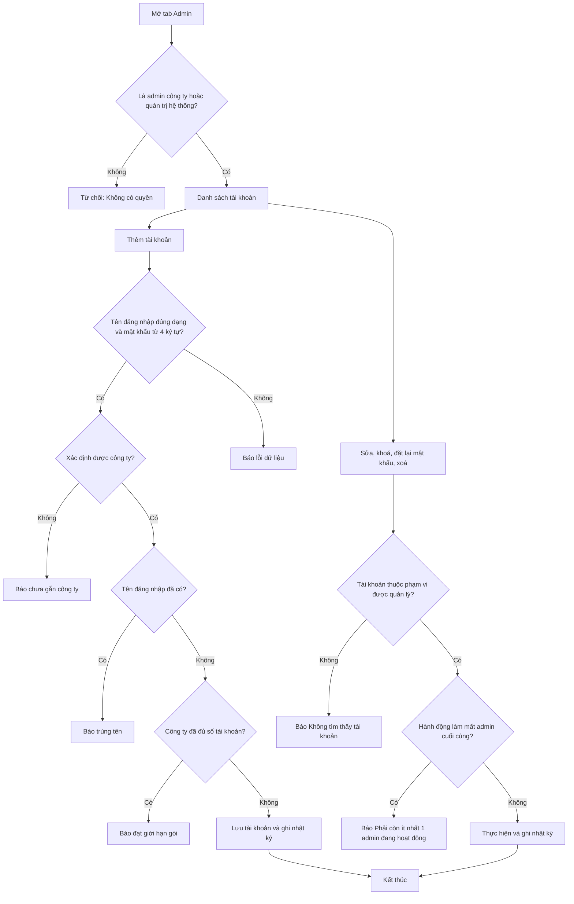
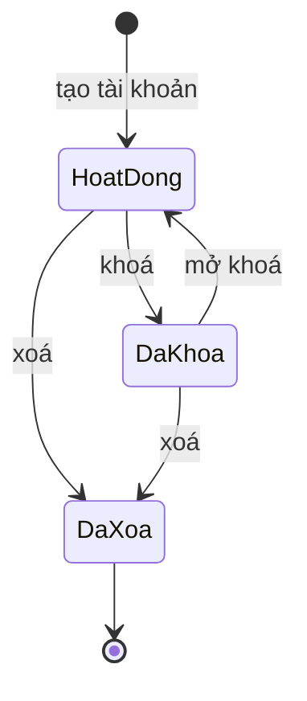

# [QT-03] Quản lý tài khoản và phân quyền

| Mục | Giá trị |
|-----|---------|
| Dự án | QS Pro |
| Phiên bản | 1.0 - 2026-10-07 |
| Người yêu cầu | — |
| Ưu tiên | Bình thường |
| Loại | Mô tả hiện trạng |

## 1. Tóm tắt
Admin công ty tạo, sửa, khoá, mở khoá, xoá tài khoản của công ty mình, chọn vai trò, cấp quyền vào từng mục, ghi phòng ban và đặt lại mật khẩu cho người khác. Quản trị hệ thống làm được các việc đó với mọi công ty và gán tài khoản vào công ty. Hệ thống luôn giữ lại ít nhất một admin đang hoạt động cho mỗi công ty.

## 2. Tác nhân & quyền
| Tác nhân | Vai trò hệ thống | Được làm gì trong quy trình |
|----------|-----------------|-----------------------------|
| Quản trị hệ thống | `super` | Xem tài khoản của toàn hệ thống (kể cả tài khoản chưa thuộc công ty nào); tạo tài khoản cho công ty bất kỳ; sửa, khoá, mở, xoá, đặt lại mật khẩu mọi tài khoản; chuyển tài khoản sang công ty khác; là người duy nhất tạo hoặc giữ được vai trò `super`. |
| Admin công ty | `admin` | Xem, tạo, sửa, khoá, mở, xoá, đặt lại mật khẩu các tài khoản `admin` và `staff` của công ty mình. Không thấy và không đụng được tài khoản `super` hay tài khoản công ty khác. |
| Nhân viên | `staff` | Không được làm gì trong quy trình này; không mở được tab "Admin". Là đối tượng được cấp quyền. |

## 3. Điều kiện trước
- Người thao tác đã đăng nhập với vai trò `admin` hoặc `super` (QT-01).
- Công ty còn chỗ trong giới hạn người dùng của gói (QT-02) khi tạo tài khoản mới.
- `super` muốn tạo tài khoản thì phải chọn công ty trong biểu mẫu, hoặc đang "xem như" một công ty, hoặc bản thân thuộc một công ty.

## 4. Luồng chính
| Bước | Ai | Hành động | Hệ thống xử lý | Kết quả người dùng thấy | Đã có / Mới |
|------|----|-----------|----------------|--------------------------|-------------|
| 1 | Admin công ty / Quản trị hệ thống | Bấm tab "Admin" | Lấy tối đa 500 tài khoản: `admin` chỉ của công ty mình, `super` thì toàn hệ thống (hoặc của công ty đang "xem như"). Đồng thời tải các danh sách chờ duyệt và nhật ký (QT-04) | Thẻ "Tài khoản (<số>)": tên đăng nhập, họ tên, vai trò, quyền truy cập, trạng thái, đăng nhập gần nhất; `super` có thêm cột "Công ty" và dải cảnh báo nếu có tài khoản chưa gán công ty | Đã có |
| 2 | Admin công ty / Quản trị hệ thống | Bấm "Thêm tài khoản" | Mở biểu mẫu "Thêm tài khoản" với vai trò mặc định "Nhân viên" | Biểu mẫu gồm "Thông tin đăng nhập", "Vai trò", "Quyền truy cập" | Đã có |
| 3 | Admin công ty / Quản trị hệ thống | Nhập tên đăng nhập, họ tên, phòng ban, mật khẩu | — | Các ô đã điền | Đã có |
| 4 | Quản trị hệ thống | (Chỉ `super`) Chọn công ty cho tài khoản | — | Ô "Công ty" đã chọn | Đã có |
| 5 | Admin công ty / Quản trị hệ thống | Chọn vai trò "Nhân viên" hoặc "Quản trị công ty" | Chọn "Quản trị công ty" thì ẩn khối quyền truy cập | Khối quyền hiện hoặc ẩn | Đã có |
| 6 | Admin công ty / Quản trị hệ thống | Tích các mục nhân viên được vào (8 mục), có nút "Chọn tất cả" / "Bỏ hết" | Đếm số mục đã tích; khi tích "Danh sách sản phẩm" thì hiện thêm lựa chọn mức quyền trong mục đó | Bộ đếm "<đã tích>/8" | Đã có |
| 7 | Admin công ty / Quản trị hệ thống | (Khi đã tích "Danh sách sản phẩm") Chọn một mức: "Không giới hạn", "Chỉ được sửa", "Được sửa và duyệt" | — | Mức đã chọn | Đã có |
| 8 | Admin công ty / Quản trị hệ thống | Bấm "Tạo tài khoản" | Kiểm tra tên đăng nhập đúng dạng, mật khẩu từ 4 ký tự, xác định công ty, tên đăng nhập chưa có ai dùng trong toàn hệ thống, công ty chưa đủ số tài khoản. Lưu tài khoản ở trạng thái hoạt động với mật khẩu đã mã hoá. Ghi nhật ký "Tạo tài khoản <tên> (<vai trò>)". Không gửi thông báo cho ai | "Đã tạo tài khoản"; biểu mẫu đóng; danh sách tải lại | Đã có |
| 9 | Admin công ty / Quản trị hệ thống | Bấm "Sửa" ở dòng một tài khoản | Mở biểu mẫu "Sửa tài khoản" với dữ liệu hiện tại; ô tên đăng nhập bị khoá; không có ô mật khẩu | Biểu mẫu sửa | Đã có |
| 10 | Admin công ty / Quản trị hệ thống | Đổi họ tên, phòng ban, vai trò, quyền (và công ty, nếu là `super`), bấm "Lưu thay đổi" | Kiểm tra tài khoản thuộc phạm vi được quản lý; nếu vai trò mới không còn là admin thì kiểm tra quy tắc giữ admin cuối cùng; đổi sang admin thì xoá hết quyền chi tiết; lưu; buộc hệ thống đọc lại quyền của tài khoản đó ở thao tác kế tiếp; ghi nhật ký "Sửa tài khoản <tên> <nội dung thay đổi>". Không gửi thông báo cho ai | "Đã cập nhật"; danh sách tải lại | Đã có |
| 11 | Admin công ty / Quản trị hệ thống | Bấm "Đặt MK" ở dòng một tài khoản, nhập mật khẩu mới, bấm "Đặt lại" | Kiểm tra mật khẩu từ 4 ký tự và tài khoản thuộc phạm vi được quản lý; lưu mật khẩu mới đã mã hoá; ghi nhật ký "Đặt lại mật khẩu cho <tên>". Không gửi thông báo cho người bị đổi | "Đã đặt lại mật khẩu" | Đã có |
| 12 | Admin công ty / Quản trị hệ thống | Bấm "Khóa" ở dòng một tài khoản đang hoạt động (không hỏi xác nhận) | Kiểm tra phạm vi và quy tắc giữ admin cuối cùng; chuyển tài khoản sang khoá; phiên đang mở của người đó mất hiệu lực (QT-01); ghi nhật ký "Khóa <tên>" | "Đã khóa"; dòng hiện "● Đã khóa" | Đã có |
| 13 | Admin công ty / Quản trị hệ thống | Bấm "Mở" ở dòng một tài khoản đang khoá | Kiểm tra phạm vi; chuyển tài khoản sang hoạt động; ghi nhật ký "Mở khóa <tên>" | "Đã mở khóa"; dòng hiện "● Hoạt động" | Đã có |
| 14 | Admin công ty / Quản trị hệ thống | Bấm "Xóa" ở dòng một tài khoản | Hỏi xác nhận "Xóa tài khoản "<tên>"? Không thể hoàn tác." | Hộp xác nhận | Đã có |
| 15 | Admin công ty / Quản trị hệ thống | Đồng ý xoá | Kiểm tra phạm vi, không phải chính mình, quy tắc giữ admin cuối cùng; xoá tài khoản; ghi nhật ký "Xóa tài khoản <tên>". Không gửi thông báo cho ai | "Đã xóa"; danh sách tải lại | Đã có |
| 16 | Quản trị hệ thống | Với tài khoản có nhãn "⚠ Chưa gán công ty": bấm "Sửa", chọn công ty, bấm "Lưu thay đổi" | Gán tài khoản vào công ty đã chọn; ghi nhật ký sửa tài khoản | "Đã cập nhật"; tài khoản đăng nhập được | Đã có |

## 5. Sơ đồ

## 6. Luồng phụ & lỗi
| Mã | Tình huống | Hệ thống phản hồi | Thông báo cho người dùng |
|----|-----------|-------------------|--------------------------|
| E1 | Không có quyền: `staff` gọi bất kỳ chức năng quản lý tài khoản nào | Trả mã 403 | "Không có quyền (chỉ Admin)" |
| E2 | `staff` mở được vùng tab "Admin" | Trang không tải dữ liệu | "Bạn không có quyền truy cập." |
| E3 | Chưa đăng nhập | Trả mã 401 | "Phiên đã hết, mời đăng nhập lại." |
| E4 | Không tìm thấy: tài khoản không tồn tại | Từ chối | "Lỗi: Không tìm thấy tài khoản" |
| E5 | Không có quyền: `admin` thao tác với tài khoản công ty khác hoặc tài khoản `super` | Từ chối, trả lời như thể không tồn tại | "Lỗi: Không tìm thấy tài khoản" |
| E6 | Dữ liệu không hợp lệ: tên đăng nhập dưới 3 ký tự hoặc có ký tự ngoài chữ thường, số, `.`, `_`, `-` | Từ chối | "Lỗi: Tên đăng nhập ≥3 ký tự (chữ thường, số, . _ -)" |
| E7 | Dữ liệu không hợp lệ: mật khẩu dưới 4 ký tự (khi tạo hoặc đặt lại) | Từ chối | Máy chủ: "Lỗi: Mật khẩu tối thiểu 4 ký tự"; khi đặt lại, trang chặn trước: "Mật khẩu phải từ 4 ký tự" |
| E8 | Trùng: tên đăng nhập đã có ở bất kỳ công ty nào | Từ chối | "Lỗi: Tên đăng nhập "<tên>" đã có người dùng — chọn tên khác" |
| E9 | Công ty đã đủ số tài khoản của gói | Từ chối | "Lỗi: Đã đạt giới hạn <số> tài khoản của gói. Liên hệ để nâng gói." |
| E10 | Không xác định được công ty cho tài khoản mới (`super` không chọn công ty, không "xem như", bản thân không thuộc công ty) | Từ chối | "Lỗi: Tài khoản của bạn chưa gắn với công ty nào nên chưa tạo được tài khoản mới — chọn một công ty ở tab Công ty rồi thử lại." |
| E11 | Hạ vai trò, khoá hoặc xoá admin đang hoạt động duy nhất của công ty | Từ chối | "Lỗi: Phải còn ít nhất 1 admin đang hoạt động" |
| E12 | Xoá chính tài khoản đang đăng nhập | Từ chối | "Lỗi: Không thể tự xóa tài khoản đang đăng nhập" |
| E13 | `admin` gửi yêu cầu tạo tài khoản vai trò `super` | Không báo lỗi; tài khoản được tạo với vai trò `staff` | "Đã tạo tài khoản" |
| E14 | `admin` gửi yêu cầu đổi công ty của tài khoản | Lặng lẽ bỏ qua phần đổi công ty | "Đã cập nhật" |
| E15 | Cơ sở dữ liệu chưa có cột phân quyền | Từ chối | "Chưa cài cột phân quyền. Vào Supabase → SQL Editor chạy: alter table public.users add column if not exists perms text default ''; rồi thử lại." |
| E16 | Cơ sở dữ liệu chưa có cột phòng ban | Tự bỏ phần phòng ban và lưu các thông tin còn lại | Không có thông báo; phòng ban không được lưu |
| E17 | Huỷ hộp xác nhận xoá hoặc hộp đặt lại mật khẩu | Không làm gì | Không có thông báo |
| E18 | Lỗi khi tải dữ liệu tab Admin | — | "Lỗi tải: <lý do>" |
| E19 | Lưu biểu mẫu bị lỗi | Biểu mẫu vẫn mở, nút lưu bật lại | "Lỗi: <lý do>" |
| E20 | Gửi yêu cầu sửa mà không có thông tin nào thay đổi được | Không lưu, không ghi nhật ký | Trả kết quả thành công |

## 7. Trạng thái

| Từ | Sang | Khi nào | Ai được làm |
|----|------|---------|-------------|
| (chưa có) | Hoạt động | Tạo tài khoản | `admin` (công ty mình), `super` |
| Hoạt động | Đã khoá | Bấm "Khóa"; không được là admin đang hoạt động cuối cùng của công ty | `admin` (công ty mình), `super` |
| Đã khoá | Hoạt động | Bấm "Mở" | `admin` (công ty mình), `super` |
| Hoạt động / Đã khoá | Đã xoá | Bấm "Xóa" và xác nhận; không phải chính mình; không phải admin đang hoạt động cuối cùng | `admin` (công ty mình), `super` |

## 8. Quy tắc nghiệp vụ
| Mã | Quy tắc |
|----|---------|
| BR-01 | Có 3 vai trò: `super` (quản trị hệ thống), `admin` (admin công ty), `staff` (nhân viên). Biểu mẫu chỉ cho chọn "Nhân viên" hoặc "Quản trị công ty". |
| BR-02 | Chỉ `super` tạo hoặc giữ được vai trò `super`. `admin` gửi vai trò `super` khi tạo thì thành `staff`; khi sửa thì giữ nguyên vai trò cũ. |
| BR-03 | `admin` chỉ quản lý tài khoản thuộc công ty mình và không phải `super`. `super` quản lý mọi tài khoản. |
| BR-04 | Tên đăng nhập: từ 3 ký tự, chỉ gồm chữ thường, số, `.`, `_`, `-`; tự chuyển về chữ thường; duy nhất trong toàn hệ thống (không chỉ trong công ty); không sửa được sau khi tạo. |
| BR-05 | Mật khẩu tối thiểu 4 ký tự, lưu dạng đã mã hoá. Admin đặt lại mật khẩu cho người khác không cần biết mật khẩu cũ. |
| BR-06 | Công ty của tài khoản mới được xác định theo thứ tự: công ty `super` chọn trong biểu mẫu; công ty đang "xem như"; công ty của người tạo. Không xác định được thì không cho tạo. |
| BR-07 | Số tài khoản của công ty (đếm mọi tài khoản, kể cả đang khoá) không được vượt giới hạn người dùng của gói; giới hạn bằng 0 nghĩa là không giới hạn. |
| BR-08 | Quyền chi tiết chỉ áp dụng cho `staff`. `admin` và `super` toàn quyền và danh sách quyền chi tiết luôn để trống. |
| BR-09 | Quyền chi tiết gồm quyền vào 8 mục: `dash` (Bảng điều khiển), `boc` (Bóc tách), `chiphi` (Chi phí), `export` (Xuất báo giá), `muahang` (Mua hàng), `duan` (Dự án), `sanpham` (Danh sách sản phẩm), `import` (Nhập dữ liệu); và 2 mức trong Danh sách sản phẩm: `sp_edit` (chỉ được sửa, sửa xong sản phẩm về "Chưa duyệt"), `sp_duyet` (được sửa và duyệt). |
| BR-10 | Mức quyền trong Danh sách sản phẩm chỉ được lưu khi mục "Danh sách sản phẩm" được tích. Không chọn mức nào ("Không giới hạn") thì nhân viên được cả sửa lẫn duyệt. |
| BR-11 | Nhân viên chỉ thấy những tab vừa được cấp cho mình vừa nằm trong tính năng của công ty. Nhân viên không được cấp mục nào thì thấy "Tài khoản chưa được cấp quyền vào phần nào" khi chuyển tab. |
| BR-12 | Giữ admin cuối cùng: không được hạ vai trò, khoá hoặc xoá một admin đang hoạt động nếu công ty đó chỉ còn một admin đang hoạt động. Quy tắc chỉ xét vai trò `admin` (không xét `super`) và chỉ xét khi tài khoản bị tác động đang hoạt động. |
| BR-13 | Không ai tự xoá được tài khoản đang đăng nhập của mình. |
| BR-14 | Chỉ `super` chuyển được tài khoản sang công ty khác hoặc gán công ty cho tài khoản chưa có công ty. |
| BR-15 | Tài khoản chưa thuộc công ty nào (không phải `super`) không đăng nhập được và không hiện trong danh sách của bất kỳ công ty nào; chỉ `super` nhìn thấy để sửa hoặc xoá. |
| BR-16 | Sau khi sửa, khoá, mở hoặc xoá tài khoản, thay đổi có hiệu lực với phiên đang mở của người đó ở thao tác kế tiếp. |
| BR-17 | Phòng ban là chữ tự do, không bắt buộc; được dùng cho báo cáo nhập sản phẩm gửi Lark (người chưa có phòng ban hiện "Chưa có phòng ban"). |

## 9. Thông báo, realtime & nhật ký
Hệ thống không có realtime. Không hành động nào trong quy trình này gửi thông báo trong ứng dụng hay tin nhắn Lark; người bị khoá, bị đổi quyền hoặc bị đặt lại mật khẩu không nhận được thông báo nào.

| Sự kiện | Ai nhận | Kênh | Nội dung | Ghi audit? |
|---------|---------|------|----------|:----------:|
| Tạo tài khoản | — | — | — | Có (`create_user`: "Tạo tài khoản <tên> (<vai trò>)") |
| Sửa tài khoản (họ tên, vai trò, quyền, phòng ban, công ty) | — | — | — | Có (`update_user`: "Sửa tài khoản <tên> <nội dung thay đổi dạng kỹ thuật>") |
| Đặt lại mật khẩu | — | — | — | Có (`reset_password`: "Đặt lại mật khẩu cho <tên>") |
| Khoá tài khoản | — | — | — | Có (`lock_user`: "Khóa <tên>") |
| Mở khoá tài khoản | — | — | — | Có (`unlock_user`: "Mở khóa <tên>") |
| Xoá tài khoản | — | — | — | Có (`delete_user`: "Xóa tài khoản <tên>") |
| Xem danh sách tài khoản | — | — | — | Không |
| Thao tác bị từ chối (E1–E12) | — | — | — | Không |

## 10. Dữ liệu
| Thông tin | Bắt buộc | Ràng buộc | Ví dụ |
|-----------|----------|-----------|-------|
| Tên đăng nhập | Có (khi tạo) | Từ 3 ký tự; chữ thường, số, `.`, `_`, `-`; duy nhất toàn hệ thống; không sửa được | `nguyenvana` |
| Mật khẩu | Có (khi tạo, khi đặt lại) | Từ 4 ký tự | `****` |
| Họ tên | Không | Chữ tự do | Nguyễn Văn A |
| Phòng ban | Không | Chữ tự do | Kinh doanh |
| Email | Không | Biểu mẫu ở tab Admin không có ô này; chỉ nhập được khi tạo từ tab Công ty (QT-02) | a@congty.vn |
| Vai trò | Có | `staff` (mặc định), `admin`, `super` | `staff` |
| Quyền chi tiết | Không | Danh sách các mã ở BR-09; để trống với `admin`/`super` | `boc,sanpham,sp_edit` |
| Công ty | Có | Xác định theo BR-06 | (mã định danh công ty) |
| Trạng thái | Tự ghi | Hoạt động (mặc định khi tạo) / Đã khoá | Hoạt động |
| Ngày tạo, đăng nhập gần nhất | Tự ghi | — | 2026-10-07 09:15 |

## 11. Màn hình liên quan
- Tab "Admin" → thẻ "Tài khoản (<số>)" với ghi chú "Admin toàn quyền · Nhân viên không mở được trang này.", nút "Thêm tài khoản", các nút "Sửa", "Đặt MK", "Khóa"/"Mở", "Xóa" trên từng dòng.
- Biểu mẫu "Thêm tài khoản" / "Sửa tài khoản".
- Hộp "Đặt lại mật khẩu".
- Hộp xác nhận xoá tài khoản.
- Tab "Công ty" → phần "Người dùng" của một công ty (QT-02) cũng tạo được tài khoản.
- Thanh điều hướng: các tab ẩn/hiện theo quyền của tài khoản.

## 12. Tiêu chí nghiệm thu
- **AC-01**: Cho `admin` của công ty A còn chỗ trong gói / Khi tạo tài khoản `tranb` vai trò "Nhân viên" với quyền Bóc tách và Danh sách sản phẩm mức "Chỉ được sửa" / Thì tài khoản được tạo thuộc công ty A, trạng thái hoạt động, quyền gồm `boc`, `sanpham`, `sp_edit`; thấy "Đã tạo tài khoản"; nhật ký có `create_user`.
- **AC-02**: Cho người không có quyền (tài khoản `staff`) / Khi gọi xem danh sách, tạo, sửa, khoá, đặt lại mật khẩu hoặc xoá tài khoản / Thì bị từ chối với mã 403 "Không có quyền (chỉ Admin)".
- **AC-03**: Cho `admin` của công ty A / Khi sửa, khoá hoặc xoá một tài khoản của công ty B hoặc một tài khoản `super` / Thì bị từ chối với "Không tìm thấy tài khoản".
- **AC-04**: Cho tên đăng nhập `tranb` đã có ở công ty B / Khi `admin` công ty A tạo tài khoản `tranb` / Thì thấy "Lỗi: Tên đăng nhập "tranb" đã có người dùng — chọn tên khác".
- **AC-05**: Cho tên đăng nhập `ab` hoặc `Trần B` / Khi tạo tài khoản / Thì thấy "Lỗi: Tên đăng nhập ≥3 ký tự (chữ thường, số, . _ -)".
- **AC-06**: Cho công ty có giới hạn 5 và đã có 5 tài khoản (kể cả tài khoản đang khoá) / Khi tạo tài khoản thứ 6 / Thì thấy "Lỗi: Đã đạt giới hạn 5 tài khoản của gói. Liên hệ để nâng gói.".
- **AC-07**: Cho công ty chỉ có một admin đang hoạt động / Khi khoá, xoá hoặc đổi admin đó thành "Nhân viên" / Thì thấy "Lỗi: Phải còn ít nhất 1 admin đang hoạt động" và tài khoản không đổi.
- **AC-08**: Cho `admin` đang đăng nhập / Khi bấm "Xóa" ở dòng của chính mình và xác nhận / Thì thấy "Lỗi: Không thể tự xóa tài khoản đang đăng nhập".
- **AC-09**: Cho nhân viên đang đăng nhập / Khi `admin` khoá tài khoản đó / Thì thao tác kế tiếp của nhân viên bị đưa về màn hình đăng nhập, và đăng nhập lại thấy "Tài khoản đã bị khóa".
- **AC-10**: Cho một tài khoản nhân viên / Khi `admin` đặt lại mật khẩu thành chuỗi 4 ký tự trở lên / Thì thấy "Đã đặt lại mật khẩu", nhân viên đăng nhập được bằng mật khẩu mới, nhật ký có `reset_password`.
- **AC-11**: Cho một tài khoản nhân viên có quyền chi tiết / Khi `admin` đổi vai trò thành "Quản trị công ty" / Thì danh sách quyền chi tiết bị xoá trống và cột quyền hiện "Toàn quyền".
- **AC-12**: Cho `super` không chọn công ty, không "xem như" và không thuộc công ty nào / Khi tạo tài khoản / Thì thấy "Lỗi: Tài khoản của bạn chưa gắn với công ty nào nên chưa tạo được tài khoản mới — chọn một công ty ở tab Công ty rồi thử lại.".

## 13. Ảnh hưởng tới phần có sẵn
- Đăng nhập và phiên (QT-01): khoá, xoá, đổi vai trò, đổi công ty có hiệu lực ngay với phiên đang mở.
- Quản lý công ty (QT-02): giới hạn người dùng của gói chặn việc tạo tài khoản; tab Công ty dùng chung chức năng tạo tài khoản.
- Danh sách sản phẩm: hai mức `sp_edit` / `sp_duyet` quyết định nhân viên có được sửa và duyệt sản phẩm hay không (được kiểm tra ở máy chủ).
- Thông báo (QT-04): các yêu cầu cần duyệt được gửi tới mọi tài khoản `admin` đang hoạt động của công ty, nên việc thêm, khoá, đổi vai trò admin làm thay đổi danh sách người nhận.
- Báo cáo nhập sản phẩm gửi Lark dùng thông tin phòng ban của tài khoản.
- Giao diện: quyền chi tiết quyết định các tab nhân viên nhìn thấy.

## 14. Giả định & câu hỏi mở
| Mã | Nội dung | Cần ai trả lời |
|----|----------|----------------|
| GD-01 | Mức ưu tiên ghi "Bình thường" vì đây là tài liệu mô tả hiện trạng, không có người yêu cầu. | Chủ sản phẩm |
| GD-02 | Cơ sở dữ liệu đang chạy đã có cột phân quyền và cột phòng ban; nếu chưa thì xảy ra E15, E16. Không kiểm tra được trên cơ sở dữ liệu thật. | Dev |
| GD-03 | Khi xoá tài khoản, các phiên đăng nhập của tài khoản đó tự bị xoá theo (theo khai báo trong `db/phien_dang_nhap.sql`). Dữ liệu khác do người đó tạo (dự án, đơn mua hàng, thông báo, nhật ký) được giữ nguyên vì mã không xoá. | Dev |
| Q-01 | ⚠ Ghi chú ở máy chủ nói "'super' chỉ super giữ/gán được; trước đây form gửi 'super' bị hạ thành 'staff'", nhưng biểu mẫu "Sửa tài khoản" chỉ có hai lựa chọn "Nhân viên" / "Quản trị công ty" và với tài khoản `super` thì "Nhân viên" được chọn sẵn. Vì vậy `super` mở một tài khoản `super` (kể cả của chính mình) rồi bấm "Lưu thay đổi" sẽ hạ tài khoản đó xuống `staff`. Không có quy tắc giữ `super` cuối cùng. Có phải lỗi cần sửa không? | Dev / Chủ sản phẩm |
| Q-02 | ⚠ Quyền vào 8 mục chỉ dùng để ẩn/hiện tab ở giao diện; máy chủ chỉ kiểm tra hai mức `sp_edit` / `sp_duyet` và nhóm chức năng dành cho admin. Nhân viên không được cấp một mục vẫn gọi được chức năng của mục đó nếu gửi yêu cầu trực tiếp. Có cần chặn ở máy chủ không? | Chủ sản phẩm / Dev |
| Q-03 | ⚠ Mức "Không giới hạn" ở Danh sách sản phẩm (mặc định) cho nhân viên cả quyền duyệt sản phẩm, tức rộng hơn mức "Chỉ được sửa". Có đúng mong muốn cho tài khoản mới không? | Chủ sản phẩm |
| Q-04 | ⚠ Biểu mẫu ở tab Admin không có ô Email và không có chức năng nào sửa email hay tên đăng nhập sau khi tạo; email chỉ nhập được lúc tạo từ tab Công ty. Có cần bổ sung không? | Chủ sản phẩm |
| Q-05 | ⚠ Đặt lại mật khẩu không làm mất hiệu lực các phiên đang mở của tài khoản đó. Có cần buộc đăng nhập lại không? | Chủ sản phẩm |
| Q-06 | ⚠ Khi `super` chuyển tài khoản sang công ty khác, hệ thống không kiểm tra giới hạn người dùng của công ty đích và không kiểm tra quy tắc giữ admin cuối cùng của công ty cũ. Có cần kiểm tra không? | Chủ sản phẩm |
| Q-07 | Giới hạn người dùng đếm cả tài khoản đang khoá. Có đúng mong muốn không, hay chỉ đếm tài khoản đang hoạt động? | Chủ sản phẩm |
| Q-08 | Admin có thể tự khoá hoặc tự hạ vai trò của chính mình khi công ty còn admin khác; khoá tài khoản không hỏi xác nhận (xoá thì có). Có đúng mong muốn không? | Chủ sản phẩm |
| Q-09 | ⚠ Máy chủ không kiểm tra giá trị trong danh sách quyền chi tiết (nhận chuỗi bất kỳ). Ở cột "Quyền truy cập", hai mức `sp_edit` / `sp_duyet` hiện nguyên mã kỹ thuật vì không có nhãn tiếng Việt. Có cần sửa không? | Dev |
| Q-10 | ⚠ Nhãn vai trò không thống nhất: bảng tài khoản ghi "Admin công ty", còn biểu mẫu, ô người dùng và tab Công ty ghi "Quản trị công ty". Dùng tên nào? | Chủ sản phẩm |
| Q-11 | ⚠ Dòng mô tả của biểu mẫu thêm ghi "Tạo tài khoản mới cho công ty của bạn" cả khi người tạo là `super` đang tạo cho công ty khác. Có cần đổi lời không? | Chủ sản phẩm |
| Q-12 | Người bị khoá, bị đổi quyền hoặc bị đặt lại mật khẩu không nhận thông báo nào. Có cần báo không? | Chủ sản phẩm |

## 15. Ghi chú kỹ thuật cho dev
- API (`POST /api/<fn>`, đều thuộc nhóm `actor` + `admin`): `adminListUsers`, `adminCreateUser`, `adminUpdateUser`, `adminSetPassword`, `adminSetActive`, `adminDeleteUser` — `server/components/users/users.routes.js:4-16`.
- `adminListUsers` `server/components/users/users.service.js:23-30`; `adminCreateUser` `:31-74` (dạng tên đăng nhập `:34`, mật khẩu `:35`, xác định công ty `:41-45`, trùng tên `:48-49`, giới hạn gói `:51-58`, vai trò `:60-61`, quyền `:62`, audit `:72`).
- Phạm vi tài khoản đích `targetUser_` `:76-83`; giữ admin cuối cùng `keepLastAdmin_` `:85-91`.
- `adminUpdateUser` `:92-119` (vai trò `:97-102`, đổi công ty chỉ super `:106`, xoá quyền khi là admin `:108`, quên cache phiên `:116`, audit `:117`); `adminSetPassword` `:120-126`; `adminSetActive` `:127-134`; `adminDeleteUser` `:135-143`.
- Xử lý thiếu cột `phong_ban` / `perms`: `users.service.js:12-22`.
- Ánh xạ tài khoản trả về client `userOut`: `server/components/users/users.repository.js:6-10`.
- Quên cache phiên theo tài khoản `forgetSession_`: `server/components/auth/session.js:38`.
- Kiểm quyền `sp_edit` / `sp_duyet` ở máy chủ: `server/components/san-pham/san-pham.service.js:17-26`.
- Cổng phân quyền nhóm admin: `server/libraries/rpc.js:60-61`.
- Bảng dữ liệu: `users` (`username`, `ho_ten`, `email`, `password_hash`, `role`, `perms`, `active`, `cong_ty_id`, `phong_ban`, `created_at`, `last_login`) — `db/auth.sql`, `db/user_phong_ban.sql`; bảng `users` nằm trong `TENANT_TABLES` (`server/libraries/supa.js:19-25`) nhưng các thao tác ghi ở đây dùng `noScope` và tự kiểm phạm vi.
- Client: `public/admin.js` — `renderAdmin` `:5-15`; thẻ tài khoản `admUsersCard_` `:37-64`; biểu mẫu `admUserModal` `:162-228` (lựa chọn vai trò `:211-216`); `admModalSave` `:251-272`; `admResetPw` `:273-276`; `admToggleActive` `:277`; `admDelete` `:278`.
- Danh sách tab cấp quyền `PERM_TABS`: `public/app.js:2564-2566`; `canTab` `:2576-2583`; `firstAllowedTab_` `:2584-2585`; chặn tab khi chuyển `showTab` `:345`.
- Không có job nền, không có realtime.

## Lịch sử thay đổi
| Phiên bản | Ngày | Thay đổi |
|-----------|------|----------|
| 1.0 | 2026-10-07 | Tạo mới |
