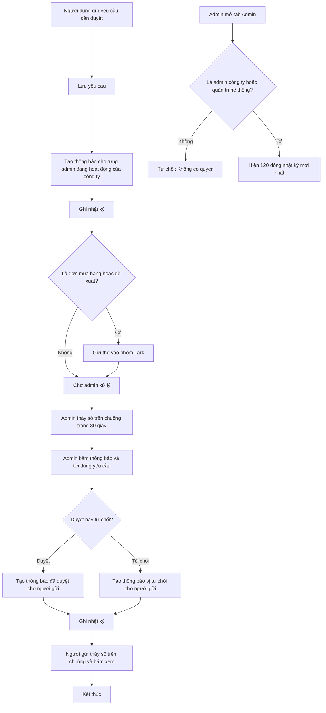

# [QT-04] Thông báo trong ứng dụng và nhật ký hoạt động

| Mục | Giá trị |
|-----|---------|
| Dự án | QS Pro |
| Phiên bản | 1.0 - 2026-10-07 |
| Người yêu cầu | — |
| Ưu tiên | Bình thường |
| Loại | Mô tả hiện trạng |

## 1. Tóm tắt
Khi có việc cần duyệt hoặc đã được duyệt (xoá sản phẩm, đơn mua hàng, đề xuất mua hàng), hệ thống tự tạo thông báo cho đúng người; người dùng xem ở biểu tượng chuông và bấm vào để tới đúng chỗ cần xử lý. Song song, hệ thống ghi lại nhật ký các thao tác quan trọng và cả lỗi giao diện xảy ra trên máy người dùng để admin xem ở tab "Admin". Một số việc còn được báo thêm vào nhóm Lark.

## 2. Tác nhân & quyền
| Tác nhân | Vai trò hệ thống | Được làm gì trong quy trình |
|----------|-----------------|-----------------------------|
| Quản trị hệ thống | `super` | Xem chuông thông báo của mình; xem nhật ký của toàn hệ thống, hoặc của một công ty khi đang "xem như" công ty đó. Không nằm trong danh sách nhận yêu cầu cần duyệt. |
| Admin công ty | `admin` | Nhận thông báo khi có yêu cầu cần duyệt trong công ty; xem và đánh dấu đã đọc thông báo của mình; xem nhật ký hoạt động của công ty mình. |
| Nhân viên | `staff` | Nhận thông báo khi yêu cầu của mình được duyệt hoặc bị từ chối; xem và đánh dấu đã đọc thông báo của mình. Không xem được nhật ký. |
| Hệ thống | — | Tự tạo thông báo, tự ghi nhật ký, tự gửi tin Lark, tự gửi báo cáo theo lịch. |

## 3. Điều kiện trước
- Người dùng đã đăng nhập (QT-01); chuông thông báo chỉ hiện sau khi đăng nhập.
- Để có người nhận yêu cầu cần duyệt: công ty có ít nhất một tài khoản `admin` đang hoạt động (QT-03).
- Để gửi được tin Lark: máy chủ đã có địa chỉ nhận tin của nhóm Lark.

## 4. Luồng chính
| Bước | Ai | Hành động | Hệ thống xử lý | Kết quả người dùng thấy | Đã có / Mới |
|------|----|-----------|----------------|--------------------------|-------------|
| 1 | Nhân viên (hoặc bất kỳ người đã đăng nhập) | Gửi một yêu cầu cần duyệt: yêu cầu xoá sản phẩm, đơn mua hàng, hoặc đề xuất mua hàng | Lưu yêu cầu; tạo một thông báo cho từng admin đang hoạt động của công ty (với đơn mua hàng: mỗi đơn một thông báo cho mỗi admin); ghi nhật ký; riêng đơn mua hàng và đề xuất còn gửi một thẻ vào nhóm Lark | Người gửi thấy kết quả gửi ở màn hình nghiệp vụ tương ứng | Đã có |
| 2 | Hệ thống | — | Sau khi người dùng đăng nhập: hiện chuông và cứ 30 giây đếm lại số thông báo chưa đọc của người đó | Số đỏ trên chuông (quá 99 hiện "99+"); không có thông báo chưa đọc thì ẩn số | Đã có |
| 3 | Người dùng | Bấm vào chuông | Lấy 30 thông báo mới nhất của chính người đó | Danh sách: tiêu đề, nội dung, thời gian; thông báo chưa đọc được làm nổi; chưa có gì thì hiện "Chưa có thông báo" | Đã có |
| 4 | Người dùng | Bấm vào một thông báo | Đánh dấu thông báo đó đã đọc, cập nhật số trên chuông, đóng danh sách và đưa người dùng tới nơi liên quan (bước 5–7) | Số trên chuông giảm | Đã có |
| 5 | Hệ thống | — | Với thông báo về đơn mua hàng: admin được đưa sang tab "Admin" và mở chi tiết đúng đơn; nhân viên được đưa sang tab "Mua hàng" | Admin: hộp "Chi tiết đơn mua hàng". Nhân viên: tab Mua hàng và dòng "Đơn <mã đơn>" | Đã có |
| 6 | Hệ thống | — | Với thông báo về yêu cầu xoá sản phẩm: admin được đưa sang tab "Admin", cuộn tới và nháy sáng đúng yêu cầu; nhân viên được đưa sang tab "Danh sách sản phẩm" | Nhân viên thấy "Yêu cầu xoá sản phẩm đã được duyệt / bị từ chối / đang chờ duyệt" | Đã có |
| 7 | Hệ thống | — | Với các loại thông báo khác (gồm cả thông báo về đề xuất mua hàng): chỉ đánh dấu đã đọc và tải lại danh sách | ⚠ Không được đưa tới đâu | Đã có |
| 8 | Người dùng | Bấm "Đánh dấu đã đọc" ở đầu danh sách | Đánh dấu mọi thông báo chưa đọc của người đó là đã đọc | Số trên chuông biến mất | Đã có |
| 9 | Admin công ty | Duyệt hoặc từ chối một yêu cầu (ở tab "Admin") | Cập nhật yêu cầu; tạo thông báo cho người đã gửi yêu cầu; ghi nhật ký | Admin thấy kết quả duyệt; người gửi thấy số trên chuông tăng trong vòng 30 giây | Đã có |
| 10 | Hệ thống | — | Mỗi thao tác thuộc danh sách ở mục 9 ghi một dòng nhật ký: ai làm, hành động gì, chi tiết, lúc nào, thuộc công ty nào. Nếu ghi nhật ký lỗi thì bỏ qua, thao tác chính vẫn thành công | — | Đã có |
| 11 | Admin công ty / Quản trị hệ thống | Bấm tab "Admin" | Lấy 120 dòng nhật ký mới nhất trong phạm vi công ty đang làm việc | Thẻ "Nhật ký hoạt động": Thời gian, Người dùng, Hành động, Chi tiết; chưa có gì thì hiện "Chưa có" | Đã có |
| 12 | Hệ thống | — | Khi trang của một người đã đăng nhập gặp lỗi chưa được xử lý: gửi nội dung lỗi (tối đa 300 ký tự), nơi phát sinh và tên tab đang mở về máy chủ; mỗi nội dung lỗi chỉ gửi một lần, tối đa 20 lỗi cho mỗi lần mở trang; máy chủ ghi thành một dòng nhật ký | Người dùng không thấy gì; admin thấy dòng "Lỗi giao diện" trong nhật ký | Đã có |
| 13 | Hệ thống | — | Thứ 4 và thứ 7, từ 8 giờ sáng giờ Việt Nam: gửi báo cáo sản phẩm nhập mới vào nhóm Lark, mỗi công ty một thẻ; gửi được thì ghi một dòng nhật ký với người thực hiện là "hệ thống"; trong ngày đã gửi rồi thì không gửi lại | Tin trong nhóm Lark | Đã có |

## 5. Sơ đồ

## 6. Luồng phụ & lỗi
| Mã | Tình huống | Hệ thống phản hồi | Thông báo cho người dùng |
|----|-----------|-------------------|--------------------------|
| E1 | Không có quyền: `staff` gọi xem nhật ký | Trả mã 403 | "Không có quyền (chỉ Admin)" |
| E2 | `staff` mở được vùng tab "Admin" | Trang không tải dữ liệu | "Bạn không có quyền truy cập." |
| E3 | Chưa đăng nhập mà gọi đếm, xem, đánh dấu thông báo, xem nhật ký hoặc gửi lỗi giao diện | Trả mã 401 | "Phiên đã hết, mời đăng nhập lại." (riêng lỗi giao diện thì trang không gửi khi chưa đăng nhập) |
| E4 | Không tìm thấy: đánh dấu đã đọc một thông báo không tồn tại hoặc của người khác | ⚠ Không đổi gì nhưng vẫn trả kết quả thành công, không báo lỗi | Không có thông báo |
| E5 | Không tìm thấy: admin bấm thông báo đơn mua hàng nhưng đơn không còn | Hộp chi tiết báo lỗi | "Lỗi tải đơn: Không tìm thấy đơn mua hàng" |
| E6 | Không tìm thấy: bấm thông báo sửa sản phẩm (loại cũ) mà sản phẩm không còn | — | "Không tìm thấy sản phẩm <mã> (có thể đã bị xoá)" |
| E7 | Yêu cầu đã được người khác xử lý trước khi admin bấm duyệt | Từ chối | "Lỗi: Yêu cầu đã được xử lý" / "Lỗi: Đơn đã được xử lý" / "Lỗi: Đề xuất đã được xử lý" |
| E8 | Dữ liệu không hợp lệ: số dòng nhật ký hoặc số thông báo yêu cầu không phải số | Dùng giá trị mặc định (200 dòng nhật ký, 30 thông báo); không báo lỗi | Không có thông báo |
| E9 | Yêu cầu quá nhiều dòng | Cắt còn tối đa 1000 dòng nhật ký, 100 thông báo | Không có thông báo |
| E10 | Lưu thông báo bị lỗi | Bỏ qua; thao tác chính vẫn thành công; chỉ ghi cảnh báo ở máy chủ | Không có thông báo; người nhận không biết |
| E11 | Ghi nhật ký bị lỗi | Bỏ qua hoàn toàn; thao tác chính vẫn thành công | Không có thông báo |
| E12 | Gửi tin Lark lỗi (đơn mua hàng, đề xuất) | Bỏ qua; việc lưu và duyệt trong ứng dụng không bị ảnh hưởng; kết quả trả về ghi rõ Lark không gửi được | Tuỳ màn hình nghiệp vụ (ngoài phạm vi tài liệu này) |
| E13 | Yêu cầu không ghi được người gửi (ví dụ dữ liệu cũ) | Không tạo thông báo kết quả duyệt | Không ai được báo |
| E14 | Công ty không có admin nào đang hoạt động | Không tạo thông báo yêu cầu; yêu cầu vẫn được lưu | Không ai được báo |
| E15 | Tải danh sách thông báo lỗi | — | "Lỗi: <lý do>" trong danh sách chuông |
| E16 | Đếm thông báo chưa đọc lỗi | Bỏ qua, thử lại sau 30 giây | Số trên chuông giữ nguyên |
| E17 | Tải nhật ký lỗi | Cả tab Admin không hiện dữ liệu | "Lỗi tải: <lý do>" |
| E18 | Gửi lỗi giao diện về máy chủ thất bại | Bỏ qua | Không có thông báo |

## 8. Quy tắc nghiệp vụ
| Mã | Quy tắc |
|----|---------|
| BR-01 | Mỗi thông báo thuộc về đúng một người nhận. Mỗi người chỉ đếm, xem và đánh dấu được thông báo của chính mình, trong phạm vi công ty đang làm việc. |
| BR-02 | Người nhận yêu cầu cần duyệt là mọi tài khoản vai trò `admin` đang hoạt động trong công ty của người gửi. Tài khoản `super` không nằm trong danh sách này. |
| BR-03 | Người nhận kết quả duyệt là người đã gửi yêu cầu. |
| BR-04 | Thông báo có 9 loại: `delete_request`, `delete_approved`, `delete_rejected`, `purchase_request`, `purchase_approved`, `purchase_rejected`, `de_xuat`, `de_xuat_approved`, `de_xuat_rejected`. |
| BR-05 | Thông báo không tự mất và không có chức năng xoá; chỉ có hai trạng thái chưa đọc và đã đọc. Bấm vào thông báo là đánh dấu đã đọc. |
| BR-06 | Số trên chuông được cập nhật 30 giây một lần và ngay sau khi admin duyệt hoặc từ chối một yêu cầu; không có cập nhật tức thời. |
| BR-07 | Chuông hiện tối đa 30 thông báo mới nhất; số chưa đọc đếm tối đa 500. |
| BR-08 | Chỉ `admin` và `super` xem được nhật ký. `admin` chỉ thấy nhật ký của công ty mình. `super` thấy toàn hệ thống, hoặc chỉ một công ty khi đang "xem như" công ty đó. |
| BR-09 | Tab "Admin" hiện 120 dòng nhật ký mới nhất; không có tìm kiếm, lọc, phân trang hay xuất file. |
| BR-10 | Nhật ký chỉ được ghi thêm; không có chức năng sửa hay xoá từng dòng. Nhật ký của một công ty bị xoá khi công ty đó bị xoá (QT-02). |
| BR-11 | Ghi nhật ký và tạo thông báo không bao giờ được làm hỏng thao tác chính: nếu lỗi thì bỏ qua. |
| BR-12 | Lỗi giao diện chỉ được ghi khi người dùng đã đăng nhập; mỗi nội dung lỗi một lần, tối đa 20 lỗi cho mỗi lần mở trang; lỗi do hết phiên không được ghi. |
| BR-13 | Nhãn tiếng Việt của cột "Hành động" có cho 11 loại: Lỗi giao diện, Đăng nhập, Đăng xuất, ĐN lỗi, Tạo TK, Sửa TK, Xóa TK, Đặt lại MK, Đổi MK, Khóa TK, Mở khóa. Các loại khác hiện nguyên mã. |
| BR-14 | Tin Lark chỉ là kênh báo thêm: gửi lỗi không chặn luồng duyệt trong ứng dụng. |
| BR-15 | Báo cáo sản phẩm nhập mới gửi Lark vào thứ 4 và thứ 7 lúc 8 giờ sáng giờ Việt Nam; máy chủ khởi động muộn trong ngày đó vẫn gửi bù; mỗi ngày chỉ gửi một lần. |

## 9. Thông báo, realtime & nhật ký
Hệ thống không có realtime. Bảng dưới liệt kê mọi hành động trong hệ thống có sinh thông báo, tin Lark hoặc ghi nhật ký (đã dò toàn bộ phần máy chủ).

**A. Hành động có sinh thông báo**

| Sự kiện | Ai nhận | Kênh | Nội dung | Ghi audit? |
|---------|---------|------|----------|:----------:|
| Gửi yêu cầu xoá sản phẩm | Mọi `admin` đang hoạt động của công ty | Trong ứng dụng (`delete_request`) | "Yêu cầu xóa sản phẩm" — "<người gửi> yêu cầu xóa <số> sản phẩm" | Có (`request_delete`) |
| Duyệt yêu cầu xoá sản phẩm | Người gửi yêu cầu | Trong ứng dụng (`delete_approved`) | "Yêu cầu xóa đã được duyệt" — "Đã xóa <đã xoá>/<tổng> sản phẩm bạn yêu cầu" | Có (`approve_delete`, kèm một dòng `xoa_sp` cho mỗi sản phẩm bị xoá) |
| Từ chối yêu cầu xoá sản phẩm | Người gửi yêu cầu | Trong ứng dụng (`delete_rejected`) | "Yêu cầu xóa bị từ chối" — "Yêu cầu xóa <số> sản phẩm không được duyệt" | Có (`reject_delete`) |
| Gửi đơn mua hàng | Mọi `admin` đang hoạt động của công ty (mỗi đơn một thông báo); nhóm Lark | Trong ứng dụng (`purchase_request`) + thẻ Lark | "Yêu cầu mua hàng" — "<người gửi> gửi đơn <mã đơn> (<nhà cung cấp>)" | Có (`request_purchase`: "<người gửi> gửi <số> đơn mua hàng") |
| Duyệt đơn mua hàng | Người gửi đơn | Trong ứng dụng (`purchase_approved`) | "Đơn mua hàng đã được duyệt" — "Đơn <mã đơn> (<nhà cung cấp>)" | Có (`approve_purchase`) |
| Từ chối đơn mua hàng | Người gửi đơn | Trong ứng dụng (`purchase_rejected`) | "Đơn mua hàng bị từ chối" — "Đơn <mã đơn> (<nhà cung cấp>)" | Có (`reject_purchase`) |
| Gửi đề xuất mua hàng (chiết khấu hoặc thanh toán) | Mọi `admin` đang hoạt động của công ty; nhóm Lark | Trong ứng dụng (`de_xuat`) + thẻ Lark | "Đề xuất mua hàng" — "<người gửi> gửi đề xuất chiết khấu / đề xuất thanh toán <mã> (<nhà cung cấp>)" | Có (`request_de_xuat`) |
| Duyệt đề xuất | Người gửi đề xuất | Trong ứng dụng (`de_xuat_approved`) | "Đề xuất đã được duyệt" — "Phiếu <mã> (<nhà cung cấp>)" | Có (`approve_de_xuat`) |
| Từ chối đề xuất | Người gửi đề xuất | Trong ứng dụng (`de_xuat_rejected`) | "Đề xuất bị từ chối" — "Phiếu <mã> (<nhà cung cấp>)" | Có (`reject_de_xuat`) |
| Báo cáo sản phẩm nhập mới theo lịch (hoặc `super` chạy tay) | Nhóm Lark | Thẻ Lark, mỗi công ty một thẻ | Thống kê sản phẩm nhập mới trong kỳ | Có (`bao_cao_nhap_sp`, người thực hiện "hệ thống", không gắn công ty) |

**B. Hành động chỉ ghi nhật ký (không có thông báo)**

| Sự kiện | Ai nhận | Kênh | Nội dung | Ghi audit? |
|---------|---------|------|----------|:----------:|
| Đăng nhập thành công / sai tài khoản hoặc mật khẩu / đăng xuất / tự đổi mật khẩu | — | — | — | Có (`login`, `login_fail`, `logout`, `change_password`) |
| Tạo, sửa, đặt lại mật khẩu, khoá, mở khoá, xoá tài khoản | — | — | — | Có (`create_user`, `update_user`, `reset_password`, `lock_user`, `unlock_user`, `delete_user`) |
| Tạo, sửa, xoá công ty | — | — | — | Có (`create_company`, `update_company`, `delete_company`) |
| Chuyển trạng thái đơn mua hàng sau duyệt (Đã đặt hàng, Đã nhận hàng) | — | — | — | Có (`purchase_status`) |
| Thêm sản phẩm / cập nhật sản phẩm qua form Nhập dữ liệu / sửa sản phẩm / xoá sản phẩm | — | — | — | Có (`them_sp`, `cap_nhat_sp`, `sua_sp`, `xoa_sp`) |
| Duyệt / bỏ duyệt sản phẩm | — | — | — | Có (`duyet_sp`, `bo_duyet_sp`) |
| Gom biến thể sản phẩm / đặt sản phẩm đi kèm | — | — | — | Có (`sua_bien_the`, `sua_combo`) |
| Nhập sản phẩm hàng loạt từ file | — | — | — | Có (một dòng tổng `nhap_sp`; không ghi riêng từng sản phẩm) |
| Thêm, sửa, xoá, duyệt, bỏ duyệt công tác xây dựng | — | — | — | Có (`them_cong_tac`, `sua_cong_tac`, `xoa_cong_tac`, `duyet_cong_tac`, `bo_duyet_cong_tac`) |
| Lỗi giao diện trên máy người dùng | — | — | — | Có (`loi_giao_dien`: "[<tab>] <nội dung lỗi> @ <nơi phát sinh>") |

**C. Hành động không ghi nhật ký và không có thông báo**

| Sự kiện | Ai nhận | Kênh | Nội dung | Ghi audit? |
|---------|---------|------|----------|:----------:|
| Tạo, sửa, xoá dự án; thêm, sửa, xoá dòng bóc tách; khái toán / tờ bìa; dữ liệu rời của dự án | — | — | — | Không ⚠ |
| Xuất file Excel, tải ảnh và tài liệu lên | — | — | — | Không |
| Đánh dấu sản phẩm yêu thích | — | — | — | Không |
| Lưu cài đặt giao diện | — | — | — | Không |
| Đọc và đánh dấu đã đọc thông báo; xem nhật ký | — | — | — | Không |
| Đăng nhập bị từ chối vì tài khoản khoá, công ty khoá hoặc hết hạn | — | — | — | Không ⚠ |

## 10. Dữ liệu
| Thông tin | Bắt buộc | Ràng buộc | Ví dụ |
|-----------|----------|-----------|-------|
| Thông báo: người nhận | Có | Một tài khoản; không có thì không tạo thông báo | (mã định danh tài khoản) |
| Thông báo: loại | Có | Một trong 9 loại ở BR-04 | `purchase_request` |
| Thông báo: tiêu đề | Không | Chữ | Yêu cầu mua hàng |
| Thông báo: nội dung | Không | Chữ | Nguyễn Văn A gửi đơn PO-0012 (Philips) |
| Thông báo: đối tượng liên quan | Không | Số của yêu cầu xoá, mã đơn mua hàng hoặc mã đề xuất | `PO-0012` |
| Thông báo: đã đọc | Có | Mặc định chưa đọc | chưa đọc |
| Thông báo: thời gian tạo, công ty | Tự ghi | — | 2026-10-07 09:15 |
| Nhật ký: người thực hiện | Không | Mã định danh và tên đăng nhập; "hệ thống" với báo cáo tự động; trống mã định danh với đăng nhập sai | `nguyenvana` |
| Nhật ký: hành động | Có | Mã hành động (xem mục 9) | `create_user` |
| Nhật ký: chi tiết | Không | Chữ tự do | Tạo tài khoản tranb (staff) |
| Nhật ký: thời gian, công ty | Tự ghi | Công ty theo phạm vi đang làm việc lúc ghi; có thể trống | 2026-10-07 09:15 |
| Lỗi giao diện: nội dung | Có | Tối đa 300 ký tự | Cannot read properties of undefined |
| Lỗi giao diện: nơi phát sinh | Không | Tối đa 120 ký tự, đã bỏ phần địa chỉ máy chủ | `boc.js:412` |
| Lỗi giao diện: tab đang mở | Không | Tối đa 20 ký tự | Bóc tách |

## 11. Màn hình liên quan
- Biểu tượng chuông ở thanh trên cùng: số chưa đọc, danh sách thông báo, nút "Đánh dấu đã đọc".
- Tab "Admin": thẻ "Nhật ký hoạt động"; các thẻ "Yêu cầu xóa sản phẩm", "Yêu cầu mua hàng", đề xuất chờ duyệt (nơi thông báo dẫn tới); bốn ô đếm ở đầu trang.
- Hộp "Chi tiết đơn mua hàng" (mở từ thông báo đơn mua hàng với admin).
- Tab "Mua hàng" và tab "Danh sách sản phẩm" (nơi thông báo dẫn nhân viên tới).
- Nhóm Lark nhận thẻ đơn mua hàng, đề xuất và báo cáo sản phẩm nhập mới.

## 12. Tiêu chí nghiệm thu
- **AC-01**: Cho công ty có 2 tài khoản `admin` đang hoạt động và 1 admin đang khoá / Khi một nhân viên gửi yêu cầu xoá 3 sản phẩm / Thì đúng 2 admin đang hoạt động nhận thông báo "Yêu cầu xóa sản phẩm" với nội dung "<người gửi> yêu cầu xóa 3 sản phẩm", và nhật ký có dòng `request_delete`.
- **AC-02**: Cho admin vừa có thông báo mới / Khi chờ tối đa 30 giây / Thì số chưa đọc trên chuông tăng mà không cần tải lại trang.
- **AC-03**: Cho admin có thông báo "Yêu cầu mua hàng" của đơn X / Khi bấm vào thông báo / Thì thông báo chuyển sang đã đọc, tab "Admin" mở và hộp "Chi tiết đơn mua hàng" hiện đúng đơn X.
- **AC-04**: Cho nhân viên đã gửi đơn mua hàng X / Khi admin duyệt đơn / Thì nhân viên nhận thông báo "Đơn mua hàng đã được duyệt", bấm vào thì sang tab "Mua hàng", và nhật ký có dòng `approve_purchase`.
- **AC-05**: Cho người dùng có nhiều thông báo chưa đọc / Khi bấm "Đánh dấu đã đọc" / Thì mọi thông báo của người đó thành đã đọc và số trên chuông biến mất; thông báo của người khác không đổi.
- **AC-06**: Cho người không có quyền (tài khoản `staff`) / Khi gọi xem nhật ký hoạt động / Thì bị từ chối với mã 403 "Không có quyền (chỉ Admin)".
- **AC-07**: Cho `admin` của công ty A / Khi mở tab "Admin" / Thì thẻ "Nhật ký hoạt động" chỉ có các dòng của công ty A, tối đa 120 dòng, mới nhất ở trên.
- **AC-08**: Cho người dùng A và B / Khi A gọi đánh dấu đã đọc một thông báo của B / Thì thông báo của B vẫn chưa đọc.
- **AC-09**: Cho người dùng đã đăng nhập đang ở tab "Bóc tách" / Khi trang gặp một lỗi chưa được xử lý / Thì nhật ký có một dòng "Lỗi giao diện" với chi tiết bắt đầu bằng "[Bóc tách]"; cùng lỗi đó lặp lại thì không thêm dòng mới.
- **AC-10**: Cho việc lưu thông báo hoặc ghi nhật ký bị lỗi / Khi người dùng thực hiện thao tác chính (ví dụ gửi đơn mua hàng) / Thì thao tác chính vẫn thành công.
- **AC-11**: Cho địa chỉ nhận tin Lark bị lỗi / Khi nhân viên gửi đơn mua hàng / Thì đơn vẫn được lưu ở trạng thái chờ duyệt và admin vẫn nhận thông báo trong ứng dụng.
- **AC-12**: Cho người chưa đăng nhập / Khi gọi đếm hoặc xem thông báo / Thì bị từ chối với mã 401 "Chưa đăng nhập".

## 13. Ảnh hưởng tới phần có sẵn
- Quy trình xoá sản phẩm, mua hàng, đề xuất mua hàng: là nơi sinh ra thông báo và là nơi thông báo dẫn tới.
- Quản lý tài khoản (QT-03): danh sách admin đang hoạt động quyết định ai nhận yêu cầu cần duyệt.
- Quản lý công ty (QT-02): thông báo và nhật ký được tách theo công ty; xoá công ty xoá luôn cả hai.
- Đăng nhập (QT-01): chuông chỉ chạy khi đã đăng nhập; nhật ký ghi đăng nhập, đăng xuất, đổi mật khẩu.
- Báo cáo sản phẩm nhập mới: dùng chính nhật ký để biết trong ngày đã gửi chưa.

## 14. Giả định & câu hỏi mở
| Mã | Nội dung | Cần ai trả lời |
|----|----------|----------------|
| GD-01 | Mức ưu tiên ghi "Bình thường" vì đây là tài liệu mô tả hiện trạng, không có người yêu cầu. | Chủ sản phẩm |
| GD-02 | Các bước người dùng bấm để gửi yêu cầu xoá sản phẩm, đơn mua hàng, đề xuất (màn hình, nút, thông báo kết quả) thuộc quy trình nghiệp vụ riêng và không được dò ở phía giao diện trong tài liệu này; tài liệu chỉ xác nhận phần máy chủ tạo thông báo và ghi nhật ký. | Dev |
| GD-03 | Nội dung chi tiết của thẻ Lark (đơn mua hàng, đề xuất, báo cáo) không được dò trong tài liệu này. | Dev |
| GD-04 | Địa chỉ nhận tin Lark trên môi trường thật còn hoạt động; không kiểm tra được vì không được gọi ra mạng. | Vận hành |
| Q-01 | ⚠ Thông báo về đề xuất mua hàng (`de_xuat`, `de_xuat_approved`, `de_xuat_rejected`) không có xử lý khi bấm: chỉ đánh dấu đã đọc, không đưa người dùng tới phiếu đề xuất. Có cần dẫn tới đúng phiếu không? | Chủ sản phẩm |
| Q-02 | ⚠ Giao diện còn xử lý loại thông báo `sp_edit…` (ghi chú trong mã: "bản duyệt cũ") nhưng máy chủ không còn tạo loại này. Bỏ phần xử lý cũ hay sẽ dùng lại? | Dev |
| Q-03 | ⚠ Khi `super` không "xem như" công ty nào mà gửi một yêu cầu cần duyệt, danh sách người nhận là admin của MỌI công ty, và thông báo được lưu không gắn công ty nên chính những admin đó lại không nhìn thấy. Có cần chặn `super` gửi yêu cầu khi chưa chọn công ty không? | Dev / Chủ sản phẩm |
| Q-04 | ⚠ Cột "Hành động" của nhật ký chỉ có nhãn tiếng Việt cho 11 loại; hơn 25 loại còn lại (ví dụ `create_company`, `request_purchase`, `them_sp`, `duyet_cong_tac`) hiện nguyên mã kỹ thuật. Có cần bổ sung nhãn không? | Chủ sản phẩm |
| Q-05 | Nhật ký chỉ xem được 120 dòng mới nhất, không tìm, lọc, phân trang, xuất file; không có quy định giữ nhật ký bao lâu. Có cần bổ sung không? | Chủ sản phẩm |
| Q-06 | ⚠ Thao tác với dự án, dòng bóc tách, khái toán / tờ bìa, xuất file, tải tệp không được ghi nhật ký. Có cần ghi không? | Chủ sản phẩm |
| Q-07 | ⚠ Ghi nhật ký và tạo thông báo bị lỗi thì bị bỏ qua mà không ai được báo (nhật ký: không để lại dấu vết nào; thông báo: chỉ cảnh báo ở máy chủ). Có cần cơ chế phát hiện không? | Dev |
| Q-08 | ⚠ Dòng nhật ký do `super` tạo khi không "xem như", dòng đăng nhập sai với tên đăng nhập không tồn tại, và dòng báo cáo tự động đều không gắn công ty nên chỉ `super` (khi không "xem như") nhìn thấy. Có đúng mong muốn không? | Chủ sản phẩm |
| Q-09 | ⚠ Ghi chú trong `db/notifications.sql` chỉ liệt kê 6 loại thông báo, trong khi mã tạo 9 loại (thêm 3 loại đề xuất). Cập nhật tài liệu cơ sở dữ liệu? | Dev |
| Q-10 | ⚠ Đánh dấu đã đọc một thông báo không tồn tại hoặc của người khác vẫn trả về thành công. Có cần báo lỗi không? | Dev |
| Q-11 | Thông báo không bao giờ bị xoá, chuông chỉ hiện 30 thông báo mới nhất và không có "xem thêm". Có cần dọn thông báo cũ hoặc xem thêm không? | Chủ sản phẩm |
| Q-12 | ⚠ Chi tiết nhật ký sửa tài khoản là nội dung thay đổi ở dạng kỹ thuật (tên cột và giá trị thô), admin khó đọc. Có cần viết lại dễ đọc không? | Chủ sản phẩm |
| Q-13 | ⚠ Địa chỉ nhận tin Lark mặc định được viết sẵn trong mã nguồn và dùng chung cho mọi công ty: đơn mua hàng và đề xuất của mọi công ty đều vào cùng một nhóm Lark nếu không đặt biến môi trường riêng. Có đúng mong muốn với mô hình nhiều công ty không? | Chủ sản phẩm / Vận hành |
| Q-14 | Người gửi yêu cầu không được báo qua Lark khi yêu cầu được duyệt hay từ chối (chỉ có thông báo trong ứng dụng). Có cần không? | Chủ sản phẩm |
| Q-15 | ⚠ Có hai hàm ghi nhật ký gần giống nhau (`audit` và `logAudit_`); chỉ `audit` nhận tham số công ty. Có gộp lại không? | Dev |

## 15. Ghi chú kỹ thuật cho dev
- API (`POST /api/<fn>`): `notifCount`, `notifList`, `notifRead`, `notifReadAll`, `logClientError` (nhận actor, mọi người đã đăng nhập); `getAuditLog` (nhóm `admin`, không nhận actor) — `server/components/thong-bao/thong-bao.routes.js:6-15`.
- Thông báo: `server/components/thong-bao/thong-bao.service.js` — `getAdmins_` `:5`, `notify_` `:6-9`, `notifCount` `:10-13`, `notifList` `:14-17`, `notifRead` `:18`, `notifReadAll` `:19`.
- Nhật ký: `server/components/thong-bao/audit.js` — `audit` `:9-19`, `logAudit_` `:21-28`, `logClientError` `:30-37`, `getAuditLog` `:38-41`.
- Nơi tạo thông báo:
  - Yêu cầu xoá sản phẩm: `server/components/san-pham/yeu-cau-xoa.service.js:17` (gửi), `:41` (duyệt), `:45` (từ chối); audit `:18`, `:42`, `:46`.
  - Đơn mua hàng: `server/components/mua-hang/mua-hang.service.js:13-24` (gửi + audit `:23`), `:58-61` (duyệt/từ chối + audit); `setPurchaseStatus` audit `:72`; thẻ Lark `:89-98`.
  - Đề xuất: `server/components/mua-hang/de-xuat.service.js:14-24` (gửi + audit `:23`), `:48-51` (duyệt/từ chối + audit); thẻ Lark `:62-71`.
- Nơi chỉ ghi nhật ký:
  - Đăng nhập/phiên: `server/components/auth/auth.service.js:34`, `:51`, `:92`, `:98`.
  - Tài khoản: `server/components/users/users.service.js:72`, `:117`, `:124`, `:132`, `:141`.
  - Công ty: `server/components/cong-ty/cong-ty.service.js:49`, `:92`, `:105`.
  - Sản phẩm: `server/components/san-pham/san-pham.repository.js:156`, `:169`, `:193`, `:248`, `:298`; biến thể `server/components/san-pham/san-pham.bien-the.js:58`; sản phẩm đi kèm `server/components/san-pham/san-pham.combo.js:85`; nhập hàng loạt `server/components/san-pham/san-pham.import.js:149` (từng sản phẩm tắt ghi riêng tại `:145`).
  - Công tác: `server/components/cong-tac/cong-tac.repository.js:99`, `:163`, `:179`, `:198`.
  - Báo cáo tự động: `server/components/bao-cao/bao-cao.service.js:230` (ghi), `:240` (kiểm đã gửi trong ngày); lịch chạy `server/components/bao-cao/bao-cao.job.js:5-35`; khởi động job `server/index.js:10`.
- Không có lời gọi ghi nhật ký hay tạo thông báo nào trong `server/components/du-an/`, `server/components/xuat-file/`, `server/components/tep-tin/` (đã dò bằng tìm kiếm `audit(`, `logAudit_(`, `notify_(`).
- Địa chỉ Lark: `server/config/index.js:5-6` (mặc định cho mua hàng), `:16` (báo cáo).
- Phân quyền các hàm gửi/duyệt: `server/components/san-pham/san-pham.routes.js:31-34`, `server/components/mua-hang/mua-hang.routes.js:21-23`, `server/components/bao-cao/bao-cao.routes.js:8-9`.
- Lọc theo công ty: `notifications` và `audit_log` nằm trong `TENANT_TABLES` — `server/libraries/supa.js:19-25`.
- Bảng dữ liệu: `notifications` (`user_id`, `kind`, `title`, `body`, `ref_id`, `is_read`, `created_at`, `cong_ty_id`) — `db/notifications.sql`; `audit_log` (`user_id`, `username`, `action`, `detail`, `created_at`, `cong_ty_id`) — `db/auth.sql`, `db/multitenant.sql`.
- Client:
  - Bắt lỗi giao diện: `public/app.js:17-29`.
  - Chuông: `toggleNotif` `public/app.js:2620-2621`; `renderNotif_` `:2623-2639`; `notifClick` `:2641-2661`; `notifOpenSP_` `:2663-2671`; `notifHighlight_` `:2673-2677`; `notifMarkAll` `:2678`; `refreshNotifCount_` `:2679-2680`; `startNotifPoll_` (30 giây) `:2681`; bật chuông sau đăng nhập `:2616-2617`.
  - Chuông trong HTML: `public/index.html:6576-6583`.
  - Nhật ký ở tab Admin: nhãn hành động `admActionLabel_` `public/admin.js:4`; tải `getAuditLog(120)` `:10`; thẻ `admLogCard_` `:156-159`; cập nhật số chuông sau khi duyệt `:132`, `:152`.
- Job nền: chỉ có lịch báo cáo sản phẩm nhập mới. Không có realtime.

## Lịch sử thay đổi
| Phiên bản | Ngày | Thay đổi |
|-----------|------|----------|
| 1.0 | 2026-10-07 | Tạo mới |
