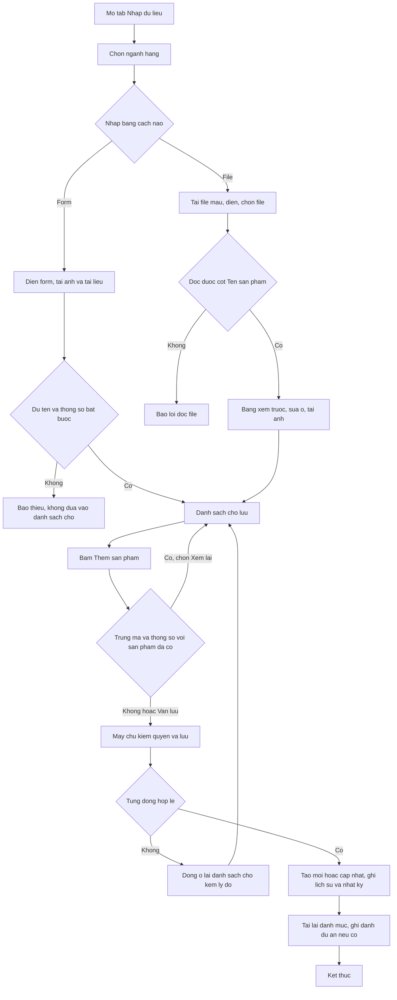

# [QT-05] Nhập sản phẩm vào danh mục

| Mục | Giá trị |
|-----|---------|
| Dự án | QS Pro |
| Phiên bản | 1.0 - 2026-10-07 |
| Người yêu cầu | — |
| Ưu tiên | — (mô tả hiện trạng, chưa xếp ưu tiên) |
| Loại | Mô tả hiện trạng |

## 1. Tóm tắt
Người dùng của một công ty thêm sản phẩm mới vào danh mục sản phẩm của công ty mình, theo ba cách: điền form ở tab **Nhập dữ liệu**, nhập hàng loạt từ file Excel/CSV, hoặc lưu nhanh một dòng đang bóc tách thành sản phẩm. Với form và file, sản phẩm chưa được lưu ngay mà nằm ở **danh sách chờ** trên màn hình; chỉ khi bấm **Thêm sản phẩm** thì mới ghi vào danh mục. Sản phẩm thuộc một trong ba ngành: Thiết bị đèn (mặc định), Thiết bị vệ sinh, Sơn nước.

## 2. Tác nhân & quyền
| Tác nhân | Vai trò hệ thống | Được làm gì trong quy trình |
|----------|-----------------|-----------------------------|
| Nhân viên | `staff` | Điền form, đọc file, tải ảnh / tài liệu, đưa vào danh sách chờ, lưu vào danh mục, lưu dòng bóc tách thành sản phẩm. Máy chủ có kiểm "quyền sửa sản phẩm" khi lưu, nhưng theo mã hiện tại mọi nhân viên đã đăng nhập đều qua được bước kiểm này (⚠ xem Q-01) |
| Admin công ty | `admin` | Như nhân viên, luôn có quyền |
| Quản trị hệ thống | `super` | Như admin. Khi không "xem như" một công ty thì sản phẩm tạo ra không gắn công ty nào (⚠ xem Q-12) |
| Người chưa đăng nhập | — | Không lưu được gì. Vẫn tải được hai file mẫu Thiết bị vệ sinh và Sơn nước (⚠ xem Q-06) |

## 3. Điều kiện trước
- Đã đăng nhập, tài khoản đang mở, công ty còn hoạt động và chưa hết hạn.
- Tài khoản nhìn thấy tab **Nhập dữ liệu** (tab bị ẩn nếu công ty không có tính năng này hoặc tài khoản không được cấp).
- Để lưu dòng bóc tách thành sản phẩm: đang mở một dự án ở tab **Bóc tách** và có ít nhất một dòng.
- Để ghi danh sản phẩm vào dự án ngay khi lưu: đã có dự án trong danh sách dự án.

## 4. Luồng chính
| Bước | Ai | Hành động | Hệ thống xử lý | Kết quả người dùng thấy | Đã có / Mới |
|------|----|-----------|----------------|--------------------------|-------------|
| 1 | Nhân viên | Mở tab **Nhập dữ liệu** | Dựng form theo ngành đang chọn (mặc định Thiết bị đèn) và khung bên phải "Sản phẩm vừa nhập (phiên này)" | Form nhập, ô chọn **Ngành hàng** kèm số sản phẩm của ngành, ba ô đếm (SKU đã nhập, Brand, nhà cung cấp) tính theo phiên đang mở | Đã có |
| 2 | Nhân viên | Bấm ô **Ngành hàng**, chọn Thiết bị đèn / Thiết bị vệ sinh / Sơn nước | Vẽ lại form theo bộ trường của ngành. Nếu đang sửa một dòng chờ của ngành khác thì chế độ sửa bị huỷ | Form đổi theo ngành. (Mục "Xây dựng · công tác phần thô" trong cùng ô chọn thuộc quy trình khác) | Đã có |
| 3 | Nhân viên | (Vệ sinh / Sơn nước) Chọn **Hạng mục** | Chỉ hiện các thông số của hạng mục đó, đánh dấu * thông số bắt buộc, đổi danh sách gợi ý | Hai khối thông số hiện đúng bộ ô; chưa chọn hạng mục thì hiện dòng nhắc "Chọn Hạng mục…" | Đã có |
| 4 | Nhân viên | Thêm ảnh: bấm chọn, kéo-thả, dán bằng Ctrl+V, hoặc dán link ảnh | Thu nhỏ và nén ảnh trên máy người dùng rồi tải lên kho ảnh; lỗi mạng thì tự thử lại tối đa 4 lần nữa. Hình đại diện chỉ nhận 1 ảnh | Ảnh xem trước hiện ngay, báo "Đang tải ảnh lên…" rồi "Đã tải ảnh lên" | Đã có |
| 5 | Nhân viên | Điền các ô thông tin; ở khối **Tài liệu** bấm "Tải file" hoặc dán link | File tài liệu được tải lên kho (mỗi file tối đa 50MB, đúng định dạng cho phép); link được thêm vào danh sách của ô | Danh sách file / link dưới mỗi ô tài liệu; giá đại lý tự tính khi gõ giá bán lẻ và % chiết khấu | Đã có |
| 6 | Nhân viên | (Tuỳ chọn) Chọn sản phẩm đi kèm; nhập biến thể (nhiều giá trị cách nhau dấu phẩy); tick "Thêm sản phẩm này vào dự án đã chọn" | Tính số tổ hợp biến thể và hiện phép nhân; với vệ sinh, ô tìm sản phẩm đi kèm gợi ý theo hạng mục | Dòng ghi chú "… = N sản phẩm" kèm vài nhãn biến thể | Đã có |
| 7 | Nhân viên | Bấm **Đưa vào danh sách chờ** | Kiểm có Tên sản phẩm; với vệ sinh / sơn nước kiểm đã chọn hạng mục và đủ thông số bắt buộc. Đợi ảnh tải xong. Tạo 1 dòng chờ cho mỗi tổ hợp biến thể. **Chưa ghi vào danh mục** | Thẻ "Chờ lưu" xuất hiện ở khung bên phải; form được xoá trắng | Đã có |
| 8 | Nhân viên | (Nhập từ file) Bấm **Tải file mẫu** của ngành đang chọn | Đèn: tải file mẫu có sẵn. Vệ sinh: máy chủ tạo file mẫu ngay lúc tải. Sơn nước: phải chọn hạng mục trước, file mẫu chỉ có cột của hạng mục đó | File Excel mẫu gồm sheet "San pham" (có dòng ví dụ) và sheet "Hướng dẫn" | Đã có |
| 9 | Nhân viên | Chọn file `.xlsx` / `.xls` / `.csv` đã điền | Máy chủ đọc file, tự dò dòng tiêu đề trong 15 dòng đầu và dò cột theo tên. Nếu đang ở ngành đèn mà từ một nửa số dòng trở lên có hạng mục của vệ sinh (hoặc sơn nước) thì tự chuyển ngành | Bảng xem trước "Đọc được N sản phẩm · M cột từ file"; nếu tự chuyển ngành có thông báo | Đã có |
| 10 | Nhân viên | Sửa trực tiếp các ô trong bảng xem trước; bấm ô ảnh để tải ảnh chính / ảnh chi tiết cho từng dòng | Với vệ sinh / sơn nước: ô thiếu thông số bắt buộc viền đỏ, cột không áp dụng cho hạng mục hiện "—", có dòng tổng kết số dòng lỗi. Ảnh trong file không được dùng | Bộ đếm "x/N đã có ảnh"; dòng lỗi có dấu "!" | Đã có |
| 11 | Nhân viên | Bấm **Đưa N sản phẩm vào danh sách chờ** | Nếu còn dòng chưa có ảnh thì hỏi lại. Đưa cả lô vào danh sách chờ, xoá bảng xem trước. **Chưa ghi vào danh mục** | Các thẻ "Chờ lưu" ở khung bên phải | Đã có |
| 12 | Nhân viên | (Tuỳ chọn) Bấm ✎ trên một thẻ chờ để sửa, hoặc 🗑 để bỏ | Sửa: nạp lại dòng đó vào form đúng ngành; bấm "Cập nhật vào danh sách chờ" thì thay đúng dòng. Bỏ: hỏi xác nhận rồi xoá khỏi danh sách chờ | Thẻ mang nhãn "Đang sửa"; hoặc thẻ biến mất | Đã có |
| 13 | Nhân viên | Bấm **Thêm sản phẩm (N)** | So các dòng chờ với danh mục đang có trên màn hình; nếu có dòng trùng mã và trùng thông số phân biệt thì hỏi "Vẫn lưu (cập nhật đè)" hay "Xem lại" | Nút đổi thành "Đang lưu x/N…" | Đã có |
| 14 | Hệ thống | — | Lưu từng dòng nhập từ form: kiểm quyền; nếu trùng mã và trùng mọi thông số phân biệt thì cập nhật sản phẩm cũ, ngược lại tạo mới và ghi người tạo; ghi lịch sử sản phẩm và nhật ký. Sau đó lưu danh sách sản phẩm đi kèm (nếu có) | — | Đã có |
| 15 | Hệ thống | — | Lưu cả lô nhập từ file trong một lần: kiểm quyền; từng dòng được tự nhận ngành theo hạng mục, chuẩn hoá tên hạng mục, bỏ các cột không thuộc hạng mục, kiểm thông số bắt buộc; dòng lỗi bị bỏ qua và trả về lý do. Ghi một dòng nhật ký cho cả lô | — | Đã có |
| 16 | Hệ thống | — | Tải lại danh mục; ghi danh vào dự án cho các dòng đã tick; bỏ các dòng đã lưu khỏi danh sách chờ, giữ lại dòng lỗi | "Đã lưu N sản phẩm vào Database" (kèm "ghi danh M vào dự án"). Nếu có lỗi: hộp "N sản phẩm chưa lưu được" liệt kê tên và lý do; dòng lỗi mang nhãn "Lỗi — sửa lại" | Đã có |
| 17 | Nhân viên | (Lưu dòng bóc tách) Ở tab **Bóc tách**, trong ô chọn sản phẩm của một dòng bấm "＋ Tạo sản phẩm mới", điền form nhỏ, bấm **Lưu vào danh mục** | Kiểm có Tên và Nhóm; máy chủ kiểm quyền rồi lưu như một sản phẩm thường (trùng mã thì cập nhật); điền thông tin vừa lưu ngược vào dòng bóc tách | "Đã lưu "…" vào danh mục và điền vào dòng" | Đã có |

## 5. Sơ đồ

## 6. Luồng phụ & lỗi
| Mã | Tình huống | Hệ thống phản hồi | Thông báo cho người dùng |
|----|-----------|-------------------|--------------------------|
| E1 | Chưa đăng nhập / phiên hết hạn khi gọi bất kỳ thao tác lưu, đọc file, tải ảnh | Từ chối, mã 401 | "Chưa đăng nhập" |
| E2 | Không có quyền thêm sản phẩm (form) | Từ chối khi lưu | "Tài khoản không có quyền thêm/sửa sản phẩm" ⚠ theo mã hiện tại không tài khoản đã đăng nhập nào rơi vào trường hợp này (Q-01) |
| E3 | Không có quyền nhập hàng loạt | Từ chối cả lô; mọi dòng file ở lại danh sách chờ với cùng lý do | "Tài khoản không có quyền nhập sản phẩm" ⚠ (Q-01) |
| E4 | Không có quyền lưu dòng bóc tách thành sản phẩm | Từ chối | "Lỗi: Tài khoản không có quyền thêm sản phẩm vào danh mục" ⚠ (Q-01) |
| E5 | Thiếu tên sản phẩm | Màn hình chặn trước; máy chủ cũng chặn | Màn hình: "Nhập Tên sản phẩm". Máy chủ: "Chưa có Tên sản phẩm." |
| E6 | Vệ sinh / sơn nước chưa chọn hạng mục (form) | Không đưa vào danh sách chờ | "Chọn Hạng mục thiết bị vệ sinh" / "Chọn Hạng mục sơn nước" |
| E7 | Vệ sinh / sơn nước thiếu thông số bắt buộc (form) | Không đưa vào danh sách chờ | "<Hạng mục> cần nhập: <danh sách thông số>" |
| E8 | File: hạng mục không thuộc danh sách của ngành | Máy chủ bỏ dòng đó, các dòng khác vẫn lưu | "Hạng mục "…" không thuộc danh sách: <các hạng mục hợp lệ>" |
| E9 | File: thiếu thông số bắt buộc theo hạng mục | Máy chủ bỏ dòng đó | "<Hạng mục> thiếu: <danh sách thông số>" |
| E10 | File không có sheet | Từ chối đọc | "Lỗi đọc file: File không có sheet dữ liệu" |
| E11 | File không có cột tên sản phẩm trong 15 dòng đầu | Từ chối đọc | "Lỗi đọc file: Không tìm thấy cột "Tên sản phẩm" trong file (cần 1 cột tiêu đề có chữ Tên / Name)" |
| E12 | File có tiêu đề nhưng không có dòng dữ liệu | Không hiện bảng xem trước | "Không đọc được sản phẩm nào (kiểm tra cột Tên sản phẩm)." |
| E13 | Trùng (đã tồn tại): cùng mã và cùng mọi thông số phân biệt (nhiệt độ màu, công suất, góc chiếu, màu sắc; thêm kích thước với vệ sinh / sơn nước hoặc khi có nhập kích thước) | Không báo lỗi: máy chủ **cập nhật đè** sản phẩm cũ. Màn hình hỏi trước khi lưu | Hộp "N sản phẩm đã có sẵn" với hai nút "Vẫn lưu (cập nhật đè)" / "Xem lại" |
| E14 | Ảnh không đọc được (ví dụ ảnh .HEIC của iPhone) | Bỏ ảnh đó | "Không đọc được ảnh — có thể ảnh iPhone (.HEIC). Hãy đổi sang JPG/PNG hoặc dán URL ảnh." |
| E15 | Tải ảnh lỗi sau khi đã thử lại | Gỡ ảnh xem trước | "Tải ảnh lỗi: mất kết nối, thử lại — hoặc dán URL ảnh." (hoặc kèm lý do máy chủ, ví dụ "Ảnh rỗng.") |
| E16 | File tài liệu quá 50MB | Không tải | Màn hình: ""<tên file>" nặng x MB — quá giới hạn 50MB, hãy dán link". Máy chủ: "File x MB quá lớn (tối đa 50MB) — hãy dán link thay vì tải lên." |
| E17 | File tài liệu sai định dạng | Từ chối | "Định dạng .<đuôi> chưa hỗ trợ (PDF, ảnh, DWG/DXF, SKP, ZIP/RAR, Word, Excel)." |
| E18 | File tài liệu rỗng / kho file từ chối | Từ chối | "File rỗng." / "Kho file từ chối: file x MB vượt giới hạn — hãy dán link thay vì tải lên." |
| E19 | Cơ sở dữ liệu thiếu cột của tính năng mới | Từ chối lưu dòng đó | "Cơ sở dữ liệu chưa có cột "…". Vào Supabase → SQL Editor chạy file db/….sql rồi thử lại." |
| E20 | Tick ghi danh dự án nhưng chưa chọn dự án | Không đưa vào danh sách chờ | "Đã tick "Thêm vào dự án" nhưng chưa chọn dự án — chọn dự án ở ô bên cạnh" |
| E21 | Lưu sản phẩm được nhưng lưu sản phẩm đi kèm lỗi | Sản phẩm vẫn được tạo | "Lưu "…" OK nhưng combo lỗi: <lý do>" |
| E22 | Lưu sản phẩm được nhưng ghi danh dự án lỗi | Sản phẩm vẫn được tạo | "Lưu "…" OK nhưng ghi danh dự án lỗi: <lý do>" |
| E23 | Còn dòng chờ mà đóng / tải lại trang | Trình duyệt hỏi lại | "Còn dữ liệu chưa lưu vào Database" |
| E24 | Bấm Thêm sản phẩm khi đang sửa dở một dòng chờ | Hỏi xác nhận | "Bạn đang sửa 1 sản phẩm trong form nhưng chưa bấm "Cập nhật". Lưu luôn bản CŨ của sản phẩm đó?" |
| E25 | Lưu dòng bóc tách: thiếu Tên hoặc Nhóm | Không gửi | "Chưa có Tên sản phẩm" / "Chọn/nhập Nhóm — nhóm để lọc trong danh mục" |

## 8. Quy tắc nghiệp vụ
| Mã | Quy tắc |
|----|---------|
| BR-01 | Form và file chỉ đưa sản phẩm vào danh sách chờ. Danh sách chờ chỉ nằm trên trình duyệt đang mở: tải lại trang là mất. |
| BR-02 | Sản phẩm trùng = cùng mã sản phẩm **và** cùng nhiệt độ màu, công suất, góc chiếu, màu sắc (ô trống coi như bằng nhau). Với vệ sinh / sơn nước, hoặc khi có nhập kích thước, kích thước cũng là một trục. Trùng thì cập nhật sản phẩm cũ; khác bất kỳ trục nào thì là sản phẩm riêng (biến thể cùng mã). |
| BR-03 | Sản phẩm không có mã luôn được tạo mới, không kiểm trùng. |
| BR-04 | Khi cập nhật đè qua nhập liệu, ô để trống không xoá giá trị cũ; chỉ ô có nhập mới được ghi. |
| BR-05 | Ngành được tự nhận theo hạng mục: tên hạng mục thuộc danh sách sơn nước → sơn nước; thuộc danh sách vệ sinh → vệ sinh; còn lại → đèn. So khớp không phân biệt dấu, hoa thường, khoảng trắng thừa. |
| BR-06 | Vệ sinh / sơn nước: chỉ giữ các trường chung và thông số của đúng hạng mục; cột của hạng mục khác bị bỏ. Thiếu thông số bắt buộc của hạng mục thì dòng không được lưu. |
| BR-07 | Thiết bị đèn: máy chủ chỉ bắt buộc Tên sản phẩm. |
| BR-08 | Dòng có tên bắt đầu bằng "[VÍ DỤ]" không bao giờ được lưu. |
| BR-09 | File đèn chỉ đọc sheet đầu tiên. File vệ sinh / sơn nước đọc mọi sheet trừ sheet "Hướng dẫn"; ô hạng mục trống thì lấy theo tên sheet. Tối đa 2000 dòng mỗi lần đọc. |
| BR-10 | Ảnh không lấy từ file: người dùng tự tải ảnh cho từng dòng ở bảng xem trước. |
| BR-11 | Mặc định khi để trống: đơn vị tính "Cái" (form sơn nước: "Thùng"), trạng thái "Đang kinh doanh". |
| BR-12 | Giá đại lý không nhập được: hệ thống tự tính = giá bán lẻ × (1 − % chiết khấu). |
| BR-13 | Hình đại diện chỉ 1 ảnh; ảnh chi tiết nhiều ảnh. Ảnh đầu tiên trong danh sách là hình đại diện. |
| BR-14 | Sản phẩm mới chưa ở trạng thái "Đã duyệt" (xem QT-06). |
| BR-15 | Sản phẩm chỉ thuộc công ty của người lưu; công ty khác không thấy (trừ kho chung Dezon, xem QT-08). |

## 9. Thông báo, realtime & nhật ký
Hệ thống không có realtime. Quy trình này không gửi thông báo trong ứng dụng và không gửi tin Lark.

| Sự kiện | Ai nhận | Kênh | Nội dung | Ghi audit? |
|---------|---------|------|----------|:----------:|
| Tạo sản phẩm mới từ form | Không ai | — | Lịch sử sản phẩm: "TẠO SẢN PHẨM" | Có — `them_sp` "Thêm SP mới <mã> (<tên>)" |
| Cập nhật đè sản phẩm cũ từ form | Không ai | — | Lịch sử sản phẩm: "CẬP NHẬT (nhập liệu)" (không ghi từng trường) | Có — `cap_nhat_sp` |
| Nhập hàng loạt từ file | Không ai | — | Mỗi sản phẩm một dòng lịch sử như trên | Có — một dòng `nhap_sp` cho cả lô: "Nhập hàng loạt: thêm X, cập nhật Y sản phẩm (Z lỗi)" |
| Lưu sản phẩm đi kèm lúc nhập | Không ai | — | Lịch sử sản phẩm: "SẢN PHẨM ĐI KÈM" | Có — `sua_combo` |
| Lưu dòng bóc tách thành sản phẩm | Không ai | — | Như tạo / cập nhật từ form | Có — `them_sp` hoặc `cap_nhat_sp` |
| Đọc file để xem trước | Không ai | — | — | Không |
| Tải ảnh / tài liệu lên kho | Không ai | — | — | Không |
| Tải file mẫu | Không ai | — | — | Không |

## 10. Dữ liệu
| Thông tin | Bắt buộc | Ràng buộc | Ví dụ |
|-----------|----------|-----------|-------|
| Tên sản phẩm | Có | Không rỗng | Bồn cầu một khối nắp đóng êm |
| Mã sản phẩm | Không (form có dấu * nhưng không bị chặn) | Cùng các thông số phân biệt tạo thành khoá chống trùng | MS885DT8 |
| Ngành hàng | Tự gán | `den` / `vs` / `son` | vs |
| Hạng mục | Có với vệ sinh / sơn nước | Phải thuộc danh sách của ngành | Bồn cầu |
| Thông số theo hạng mục | Theo từng hạng mục | Ví dụ Bồn cầu bắt buộc: Màu sắc, Kiểu lắp đặt, Kích thước, Lượng nước xả | Trắng · Một khối · L710 x W400 x H700 (mm) · 4.8/3L |
| Thương hiệu, Nhà cung cấp, Dòng sản phẩm, Nhóm sản phẩm | Không | Chữ | TOTO |
| Giá bán lẻ, % chiết khấu đại lý | Không | Số | 12500000 · 30 |
| Thông số đèn (công suất, nhiệt độ màu, góc chiếu, lỗ khoét…) | Không | Chữ, cho phép nhiều giá trị ("3000, 4000", "2×5") | 7 · 3000 · 24 |
| Quang thông, chiều cao, đường kính, hiệu suất, dòng ra, bảo hành, giá bộ nguồn | Không | Số | 650 |
| Đơn vị tính | Không | Mặc định "Cái" | Bộ |
| Trạng thái kinh doanh | Không | Mặc định "Đang kinh doanh" | Đặt hàng |
| Ảnh sản phẩm | Không (nhãn trên form ghi "bắt buộc" nhưng không bị chặn) | Nhiều ảnh, mỗi dòng một đường dẫn; ảnh đầu là đại diện | https://…/sp/1700000000-123.jpg |
| Tài liệu (catalogue, thông số kỹ thuật, hướng dẫn, bản vẽ) | Không | File ≤ 50MB, đuôi pdf, png, jpg, webp, gif, dwg, dxf, skp, zip, rar, 7z, doc(x), xls(x), ppt(x); hoặc link | https://…/docs/1700000000-catalogue.pdf |
| Người tạo, ngày tạo | Tự ghi | Tên đăng nhập của người lưu | nguyenvana |
| Sản phẩm đi kèm | Không | Danh sách sản phẩm + số lượng ≥ 1 | Nắp rửa điện tử ×1 |

## 11. Màn hình liên quan
- Tab **Nhập dữ liệu** (`import`): ô Ngành hàng, form theo ngành, khối Ảnh sản phẩm, Sản phẩm đi kèm (combo), Nhập biến thể, Ghi danh vào dự án, Nhập hàng loạt từ file (bảng xem trước), khung "Sản phẩm vừa nhập (phiên này)" gồm phần "Chờ lưu" và phần "Đã lưu vào Database".
- Tab **Bóc tách** (`boc`): ô chọn sản phẩm của dòng → "＋ Tạo sản phẩm mới" → hộp "Tạo sản phẩm mới vào danh mục".
- Tab **Danh sách sản phẩm** (`sanpham`): nơi xem kết quả; nút ✎ ở khung "Sản phẩm vừa nhập" mở cùng hộp Cập nhật sản phẩm của tab này (QT-06).
- File mẫu: `Mau-nhap-hang-loat-DezonQS.xlsx` (đèn), `Mau-nhap-thiet-bi-ve-sinh-DezonQS.xlsx`, `Mau-nhap-<hạng mục>-DezonQS.xlsx` (sơn nước).

## 12. Tiêu chí nghiệm thu
- **AC-01**: Cho nhân viên đang ở ngành Thiết bị đèn / Khi nhập Tên sản phẩm rồi bấm "Đưa vào danh sách chờ" / Thì xuất hiện một thẻ "Chờ lưu" và danh mục chưa có sản phẩm đó.
- **AC-02**: Cho một thẻ "Chờ lưu" hợp lệ / Khi bấm "Thêm sản phẩm" / Thì sản phẩm có trong Danh sách sản phẩm, có người tạo, lịch sử có dòng "TẠO SẢN PHẨM", nhật ký có dòng `them_sp`, thẻ chuyển sang phần đã lưu.
- **AC-03**: Cho người chưa đăng nhập (hoặc phiên đã hết hạn) / Khi gọi lưu sản phẩm, nhập hàng loạt hoặc tải ảnh / Thì bị từ chối với "Chưa đăng nhập" và không có gì được ghi.
- **AC-04**: Cho tài khoản mà máy chủ xác định không có quyền sửa sản phẩm / Khi bấm "Thêm sản phẩm" / Thì dòng form bị từ chối với "Tài khoản không có quyền thêm/sửa sản phẩm", lô file bị từ chối với "Tài khoản không có quyền nhập sản phẩm", các dòng ở lại danh sách chờ. (⚠ hiện chưa có tài khoản nào tái hiện được — Q-01.)
- **AC-05**: Cho ngành Thiết bị vệ sinh, hạng mục Bồn cầu / Khi để trống Lượng nước xả và bấm "Đưa vào danh sách chờ" / Thì không tạo thẻ chờ và báo "Bồn cầu cần nhập: Lượng nước xả".
- **AC-06**: Cho file vệ sinh có một dòng hạng mục "Bồn cầu" thiếu Kích thước và một dòng đủ / Khi đưa vào danh sách chờ rồi bấm "Thêm sản phẩm" / Thì dòng đủ được lưu, dòng thiếu ở lại với lý do "Bồn cầu thiếu: Kích thước".
- **AC-07**: Cho danh mục đã có sản phẩm mã A, màu Trắng / Khi lưu một dòng mã A, màu Trắng (các trục khác giống) / Thì có hộp hỏi cập nhật đè; chọn "Vẫn lưu" thì sản phẩm cũ được cập nhật, không sinh sản phẩm thứ hai.
- **AC-08**: Cho danh mục đã có sản phẩm mã A, màu Trắng / Khi lưu một dòng mã A, màu Đen / Thì tạo một sản phẩm riêng cùng mã.
- **AC-09**: Cho file không có cột tên sản phẩm / Khi chọn file / Thì hiện "Lỗi đọc file: Không tìm thấy cột "Tên sản phẩm" trong file (cần 1 cột tiêu đề có chữ Tên / Name)".
- **AC-10**: Cho file mẫu vệ sinh còn nguyên các dòng "[VÍ DỤ]" / Khi nhập ở ngành Thiết bị vệ sinh / Thì các dòng ví dụ không hiện trong bảng xem trước và không được lưu.
- **AC-11**: Cho đang ở ngành Thiết bị đèn / Khi chọn một file mà đa số dòng có hạng mục của sơn nước / Thì ngành tự chuyển sang Sơn nước và có thông báo.
- **AC-12**: Cho file tài liệu 60MB / Khi bấm "Tải file" / Thì file không được tải và có thông báo quá giới hạn 50MB.
- **AC-13**: Cho một dòng ở tab Bóc tách / Khi chọn "＋ Tạo sản phẩm mới", nhập Tên và Nhóm, bấm "Lưu vào danh mục" / Thì sản phẩm có trong danh mục và dòng bóc tách được điền tên, mã, giá vừa nhập.

## 13. Ảnh hưởng tới phần có sẵn
- Danh mục sản phẩm dùng ở tab Bóc tách và Danh sách sản phẩm được tải lại sau khi lưu.
- Ghi danh vào dự án tạo thêm dòng trong dự án được chọn (đề mục theo ngành: đèn 3.2.6.1, vệ sinh 3.2.5, sơn nước 3.2.2), kéo theo tổng tiền dự án.
- Cập nhật đè qua nhập liệu thay đổi sản phẩm đang được dùng làm nguồn tra cứu cho các dự án; trạng thái duyệt của sản phẩm đó không đổi (⚠ Q-04).
- Sản phẩm đi kèm chọn lúc nhập được ghi qua cùng cơ chế với QT-08.
- File tải Excel ở QT-08 dùng cùng bộ tên cột nên nạp lại được qua quy trình này.

## 14. Giả định & câu hỏi mở
| Mã | Nội dung | Cần ai trả lời |
|----|----------|----------------|
| GD-01 | Sản phẩm mới ở trạng thái "chưa duyệt" vì mã không gán trạng thái duyệt khi tạo và cột có mặc định `false` trong file `db/sp_duyet_status.sql`. Chưa kiểm được trên cơ sở dữ liệu đang chạy. | Dev |
| GD-02 | File mẫu đèn `public/mau-nhap-hang-loat.xlsx` là file tĩnh (tạo bằng `scripts/gen-template.js`); nội dung file không được mở ra kiểm trong lần mô tả này. | Dev |
| GD-03 | Ảnh / tài liệu đã tải lên kho nhưng sau đó bỏ khỏi form hoặc xoá dòng chờ thì vẫn nằm lại trong kho (không thấy mã dọn dẹp). | Dev |
| GD-04 | Bước ghi danh vào dự án (thêm dòng vào dự án) thuộc quy trình dự án; ở đây chỉ mô tả điểm gọi. | BA |
| Q-01 | ⚠ Hàm kiểm quyền trả "được sửa" cho mọi nhân viên: không cấu hình gì → được sửa và duyệt; có `sp_edit` → được sửa; có `sp_duyet` → được sửa. Vì vậy các thông báo "Tài khoản không có quyền thêm/sửa sản phẩm", "…không có quyền nhập sản phẩm", "…không có quyền thêm sản phẩm vào danh mục" không bao giờ xảy ra với người đã đăng nhập. Có cần một mức "chỉ xem" không? | Chủ sản phẩm |
| Q-02 | ⚠ Form đèn đánh dấu * ở nhiều ô (Thương hiệu, Nhà cung cấp, Hạng mục, Mã, Giá, Công suất…) và nhãn ảnh ghi "bắt buộc", file mẫu tô xanh sáng các cột "bắt buộc", nhưng cả màn hình lẫn máy chủ chỉ chặn khi thiếu Tên (và thông số bắt buộc theo hạng mục với vệ sinh / sơn nước). Các ô còn lại có thật sự bắt buộc? | Chủ sản phẩm |
| Q-03 | ⚠ Chú thích nút "Tải file" ghi "mỗi file tối đa 20MB" nhưng giới hạn thực là 50MB. Khối ảnh ghi "tối đa 5MB" nhưng không có bước kiểm dung lượng ảnh (ảnh được thu nhỏ trước khi tải). Con số nào đúng? | Chủ sản phẩm |
| Q-04 | ⚠ Cập nhật đè một sản phẩm đã duyệt qua form / file / lưu dòng bóc tách **không** đưa sản phẩm về "chưa duyệt" và lịch sử chỉ ghi một dòng "CẬP NHẬT (nhập liệu)" không nêu trường nào đổi — khác với sửa ở Danh sách sản phẩm (QT-06). Có chủ ý không? | Chủ sản phẩm |
| Q-05 | ⚠ Lưu dòng bóc tách thành sản phẩm: ô "Kích thước" trong hộp nhập không được ghi vào sản phẩm; ngành không được gán (tự đoán theo hạng mục gõ tay); màn hình có nhánh xử lý lỗi "đã có sẵn" nhưng máy chủ không bao giờ trả lỗi đó mà âm thầm cập nhật đè sản phẩm trùng mã. Hành vi mong muốn là gì? | Chủ sản phẩm |
| Q-06 | ⚠ Bước đọc file để xem trước chỉ cần đăng nhập, không kiểm quyền sửa. Hai đường tải file mẫu vệ sinh và sơn nước không kiểm đăng nhập. Tải ảnh / tài liệu lên kho chỉ cần đăng nhập. Có chấp nhận không? | Chủ sản phẩm / Dev |
| Q-07 | ⚠ File quá 2000 dòng bị cắt lặng lẽ ở dòng 2000, không có cảnh báo. Có cần báo cho người dùng? | Chủ sản phẩm |
| Q-08 | ⚠ Sơn nước: form mặc định đơn vị tính "Thùng", còn nhập từ file để trống thì thành "Cái". Có nên thống nhất? | Chủ sản phẩm |
| Q-09 | ⚠ Sau khi tải tài liệu, thông báo luôn ghi "Đã tải lên N file — bấm "Lưu cập nhật" để gắn vào sản phẩm" với N là số file đã chọn, kể cả khi có file lỗi; và ở form Nhập không có nút "Lưu cập nhật". Cần sửa câu chữ? | Chủ sản phẩm |
| Q-10 | ⚠ Sản phẩm không có mã luôn được tạo mới nên nhập lại cùng một file không mã sẽ sinh trùng lặp. Có cần chặn hoặc cảnh báo? | Chủ sản phẩm |
| Q-11 | ⚠ Khi file vệ sinh / sơn nước được chọn lúc đang ở ngành đèn và hệ thống tự chuyển ngành, file đã được đọc theo kiểu đèn: chỉ sheet đầu, các dòng "[VÍ DỤ]" vẫn hiện trong bảng xem trước. Khi lưu, máy chủ bỏ qua các dòng ví dụ (và dòng trống tên) mà không trả lỗi, nên màn hình vẫn tính chúng là "đã lưu" và đưa vào danh sách đã nhập. Có phải lỗi cần sửa? | Dev |
| Q-12 | ⚠ Tài khoản `super` không "xem như" công ty nào thì sản phẩm tạo ra không được gắn công ty. Có nên chặn nhập sản phẩm trong trường hợp này? | Chủ sản phẩm |

## 15. Ghi chú kỹ thuật cho dev
- API (đều `POST /api/<fn>`, body `{args:[…]}`): `saveDbProduct`, `importParse`, `importCommit`, `saveLineAsProduct`, `uploadImage`, `setCombo`, `getProducts` — khai báo ở `server/components/san-pham/san-pham.routes.js:10`, danh sách `actor` ở `:31`. `importParse` không nằm trong `actor` nên không nhận người thao tác.
- Kiểm quyền: `server/components/san-pham/san-pham.service.js:17` (`spPerms_`), các cửa ngõ `createProductGated` `:35`, `importGated` `:41`, `saveLineAsProductGated` `:47`.
- Lưu sản phẩm: `server/components/san-pham/san-pham.repository.js:117` (`saveDbProduct`) — khoá trùng `:137-149`, nhánh cập nhật `:150-158`, nhánh tạo mới `:160-170`; `saveLineAsProduct` `:312`; ghi lịch sử `spHistory_` `:108`.
- Đọc / ghi file: `server/components/san-pham/san-pham.import.js:46` (`importParse`, giới hạn 2000 ở `:101`, lỗi thiếu cột tên `:105`), `:110` (`importCommit`, lọc theo hạng mục `:133-144`, nhật ký `:149`). Bảng tên cột thay thế `IMPORT_ALIAS` `:10`.
- Ánh xạ nhãn ↔ cột và nhận ngành: `server/components/san-pham/san-pham.mapper.js:12` (`nganhCua_`), `:128` (`DB_NUM`), `:131` (`DB_LABEL2COL`).
- Bộ thông số theo hạng mục (nguồn duy nhất, dùng chung trình duyệt và máy chủ): `public/vs-spec.js:54` (`HM`), `:173` (`CHUNG`), `:182` (`chuanHM`); `public/son-spec.js:108` (`HANG_MUC`).
- File mẫu động: `server/components/xuat-file/xuat-file.routes.js:63` (vệ sinh), `:73` (sơn nước, tham số `hm`); dựng file ở `server/components/xuat-file/vs-template.js:40` và `server/components/xuat-file/son-template.js:47`. File mẫu đèn là file tĩnh trong `public/`.
- Tải ảnh / tài liệu: `server/components/tep-tin/tep-tin.service.js:6` (`uploadImage`), `:26` (`uploadFileBuf`, giới hạn `DOC_MAX_MB` `:19`, đuôi cho phép `:18`); route nhị phân `server/components/tep-tin/tep-tin.routes.js:24`.
- Trình duyệt: `public/nhap.js:775` (`renderImport`), `:1296` (`tdSave`), `:1111` (`impPick`, tự nhận ngành `:1121-1127`), `:1226` (`impShow`), `:1246` (`impCommit`), `:497` (`pendingAdd_`), `:554` (`pendingCommit_`), `:576` (`pendingCommitRun_`), `:568` (`impTrungSP_`), `:1082` (`upFile`), `:200` (`upDoc_`), `:228` (`vsApplyHM_`). Lưu dòng bóc tách: `public/boc.js:739` (`openCreateProduct`), `:777` (`submitCreateProduct`).
- Bảng dữ liệu: `db_san_pham`, `db_san_pham_history`, `audit_log`, `sp_combo`; kho file Supabase Storage (thư mục `sp/` cho ảnh, `docs/` cho tài liệu).
- Nhật ký: `server/components/thong-bao/audit.js:21` (`logAudit_`, nuốt lỗi). Không có job nền, không có sự kiện realtime.

## Lịch sử thay đổi
| Phiên bản | Ngày | Thay đổi |
|-----------|------|----------|
| 1.0 | 2026-10-07 | Tạo mới (mô tả hiện trạng từ mã nguồn) |
