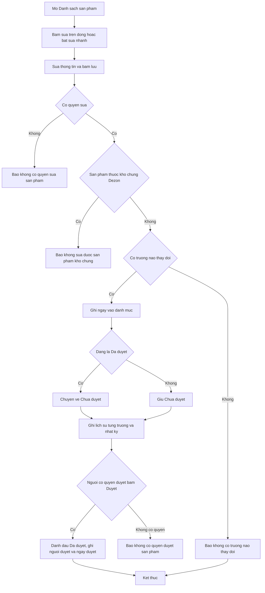
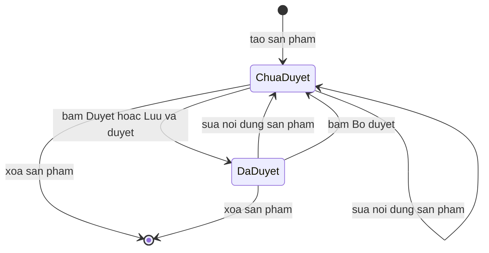

# [QT-06] Sửa và duyệt sản phẩm

| Mục | Giá trị |
|-----|---------|
| Dự án | QS Pro |
| Phiên bản | 1.0 - 2026-10-07 |
| Người yêu cầu | — |
| Ưu tiên | — (mô tả hiện trạng, chưa xếp ưu tiên) |
| Loại | Mô tả hiện trạng |

## 1. Tóm tắt
Người dùng sửa thông tin sản phẩm trong danh mục của công ty mình ở tab **Danh sách sản phẩm**. Mọi thay đổi được ghi ngay vào danh mục, không có bước "gửi chờ duyệt"; nếu sản phẩm đang "Đã duyệt" thì sau khi sửa nó tự quay về "Chưa duyệt". Người có quyền duyệt bấm Duyệt để đánh dấu lại là "Đã duyệt". Mỗi lần sửa và mỗi lần đổi trạng thái duyệt đều được ghi vào lịch sử của sản phẩm.

## 2. Tác nhân & quyền
| Tác nhân | Vai trò hệ thống | Được làm gì trong quy trình |
|----------|-----------------|-----------------------------|
| Nhân viên chưa cấu hình quyền sản phẩm | `staff`, `users.perms` không có `sp_edit` lẫn `sp_duyet` | Sửa và duyệt (hệ thống giữ như trước để không khoá tài khoản đang dùng) |
| Nhân viên chỉ được sửa | `staff` có `sp_edit` | Sửa. Không duyệt / bỏ duyệt được |
| Nhân viên được sửa và duyệt | `staff` có `sp_duyet` | Sửa, duyệt, bỏ duyệt |
| Admin công ty | `admin` | Sửa, duyệt, bỏ duyệt |
| Quản trị hệ thống | `super` | Sửa, duyệt, bỏ duyệt; khi không "xem như" một công ty thì không bị chặn bởi quy tắc kho chung |
| Mọi tài khoản đã đăng nhập | bất kỳ | Xem sản phẩm và xem lịch sử thay đổi của sản phẩm trong công ty mình |

## 3. Điều kiện trước
- Đã đăng nhập; tài khoản nhìn thấy tab **Danh sách sản phẩm**.
- Sản phẩm thuộc công ty của người thao tác. Sản phẩm thuộc kho chung Dezon chỉ xem được (xem QT-08).
- Để mở hộp **Cập nhật sản phẩm**: sản phẩm phải có mã.

## 4. Luồng chính
| Bước | Ai | Hành động | Hệ thống xử lý | Kết quả người dùng thấy | Đã có / Mới |
|------|----|-----------|----------------|--------------------------|-------------|
| 1 | Người dùng | Mở tab **Danh sách sản phẩm** | Tải danh mục và hỏi máy chủ quyền sửa / duyệt của tài khoản | Bốn khung nhìn kèm số đếm: Tất cả, Chưa duyệt, Đã duyệt, ♥ Yêu thích. Tài khoản không có quyền duyệt thấy thêm dòng "Bạn chỉ được sửa — sản phẩm sửa xong sẽ chờ người có quyền duyệt" | Đã có |
| 2 | Người dùng | Bấm ✎ trên dòng sản phẩm | Tải cùng lúc: dữ liệu gốc của đúng sản phẩm đó, lịch sử thay đổi theo mã sản phẩm, danh sách sản phẩm đi kèm, nhóm biến thể | Hộp **Cập nhật sản phẩm**: bên trái là ảnh và các nhóm trường như form Nhập; bên phải là "Tạo bởi", "Sửa cuối bởi", "Duyệt bởi" (hoặc "Chưa duyệt") và danh sách "Lịch sử cập nhật" (trường – giá trị cũ → giá trị mới – ai – lúc nào) | Đã có |
| 3 | Người dùng | Sửa các ô, ảnh, tài liệu, sản phẩm liên quan | Ô Mã sản phẩm bị khoá. Với vệ sinh / sơn nước: đổi hạng mục thì chỉ hiện thông số của hạng mục mới | Giá đại lý tự tính lại khi đổi giá bán lẻ / % chiết khấu | Đã có |
| 4 | Người dùng | Bấm **Lưu cập nhật** | Máy chủ kiểm quyền sửa; chặn nếu sản phẩm thuộc kho chung; so từng trường với dữ liệu đang có để lấy danh sách trường thật sự đổi | — | Đã có |
| 5 | Hệ thống | — | Nếu có trường đổi: ghi ngay vào sản phẩm, ghi người sửa và thời điểm. Nếu sản phẩm đang "Đã duyệt": chuyển về "Chưa duyệt", xoá người duyệt và ngày duyệt. Ghi mỗi trường đổi thành một dòng lịch sử (kèm dòng "TRẠNG THÁI DUYỆT: Đã duyệt → Chưa duyệt (do sửa lại)") và một dòng nhật ký | — | Đã có |
| 6 | Hệ thống | — | Ghi lại danh sách sản phẩm đi kèm, rồi ghi lại nhóm biến thể của sản phẩm (xem QT-08) | "Đã cập nhật N trường — sản phẩm chuyển về Chưa duyệt" (nếu trước đó đã duyệt), hoặc "Đã cập nhật N trường", hoặc "Không có trường nào thay đổi". Hộp đóng, bảng và số đếm khung nhìn được làm mới | Đã có |
| 7 | Người có quyền duyệt | Bấm ✓ trên dòng sản phẩm đang "Chưa duyệt" | Máy chủ kiểm quyền duyệt. Dòng đại diện cho cả nhóm biến thể nên mọi biến thể trong nhóm (không tính sản phẩm kho chung) được duyệt cùng lúc: đánh dấu đã duyệt, ghi người duyệt và ngày duyệt, ghi lịch sử và nhật ký | "Đã duyệt "<tên>"" (kèm "· N biến thể" nếu là nhóm) | Đã có |
| 8 | Người có quyền duyệt | (Thay thế bước 4 và 7) Trong hộp Cập nhật bấm **Lưu & duyệt** | Lưu như bước 4–6 rồi duyệt ngay sản phẩm đang mở, kể cả khi không có trường nào đổi | "Đã cập nhật N trường và duyệt" hoặc "Đã duyệt sản phẩm" | Đã có |
| 9 | Người có quyền duyệt | Bấm ✓ trên dòng đang "Đã duyệt" | Bỏ duyệt cả nhóm biến thể: về "Chưa duyệt", xoá người duyệt và ngày duyệt, ghi lịch sử và nhật ký | "Đã bỏ duyệt "<tên>"" | Đã có |
| 10 | Người dùng | Bấm nút **Edit** trên thanh công cụ để bật sửa nhanh, gõ vào ô trên bảng, rời ô | Mỗi lần rời ô có thay đổi là một lần lưu như bước 4–5 cho đúng một trường của đúng một sản phẩm | Ô nháy xanh khi lưu được, đỏ khi lỗi. Sản phẩm đang "Đã duyệt" chuyển về "Chưa duyệt", số đếm khung nhìn đổi | Đã có |
| 11 | Người dùng | Bấm nút hoàn tác hoặc Ctrl+Z (khi không đang gõ trong ô) | Gửi lại giá trị cũ của thao tác sửa gần nhất như một lần sửa mới (tối đa 50 bước, một bước có thể gồm nhiều ô) | "↶ Đã hoàn tác: <mô tả thao tác>" | Đã có |
| 12 | Người dùng | Tick nhiều dòng, bấm **Sửa hàng loạt**, chọn trường, nhập giá trị, bấm **Áp dụng**, xác nhận | Lần lượt sửa trường đó cho từng sản phẩm đã chọn (dòng đại diện nhóm biến thể = cả nhóm); bỏ qua sản phẩm kho chung. Mỗi sản phẩm là một lần sửa như bước 4–5 | "Đã đặt <trường> = "<giá trị>" cho N sản phẩm"; có lỗi thì "Cập nhật x/N — lỗi: …" | Đã có |
| 13 | Người có quyền duyệt | Tick nhiều dòng, bấm **Duyệt** (hoặc ⋯ → **Bỏ duyệt**) | Đổi trạng thái cho mọi sản phẩm đã chọn (kể cả các biến thể trong nhóm); sản phẩm đã ở đúng trạng thái được tính là xong; ghi một dòng nhật ký cho cả lượt | "Đã duyệt N sản phẩm"; nếu có sản phẩm không đổi được thì hiện hộp liệt kê từng sản phẩm và lý do | Đã có |
| 14 | Người dùng | Chọn khung nhìn **Chưa duyệt** / **Đã duyệt** | Lọc danh sách theo trạng thái duyệt, trong phạm vi hạng mục đang lọc | Danh sách chỉ còn sản phẩm đúng trạng thái | Đã có |

## 5. Sơ đồ

## 6. Luồng phụ & lỗi
| Mã | Tình huống | Hệ thống phản hồi | Thông báo cho người dùng |
|----|-----------|-------------------|--------------------------|
| E1 | Chưa đăng nhập / phiên hết hạn | Từ chối, mã 401 | "Chưa đăng nhập" |
| E2 | Không có quyền sửa | Từ chối, không ghi gì | "Tài khoản không có quyền sửa sản phẩm" ⚠ theo mã hiện tại không tài khoản đã đăng nhập nào rơi vào trường hợp này (Q-02) |
| E3 | Không có quyền duyệt (nhân viên chỉ có `sp_edit`) bấm duyệt / bỏ duyệt | Từ chối, không đổi trạng thái | "Tài khoản không có quyền duyệt sản phẩm" (nút duyệt cũng bị ẩn trên màn hình) |
| E4 | Không tìm thấy sản phẩm khi lưu | Từ chối | "Không tìm thấy sản phẩm." |
| E5 | Không tìm thấy sản phẩm khi duyệt | Bỏ qua sản phẩm đó, ghi vào danh sách lỗi của lượt duyệt | Hộp "Không đổi được trạng thái duyệt" với lý do "Không tìm thấy sản phẩm" |
| E6 | Thiếu mã / mã định danh sản phẩm trong yêu cầu | Từ chối | "Thiếu mã/ID sản phẩm." |
| E7 | Sản phẩm thuộc kho chung Dezon | Từ chối sửa và duyệt | "Sản phẩm thuộc kho chung của Dezon — không sửa/xoá được. Hãy tạo bản sao riêng cho công ty bạn." Trên màn hình: "Sản phẩm kho chung Dezon — không đổi được trạng thái duyệt"; sửa hàng loạt: "Các sản phẩm đã chọn đều thuộc kho chung của Dezon — không sửa được" |
| E8 | Dữ liệu gửi lên không khác dữ liệu đang có | Không ghi, không đổi trạng thái duyệt, không ghi lịch sử | Hộp Cập nhật: "Không có trường nào thay đổi". Sửa nhanh: ô báo đỏ, trả giá trị cũ, "Máy chủ báo không có gì thay đổi nên chưa lưu. Tải lại trang (Ctrl/⌘+Shift+R) rồi thử lại — nếu vẫn vậy, báo lại để kiểm tra bản ghi." |
| E9 | Cơ sở dữ liệu thiếu cột (ví dụ cột trạng thái duyệt) | Từ chối | "Cơ sở dữ liệu chưa có cột "…". Vào Supabase → SQL Editor chạy file db/….sql rồi thử lại." |
| E10 | Sản phẩm chưa có mã, bấm ✎ | Không mở hộp | "Sản phẩm chưa có mã — không cập nhật được" |
| E11 | Không tải được dữ liệu gốc khi mở hộp (ví dụ sản phẩm vừa bị xoá) | Hộp mở nhưng không có form | "Không tải được dữ liệu sản phẩm." |
| E12 | Lưu sản phẩm xong nhưng lưu sản phẩm đi kèm / nhóm biến thể lỗi | Phần thông tin sản phẩm vẫn đã lưu | "Lưu sản phẩm đi kèm lỗi: <lý do>" / "Lưu nhóm biến thể lỗi: <lý do>" |
| E13 | "Lưu & duyệt": lưu được nhưng bước duyệt lỗi | Thay đổi vẫn đã lưu, sản phẩm ở "Chưa duyệt" | Hộp "Chưa duyệt được sản phẩm": "Đã lưu N trường nhưng bước duyệt lỗi: <lý do>" |
| E14 | Duyệt một sản phẩm đã ở đúng trạng thái | Không đổi gì, được tính là xong | Duyệt hàng loạt: "Đã duyệt 0 sản phẩm (các sản phẩm chọn đã ở đúng trạng thái)" |
| E15 | Đóng hộp Cập nhật khi còn thay đổi chưa lưu | Hỏi xác nhận | "Thoát mà chưa lưu?" — "Có thay đổi chưa lưu (kể cả ảnh / file vừa tải lên). Thoát bây giờ là mất những thay đổi đó." |
| E16 | Hoàn tác thất bại | Bước hoàn tác được giữ lại trong danh sách | "Không hoàn tác được: <lý do>" hoặc "Hoàn tác x/N — lỗi: <lý do>" |
| E17 | Sửa nhanh lỗi (mạng, quyền, kho chung…) | Ô báo đỏ | "Lỗi lưu: <lý do>" |

## 7. Trạng thái

| Từ | Sang | Khi nào | Ai được làm |
|----|------|---------|-------------|
| (mới tạo) | Chưa duyệt | Tạo sản phẩm (QT-05) | Người có quyền sửa |
| Chưa duyệt | Đã duyệt | Bấm ✓ trên dòng, "Duyệt" hàng loạt, hoặc "Lưu & duyệt" | `admin`, `super`, `staff` có `sp_duyet`, `staff` chưa cấu hình quyền sản phẩm |
| Đã duyệt | Chưa duyệt | Sửa bất kỳ trường nào qua hộp Cập nhật, sửa nhanh, sửa hàng loạt, hoàn tác | Người có quyền sửa (kể cả admin và người có quyền duyệt) |
| Đã duyệt | Chưa duyệt | Bấm ✓ trên dòng đã duyệt, hoặc ⋯ → "Bỏ duyệt" | Người có quyền duyệt |
| Đã duyệt | Đã duyệt | Chỉ đổi sản phẩm đi kèm, nhóm biến thể hoặc dấu yêu thích; hoặc cập nhật đè qua Nhập dữ liệu (⚠ Q-05) | — |

## 8. Quy tắc nghiệp vụ
| Mã | Quy tắc |
|----|---------|
| BR-01 | Không có phiếu chờ duyệt. Thay đổi được ghi ngay vào danh mục; trạng thái duyệt là một dấu trên chính sản phẩm. |
| BR-02 | Sửa nội dung một sản phẩm đang "Đã duyệt" luôn đưa nó về "Chưa duyệt", bất kể người sửa là ai. |
| BR-03 | Chỉ những trường thật sự khác giá trị cũ mới được tính là thay đổi; không có trường nào khác thì không ghi gì. |
| BR-04 | Sửa đúng một sản phẩm (một biến thể), không lan sang các biến thể cùng mã. |
| BR-05 | Duyệt / bỏ duyệt từ dòng đại diện áp dụng cho cả nhóm biến thể. Khi máy chủ nhận mã sản phẩm thay vì mã định danh dòng, nó duyệt mọi sản phẩm cùng mã (tối đa 200). |
| BR-06 | Duyệt không đổi nội dung sản phẩm, chỉ đổi trạng thái, người duyệt, ngày duyệt. |
| BR-07 | Sản phẩm thuộc kho chung Dezon không sửa, không duyệt được từ công ty khác. |
| BR-08 | Nhân viên không có `sp_edit` lẫn `sp_duyet` được coi là có cả hai quyền. Có `sp_duyet` thì mặc nhiên được sửa. |
| BR-09 | Lịch sử sản phẩm gắn theo **mã sản phẩm**: các biến thể cùng mã dùng chung một lịch sử; hộp Cập nhật hiện tối đa 200 dòng gần nhất. |
| BR-10 | Ghi lịch sử và ghi nhật ký không được làm hỏng thao tác chính: nếu ghi lỗi thì thao tác vẫn thành công. |
| BR-11 | Số bước hoàn tác tối đa 50, chỉ tồn tại trong phiên đang mở. Xoá sản phẩm không hoàn tác được. |

## 9. Thông báo, realtime & nhật ký
Hệ thống không có realtime. Quy trình này không gửi thông báo trong ứng dụng và không gửi tin Lark: không ai được báo khi sản phẩm bị sửa, quay về "Chưa duyệt", hay được duyệt.

| Sự kiện | Ai nhận | Kênh | Nội dung | Ghi audit? |
|---------|---------|------|----------|:----------:|
| Sửa sản phẩm (hộp Cập nhật, sửa nhanh, sửa hàng loạt, hoàn tác) | Không ai | — | Lịch sử sản phẩm: mỗi trường đổi một dòng (trường, giá trị cũ, giá trị mới, người sửa, thời điểm) | Có — `sua_sp` "Sửa SP <mã> (<tên>): <các trường>" cho mỗi lần lưu |
| Sản phẩm tự về "Chưa duyệt" do sửa | Không ai | — | Lịch sử: "TRẠNG THÁI DUYỆT: Đã duyệt → Chưa duyệt (do sửa lại)" | Nằm trong dòng `sua_sp` ở trên |
| Duyệt | Không ai | — | Lịch sử: "TRẠNG THÁI DUYỆT: Chưa duyệt → Đã duyệt" cho từng sản phẩm | Có — một dòng `duyet_sp` cho cả lượt "Duyệt N sản phẩm: <tối đa 8 mã>" |
| Bỏ duyệt | Không ai | — | Lịch sử: "TRẠNG THÁI DUYỆT: Đã duyệt → Chưa duyệt" | Có — một dòng `bo_duyet_sp` cho cả lượt |
| Lưu lại sản phẩm đi kèm / nhóm biến thể khi bấm Lưu cập nhật | Không ai | — | Lịch sử: "SẢN PHẨM ĐI KÈM", "BIẾN THỂ" | Có — `sua_combo`, `sua_bien_the` |
| Xem sản phẩm, xem lịch sử, hỏi quyền | Không ai | — | — | Không |

## 10. Dữ liệu
| Thông tin | Bắt buộc | Ràng buộc | Ví dụ |
|-----------|----------|-----------|-------|
| Sản phẩm cần sửa | Có | Mã định danh dòng (chính xác một biến thể); nếu gửi mã sản phẩm thì lấy sản phẩm đầu tiên có mã đó | 1523 |
| Các trường sửa | Ít nhất một trường khác giá trị cũ thì mới ghi | Cùng bộ trường với form Nhập. Ô số để trống được lưu là trống; ô chữ để trống được lưu là chuỗi rỗng | Giá bán lẻ = 930000 |
| Trạng thái duyệt | Tự quản | Đã duyệt / Chưa duyệt | Chưa duyệt |
| Người duyệt, ngày duyệt | Tự ghi khi duyệt, xoá khi về Chưa duyệt | Tên đăng nhập, thời điểm | tranthib · 07/10/2026 09:15 |
| Người sửa cuối, ngày cập nhật | Tự ghi khi sửa | Tên đăng nhập, thời điểm | nguyenvana |
| Dòng lịch sử | Tự ghi | Mã sản phẩm, trường, giá trị cũ, giá trị mới, người thay đổi, thời điểm | MS885DT8 · GIÁ BÁN LẺ · 900000 → 930000 |

## 11. Màn hình liên quan
- Tab **Danh sách sản phẩm** (`sanpham`): bốn khung nhìn theo trạng thái; cột thao tác trên dòng (♥, ghi danh dự án, ✓ duyệt, ✎ sửa, sao chép, xem, xoá); thanh công cụ (hoàn tác, Edit, Tải Excel); thanh thao tác hàng loạt (Duyệt, Sửa hàng loạt, ⋯ → Bỏ duyệt).
- Hộp **Cập nhật sản phẩm**: form + khối "Sản phẩm liên quan" + cột "Lịch sử cập nhật"; nút Huỷ, Lưu & duyệt, Lưu cập nhật.
- Hộp **Thông tin sản phẩm** (xem chi tiết): nhãn "Đã duyệt" / "Chưa duyệt", nút Cập nhật.
- Tab **Nhập dữ liệu**: nút ✎ ở khung "Sản phẩm vừa nhập" mở cùng hộp Cập nhật.
- Tab **Admin** → sửa tài khoản → mục "Trong tab Danh sách sản phẩm": Không giới hạn / Chỉ được sửa / Được sửa và duyệt.

## 12. Tiêu chí nghiệm thu
- **AC-01**: Cho sản phẩm đang "Đã duyệt" / Khi người có quyền sửa đổi Giá bán lẻ và bấm "Lưu cập nhật" / Thì giá mới có hiệu lực ngay, sản phẩm về "Chưa duyệt", người duyệt và ngày duyệt bị xoá, lịch sử có dòng "GIÁ BÁN LẺ" và dòng "TRẠNG THÁI DUYỆT: Đã duyệt → Chưa duyệt (do sửa lại)", nhật ký có `sua_sp`.
- **AC-02**: Cho nhân viên chỉ có `sp_edit` / Khi gọi duyệt một sản phẩm / Thì bị từ chối với "Tài khoản không có quyền duyệt sản phẩm" và trạng thái không đổi; trên màn hình không có nút ✓ và nút "Lưu & duyệt".
- **AC-03**: Cho người chưa đăng nhập / Khi gọi sửa hoặc duyệt / Thì bị từ chối với "Chưa đăng nhập".
- **AC-04**: Cho sản phẩm "Chưa duyệt" thuộc nhóm 3 biến thể / Khi người có quyền duyệt bấm ✓ trên dòng đại diện / Thì cả 3 biến thể thành "Đã duyệt", có người duyệt và ngày duyệt, lịch sử có 3 dòng đổi trạng thái, nhật ký có một dòng `duyet_sp`.
- **AC-05**: Cho hộp Cập nhật đang mở và không sửa gì / Khi bấm "Lưu cập nhật" / Thì báo "Không có trường nào thay đổi" và trạng thái duyệt không đổi.
- **AC-06**: Cho hộp Cập nhật đang mở và không sửa gì / Khi người có quyền duyệt bấm "Lưu & duyệt" / Thì sản phẩm thành "Đã duyệt" và báo "Đã duyệt sản phẩm".
- **AC-07**: Cho sản phẩm thuộc kho chung Dezon / Khi công ty khác gọi sửa hoặc duyệt / Thì bị từ chối với "Sản phẩm thuộc kho chung của Dezon — không sửa/xoá được. Hãy tạo bản sao riêng cho công ty bạn.".
- **AC-08**: Cho chế độ sửa nhanh đang bật / Khi sửa một ô của sản phẩm "Đã duyệt" rồi rời ô / Thì giá trị được lưu, sản phẩm về "Chưa duyệt", số đếm khung nhìn "Chưa duyệt" tăng 1.
- **AC-09**: Cho vừa sửa nhanh một ô / Khi bấm Ctrl+Z ngoài ô nhập / Thì giá trị cũ được ghi lại và lịch sử có thêm một dòng cho lần hoàn tác.
- **AC-10**: Cho một mã định danh sản phẩm không tồn tại / Khi gọi sửa / Thì nhận "Không tìm thấy sản phẩm.".
- **AC-11**: Cho 5 sản phẩm được tick, 2 trong đó đã duyệt / Khi bấm "Duyệt" / Thì cả 5 ở trạng thái "Đã duyệt" và không báo lỗi.

## 13. Ảnh hưởng tới phần có sẵn
- Danh mục dùng ở tab Bóc tách được tải lại sau khi lưu; giá và thông số mới áp dụng cho các lần chọn sản phẩm sau đó.
- Mỗi lần bấm "Lưu cập nhật" cũng ghi lại sản phẩm đi kèm và nhóm biến thể (QT-08), kéo theo dòng lịch sử và nhật ký của hai phần đó.
- Khung "Sản phẩm vừa nhập" ở tab Nhập dữ liệu được đồng bộ tên, thương hiệu, ảnh sau khi lưu.
- Số đếm khung nhìn "Chưa duyệt" / "Đã duyệt" thay đổi theo mỗi lần sửa.

## 14. Giả định & câu hỏi mở
| Mã | Nội dung | Cần ai trả lời |
|----|----------|----------------|
| GD-01 | Sửa một sản phẩm sao cho trùng mã và trùng mọi thông số phân biệt với một sản phẩm khác sẽ bị cơ sở dữ liệu từ chối bằng lỗi kỹ thuật, vì có chỉ mục chống trùng trong `db/thiet_bi_ve_sinh.sql` và mã không kiểm trước. Chưa kiểm được trên cơ sở dữ liệu đang chạy. | Dev |
| GD-02 | Ô Mã sản phẩm bị khoá trong hộp Cập nhật; chế độ sửa nhanh có nhánh xử lý đổi mã nhưng chưa kiểm cột mã có thật sự sửa được trên bảng hay không. | Dev |
| GD-03 | Các giá trị quyền khác trong `users.perms` (quyền theo tab) chỉ dùng để ẩn / hiện tab trên màn hình; không kiểm trong phạm vi quy trình này. | Dev |
| Q-01 | ⚠ Lệch giữa chú thích và mã: ở `san-pham.routes.js` dòng khai báo `updateDbProductTracked` ghi chú "cửa ngõ: chỉ 'sp_edit' -> tạo phiếu chờ duyệt", nhưng mã thực tế (và chú thích ở `san-pham.service.js`) **không tạo phiếu nào**: thay đổi ghi ngay vào danh mục và sản phẩm quay về "chưa duyệt". Chú thích ở routes là chú thích cũ. Có cần khôi phục cơ chế phiếu chờ duyệt (thay đổi chưa có hiệu lực cho tới khi duyệt) không? | Chủ sản phẩm |
| Q-02 | ⚠ Hàm kiểm quyền luôn trả "được sửa" cho mọi tài khoản đã đăng nhập (không cấu hình → sửa và duyệt; `sp_edit` → sửa; `sp_duyet` → sửa và duyệt). Thông báo "Tài khoản không có quyền sửa sản phẩm" không bao giờ xảy ra. Có cần mức "chỉ xem"? | Chủ sản phẩm |
| Q-03 | ⚠ Mỗi lần bấm "Lưu cập nhật", hệ thống luôn ghi lại sản phẩm đi kèm và nhóm biến thể dù không đổi, nên lịch sử sản phẩm và nhật ký luôn có thêm dòng "SẢN PHẨM ĐI KÈM" và "BIẾN THỂ" (kể cả "Bỏ hết" / "Bỏ nhóm" khi vốn không có). Có phải lỗi cần sửa? | Dev |
| Q-04 | ⚠ Lịch sử gắn theo mã sản phẩm chứ không theo từng sản phẩm: các biến thể cùng mã thấy chung lịch sử; nếu mã bị đổi thì lịch sử cũ nằm lại dưới mã cũ; sản phẩm không có mã thì lịch sử tạo được ghi dưới tên và không mở được hộp Cập nhật. Có cần gắn lịch sử theo từng sản phẩm? | Chủ sản phẩm |
| Q-05 | ⚠ Cập nhật đè sản phẩm qua Nhập dữ liệu / nhập file (QT-05) không đưa sản phẩm về "Chưa duyệt", trong khi sửa ở đây thì có. Có chủ ý không? | Chủ sản phẩm |
| Q-06 | ⚠ Không ai được báo khi sản phẩm quay về "Chưa duyệt"; người duyệt phải tự vào khung nhìn "Chưa duyệt". Màn hình thông báo vẫn còn nhánh xử lý loại thông báo `sp_edit…` ("bản duyệt cũ") nhưng máy chủ không còn tạo loại này. Có cần thông báo cho người duyệt? | Chủ sản phẩm |
| Q-07 | ⚠ Người có quyền duyệt được duyệt chính thay đổi của mình ("Lưu & duyệt"), và admin sửa cũng làm sản phẩm về "Chưa duyệt". Có cần tách người sửa và người duyệt, hoặc miễn duyệt cho admin? | Chủ sản phẩm |
| Q-08 | ⚠ Nút ✎ trên dòng hiện với mọi tài khoản (không theo quyền sửa), trong khi nút sao chép và nút "Cập nhật" ở hộp xem chi tiết thì theo quyền sửa. Khi không tải được quyền từ máy chủ, màn hình mặc định coi như được sửa và duyệt. Có cần thống nhất? | Dev |
| Q-09 | ⚠ Hoàn tác (Ctrl+Z) được tính như một lần sửa mới: sản phẩm vừa được duyệt mà hoàn tác thì lại về "Chưa duyệt". Có chủ ý không? | Chủ sản phẩm |

## 15. Ghi chú kỹ thuật cho dev
- API: `updateDbProductTracked`, `setSpDuyet`, `spMyPerms`, `getDbProduct`, `getProductHistory` — `server/components/san-pham/san-pham.routes.js:10`; chú thích lệch ở `:16`; danh sách `actor` `:31`. `getDbProduct` và `getProductHistory` không nằm trong `actor` / `admin` nên chỉ cần đăng nhập.
- Kiểm quyền: `server/components/san-pham/san-pham.service.js:17` (`spPerms_`, nhánh "chưa cấu hình" `:23`), `:29` (`updateProductGated`), `:65` (`setSpDuyet`). Khối chú thích mô tả đúng hành vi ở `:9-16`.
- Ghi sản phẩm: `server/components/san-pham/san-pham.repository.js:223` (`updateDbProductTracked`) — không đổi thì trả `{updated:false}` `:230`, đưa về chưa duyệt `:234-237`, ghi lịch sử `:243-247`, nhật ký `:248`; so sánh trường `diffDbProduct` `:209`; chặn kho chung `guardSpChung_` `:52`; tra sản phẩm `getDbProduct` `:199`.
- Duyệt: `server/components/san-pham/san-pham.repository.js:256` (`setSpDuyet`) — mở rộng mã thành mọi biến thể `:264-271`, đã đúng trạng thái `:278`, nhật ký `:298`. Lịch sử: `getProductHistory` `:307`.
- Ép kiểu khi lưu: `server/components/san-pham/san-pham.mapper.js:155` (`dataToRow_`); cờ `daDuyet` trả về màn hình `:104`.
- Trình duyệt (`public/sanpham.js`): quyền `:323-328`, khung nhìn `:330`, duyệt một dòng `:464`, duyệt hàng loạt `:491`, hoàn tác `:530`, sửa nhanh `:559`, sửa hàng loạt `:1776`, nút trên dòng `:1485`, mở hộp `:2307`, lưu `:2418` (gọi lưu sản phẩm `:2476`, combo `:2478`, biến thể `:2480`, duyệt `:2489`). Cấu hình quyền: `public/admin.js:170-178`. Nhánh thông báo `sp_edit` cũ: `public/app.js:2659`.
- Bảng dữ liệu: `db_san_pham` (cột `da_duyet`, `nguoi_duyet`, `ngay_duyet`, `nguoi_sua`, `ngay_cap_nhat`), `db_san_pham_history`, `audit_log`, `users.perms`. Cột duyệt do `db/sp_duyet_status.sql` thêm.
- Không có job nền, không có sự kiện realtime, không gọi Lark.

## Lịch sử thay đổi
| Phiên bản | Ngày | Thay đổi |
|-----------|------|----------|
| 1.0 | 2026-10-07 | Tạo mới (mô tả hiện trạng từ mã nguồn) |
