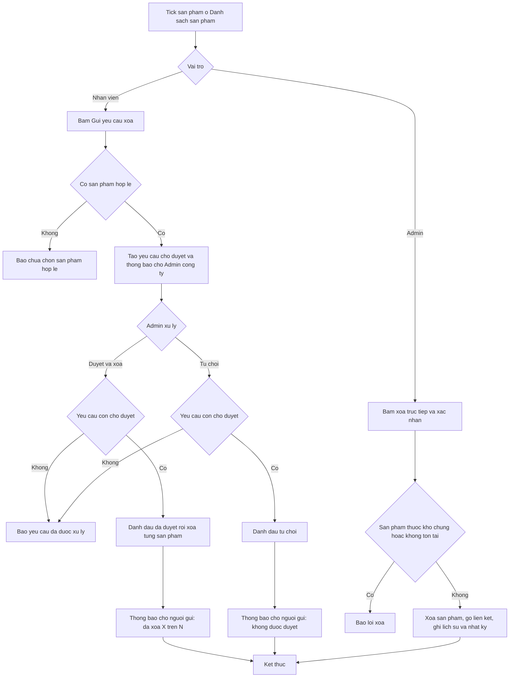
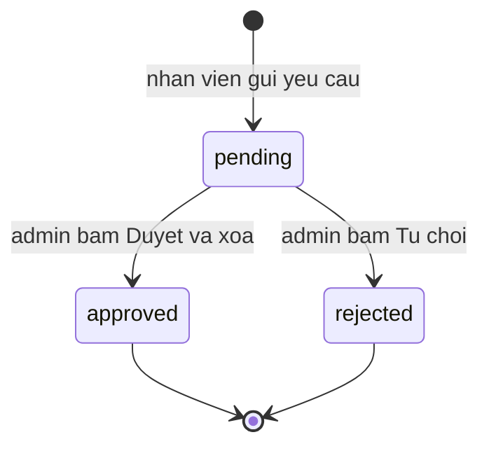

# [QT-07] Yêu cầu xoá sản phẩm

| Mục | Giá trị |
|-----|---------|
| Dự án | QS Pro |
| Phiên bản | 1.0 - 2026-10-07 |
| Người yêu cầu | — |
| Ưu tiên | — (mô tả hiện trạng, chưa xếp ưu tiên) |
| Loại | Mô tả hiện trạng |

## 1. Tóm tắt
Nhân viên không được xoá sản phẩm khỏi danh mục. Muốn xoá, nhân viên chọn sản phẩm và gửi một **yêu cầu xoá** tới Admin công ty; Admin duyệt (sản phẩm bị xoá ngay) hoặc từ chối, và nhân viên nhận thông báo kết quả. Admin cũng có thể tự xoá trực tiếp từng sản phẩm hoặc nhiều sản phẩm một lượt mà không cần yêu cầu.

## 2. Tác nhân & quyền
| Tác nhân | Vai trò hệ thống | Được làm gì trong quy trình |
|----------|-----------------|-----------------------------|
| Nhân viên | `staff` | Gửi yêu cầu xoá một hoặc nhiều sản phẩm; nhận thông báo kết quả. Không xoá trực tiếp được, không xem được danh sách yêu cầu |
| Admin công ty | `admin` | Nhận thông báo có yêu cầu mới; xem danh sách yêu cầu của công ty; duyệt hoặc từ chối; xoá trực tiếp sản phẩm của công ty |
| Quản trị hệ thống | `super` | Làm được mọi việc của admin (xem, duyệt, từ chối, xoá trực tiếp). **Không** nhận thông báo khi có yêu cầu mới |

## 3. Điều kiện trước
- Đã đăng nhập; tài khoản nhìn thấy tab **Danh sách sản phẩm**.
- Sản phẩm thuộc công ty của người thao tác. Sản phẩm kho chung Dezon không xoá được (xem QT-08).
- Để có người xử lý yêu cầu: công ty có ít nhất một tài khoản `admin` đang mở.
- Bảng yêu cầu xoá và bảng thông báo đã được tạo trong cơ sở dữ liệu.

## 4. Luồng chính
| Bước | Ai | Hành động | Hệ thống xử lý | Kết quả người dùng thấy | Đã có / Mới |
|------|----|-----------|----------------|--------------------------|-------------|
| 1 | Nhân viên | Ở tab **Danh sách sản phẩm**, tick một hoặc nhiều sản phẩm | Hiện thanh thao tác hàng loạt ở cuối màn hình | Thanh "N sản phẩm đã chọn" | Đã có |
| 2 | Nhân viên | Bấm ⋯ rồi chọn **Gửi yêu cầu xoá** | Gửi ngay danh sách (mã, mã định danh dòng, tên) lên máy chủ, **không hỏi xác nhận** | — | Đã có |
| 3 | Hệ thống | — | Bỏ các mục không có mã; nếu không còn mục nào thì báo lỗi. Tạo một yêu cầu ở trạng thái "chờ duyệt" kèm tên người gửi. Tạo thông báo trong ứng dụng cho từng tài khoản `admin` đang mở của công ty. Ghi nhật ký | "Đã gửi yêu cầu xóa N sản phẩm tới Admin"; các ô tick được bỏ chọn. Sản phẩm vẫn còn nguyên trong danh mục | Đã có |
| 4 | Admin công ty | Thấy số trên biểu tượng chuông, bấm vào thông báo "Yêu cầu xóa sản phẩm" | Đánh dấu thông báo đã đọc, chuyển sang tab **Admin**, cuộn tới và nháy sáng đúng yêu cầu đó | Thẻ "Yêu cầu xóa sản phẩm" kèm nhãn "N chờ duyệt"; mỗi yêu cầu hiện người gửi, số sản phẩm, tên từng sản phẩm, thời điểm | Đã có |
| 5 | Admin công ty | Bấm **Duyệt & xóa** trên yêu cầu | **Không hỏi xác nhận.** Máy chủ kiểm vai trò; kiểm yêu cầu còn "chờ duyệt"; chuyển yêu cầu sang "đã duyệt" kèm người xử lý và thời điểm (hai admin bấm cùng lúc thì chỉ một người thành công) | — | Đã có |
| 6 | Hệ thống | — | Xoá lần lượt từng sản phẩm trong yêu cầu, theo đúng dòng người gửi đã chọn. Với mỗi sản phẩm xoá được: gỡ các liên kết sản phẩm đi kèm và dấu yêu thích trỏ tới nó, ghi lịch sử "XOÁ SẢN PHẨM", ghi nhật ký. Sản phẩm không xoá được thì bỏ qua và giữ lại lý do đầu tiên | — | Đã có |
| 7 | Hệ thống | — | Tạo thông báo cho người gửi; ghi nhật ký duyệt | Admin thấy "Đã duyệt & xóa X sản phẩm" (kèm "— có sản phẩm không xoá được: <lý do>" nếu có); yêu cầu chuyển nhãn "Đã duyệt", hiện "Xử lý bởi <tên>" | Đã có |
| 8 | Admin công ty | (Thay thế bước 5) Bấm **Từ chối**, xác nhận | Kiểm yêu cầu còn "chờ duyệt"; chuyển sang "từ chối" kèm người xử lý; tạo thông báo cho người gửi; ghi nhật ký. Không xoá gì | "Đã từ chối yêu cầu"; yêu cầu chuyển nhãn "Từ chối" | Đã có |
| 9 | Nhân viên | Bấm thông báo kết quả trên chuông | Đánh dấu đã đọc, chuyển về tab Danh sách sản phẩm | "Yêu cầu xoá sản phẩm đã được duyệt" hoặc "…bị từ chối". Nội dung thông báo: "Đã xóa X/N sản phẩm bạn yêu cầu" hoặc "Yêu cầu xóa N sản phẩm không được duyệt" | Đã có |
| 10 | Admin công ty | (Xoá trực tiếp một sản phẩm) Bấm 🗑 trên dòng sản phẩm, xác nhận | Máy chủ kiểm vai trò; chặn nếu thuộc kho chung; xoá đúng dòng đó; gỡ liên kết sản phẩm đi kèm và dấu yêu thích; ghi lịch sử và nhật ký | "Đã xoá: <tên>"; danh mục được tải lại | Đã có |
| 11 | Admin công ty | (Xoá trực tiếp nhiều sản phẩm) Tick nhiều dòng, bấm ⋯ → **Xoá sản phẩm**, xác nhận | Bỏ qua sản phẩm kho chung; xoá lần lượt từng sản phẩm như bước 10; sản phẩm nào lỗi thì bỏ qua lặng lẽ | "Đã xóa X sản phẩm"; danh mục được tải lại | Đã có |

## 5. Sơ đồ

## 6. Luồng phụ & lỗi
| Mã | Tình huống | Hệ thống phản hồi | Thông báo cho người dùng |
|----|-----------|-------------------|--------------------------|
| E1 | Chưa đăng nhập / phiên hết hạn | Từ chối, mã 401 | "Chưa đăng nhập" |
| E2 | Nhân viên gọi xoá trực tiếp, xem danh sách yêu cầu, hoặc duyệt / từ chối yêu cầu | Từ chối, mã 403, không làm gì | "Không có quyền (chỉ Admin)" (trên màn hình nhân viên không có nút 🗑, không có mục "Xoá sản phẩm", tab Admin hiện "Bạn không có quyền truy cập.") |
| E3 | Gửi yêu cầu mà không có sản phẩm nào có mã | Không tạo yêu cầu | "Lỗi: Chưa chọn sản phẩm hợp lệ" |
| E4 | Không tìm thấy yêu cầu | Từ chối | "Lỗi: Không tìm thấy yêu cầu" |
| E5 | Yêu cầu đã được duyệt hoặc từ chối trước đó (kể cả hai admin bấm gần như cùng lúc) | Từ chối lần xử lý sau, không xoá lại | "Lỗi: Yêu cầu đã được xử lý" |
| E6 | Sản phẩm trong yêu cầu không còn tồn tại lúc duyệt (đã bị xoá bởi yêu cầu khác hoặc bởi admin) | Bỏ qua sản phẩm đó; yêu cầu vẫn chuyển sang "đã duyệt" | "Đã duyệt & xóa X sản phẩm — có sản phẩm không xoá được: Không tìm thấy sản phẩm để xoá." |
| E7 | Sản phẩm thuộc kho chung Dezon | Không xoá | Xoá trực tiếp: "Lỗi xoá: Sản phẩm thuộc kho chung của Dezon — không sửa/xoá được. Hãy tạo bản sao riêng cho công ty bạn." Xoá hàng loạt khi mọi dòng đều là kho chung: "Không có sản phẩm nào xoá được (kho chung Dezon chỉ xem)" |
| E8 | Xoá trực tiếp sản phẩm không tồn tại | Từ chối | "Lỗi xoá: Không tìm thấy sản phẩm để xoá." |
| E9 | Yêu cầu xoá trực tiếp không kèm mã / mã định danh | Từ chối | "Thiếu mã/ID sản phẩm." |
| E10 | Admin bấm huỷ ở hộp xác nhận (xoá trực tiếp, xoá hàng loạt, từ chối) | Không làm gì | — |
| E11 | Xoá hàng loạt có sản phẩm lỗi | Bỏ qua sản phẩm lỗi, không nêu lý do | "Đã xóa X sản phẩm" với X nhỏ hơn số đã chọn |
| E12 | Ghi thông báo cho admin hoặc người gửi bị lỗi | Bỏ qua, thao tác chính vẫn thành công | Không có |
| E13 | Tab Admin không tải được danh sách | Không hiện thẻ nào | "Lỗi tải: <lý do>" |

## 7. Trạng thái

| Từ | Sang | Khi nào | Ai được làm |
|----|------|---------|-------------|
| (chưa có) | `pending` (Chờ duyệt) | Gửi yêu cầu xoá với ít nhất một sản phẩm có mã | Mọi tài khoản đã đăng nhập (màn hình chỉ đưa nút này cho `staff`) |
| `pending` | `approved` (Đã duyệt) | Bấm "Duyệt & xóa" — trạng thái đổi trước, việc xoá từng sản phẩm diễn ra sau | `admin`, `super` |
| `pending` | `rejected` (Từ chối) | Bấm "Từ chối" và xác nhận | `admin`, `super` |
| `approved` / `rejected` | — | Trạng thái cuối, không đổi lại được | — |

## 8. Quy tắc nghiệp vụ
| Mã | Quy tắc |
|----|---------|
| BR-01 | Chỉ `admin` và `super` được xoá sản phẩm trực tiếp. Máy chủ chặn theo vai trò, không phụ thuộc việc ẩn nút. |
| BR-02 | Một yêu cầu có thể gồm nhiều sản phẩm; được duyệt hoặc từ chối cả yêu cầu, không duyệt từng sản phẩm. |
| BR-03 | Mỗi yêu cầu chỉ được xử lý một lần. Việc đổi trạng thái có điều kiện "còn chờ duyệt" nên hai người xử lý cùng lúc không làm xoá hai lần. |
| BR-04 | Khi duyệt, sản phẩm được xoá theo đúng dòng người gửi đã chọn (đúng biến thể), không xoá các biến thể khác cùng mã. Nếu yêu cầu không có mã định danh dòng thì xoá theo mã sản phẩm (sản phẩm đầu tiên có mã đó). |
| BR-05 | Xoá sản phẩm là xoá hẳn, không khôi phục và không hoàn tác được. |
| BR-06 | Khi một sản phẩm bị xoá, các liên kết "sản phẩm đi kèm" có nó (cả hai chiều) và dấu yêu thích của nó cũng bị gỡ. Lịch sử thay đổi của sản phẩm được giữ lại và thêm dòng "XOÁ SẢN PHẨM". |
| BR-07 | Sản phẩm kho chung Dezon không xoá được từ công ty khác. |
| BR-08 | Yêu cầu, thông báo và nhật ký chỉ thuộc công ty của người gửi; admin công ty khác không thấy. |
| BR-09 | Danh sách yêu cầu ở tab Admin hiện tối đa 200 yêu cầu gần nhất, mới nhất ở trên, gồm cả yêu cầu đã xử lý. |
| BR-10 | Yêu cầu vẫn được coi là "đã duyệt" kể cả khi không sản phẩm nào xoá được; số xoá được thể hiện trong thông báo "Đã xóa X/N". |

## 9. Thông báo, realtime & nhật ký
Hệ thống không có realtime: chuông thông báo tự hỏi lại máy chủ theo chu kỳ. Quy trình này chỉ dùng thông báo trong ứng dụng, **không gửi tin Lark**.

| Sự kiện | Ai nhận | Kênh | Nội dung | Ghi audit? |
|---------|---------|------|----------|:----------:|
| Nhân viên gửi yêu cầu xoá | Mọi tài khoản `admin` đang mở của công ty (không gồm `super`) | Thông báo trong ứng dụng, loại `delete_request` | "Yêu cầu xóa sản phẩm" — "<người gửi> yêu cầu xóa N sản phẩm" | Có — `request_delete` "<người gửi> yêu cầu xóa N SP" |
| Admin duyệt yêu cầu | Người gửi yêu cầu | Thông báo trong ứng dụng, loại `delete_approved` | "Yêu cầu xóa đã được duyệt" — "Đã xóa X/N sản phẩm bạn yêu cầu" | Có — `approve_delete` "Duyệt xóa X SP (yêu cầu #<số> của <người gửi>)", cộng mỗi sản phẩm bị xoá một dòng `xoa_sp` |
| Admin từ chối yêu cầu | Người gửi yêu cầu | Thông báo trong ứng dụng, loại `delete_rejected` | "Yêu cầu xóa bị từ chối" — "Yêu cầu xóa N sản phẩm không được duyệt" | Có — `reject_delete` "Từ chối yêu cầu xóa #<số>" |
| Admin xoá trực tiếp một sản phẩm | Không ai | — | Lịch sử sản phẩm: "XOÁ SẢN PHẨM" | Có — `xoa_sp` "Xoá SP <mã> (<tên>)" |
| Admin xoá trực tiếp nhiều sản phẩm | Không ai | — | Mỗi sản phẩm một dòng lịch sử | Có — mỗi sản phẩm một dòng `xoa_sp` |
| Admin xem danh sách yêu cầu | Không ai | — | — | Không |

## 10. Dữ liệu
| Thông tin | Bắt buộc | Ràng buộc | Ví dụ |
|-----------|----------|-----------|-------|
| Danh sách sản phẩm cần xoá | Có, ít nhất 1 | Mỗi mục gồm mã sản phẩm (bắt buộc), mã định danh dòng, tên | MS885DT8 · 1523 · Bồn cầu một khối |
| Người gửi | Tự ghi | Họ tên, nếu trống thì tên đăng nhập | Nguyễn Văn A |
| Trạng thái yêu cầu | Tự quản | `pending` / `approved` / `rejected` | pending |
| Người xử lý, thời điểm xử lý | Tự ghi khi duyệt / từ chối | Họ tên hoặc tên đăng nhập | Trần Thị B · 07/10/2026 10:30 |
| Lý do / ghi chú | Không dùng | Bảng có cột ghi chú nhưng không có chỗ nhập và không được ghi | — |
| Thông báo | Tự tạo | Người nhận, loại, tiêu đề, nội dung, số yêu cầu liên quan, đã đọc hay chưa | delete_request · #42 |

## 11. Màn hình liên quan
- Tab **Danh sách sản phẩm** (`sanpham`): ô tick, thanh thao tác hàng loạt, menu ⋯ ("Gửi yêu cầu xoá" với nhân viên, "Xoá sản phẩm" với admin), nút 🗑 trên dòng (chỉ admin, không hiện với sản phẩm kho chung).
- Tab **Admin** (`admin`): ô đếm "Yêu cầu xóa chờ duyệt", thẻ "Yêu cầu xóa sản phẩm" với nút "Duyệt & xóa" / "Từ chối", thẻ "Nhật ký hoạt động".
- Chuông thông báo trên thanh trên cùng.

## 12. Tiêu chí nghiệm thu
- **AC-01**: Cho nhân viên đã tick 3 sản phẩm / Khi bấm ⋯ → "Gửi yêu cầu xoá" / Thì có một yêu cầu "chờ duyệt" gồm 3 sản phẩm, mọi admin đang mở của công ty nhận thông báo "Yêu cầu xóa sản phẩm", nhật ký có `request_delete`, và 3 sản phẩm vẫn còn trong danh mục.
- **AC-02**: Cho nhân viên (`staff`) / Khi gọi thẳng lệnh xoá sản phẩm, lệnh xem danh sách yêu cầu, hoặc lệnh duyệt yêu cầu / Thì bị từ chối với "Không có quyền (chỉ Admin)" và không có gì thay đổi.
- **AC-03**: Cho một yêu cầu "chờ duyệt" gồm 3 sản phẩm còn tồn tại / Khi admin bấm "Duyệt & xóa" / Thì 3 sản phẩm biến mất khỏi danh mục, liên kết sản phẩm đi kèm và dấu yêu thích của chúng bị gỡ, yêu cầu thành "Đã duyệt" kèm tên người xử lý, người gửi nhận "Đã xóa 3/3 sản phẩm bạn yêu cầu", nhật ký có 3 dòng `xoa_sp` và 1 dòng `approve_delete`.
- **AC-04**: Cho một yêu cầu "chờ duyệt" / Khi admin bấm "Từ chối" và xác nhận / Thì không sản phẩm nào bị xoá, yêu cầu thành "Từ chối", người gửi nhận "Yêu cầu xóa bị từ chối", nhật ký có `reject_delete`.
- **AC-05**: Cho một yêu cầu đã được xử lý / Khi một admin khác bấm "Duyệt & xóa" hoặc "Từ chối" / Thì nhận "Yêu cầu đã được xử lý" và không có gì thay đổi.
- **AC-06**: Cho một yêu cầu gồm 2 sản phẩm, 1 trong đó đã bị xoá trước / Khi admin duyệt / Thì sản phẩm còn lại bị xoá, admin thấy "Đã duyệt & xóa 1 sản phẩm — có sản phẩm không xoá được: Không tìm thấy sản phẩm để xoá.", người gửi nhận "Đã xóa 1/2 sản phẩm bạn yêu cầu".
- **AC-07**: Cho admin công ty / Khi bấm 🗑 trên một sản phẩm và xác nhận / Thì sản phẩm bị xoá, lịch sử có dòng "XOÁ SẢN PHẨM", nhật ký có `xoa_sp`, và không tạo yêu cầu nào.
- **AC-08**: Cho sản phẩm thuộc kho chung Dezon / Khi admin của công ty khác gọi xoá / Thì bị từ chối với "Sản phẩm thuộc kho chung của Dezon — không sửa/xoá được. Hãy tạo bản sao riêng cho công ty bạn.".
- **AC-09**: Cho sản phẩm A có 2 biến thể cùng mã / Khi nhân viên yêu cầu xoá một biến thể và admin duyệt / Thì chỉ biến thể đó bị xoá.
- **AC-10**: Cho nhân viên công ty X gửi yêu cầu / Khi admin công ty Y mở tab Admin / Thì không thấy yêu cầu đó và không nhận thông báo.

## 13. Ảnh hưởng tới phần có sẵn
- Sản phẩm bị xoá biến mất khỏi danh mục ở tab Danh sách sản phẩm và tab Bóc tách sau lần tải lại danh mục kế tiếp.
- Sản phẩm khác đang kèm sản phẩm bị xoá sẽ giảm số "Combo"; nhóm biến thể mất một thành viên.
- Số chưa đọc trên chuông của admin và của người gửi thay đổi.
- Thẻ "Nhật ký hoạt động" ở tab Admin có thêm các dòng tương ứng.

## 14. Giả định & câu hỏi mở
| Mã | Nội dung | Cần ai trả lời |
|----|----------|----------------|
| GD-01 | Các dòng đã đưa vào dự án / báo giá từ sản phẩm bị xoá không bị ảnh hưởng, vì mã xoá chỉ đụng tới danh mục, bảng sản phẩm đi kèm và bảng yêu thích. Chưa kiểm cách các dòng dự án tham chiếu sản phẩm. | Dev |
| GD-02 | Chu kỳ chuông thông báo tự hỏi lại máy chủ chưa được kiểm trong lần mô tả này. | Dev |
| GD-03 | Khoá tra sản phẩm toàn chữ số được hiểu là mã định danh dòng. Một sản phẩm có **mã sản phẩm toàn chữ số** mà bị xoá theo mã (không kèm mã định danh dòng) có thể bị tra nhầm sang dòng khác. Màn hình luôn gửi mã định danh dòng nên chỉ xảy ra với yêu cầu thiếu trường này. | Dev |
| Q-01 | ⚠ "Duyệt & xóa" không hỏi xác nhận dù là thao tác không hoàn tác được, trong khi "Từ chối" lại hỏi. "Gửi yêu cầu xoá" của nhân viên cũng không hỏi xác nhận. Có cần thêm bước xác nhận? | Chủ sản phẩm |
| Q-02 | ⚠ Yêu cầu được đánh dấu "Đã duyệt" trước khi xoá; nếu không xoá được sản phẩm nào (0/N) yêu cầu vẫn là "Đã duyệt" và không thử lại được. Chỉ lý do lỗi đầu tiên được báo cho admin, người gửi chỉ thấy con số X/N. Có cần trạng thái "duyệt một phần / lỗi"? | Chủ sản phẩm |
| Q-03 | ⚠ Không có kiểm trùng: cùng một sản phẩm có thể nằm trong nhiều yêu cầu đang chờ; yêu cầu sau sẽ báo "Không tìm thấy sản phẩm để xoá.". Có cần chặn gửi trùng? | Chủ sản phẩm |
| Q-04 | ⚠ Nhân viên gửi được yêu cầu xoá cả sản phẩm kho chung Dezon (màn hình không lọc); đến lúc duyệt mới thất bại. Có cần chặn ngay khi gửi? | Chủ sản phẩm |
| Q-05 | ⚠ Không có ô nhập lý do xoá và admin không ghi được lý do từ chối, dù bảng yêu cầu có sẵn cột ghi chú. Có cần bổ sung? | Chủ sản phẩm |
| Q-06 | ⚠ Chỉ tài khoản vai trò `admin` nhận thông báo; `super` không nhận. Công ty không có `admin` đang mở thì yêu cầu không ai được báo. Có đúng ý không? | Chủ sản phẩm |
| Q-07 | ⚠ Lệnh gửi yêu cầu xoá không kiểm vai trò hay quyền sản phẩm: mọi tài khoản đã đăng nhập (kể cả admin, hoặc nhân viên không được cấp tab sản phẩm) đều gọi được. Có cần giới hạn? | Chủ sản phẩm / Dev |
| Q-08 | ⚠ Xoá hàng loạt của admin nuốt lỗi từng sản phẩm, chỉ báo "Đã xóa X sản phẩm" mà không nêu sản phẩm nào lỗi và vì sao. Có cần báo chi tiết? | Chủ sản phẩm |
| Q-09 | ⚠ Không có kiểm tra sản phẩm đang được dùng trong dự án, đơn mua hàng hay combo trước khi xoá. Có cần cảnh báo hoặc chặn? | Chủ sản phẩm |
| Q-10 | ⚠ Nhân viên bấm thông báo kết quả chỉ được đưa về tab Danh sách sản phẩm kèm một dòng chữ, không xem lại được yêu cầu của mình gồm những sản phẩm nào và ai xử lý. Có cần màn hình "yêu cầu của tôi"? | Chủ sản phẩm |
| Q-11 | ⚠ `super` không "xem như" công ty nào thì không bị quy tắc kho chung chặn và xoá được sản phẩm của bất kỳ công ty nào theo mã định danh dòng. Có chủ ý không? | Chủ sản phẩm |

## 15. Ghi chú kỹ thuật cho dev
- API: `requestDeleteProducts`, `listDeleteRequests`, `resolveDeleteRequest`, `deleteDbProduct` — `server/components/san-pham/san-pham.routes.js:14` và `:27-29`; danh sách `actor` `:31-32`; danh sách `admin` `:33-34` (gồm `listDeleteRequests`, `resolveDeleteRequest`, `deleteDbProduct`). `requestDeleteProducts` không nằm trong `admin`.
- Kiểm vai trò chung: `server/libraries/rpc.js:57` (401 "Chưa đăng nhập"), `:61` (403 "Không có quyền (chỉ Admin)").
- Nghiệp vụ yêu cầu: `server/components/san-pham/yeu-cau-xoa.service.js:10` (`requestDeleteProducts` — lọc mục có mã `:11`, lỗi `:12`, tạo yêu cầu `:15`, thông báo admin `:16-17`, nhật ký `:18`), `:21` (`listDeleteRequests`, giới hạn 200), `:25` (`resolveDeleteRequest` — không tìm thấy `:27`, đã xử lý `:28` và `:35`, đổi trạng thái có điều kiện `:33`, xoá từng sản phẩm `:40`, thông báo và nhật ký `:41-42`, nhánh từ chối `:45-46`).
- Xoá sản phẩm: `server/components/san-pham/san-pham.repository.js:172` (`deleteDbProduct` — chặn kho chung `:175`, lỗi thiếu khoá `:176`, không tìm thấy `:178`, xoá theo mã định danh dòng `:181`, gỡ combo và yêu thích `:184-186`, lịch sử `:189`, nhật ký `:193`); `guardSpChung_` `:52`; `getDbProduct` `:199`.
- Thông báo: `server/components/thong-bao/thong-bao.service.js:5` (`getAdmins_` — chỉ `role = 'admin'`, còn mở), `:6` (`notify_`, nuốt lỗi). Nhật ký: `server/components/thong-bao/audit.js:9` (`audit`), `:21` (`logAudit_`).
- Trình duyệt: `public/sanpham.js:1752` (menu ⋯), `:1805` (`spBulkDelete`), `:1816` (`spBulkRequest`), `:2505` (`spDelete`), `:1502` (nút 🗑 chỉ admin). `public/admin.js:10` (tải danh sách), `:134` (`admReqCard_`), `:148` (`drqResolve`). `public/app.js:2575` (`isAdminRole_`), `:2653-2656` (bấm thông báo loại `delete_…`).
- Bảng dữ liệu: `delete_requests` (định nghĩa ở `db/notifications.sql:25`, cột `items` là chuỗi JSON), `notifications`, `audit_log`, `db_san_pham`, `db_san_pham_history`, `sp_combo`, `sp_yeu_thich`. Tất cả nằm trong danh sách tự lọc theo công ty ở `server/libraries/supa.js:19`.
- Không có job nền, không có sự kiện realtime, không gọi Lark.

## Lịch sử thay đổi
| Phiên bản | Ngày | Thay đổi |
|-----------|------|----------|
| 1.0 | 2026-10-07 | Tạo mới (mô tả hiện trạng từ mã nguồn) |
