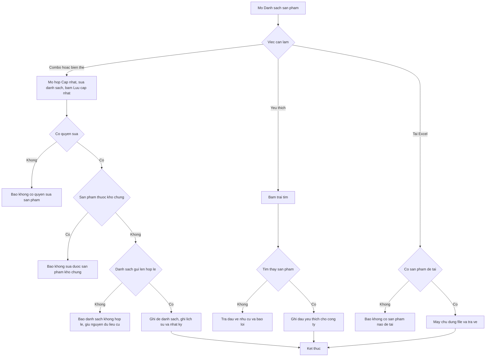

# [QT-08] Sản phẩm đi kèm, biến thể, yêu thích, kho chung và xuất danh sách

| Mục | Giá trị |
|-----|---------|
| Dự án | QS Pro |
| Phiên bản | 1.0 - 2026-10-07 |
| Người yêu cầu | — |
| Ưu tiên | — (mô tả hiện trạng, chưa xếp ưu tiên) |
| Loại | Mô tả hiện trạng |

## 1. Tóm tắt
Quy trình này gom năm việc xoay quanh danh mục sản phẩm ở tab **Danh sách sản phẩm**: (A) khai báo **sản phẩm đi kèm** (combo) để khi đưa vào dự án có thể lấy cả bộ; (B) gom và tạo **biến thể** của cùng một sản phẩm; (C) đánh dấu **yêu thích** để lọc nhanh sản phẩm hay dùng; (D) **kho chung Dezon** — công ty được quản trị hệ thống bật quyền sẽ thấy thêm danh mục của Dezon ở chế độ chỉ xem; (E) **tải danh sách sản phẩm ra Excel**.

## 2. Tác nhân & quyền
| Tác nhân | Vai trò hệ thống | Được làm gì trong quy trình |
|----------|-----------------|-----------------------------|
| Nhân viên | `staff` | Xem combo và biến thể; đánh dấu / bỏ yêu thích (không cần quyền sản phẩm); tải Excel. Sửa combo, gom biến thể, tạo biến thể khi có "quyền sửa sản phẩm" — theo mã hiện tại mọi nhân viên đã đăng nhập đều có (⚠ Q-01) |
| Admin công ty | `admin` | Mọi việc của nhân viên, luôn có quyền sửa |
| Quản trị hệ thống | `super` | Mọi việc của admin; là người duy nhất bật / tắt quyền dùng kho chung Dezon cho một công ty |
| Công ty Dezon | công ty có mã `dezon` | Danh mục của công ty này là nguồn của kho chung |

## 3. Điều kiện trước
- Đã đăng nhập; tài khoản nhìn thấy tab **Danh sách sản phẩm**.
- Combo, biến thể gom tay, yêu thích: các bảng / cột tương ứng đã được tạo trong cơ sở dữ liệu (nếu chưa, phần xem coi như trống, phần ghi báo hướng dẫn chạy file SQL).
- Sửa combo / biến thể: sản phẩm thuộc công ty mình (không phải kho chung) và có mã (để mở được hộp Cập nhật sản phẩm).
- Kho chung: tồn tại công ty có mã `dezon`; công ty người dùng được bật "Cho dùng danh sách sản phẩm của Dezon".

## 4. Luồng chính
| Bước | Ai | Hành động | Hệ thống xử lý | Kết quả người dùng thấy | Đã có / Mới |
|------|----|-----------|----------------|--------------------------|-------------|
| A1 | Người có quyền sửa | Bấm ✎ trên dòng sản phẩm, xuống khối **Sản phẩm liên quan**, tab **Đi kèm (combo)** | Tải danh sách sản phẩm đang đi kèm, gồm cả liên kết do sản phẩm kia đặt (có nhãn "↔ hai chiều") | Danh sách sản phẩm đi kèm kèm ô số lượng "×N" và số đếm trên tab | Đã có |
| A2 | Người có quyền sửa | Gõ tên / mã / thương hiệu vào ô tìm rồi bấm một gợi ý | Thêm vào danh sách tạm trên màn hình với số lượng 1; sản phẩm cùng ngành được xếp trước; với thiết bị vệ sinh, ô trống gợi ý theo hạng mục hay đi kèm | Sản phẩm hiện trong danh sách; trùng thì báo "Sản phẩm này đã có trong combo" | Đã có |
| A3 | Người có quyền sửa | Sửa số lượng hoặc bấm ✕ để bỏ một sản phẩm | Chỉ đổi danh sách tạm | Danh sách và số đếm đổi | Đã có |
| A4 | Người có quyền sửa | Bấm **Lưu cập nhật** | Sau khi lưu thông tin sản phẩm (QT-06), máy chủ kiểm quyền sửa, kiểm sản phẩm tồn tại và không thuộc kho chung, rồi ghi đè toàn bộ danh sách đi kèm: liên kết do phía kia đặt mà bị bỏ thì xoá; còn giữ thì để nguyên; phần của mình ghi lại. Ghi lịch sử sản phẩm và nhật ký | Thông báo lưu của hộp Cập nhật; nhãn "Combo N" trên dòng được cập nhật | Đã có |
| A5 | Mọi người dùng | Bấm nhãn **Combo N** trên dòng sản phẩm, hoặc mở **Thông tin sản phẩm** | Tải danh sách sản phẩm đi kèm của sản phẩm đó | Danh sách bung ngay dưới dòng; trong hộp chi tiết có thể thêm cả bộ vào dự án | Đã có |
| B1 | Người có quyền sửa | Trong hộp Cập nhật, chọn tab **Biến thể** | Hiện hai phần: nhóm gom tay, và dòng "Cùng mã … — tự động là biến thể" liệt kê các sản phẩm cùng mã | Danh sách biến thể và số đếm | Đã có |
| B2 | Người có quyền sửa | Tìm và bấm một sản phẩm khác mã để gom vào nhóm | Thêm vào danh sách tạm; không cho chọn chính nó, không cho chọn sản phẩm kho chung; nếu sản phẩm đang ở nhóm khác thì báo trước | "Sản phẩm này đang ở nhóm biến thể khác — lưu xong sẽ chuyển sang nhóm này" (nếu có) | Đã có |
| B3 | Người có quyền sửa | Bấm **Lưu cập nhật** | Máy chủ kiểm quyền sửa, sản phẩm tồn tại, không thuộc kho chung; gán cùng một mã nhóm cho sản phẩm đang mở và các sản phẩm trong danh sách; sản phẩm bị bỏ khỏi danh sách thì ra khỏi nhóm; danh sách rỗng thì giải tán cả nhóm. Ghi lịch sử và nhật ký | Bảng gộp các sản phẩm cùng nhóm thành một dòng, bung ra mới thấy từng biến thể | Đã có |
| B4 | Người có quyền sửa | Bấm nút sao chép trên dòng → **Tạo biến thể** | Mở hộp "Nhân bản — tạo biến thể mới" giữ nguyên mã và mọi thông tin. Khi lưu, bắt buộc khác bản gốc ít nhất một trong: nhiệt độ màu, công suất, góc chiếu, màu sắc, kích thước | "Đã tạo biến thể mới — khác ở: <các mục>" | Đã có |
| B5 | Người có quyền sửa | Bấm nút sao chép → **Tạo nhanh biến thể**, nhập nhiều dòng (mã, màu, bề mặt, dung tích, giá) hoặc dán từ Excel, bấm **Tạo biến thể** | Mỗi dòng cần mã và giá bán lẻ > 0; bỏ qua dòng trùng mã + màu + dung tích với sản phẩm đã có; tạo từng sản phẩm mới chép thông số và ảnh từ bản gốc; nếu có dòng khác mã (hoặc bản gốc đã ở nhóm gom tay) thì tự gom tất cả vào một nhóm | "Đã tạo N biến thể cho <mã>" (kèm "· bỏ qua M dòng đã có", "· lỗi: …") | Đã có |
| B6 | Người có quyền sửa | Bấm nút sao chép → **Sao chép thành sản phẩm mới**, nhập mã mới, bấm **Tạo sản phẩm** | Bắt buộc có mã mới và mã đó chưa có trong danh mục đang hiện; tạo sản phẩm mới chép toàn bộ thông tin, ảnh, tài liệu | "Đã tạo sản phẩm mới <mã mới> (chép từ <mã gốc>)" | Đã có |
| C1 | Mọi người dùng | Bấm ♥ trên dòng sản phẩm | Màn hình đổi dấu ngay rồi mới gọi máy chủ; máy chủ ghi dấu yêu thích cho **công ty** của người bấm (đã có thì không ghi trùng). Lỗi thì màn hình trả dấu về như cũ | "Đã thêm vào sản phẩm yêu thích" / "Đã bỏ khỏi sản phẩm yêu thích"; số đếm khung nhìn ♥ đổi | Đã có |
| C2 | Mọi người dùng | Tick nhiều dòng, bấm **Yêu thích** (hoặc ⋯ → **Bỏ yêu thích**) | Bật / tắt dấu cho mọi sản phẩm đã chọn | "Đã lưu N sản phẩm vào Yêu thích" | Đã có |
| C3 | Mọi người dùng | Chọn khung nhìn **♥ Yêu thích**, hoặc bấm nút ★ ở panel sản phẩm của tab Bóc tách | Lọc chỉ còn sản phẩm đã đánh dấu | Danh sách sản phẩm yêu thích của công ty | Đã có |
| D1 | Quản trị hệ thống | Ở tab **Công ty**, mở một công ty, bật công tắc "Cho dùng danh sách sản phẩm của Dezon", lưu | Ghi cờ dùng kho chung cho công ty đó; ghi nhật ký | Công ty có nhãn "Kho SP Dezon" trong danh sách công ty | Đã có |
| D2 | Người dùng của công ty được bật | Mở danh mục sản phẩm (bất kỳ tab nào dùng danh mục) | Lấy sản phẩm của công ty, rồi ghép thêm sản phẩm của công ty Dezon; sản phẩm Dezon trùng mã, công suất, nhiệt độ màu, góc chiếu, màu sắc với sản phẩm riêng thì bị ẩn; sắp lại theo tên | Sản phẩm Dezon có nhãn "Kho Dezon", không có nút sửa / duyệt / sao chép / xoá; vẫn bấm ♥ và đưa vào dự án được | Đã có |
| E1 | Mọi người dùng | Bấm **Tải Excel** trên thanh công cụ (hoặc ⋯ → "Tải Excel N dòng") | Có tick dòng thì chỉ lấy các dòng đó; không tick thì lấy toàn bộ danh sách đang lọc. Máy chủ kiểm đăng nhập, lấy danh mục của công ty (kể cả kho chung nếu được bật), dựng file | Nút đổi thành "Đang tạo file…"; trình duyệt tải về `danh-sach-san-pham-<năm-tháng-ngày>.xlsx`; "Đã tải N sản phẩm ra Excel" | Đã có |

## 5. Sơ đồ

## 6. Luồng phụ & lỗi
| Mã | Tình huống | Hệ thống phản hồi | Thông báo cho người dùng |
|----|-----------|-------------------|--------------------------|
| E1 | Chưa đăng nhập / phiên hết hạn | Từ chối, mã 401 (kể cả tải Excel) | "Chưa đăng nhập" |
| E2 | Không có quyền sửa khi lưu combo hoặc nhóm biến thể | Từ chối, không đổi gì | "Lưu sản phẩm đi kèm lỗi: Tài khoản không có quyền sửa sản phẩm" / "Lưu nhóm biến thể lỗi: Tài khoản không có quyền sửa sản phẩm" ⚠ theo mã hiện tại không xảy ra (Q-01) |
| E3 | Không có quyền khi tạo biến thể / sao chép sản phẩm | Từ chối | "Lỗi tạo biến thể: Tài khoản không có quyền thêm/sửa sản phẩm" / "Lỗi tạo sản phẩm: …" ⚠ (Q-01) |
| E4 | Không tìm thấy sản phẩm khi lưu combo / biến thể | Từ chối | "Không tìm thấy sản phẩm." |
| E5 | Sản phẩm thuộc kho chung Dezon | Từ chối sửa combo / biến thể | "Sản phẩm thuộc kho chung của Dezon — không sửa/xoá được. Hãy tạo bản sao riêng cho công ty bạn." |
| E6 | Danh sách combo gửi lên có mục nhưng không mục nào hợp lệ (thiếu mã định danh, hoặc chỉ gồm chính nó) | Từ chối, **không** xoá combo cũ | "Danh sách sản phẩm đi kèm không hợp lệ (thiếu id) — không thay đổi combo. Tải lại trang rồi thử lại." |
| E7 | Danh sách biến thể gửi lên có mục nhưng không mục nào hợp lệ | Từ chối, **không** đổi nhóm | "Danh sách biến thể không hợp lệ (thiếu id) — không thay đổi nhóm. Tải lại trang rồi thử lại." |
| E8 | Trùng: chọn sản phẩm đã có trong combo / nhóm biến thể, hoặc chọn chính nó | Không thêm | "Sản phẩm này đã có trong combo" / "Sản phẩm này đã có trong nhóm biến thể" / "Không thể cho sản phẩm đi kèm chính nó" / "Không thể gom sản phẩm với chính nó" |
| E9 | Chưa có bảng combo | Xem: coi như không có combo. Ghi: từ chối | "Chưa có bảng sp_combo. Vào Supabase → SQL Editor chạy file db/sp_combo.sql rồi thử lại." |
| E10 | Bảng combo / yêu thích bị khoá ghi | Từ chối | "Bảng <tên bảng> đang BẬT RLS nên không ghi được. Vào Supabase → SQL Editor chạy: …" |
| E11 | Chưa có cột nhóm biến thể | Xem: coi như chưa gom. Ghi: từ chối | "Chưa có cột nhom_bt. Vào Supabase → SQL Editor chạy file db/bien_the_nhom.sql rồi thử lại." |
| E12 | Tạo biến thể không khác bản gốc ở mục nào | Không gửi | Hộp "Chưa khác gì so với bản gốc": "Biến thể phải khác bản gốc ít nhất một trong các mục sau, nếu không sẽ ghi đè lên chính sản phẩm cũ:" kèm danh sách mục |
| E13 | Tạo nhanh biến thể: không có dòng nào / thiếu mã hoặc giá | Không gửi | "Nhập ít nhất 1 biến thể." / "Mỗi dòng cần Mã SP và Giá bán lẻ > 0 (còn N dòng thiếu)." |
| E14 | Tạo nhanh biến thể: mọi dòng đều trùng sản phẩm đã có | Không gửi | "Đã có sản phẩm trùng mã + màu + dung tích: <danh sách>. Biến thể khác bề mặt cần mã riêng (VD GJ8B)." |
| E15 | Sao chép thành sản phẩm mới: chưa nhập mã hoặc mã đã có | Không gửi | Hộp "Chưa nhập mã mới" / "Mã đã có": "Mã "…" đã có trong danh sách. Sản phẩm mới cần mã KHÁC; muốn thêm màu / kích thước cho mã này thì dùng "Tạo biến thể"." |
| E16 | Tạo biến thể nhưng máy chủ thấy đã có biến thể giống hệt | Cập nhật đè sản phẩm đã có | "Đã lưu (máy chủ nhận ra biến thể này đã có nên cập nhật lại)" |
| E17 | Yêu thích: không tìm thấy sản phẩm | Bỏ qua sản phẩm đó; nếu không sản phẩm nào thành công thì màn hình trả dấu về như cũ | "Không tìm thấy sản phẩm" |
| E18 | Yêu thích: chưa có bảng | Từ chối ghi; khi xem thì không sản phẩm nào có dấu | "Chưa có bảng sp_yeu_thich. Vào Supabase → SQL Editor chạy file db/sp_yeu_thich.sql rồi thử lại." |
| E19 | Bật kho chung khi cơ sở dữ liệu thiếu cột | Từ chối | "Chưa bật được kho SP chung: cơ sở dữ liệu thiếu cột dung_sp_dezon. Hãy chạy db/share_catalog.sql trong Supabase rồi thử lại." |
| E20 | Người không phải `super` gửi yêu cầu bật kho chung | Admin công ty: trường này bị bỏ qua lặng lẽ (các trường được phép khác vẫn lưu). Vai trò khác: từ chối | "Không có quyền" (với tài khoản không phải admin) |
| E21 | Tải Excel khi danh sách đang lọc trống | Không gọi máy chủ | "Không có sản phẩm nào để tải" |
| E22 | Tải Excel lỗi ở máy chủ | Mã 500 | "Lỗi tải Excel: <lý do>" |

## 8. Quy tắc nghiệp vụ
| Mã | Quy tắc |
|----|---------|
| BR-01 | Combo là quan hệ hai chiều: A kèm B thì mở B cũng thấy đang kèm A. Mỗi liên kết chỉ lưu một lần từ phía đặt, hiểu là "1 bộ gồm 1 sản phẩm chính + N sản phẩm kèm". Nhìn từ phía đặt hiện "×N"; nhìn từ phía kia hiện "×1". |
| BR-02 | Bỏ một liên kết ở bên nào thì mất ở cả hai bên. |
| BR-03 | Lưu combo là ghi đè toàn bộ danh sách của sản phẩm đó. Liên kết do phía kia đặt và vẫn giữ thì không bị ghi đè, trừ khi ở phía này đặt số lượng khác 1 (khi đó ghi thêm một liên kết riêng của phía này). |
| BR-04 | Sản phẩm không đi kèm chính nó; mỗi sản phẩm chỉ xuất hiện một lần trong combo; số lượng không hợp lệ hoặc bằng 0 được lưu là 1. |
| BR-05 | Nhãn "Combo N" trên dòng = số sản phẩm đối tác khác nhau, tính cả hai chiều. |
| BR-06 | Biến thể mặc định = các sản phẩm cùng mã. Gom tay cho phép các sản phẩm khác mã thành một nhóm; gom / bỏ chỉ đổi dấu nhóm, không đụng tới mã sản phẩm. |
| BR-07 | Mỗi sản phẩm chỉ thuộc một nhóm gom tay. Gom một sản phẩm đang ở nhóm khác thì nó chuyển sang nhóm mới. Lưu với danh sách rỗng thì giải tán cả nhóm cho mọi thành viên. |
| BR-08 | Hai sản phẩm cùng mã phải khác nhau ở ít nhất một trục (nhiệt độ màu, công suất, góc chiếu, màu sắc, kích thước); nếu giống hết thì lần lưu sau cập nhật đè lần trước (xem QT-05). |
| BR-09 | Sản phẩm tạo bằng "Tạo biến thể", "Tạo nhanh biến thể", "Sao chép thành sản phẩm mới" là sản phẩm mới, ở trạng thái chưa duyệt, không chép combo của bản gốc. |
| BR-10 | Dấu yêu thích thuộc về **công ty**, không thuộc về từng người: một người đánh dấu thì cả công ty thấy. Đánh dấu được cả sản phẩm kho chung. |
| BR-11 | Yêu thích không cần quyền sản phẩm; mọi tài khoản đã đăng nhập đều bật / tắt được. Yêu thích không làm đổi trạng thái duyệt. |
| BR-12 | Kho chung chỉ lấy từ công ty có mã `dezon`, chỉ cho công ty được bật cờ, và chỉ để xem: không sửa, không duyệt, không xoá, không sửa combo / biến thể. Chính công ty Dezon và tài khoản `super` xem toàn hệ thống không ghép kho chung. |
| BR-13 | Sản phẩm riêng của công ty "đè" sản phẩm kho chung có cùng mã, công suất, nhiệt độ màu, góc chiếu, màu sắc: sản phẩm kho chung đó bị ẩn. |
| BR-14 | File Excel gồm cột STT, toàn bộ các trường của form Nhập (trừ ảnh và giá đại lý), và cột ẢNH SẢN PHẨM ở cuối; giá trị là giá trị gốc đang lưu (ví dụ công suất "12", không phải "12W"). Tên cột trùng với file mẫu nhập hàng loạt. |
| BR-15 | Tải Excel chỉ cần đăng nhập. File chỉ chứa sản phẩm mà người tải được thấy (công ty mình và kho chung nếu được bật). |

## 9. Thông báo, realtime & nhật ký
Hệ thống không có realtime. Cả năm việc trong quy trình này không gửi thông báo trong ứng dụng và không gửi tin Lark.

| Sự kiện | Ai nhận | Kênh | Nội dung | Ghi audit? |
|---------|---------|------|----------|:----------:|
| Lưu danh sách sản phẩm đi kèm | Không ai | — | Lịch sử sản phẩm: "SẢN PHẨM ĐI KÈM" → "N sản phẩm" hoặc "Bỏ hết" | Có — `sua_combo` "Đặt N sản phẩm đi kèm cho <mã> (<tên>)" |
| Lưu nhóm biến thể | Không ai | — | Lịch sử sản phẩm: "BIẾN THỂ" → "N sản phẩm cùng nhóm" hoặc "Bỏ nhóm" | Có — `sua_bien_the` "Gom N biến thể cho <mã> (<tên>)" |
| Tạo biến thể / tạo nhanh biến thể / sao chép sản phẩm | Không ai | — | Lịch sử sản phẩm: "TẠO SẢN PHẨM" (hoặc "CẬP NHẬT (nhập liệu)" nếu trùng) | Có — `them_sp` hoặc `cap_nhat_sp` cho từng sản phẩm |
| Bật / tắt yêu thích | Không ai | — | — | **Không** |
| Bật / tắt quyền dùng kho chung cho công ty | Không ai | — | — | Có — `update_company` "Cập nhật công ty <tên>" (không nêu riêng việc đổi kho chung) |
| Tải danh sách ra Excel | Không ai | — | — | **Không** |
| Xem combo, xem biến thể | Không ai | — | — | Không |

## 10. Dữ liệu
| Thông tin | Bắt buộc | Ràng buộc | Ví dụ |
|-----------|----------|-----------|-------|
| Liên kết combo: sản phẩm chính, sản phẩm kèm | Có | Hai sản phẩm khác nhau; mỗi cặp theo một chiều chỉ có một liên kết | Bồn cầu MS885DT8 → Nắp rửa TCF23410AAA |
| Số lượng kèm | Không | Số; trống, 0 hoặc không hợp lệ → 1 | 2 |
| Ghi chú, thứ tự của liên kết | Không | Thứ tự theo vị trí trong danh sách lúc lưu; màn hình hiện không có ô nhập ghi chú | 0, 1, 2 |
| Mã nhóm biến thể | Tự sinh | Dạng "BT-<mã định danh sản phẩm đang mở>" khi tạo nhóm mới; dùng lại mã nhóm cũ nếu đã có | BT-1523 |
| Danh sách sản phẩm cùng nhóm | Không | Mã định danh dạng số, không gồm chính nó, không lặp | 1524, 1530 |
| Dòng tạo nhanh biến thể | Mã và giá bắt buộc | Giá bán lẻ > 0; màu, bề mặt, dung tích tuỳ chọn | GJ8B · Trắng · Bề mặt bóng · 5L · 890000 |
| Dấu yêu thích | — | Mỗi công ty – mỗi sản phẩm một dấu; lưu kèm mã sản phẩm và người đánh dấu | Công ty X · sản phẩm 1523 |
| Cờ dùng kho chung của công ty | Không | Bật / tắt; mặc định tắt | Bật |
| Danh sách khoá khi tải Excel | Không | Mã định danh dòng hoặc mã sản phẩm; không gửi thì lấy toàn bộ danh mục | 1523, 1524 |

## 11. Màn hình liên quan
- Tab **Danh sách sản phẩm** (`sanpham`): nhãn "Combo N" và nhãn "Kho Dezon" trên dòng; chấm màu của nhóm biến thể; cột thao tác (♥, sao chép); khung nhìn "♥ Yêu thích"; nút "Tải Excel"; thanh thao tác hàng loạt (Yêu thích, ⋯ → Tải Excel N dòng, Bỏ yêu thích).
- Hộp **Cập nhật sản phẩm** → khối "Sản phẩm liên quan" với hai tab "Đi kèm (combo)" và "Biến thể"; nút "Tạo nhanh biến thể".
- Hộp **Nhân bản — tạo biến thể mới**, hộp **Sao chép — tạo sản phẩm mới**, hộp **Tạo nhanh biến thể**.
- Hộp **Thông tin sản phẩm**: danh sách sản phẩm đi kèm, thêm cả bộ vào dự án.
- Tab **Nhập dữ liệu** (`import`): khối "Sản phẩm đi kèm (combo)" và "Nhập biến thể" của form (QT-05).
- Tab **Bóc tách** (`boc`): nhãn Combo trên thẻ sản phẩm, nút ★ lọc yêu thích, bộ lọc có / không có combo.
- Tab **Công ty** (`congty`, chỉ `super`): công tắc "Cho dùng danh sách sản phẩm của Dezon", nhãn "Kho SP Dezon".

## 12. Tiêu chí nghiệm thu
- **AC-01**: Cho sản phẩm A và B của cùng công ty / Khi người có quyền sửa mở A, thêm B vào combo với số lượng 2 và bấm "Lưu cập nhật" / Thì dòng A hiện "Combo 1", mở A thấy B ×2, mở B thấy A ×1 có nhãn "↔ hai chiều", lịch sử A có dòng "SẢN PHẨM ĐI KÈM", nhật ký có `sua_combo`.
- **AC-02**: Cho A đang kèm B / Khi mở B, bỏ A khỏi combo và lưu / Thì mở A cũng không còn B.
- **AC-03**: Cho tài khoản mà máy chủ xác định không có quyền sửa sản phẩm / Khi gọi lưu combo hoặc lưu nhóm biến thể / Thì bị từ chối với "Tài khoản không có quyền sửa sản phẩm" và dữ liệu không đổi. (⚠ hiện chưa có tài khoản nào tái hiện được — Q-01.)
- **AC-04**: Cho người chưa đăng nhập / Khi gọi tải Excel, bật yêu thích, hoặc lưu combo / Thì bị từ chối với "Chưa đăng nhập".
- **AC-05**: Cho sản phẩm thuộc kho chung Dezon / Khi công ty khác gọi lưu combo cho sản phẩm đó / Thì bị từ chối với "Sản phẩm thuộc kho chung của Dezon — không sửa/xoá được. Hãy tạo bản sao riêng cho công ty bạn.".
- **AC-06**: Cho yêu cầu lưu combo có 2 mục đều thiếu mã định danh / Khi gửi lên / Thì bị từ chối với "Danh sách sản phẩm đi kèm không hợp lệ (thiếu id) — không thay đổi combo. Tải lại trang rồi thử lại." và combo cũ còn nguyên.
- **AC-07**: Cho ba sản phẩm khác mã / Khi mở sản phẩm thứ nhất, gom hai sản phẩm kia ở tab Biến thể và lưu / Thì bảng gộp cả ba thành một dòng, lịch sử có dòng "BIẾN THỂ: 2 sản phẩm cùng nhóm", nhật ký có `sua_bien_the`.
- **AC-08**: Cho sản phẩm đang ở nhóm 3 biến thể gom tay / Khi mở nó, bỏ hết danh sách biến thể và lưu / Thì cả ba sản phẩm không còn thuộc nhóm nào.
- **AC-09**: Cho hộp "Nhân bản — tạo biến thể mới" không đổi gì / Khi bấm "Tạo biến thể" / Thì không tạo sản phẩm và hiện "Chưa khác gì so với bản gốc".
- **AC-10**: Cho nhân viên bất kỳ / Khi bấm ♥ trên một sản phẩm kho chung Dezon / Thì dấu được lưu, mọi người cùng công ty thấy dấu đó, công ty khác không thấy, và không có dòng nhật ký nào.
- **AC-11**: Cho công ty X chưa được bật kho chung / Khi quản trị hệ thống bật công tắc và lưu / Thì người dùng công ty X thấy thêm sản phẩm có nhãn "Kho Dezon" không kèm nút sửa, duyệt, sao chép, xoá.
- **AC-12**: Cho admin công ty (không phải `super`) / Khi gửi yêu cầu bật kho chung cho công ty mình / Thì cờ kho chung không đổi.
- **AC-13**: Cho đã tick 5 sản phẩm / Khi bấm "Tải Excel (5)" / Thì tải về file có 5 dòng dữ liệu, cột đầu STT, cột cuối ẢNH SẢN PHẨM, và báo "Đã tải 5 sản phẩm ra Excel".
- **AC-14**: Cho không tick dòng nào và đang lọc theo một hạng mục / Khi bấm "Tải Excel" / Thì file chứa đúng các sản phẩm của danh sách đang lọc.

## 13. Ảnh hưởng tới phần có sẵn
- Combo quyết định việc "thêm cả bộ" khi đưa sản phẩm vào dự án ở tab Bóc tách và hộp Thông tin sản phẩm; bộ lọc có / không có combo ở tab Bóc tách dựa trên số "Combo N".
- Nhóm biến thể quyết định cách bảng Danh sách sản phẩm và thư viện Bóc tách gộp dòng; duyệt và sửa hàng loạt trên dòng đại diện áp dụng cho cả nhóm (QT-06).
- Xoá sản phẩm gỡ luôn combo và dấu yêu thích của nó (QT-07).
- Bật kho chung làm tăng số sản phẩm mà mọi người dùng của công ty đó thấy ở Bóc tách, Danh sách sản phẩm và file Excel.
- File Excel tải về dùng cùng tên cột với file mẫu nên nạp lại được qua QT-05.

## 14. Giả định & câu hỏi mở
| Mã | Nội dung | Cần ai trả lời |
|----|----------|----------------|
| GD-01 | Chỉ mục duy nhất "một công ty – một sản phẩm" của bảng yêu thích và chỉ mục duy nhất "sản phẩm chính – sản phẩm kèm" của bảng combo được suy ra từ file `db/sp_yeu_thich.sql` và `db/sp_combo.sql`; chưa kiểm được trên cơ sở dữ liệu đang chạy. | Dev |
| GD-02 | Chi tiết bước "thêm cả combo vào dự án" thuộc quy trình bóc tách / dự án; ở đây chỉ mô tả nơi combo được khai báo và hiển thị. | BA |
| GD-03 | Cách bảng gộp biến thể (cùng dấu nhóm, nếu không có thì cùng mã, nếu không có mã thì cùng tên) được đọc từ hàm gộp ở trình duyệt; chưa kiểm mọi trường hợp biên. | Dev |
| Q-01 | ⚠ Hàm kiểm quyền luôn trả "được sửa" cho mọi tài khoản đã đăng nhập, nên các thông báo "Tài khoản không có quyền sửa sản phẩm" ở lưu combo / biến thể không bao giờ xảy ra. Có cần mức "chỉ xem"? | Chủ sản phẩm |
| Q-02 | ⚠ Số "Combo N" trên dòng được đếm trên liên kết của **mọi công ty**, trong khi danh sách bung ra chỉ lấy liên kết của công ty đang đăng nhập. Với sản phẩm kho chung (hoặc khi dữ liệu nhiều công ty), con số có thể lớn hơn danh sách thực thấy. Có phải lỗi? | Dev |
| Q-03 | ⚠ Khi lưu combo, máy chủ ghi các liên kết mới **trước** rồi mới xoá các liên kết cũ. Nếu chỉ mục duy nhất "sản phẩm chính – sản phẩm kèm" trong `db/sp_combo.sql` đang có hiệu lực, lưu lại một sản phẩm vốn đã có combo (không đổi gì) sẽ bị cơ sở dữ liệu từ chối vì trùng, và người dùng thấy "Lưu sản phẩm đi kèm lỗi: …" ở mỗi lần bấm "Lưu cập nhật". Bộ kiểm thử dùng cơ sở dữ liệu giả không có chỉ mục này nên không bắt được. Cần kiểm trên cơ sở dữ liệu thật. | Dev |
| Q-04 | ⚠ Mỗi lần bấm "Lưu cập nhật" ở hộp Cập nhật, combo và nhóm biến thể luôn được ghi lại dù không đổi, sinh dòng lịch sử "SẢN PHẨM ĐI KÈM" / "BIẾN THỂ" (kể cả "Bỏ hết", "Bỏ nhóm") và hai dòng nhật ký. Có phải lỗi cần sửa? | Dev |
| Q-05 | ⚠ Bỏ yêu thích hàng loạt vẫn hiện thông báo "Đã lưu N sản phẩm vào Yêu thích". Khi một phần sản phẩm lỗi (không phải tất cả), màn hình không báo gì và vẫn hiện dấu như đã thành công. Cần sửa câu chữ và báo lỗi từng phần? | Chủ sản phẩm / Dev |
| Q-06 | ⚠ Dấu yêu thích là của cả công ty, không phải của từng người; ai cũng bật / tắt được cho cả công ty và không có nhật ký. Đúng ý nghiệp vụ không, hay cần yêu thích theo từng người? | Chủ sản phẩm |
| Q-07 | ⚠ Quy tắc "sản phẩm riêng đè sản phẩm kho chung" so theo mã, công suất, nhiệt độ màu, góc chiếu, màu sắc — **không** tính kích thước, trong khi khoá chống trùng của thiết bị vệ sinh / sơn nước có tính kích thước. Một sản phẩm Dezon chỉ khác kích thước với sản phẩm riêng sẽ bị ẩn. Có phải lỗi? | Dev |
| Q-08 | ⚠ Thông báo chặn kho chung gợi ý "Hãy tạo bản sao riêng cho công ty bạn", nhưng nút sao chép bị ẩn với sản phẩm kho chung nên trên màn hình không có cách tạo bản sao. Cần thêm chức năng hay sửa câu chữ? | Chủ sản phẩm |
| Q-09 | ⚠ Kho chung gắn cứng với công ty có mã `dezon`; không chia sẻ được danh mục giữa hai công ty bất kỳ. Việc bật / tắt không có dòng nhật ký riêng (chỉ có "Cập nhật công ty"). Có cần mở rộng? | Chủ sản phẩm |
| Q-10 | ⚠ File Excel tải về có cả sản phẩm kho chung Dezon. Nếu nạp lại file này qua Nhập dữ liệu, các sản phẩm Dezon sẽ được tạo thành sản phẩm riêng của công ty (và từ đó đè bản kho chung). Tải Excel cũng không ghi nhật ký và không giới hạn theo vai trò. Có chấp nhận không? | Chủ sản phẩm |
| Q-11 | ⚠ Ô số lượng combo cho nhập 0 nhưng khi lưu thành 1. Gom một sản phẩm đang ở nhóm biến thể khác sẽ rút nó khỏi nhóm cũ (có thể để lại nhóm cũ chỉ còn một thành viên). Có cần chặn? | Chủ sản phẩm |
| Q-12 | ⚠ "Sao chép thành sản phẩm mới" chỉ kiểm mã trùng trên danh mục đang tải ở trình duyệt; máy chủ không báo trùng mà cập nhật đè nếu trùng mã và mọi thông số phân biệt. Có cần máy chủ chặn? | Dev |

## 15. Ghi chú kỹ thuật cho dev
- API: `getCombo`, `setCombo`, `getBienThe`, `setBienThe`, `setYeuThich`, `saveDbProduct`, `getProducts` — `server/components/san-pham/san-pham.routes.js:10`; danh sách `actor` `:31-32`. `getCombo` và `getBienThe` không nhận người thao tác, chỉ cần đăng nhập.
- Kiểm quyền: `server/components/san-pham/san-pham.service.js:53` (`setComboGated`), `:59` (`setBienTheGated`), `:73` (`setYeuThich` — không kiểm quyền sản phẩm), `:17` (`spPerms_`).
- Combo: `server/components/san-pham/san-pham.combo.js:17` (`getCombo` — gộp hai chiều `:26-35`), `:56` (`setCombo` — chặn kho chung `:58`, lỗi danh sách không hợp lệ `:63-64`, xử lý liên kết ngược `:68-75`, ghi mới trước xoá cũ `:78-82`, lịch sử `:84`, nhật ký `:85`). Đếm "Combo N": `server/components/san-pham/san-pham.repository.js:80` (`stampCombo_`, đọc không lọc công ty `:82`). Chỉ mục duy nhất: `db/sp_combo.sql:16`.
- Biến thể: `server/components/san-pham/san-pham.bien-the.js:14` (`getBienThe`), `:25` (`setBienThe` — lỗi danh sách không hợp lệ `:36-37`, giải tán nhóm `:40-41`, mã nhóm mới `:43`, lịch sử `:57`, nhật ký `:58`). Cột `nhom_bt` do `db/bien_the_nhom.sql` thêm. Khoá chống trùng biến thể: `db/thiet_bi_ve_sinh.sql:25`.
- Yêu thích: `server/components/san-pham/san-pham.yeu-thich.js:20` (`setYeuThich` — tìm cả trong kho chung `:14`, chặn trùng `:33-36`, xoá kèm điều kiện công ty `:46-47`); đóng dấu khi tải danh mục `server/components/san-pham/san-pham.repository.js:95`. Không gọi nhật ký.
- Kho chung: `server/components/san-pham/san-pham.repository.js:19` (`spChungId_`), `:27` (`getProducts` — ghép và quy tắc đè `:31-45`), `:52` (`guardSpChung_`). Bật / tắt cờ: `server/components/cong-ty/cong-ty.service.js:33-36` (tạo công ty), `:65` (`updateCongTy`, chỉ `super` đổi được `:79-86`). Cột `dung_sp_dezon`: `db/share_catalog.sql:2`. Công tắc trên màn hình: `public/congty.js:126-130`.
- Xuất Excel: route `server/components/xuat-file/xuat-file.routes.js:27` (`POST /export/san-pham`, kiểm đăng nhập `:28-29`, tự dựng ngữ cảnh công ty `:30-34`); dựng file `server/components/xuat-file/danh-sach.export.js:8` (`exportProductsXlsx` — lọc theo khoá `:12-15`, bộ cột `:16`).
- Trình duyệt (`public/sanpham.js`): yêu thích `:380` (`spFav`), `:388` (`spFavBulk`); bung combo `:398`; tải Excel `:432`; hộp chi tiết tải combo `:1846`; combo trong hộp Cập nhật `:1999-2064`; biến thể `:2083-2126`; khối "Sản phẩm liên quan" `:2137`; menu sao chép `:2166`; tạo nhanh biến thể `:2206` và `:2263`; lưu trong hộp Cập nhật `:2418` (nhánh sao chép `:2435`, nhánh nhân bản `:2452`, lưu combo `:2478`, lưu biến thể `:2480`); nhãn "Kho Dezon" `:232`. Gộp biến thể: `public/app.js:724` (`spVarKey_`).
- Bảng dữ liệu: `sp_combo`, `sp_yeu_thich`, `db_san_pham` (cột `nhom_bt`), `db_san_pham_history`, `audit_log`, `cong_ty` (cột `dung_sp_dezon`).
- Không có job nền, không có sự kiện realtime, không gọi Lark.

## Lịch sử thay đổi
| Phiên bản | Ngày | Thay đổi |
|-----------|------|----------|
| 1.0 | 2026-10-07 | Tạo mới (mô tả hiện trạng từ mã nguồn) |
