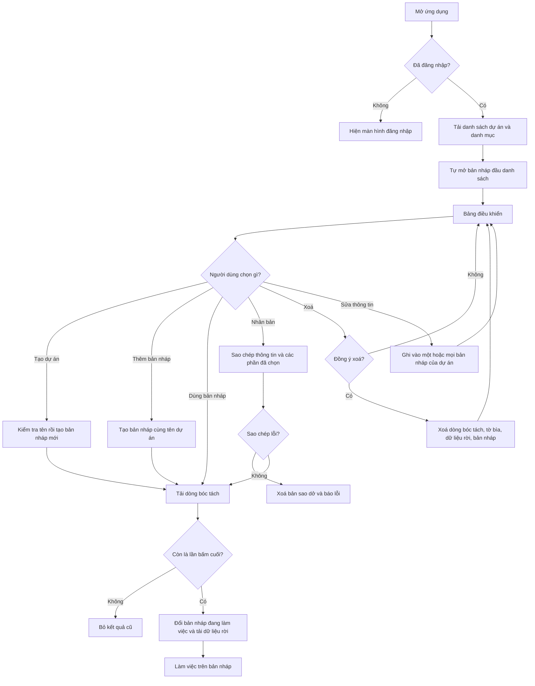

# [QT-09] Quản lý dự án và bản nháp

| Mục | Giá trị |
|-----|---------|
| Dự án | QS Pro |
| Phiên bản | 1.0 - 2026-10-07 |
| Người yêu cầu | — |
| Ưu tiên | Bình thường |
| Loại | Mô tả hiện trạng |

## 1. Tóm tắt
Người dùng đã đăng nhập tạo dự án, thêm các bản nháp (mỗi bản nháp là một phương án báo giá riêng), sửa thông tin, nhân bản, xoá và mở một bản nháp để làm việc. Khi mở, hệ thống nạp các dòng bóc tách và phần dữ liệu rời của bản nháp đó (bảng phần thô, bảng diện tích, cài đặt chi phí, cài đặt báo giá...). Bảng điều khiển hiển thị danh sách dự án và vài con số tổng của bản nháp đang mở.

Lưu ý về cách gọi: trong dữ liệu, mỗi **bản nháp** là một dòng dự án riêng có mã riêng. "Dự án" trên màn hình chỉ là **nhóm các bản nháp có cùng tên dự án**.

## 2. Tác nhân & quyền
| Tác nhân | Vai trò hệ thống | Được làm gì trong quy trình |
|----------|-----------------|-----------------------------|
| Quản trị hệ thống | `super` | Làm được mọi thao tác. Không thuộc công ty nào nên thấy dự án của mọi công ty, trừ khi đang "xem như" một công ty. |
| Quản trị công ty | `admin` | Làm được mọi thao tác trên dự án của công ty mình. Vào được mọi màn hình mà công ty được cấp. |
| Nhân viên | `staff` | Làm được mọi thao tác trên dự án của công ty mình. Chỉ thấy các màn hình được cấp trong quyền chi tiết (`users.perms`). |
| Người chưa đăng nhập | — | Không làm được gì, bị yêu cầu đăng nhập. |

⚠ Máy chủ **không phân biệt vai trò** cho các thao tác dự án: chỉ cần đã đăng nhập là tạo, sửa, xoá, nhân bản được. Việc ẩn màn hình theo quyền chi tiết chỉ làm ở giao diện (xem Q-01).

## 3. Điều kiện trước
- Người dùng đã đăng nhập, tài khoản và công ty còn hoạt động.
- Tài khoản không phải `super` thì phải thuộc một công ty.
- Muốn sửa, xoá, nhân bản, mở: bản nháp phải có trong danh sách dự án đã tải về.
- Muốn lưu dữ liệu rời: bảng lưu dữ liệu rời đã được cài trên cơ sở dữ liệu (nếu chưa, phần này tự bỏ qua khi đọc và báo lỗi khi ghi).

## 4. Luồng chính
| Bước | Ai | Hành động | Hệ thống xử lý | Kết quả người dùng thấy | Đã có / Mới |
|------|----|-----------|----------------|--------------------------|-------------|
| 1 | Người dùng | Mở ứng dụng sau khi đăng nhập | Tải danh sách dự án (mới nhất trước) và danh mục sản phẩm. Nếu chưa chọn bản nháp nào thì tự chọn bản nháp đứng đầu danh sách. Tải dòng bóc tách và dữ liệu rời của bản nháp đó. | Màn hình chờ lần lượt báo "Đang tải dự án & danh mục sản phẩm…", "Đang tải bảng bóc tách…", rồi hiện giao diện. | Đã có |
| 2 | Người dùng | Vào Bảng điều khiển | Gom các bản nháp cùng tên thành một thẻ dự án. Tính số dòng, giá vốn, giá bán, VAT, lợi nhuận, biên và biểu đồ giá trị theo nhóm hạng mục của bản nháp đang mở. | Thẻ "Đang làm việc", 5 ô số liệu, biểu đồ "Giá trị theo nhóm", danh sách dự án có ô tìm kiếm. | Đã có |
| 3 | Người dùng | Bấm "Tạo dự án", nhập tên, khách hàng, số điện thoại, địa chỉ, link Dezon, VAT rồi xác nhận | Kiểm tra đã nhập tên. Tạo một bản nháp mới với mã tự sinh theo ngày giờ Việt Nam, trạng thái "Bản nháp". Tải lại toàn bộ dữ liệu và mở bản nháp vừa tạo. | Thông báo "Đã tạo bản nháp". Bản nháp mới thành bản đang làm việc. | Đã có |
| 4 | Người dùng | Bấm "Thêm bản nháp" trên thẻ dự án | Tạo một bản nháp mới mang cùng tên, khách hàng, số điện thoại, địa chỉ của dự án. Tải lại danh sách dự án. | Thông báo "Đã thêm bản nháp mới cho …". Bản nháp mới trống, đang được mở. | Đã có |
| 5 | Người dùng | Bấm "Dùng" trên một bản nháp (hoặc chọn ở ô chọn dự án phía trên) | Tải dòng bóc tách của bản nháp đó. Chỉ khi tải xong mới đổi bản nháp đang làm việc. Nếu người dùng bấm tiếp bản khác trước khi tải xong thì chỉ lần bấm cuối có hiệu lực. Sau đó tải dữ liệu rời. | Chuyển sang màn hình Bóc tách của bản nháp vừa chọn. | Đã có |
| 6 | Hệ thống | (tự chạy khi mở bản nháp) | Đẩy nốt các thay đổi dữ liệu rời còn chờ của bản nháp cũ. Xoá dữ liệu tạm của bản cũ. Tải dữ liệu rời của bản mới. Nếu máy này còn bản lưu cũ trên trình duyệt mà máy chủ chưa có thì tự đưa lên máy chủ. | Nếu có đưa lên: "Đã đưa … lên máy chủ — từ giờ máy khác cũng xem được". | Đã có |
| 7 | Người dùng | Mở "Thông tin dự án", sửa tên dự án, khách hàng, số điện thoại, địa chỉ, link Dezon, bấm "Lưu thông tin dự án" | Lần lượt ghi các thông tin này vào **mọi bản nháp** của dự án. Link không có `http` thì tự thêm `https://`. Link ngoài dezon.vn thì hỏi lại trước khi lưu. | "Đã lưu thông tin dự án (n bản nháp)". | Đã có |
| 8 | Người dùng | Sửa thông tin riêng của bản nháp (tên bản nháp, trạng thái, VAT, mã báo giá, quy mô, diện tích, nhu cầu, phân khúc, ghi chú), bấm "Lưu bản nháp" | Ghi các thông tin này vào riêng bản nháp đang mở. | "Đã lưu bản nháp". | Đã có |
| 9 | Người dùng | Kéo thanh tiến độ, bấm "Cập nhật" | Ghi phần trăm tiến độ vào bản nháp đang mở. | "Đã cập nhật tiến độ n%". | Đã có |
| 10 | Người dùng | Bấm vào tên bản nháp trên Bảng điều khiển để đổi tên (hoặc bấm biểu tượng bút chì) | Ghi tên bản nháp mới. Để trống hoặc không đổi thì bỏ qua (khi sửa tại chỗ). | "Đã đổi tên bản nháp". | Đã có |
| 11 | Người dùng | Bấm chip "Gắn link" / "Dezon" của dự án, dán link | Chuẩn hoá link, hỏi lại nếu không thuộc dezon.vn, ghi vào bản nháp đó. Để trống = bỏ link. | "Đã gắn link Dezon cho dự án" hoặc "Đã bỏ link Dezon". Chip chuyển màu, bấm mở bài viết ở thẻ mới. | Đã có |
| 12 | Người dùng | Bấm "Nhân bản" trên một bản nháp, chọn phần cần sao chép (Bóc tách, Xuất báo giá, Phần thô), xác nhận | Tạo bản nháp mới sao chép toàn bộ thông tin của bản gốc với mã mới. Tuỳ lựa chọn: sao chép dòng bóc tách, tờ bìa, dữ liệu rời (không sao chép lịch sử các phiên bản báo giá đã chốt). Nếu hỏng giữa chừng thì xoá bản sao dở. | "Đã nhân bản (n hạng mục)". Bản sao thành bản đang làm việc. | Đã có |
| 13 | Người dùng | Bấm xoá một bản nháp, đồng ý ở hộp "Xoá bản nháp này?" | Xoá dòng bóc tách, tờ bìa, dữ liệu rời rồi xoá bản nháp. Tải lại danh sách, mở bản nháp đầu danh sách nếu bản vừa xoá đang mở. | "Đã xoá bản nháp". | Đã có |
| 14 | Người dùng | Bấm xoá cả dự án trên thẻ dự án, đồng ý ở hộp cảnh báo | Lần lượt xoá từng bản nháp của dự án như bước 13. Ghi nhận bản nào xoá lỗi. | "Đã xoá dự án … (n bản nháp)" hoặc "Xoá xong x/n bản — lỗi: …". | Đã có |
| 15 | Người dùng | Sửa một bảng dữ liệu rời ở các màn hình khác (phần thô, diện tích, cài đặt chi phí, cài đặt báo giá, kế hoạch thanh toán, định dạng bảng tính...) | Ghi nhớ thay đổi kèm mã bản nháp tại thời điểm sửa. Sau 1,2 giây không sửa thêm thì gửi lên máy chủ. Máy chủ ghi đè giá trị cũ của khoá đó và lưu tên người sửa, thời điểm sửa. | Không có thông báo khi thành công. Lỗi thì báo một lần kèm "— dữ liệu vẫn còn trên máy này". | Đã có |

## 5. Sơ đồ

## 6. Luồng phụ & lỗi
| Mã | Tình huống | Hệ thống phản hồi | Thông báo cho người dùng |
|----|-----------|-------------------|--------------------------|
| E1 | Chưa đăng nhập hoặc phiên hết hạn | Từ chối, mã `NOAUTH`, dọn cookie phiên | Màn hình đăng nhập với "Phiên đã hết, mời đăng nhập lại." |
| E2 | Tài khoản không phải `super` và không gắn công ty | Từ chối mọi thao tác đọc/ghi | "Tài khoản chưa gắn với công ty nào" |
| E3 | ⚠ Nhân viên không được cấp màn hình liên quan nhưng gọi thẳng chức năng | **Không bị chặn** — máy chủ không kiểm tra quyền chi tiết | Không có (xem Q-01) |
| E4 | Tạo dự án mà để trống tên | Giao diện chặn, không gửi | "Nhập tên dự án" |
| E5 | ⚠ Tạo dự án không có tên bằng cách gọi thẳng chức năng | Máy chủ vẫn tạo (không kiểm tra) | Không có (xem Q-05) |
| E6 | Thêm bản nháp / xoá dự án nhưng thẻ dự án không còn khớp danh sách | Không gửi yêu cầu | "Không tìm thấy dự án này — bấm F5 tải lại trang" |
| E7 | Gắn link Dezon cho bản nháp không còn trong danh sách | Không gửi yêu cầu | "Không tìm thấy dự án" |
| E8 | Link không thuộc dezon.vn | Hỏi lại, người dùng từ chối thì không lưu | "Link này không thuộc dezon.vn: … Vẫn lưu?" |
| E9 | Mở bản nháp nhưng tải dòng bóc tách lỗi | Giữ nguyên bản nháp đang mở | "Không tải được dự án: …" |
| E10 | Mở bản nháp không có trong danh sách đã tải | Không làm gì, không báo | Không có |
| E11 | ⚠ Sửa bản nháp có mã không còn tồn tại | Máy chủ không báo lỗi, trả kết quả rỗng | Giao diện vẫn báo thành công (xem Q-04) |
| E12 | Nhân bản mà không thấy bản gốc | Báo lỗi | "Lỗi nhân bản: Không tìm thấy bản nháp nguồn" |
| E13 | Nhân bản hỏng khi đang sao chép dòng / tờ bìa / dữ liệu rời | Xoá bản sao dở rồi báo lỗi gốc | "Lỗi nhân bản: …" |
| E14 | Xoá bản nháp lỗi | Dừng, không tải lại | "Lỗi xoá bản nháp: …" |
| E15 | ⚠ Xoá bản nháp hỏng giữa chừng (đã xoá dòng bóc tách nhưng chưa xoá được bản nháp) | Không hoàn tác được các phần đã xoá | "Lỗi xoá bản nháp: …" — bản nháp còn nhưng đã mất dòng |
| E16 | ⚠ Xoá bản nháp có mã không tồn tại | Vẫn trả thành công | "Đã xoá bản nháp" |
| E17 | Thiếu cột mới trên cơ sở dữ liệu (ví dụ cột link Dezon) | Đổi lỗi thành hướng dẫn chạy tệp cài đặt | "Lỗi: …" kèm tên tệp cần chạy |
| E18 | Ghi dữ liệu rời thiếu mã bản nháp hoặc thiếu khoá | Từ chối | "Thiếu mã dự án hoặc khoá dữ liệu" |
| E19 | Ghi dữ liệu rời với khoá không nằm trong danh sách cho phép | Từ chối | "Khoá dữ liệu không hợp lệ: …" |
| E20 | Chưa có bảng lưu dữ liệu rời | Đọc: trả rỗng, ứng dụng vẫn chạy. Ghi: báo lỗi | "Chưa có bảng du_an_data trên Supabase (chạy db/du_an_data.sql) — dữ liệu vẫn còn trên máy này" |
| E21 | Bảng dữ liệu rời chưa được cấp quyền ghi | Đọc: trả rỗng. Ghi: báo lỗi | "Bảng du_an_data trên Supabase chưa được cấp quyền ghi (chạy lại db/du_an_data.sql) — dữ liệu vẫn còn trên máy này" |
| E22 | Mất mạng khi ghi dữ liệu rời | Thay đổi đã lấy khỏi hàng chờ, không tự gửi lại | "Mất kết nối tới máy chủ — dữ liệu vẫn còn trên máy này" (chỉ báo lần lỗi đầu) |
| E23 | Tải danh sách dự án lỗi sau khi thêm / xoá | Giữ danh sách cũ | "Lỗi tải danh sách dự án: …" |

## 8. Quy tắc nghiệp vụ
| Mã | Quy tắc |
|----|---------|
| BR-01 | Mỗi bản nháp là một dòng dự án riêng, có mã riêng dạng `DA-yyyymmdd-hhmmss` + 2 ký tự ngẫu nhiên, tính theo giờ Việt Nam. |
| BR-02 | Các bản nháp có **cùng tên dự án** (không phân biệt hoa thường, bỏ khoảng trắng đầu cuối) được coi là cùng một dự án. Không có liên kết nào khác giữa chúng. |
| BR-03 | Bản nháp mới không ghi trạng thái thì nhận trạng thái "Bản nháp". Trạng thái chọn tự do trong ba giá trị "Bản nháp", "Đang thực hiện", "Hoàn thành"; không có luật chuyển trạng thái nào (vì vậy tài liệu này không có mục 7). |
| BR-04 | Tên bản nháp để trống thì hiển thị là "Bản nháp N", N là thứ tự theo ngày tạo trong dự án. |
| BR-05 | Thông tin chung (tên dự án, khách hàng, số điện thoại, địa chỉ, link Dezon) lưu cho mọi bản nháp của dự án. Thông tin còn lại lưu riêng từng bản nháp. |
| BR-06 | Chỉ được đổi bản nháp đang làm việc sau khi đã tải xong dòng bóc tách của bản mới; yêu cầu mở cũ hơn bị bỏ. ⚠ Một số thao tác (tạo, thêm bản nháp, nhân bản) gán bản nháp đang làm việc trước khi tải dòng (Q-09). |
| BR-07 | Xoá bản nháp xoá theo thứ tự: dòng bóc tách, tờ bìa, dữ liệu rời, rồi bản nháp. Không xoá đơn mua hàng và đề xuất đã gửi của bản nháp đó (Q-02). |
| BR-08 | Nhân bản luôn sao chép toàn bộ thông tin bản nháp (kể cả tên bản nháp, trạng thái, tiến độ). Dòng bóc tách và tờ bìa sao chép theo lựa chọn, mặc định là có. |
| BR-09 | Nhân bản không sao chép lịch sử phiên bản báo giá đã chốt. Bỏ chọn "Phần thô" thì không sao chép bảng phần thô và VAT phần thô. |
| BR-10 | Dữ liệu rời lưu theo cặp (mã bản nháp, khoá). Mỗi lần ghi thay toàn bộ giá trị của khoá đó. Khoá hợp lệ: `phanTho`, `area`, `ptInfo`, `ptVat`, `cpCfg`, `bgCfg`, `bgHist`, `bgOrg`, `mhPay`, `btFmt`. |
| BR-11 | Khoá `ptInfo` và `bgOrg` dùng chung cho cả công ty, không theo bản nháp. |
| BR-12 | Khi đọc dữ liệu rời: giá trị dùng chung kiểu cũ, rồi giá trị dùng chung của công ty, rồi giá trị riêng của bản nháp — cái sau đè cái trước nếu trùng khoá. |
| BR-13 | Thay đổi dữ liệu rời được gom 1,2 giây mới gửi, và luôn gửi về đúng bản nháp lúc sửa dù người dùng đã chuyển bản nháp khác. |
| BR-14 | Người dùng thuộc công ty nào chỉ đọc, sửa, xoá được dự án của công ty đó. |
| BR-15 | Bảng điều khiển tính trên toàn bộ dòng bóc tách của bản nháp đang mở, không theo bộ lọc hạng mục; biểu đồ gom về nhóm cấp ba (ví dụ 3.2.6.1 và 3.2.6.2 gom thành 3.2.6). |
| BR-16 | Tổng thanh toán trên Bảng điều khiển = giá bán + giá bán × VAT % (làm tròn đồng). Biên = lợi nhuận / giá bán. |

## 9. Thông báo, realtime & nhật ký
Hệ thống không có realtime. Không thao tác nào trong quy trình này tạo thông báo trong ứng dụng hay gửi Lark, và không thao tác nào ghi nhật ký `audit_log`.

| Sự kiện | Ai nhận | Kênh | Nội dung | Ghi audit? |
|---------|---------|------|----------|:----------:|
| Tạo bản nháp / dự án | Không ai | — | — | Không |
| Sửa thông tin dự án, bản nháp, tiến độ, link Dezon, VAT | Không ai | — | — | Không |
| Nhân bản bản nháp | Không ai | — | — | Không |
| Xoá bản nháp / xoá cả dự án | Không ai | — | — | Không |
| Ghi dữ liệu rời | Không ai | — | Chỉ lưu tên người sửa và thời điểm sửa lần cuối trên chính dòng dữ liệu | Không |

Người dùng khác đang mở cùng bản nháp không được báo; họ chỉ thấy thay đổi khi tải lại.

## 10. Dữ liệu
| Thông tin | Bắt buộc | Ràng buộc | Ví dụ |
|-----------|----------|-----------|-------|
| Mã bản nháp (`maDA`) | Có | Tự sinh; ⚠ máy chủ cũng nhận mã do nơi gọi gửi lên | DA-20261007-093015K7 |
| Tên dự án (`ten`) | Có ở giao diện | ⚠ Máy chủ không bắt buộc. Dùng để gom nhóm bản nháp | Biệt thự Thảo Điền |
| Khách hàng, số điện thoại, địa chỉ | Không | Văn bản tự do, không kiểm tra định dạng | Anh Minh · 0901234567 |
| Link Dezon (`linkDezon`) | Không | Tự thêm `https://`; cảnh báo nếu không thuộc dezon.vn | https://dezon.vn/du-an/abc |
| Tên bản nháp (`tenBanNhap`) | Không | Trống thì hiện "Bản nháp N" | Phương án tiết kiệm |
| Trạng thái (`trangThai`) | Không | Mặc định "Bản nháp" | Đang thực hiện |
| VAT % (`vat`) | Không | Số; không kiểm tra khoảng | 8 |
| Tiến độ % (`tienDo`) | Không | Thanh kéo 0–100 | 40 |
| Mã báo giá, quy mô, tổng diện tích, diện tích báo giá, nhu cầu, phân khúc, ghi chú | Không | Văn bản tự do | BG-2026-015 |
| Hạng mục tự tạo (`nhomTuTao`), tầng tự tạo (`tangTuTao`) | Không | Danh sách tên nối bằng dấu `\|` | TẦNG TRỆT\|TẦNG 1 |
| Ngày tạo, ngày cập nhật | Có | Hệ thống tự ghi | 2026-10-07T02:30:15Z |
| Dữ liệu rời: khoá | Có | Thuộc danh sách ở BR-10 | cpCfg |
| Dữ liệu rời: giá trị | Không | Dạng tự do theo từng khoá | {"minBien":15} |
| Dữ liệu rời: người sửa, lúc sửa | Có | Hệ thống tự ghi | nva · 2026-10-07 |

## 11. Màn hình liên quan
- **Bảng điều khiển** (`dash`): thẻ đang làm việc, số liệu, biểu đồ theo nhóm, danh sách dự án, tạo / thêm / dùng / đổi tên / nhân bản / xoá.
- **Hộp "Tạo dự án"**.
- **Hộp "Thông tin dự án"** mở từ Bảng điều khiển: thông tin chung, thông tin bản nháp, tiến độ, chuyển giữa các bản nháp.
- **Hộp "Nhân bản bản nháp"**, **hộp "Đổi tên bản nháp"**, hộp xác nhận xoá.
- **Thẻ dự án phía trên các màn hình** (mã, tên, khách hàng, tiến độ, chip Dezon) và **ô chọn dự án**.
- ⚠ Có một trang "Thông tin dự án" riêng trong mã nguồn nhưng không tìm thấy nút nào dẫn tới (Q-12).
- Lưu ý: mục menu **"Dự án"** (`duan`) là bảng "Sản phẩm trong dự án", không phải màn hình quản lý dự án.

## 12. Tiêu chí nghiệm thu
- **AC-01**: Cho người dùng đã đăng nhập ở Bảng điều khiển / Khi bấm "Tạo dự án", nhập tên "Nhà phố A" và xác nhận / Thì có một bản nháp mới trạng thái "Bản nháp", được mở làm bản đang làm việc và hiện "Đã tạo bản nháp".
- **AC-02**: Cho người chưa đăng nhập hoặc phiên hết hạn / Khi gọi bất kỳ thao tác dự án nào / Thì bị từ chối với mã `NOAUTH` và thấy màn hình đăng nhập "Phiên đã hết, mời đăng nhập lại."
- **AC-03**: Cho hộp "Tạo dự án" để trống tên / Khi xác nhận / Thì không có gì được tạo và hiện "Nhập tên dự án".
- **AC-04**: Cho dự án có 3 bản nháp / Khi sửa khách hàng rồi bấm "Lưu thông tin dự án" / Thì cả 3 bản nháp có khách hàng mới và hiện "Đã lưu thông tin dự án (3 bản nháp)".
- **AC-05**: Cho bản nháp có 20 dòng bóc tách và đã lưu tờ bìa / Khi nhân bản với cả ba ô đều chọn / Thì bản sao có mã mới, đủ 20 dòng, đủ tờ bìa, đủ dữ liệu rời trừ lịch sử phiên bản báo giá.
- **AC-06**: Cho bản nháp có bảng phần thô / Khi nhân bản và bỏ chọn "Phần thô" / Thì bản sao không có bảng phần thô và VAT phần thô.
- **AC-07**: Cho bản nháp gốc không còn tồn tại / Khi nhân bản / Thì không có bản sao nào được tạo và hiện "Lỗi nhân bản: Không tìm thấy bản nháp nguồn".
- **AC-08**: Cho bản nháp A đang mở / Khi bấm "Dùng" bản B rồi ngay lập tức bấm "Dùng" bản C / Thì bản đang làm việc là C và các dòng hiển thị là của C.
- **AC-09**: Cho bản nháp đang mở / Khi xoá và đồng ý / Thì dòng bóc tách, tờ bìa, dữ liệu rời và bản nháp đều bị xoá, hiện "Đã xoá bản nháp".
- **AC-10**: Cho người dùng công ty X / Khi tải danh sách dự án / Thì không thấy dự án của công ty Y, và không sửa hay xoá được chúng.
- **AC-11**: Cho người dùng sửa biên tối thiểu ở bản nháp A rồi chuyển sang bản nháp B trong vòng 1 giây / Khi hệ thống gửi thay đổi / Thì giá trị được lưu vào A, không phải B.
- **AC-12**: Cho yêu cầu ghi dữ liệu rời với khoá lạ / Khi gửi / Thì bị từ chối với "Khoá dữ liệu không hợp lệ: …".
- **AC-13**: Cho tài khoản không phải `super` và không gắn công ty / Khi tải danh sách dự án / Thì bị từ chối với "Tài khoản chưa gắn với công ty nào".

## 13. Ảnh hưởng tới phần có sẵn
- Mọi màn hình theo dự án (Bóc tách, Chi phí, Xuất báo giá, Mua hàng, Dự án) đọc bản nháp đang mở; đổi bản nháp làm mọi màn hình đổi theo.
- Xoá bản nháp làm mất dòng bóc tách (QT-10), tờ bìa (QT-11) và các cài đặt chi phí (QT-12) của bản nháp đó.
- Đổi tên dự án ở một bản nháp riêng lẻ (nếu có nơi nào làm được) sẽ tách bản nháp đó khỏi nhóm, vì nhóm chỉ dựa trên tên.
- Thay đổi VAT của bản nháp ảnh hưởng tổng ở Bảng điều khiển, Chi phí, Dự án và báo giá.

## 14. Giả định & câu hỏi mở
| Mã | Nội dung | Cần ai trả lời |
|----|----------|----------------|
| GD-01 | Giả định đơn mua hàng và đề xuất gắn mã bản nháp không bị xoá theo, vì hàm xoá dự án không đụng tới các bảng đó; chưa kiểm tra có ràng buộc tự xoá ở cơ sở dữ liệu hay không. | Dev |
| GD-02 | Giả định cột mã bản nháp là duy nhất toàn hệ thống (theo ghi chú trong mã nguồn); chưa xem định nghĩa bảng. | Dev |
| GD-03 | Chưa kiểm tra nội dung bảng phần thô, kế hoạch thanh toán, lịch sử báo giá — các quy trình đó nằm ngoài phạm vi tài liệu này. | — |
| Q-01 | ⚠ Mọi thao tác dự án (kể cả xoá cả dự án) chỉ cần đăng nhập, không phân biệt `admin` / `staff` và không kiểm tra quyền chi tiết ở máy chủ. Có chủ ý cho nhân viên nào cũng xoá được dự án không? | Chủ sản phẩm |
| Q-02 | ⚠ Xoá bản nháp không xoá đơn mua hàng và đề xuất đã gửi của bản nháp đó — chúng nằm lại mà không còn dự án. Muốn giữ, chặn xoá, hay xoá theo? | Chủ sản phẩm |
| Q-03 | ⚠ "Dự án" chỉ là nhóm bản nháp trùng tên. Hai dự án khác nhau đặt trùng tên sẽ bị gộp làm một, và "Lưu thông tin dự án" sẽ ghi đè khách hàng, địa chỉ của nhau. Có cần mã dự án riêng không? | Chủ sản phẩm |
| Q-04 | ⚠ Sửa bản nháp có mã không tồn tại không báo lỗi; giao diện vẫn hiện thông báo thành công. Có cần báo "không tìm thấy" không? | Dev |
| Q-05 | ⚠ Máy chủ không bắt buộc tên dự án và chấp nhận mã bản nháp do nơi gọi tự đặt. Có cần chặn ở máy chủ không? | Dev |
| Q-06 | ⚠ Dữ liệu dùng chung cả công ty (thông tin công ty in trên báo giá, thông tin công tác) ghi được bởi bất kỳ ai đã đăng nhập; chỉ giao diện chặn người không phải Admin sửa thông tin công ty trên báo giá. Có cần chặn ở máy chủ không? | Chủ sản phẩm |
| Q-07 | Không thao tác nào được ghi nhật ký hay thông báo, kể cả xoá cả dự án. Có cần ghi nhật ký xoá / nhân bản không? | Chủ sản phẩm |
| Q-08 | ⚠ Bảng điều khiển ghi nhãn "toàn dự án" nhưng không cộng Phần thô và không trừ chiết khấu báo giá, trong khi màn hình Chi phí (xem tất cả hạng mục) có cộng và có trừ. Hai nơi sẽ ra tổng khác nhau. Số nào là đúng? | Chủ sản phẩm |
| Q-09 | ⚠ Tài liệu kỹ thuật nói chỉ được đổi bản nháp đang mở qua một đường duy nhất, nhưng tạo dự án, thêm bản nháp, nhân bản và tải lại danh sách đều gán trực tiếp. Có phải lỗi tiềm ẩn (dòng của bản cũ hiện dưới tên bản mới trong lúc chờ) không? | Dev |
| Q-10 | ⚠ Lần tải đầu, máy chủ đã trả kèm dòng bóc tách nhưng giao diện bỏ qua và tải lại lần nữa. Có phải thừa không? | Dev |
| Q-11 | ⚠ "Thêm bản nháp" ở Bảng điều khiển đặt VAT = 0, còn "Thêm bản nháp" trong hộp Thông tin dự án lấy VAT của bản đang mở. Cách nào đúng? | Chủ sản phẩm |
| Q-12 | ⚠ Trang "Thông tin dự án" riêng tồn tại trong mã nguồn nhưng không có nút mở; nhân viên cũng không có quyền nào ứng với trang này. Bỏ hay nối lại? | Dev |
| Q-13 | ⚠ `super` không "xem như" công ty nào mà tạo dự án thì dự án không gắn công ty, chỉ `super` thấy. Có cần chặn không? | Chủ sản phẩm |
| Q-14 | ⚠ Nhân bản sao chép cả tên bản nháp, trạng thái và tiến độ, nên bản sao trùng tên với bản gốc. Có nên đặt lại không? | Chủ sản phẩm |
| Q-15 | ⚠ Tạo dự án không hỏi lại khi link không thuộc dezon.vn, còn sửa thông tin và gắn link thì có hỏi. Có cần thống nhất không? | Chủ sản phẩm |
| Q-16 | ⚠ Ghi dữ liệu rời lỗi (ví dụ mất mạng) thì thay đổi bị bỏ khỏi hàng chờ, không tự gửi lại; thông báo nói "dữ liệu vẫn còn trên máy này" nhưng chỉ bảng phần thô và bảng diện tích được xác nhận có bản lưu trên trình duyệt. Các khoá khác có mất khi tải lại trang không? | Dev |

## 15. Ghi chú kỹ thuật cho dev
- API (đều là `POST /api/<fn>`, thân `{args:[...]}`), khai báo ở `server/components/du-an/du-an.routes.js:8-26`. Chỉ `setProjData` nằm trong danh sách `actor`; không hàm nào trong `public`, `admin`, `super`.
- Kiểm tra đăng nhập và vai trò chung: `server/libraries/rpc.js:53-63`. Ngữ cảnh công ty và "xem như": `server/libraries/rpc.js:67-71`.
- Lọc theo công ty tự động: `server/libraries/supa.js:19-25` (`du_an`, `db_bao_gia`, `khai_toan`, `du_an_data` đều có). Lỗi "Tài khoản chưa gắn với công ty nào": `server/libraries/supa.js:28-31`. Chỉ gắn `cong_ty_id` khi có ngữ cảnh công ty: `server/libraries/supa.js:90-93`.
- `bootstrap`: `server/components/du-an/du-an.service.js:16-25` (trả `projects`, `products`, `lines`, `catSheets`).
- Bảng `du_an`: ánh xạ trường ở `server/components/du-an/du-an.repository.js:8-11`; sinh mã `:25-31`; `createProject` `:32-41`; `updateProject` `:42-50`; `deleteProject` `:51-58`; `duplicateProject` `:60-97`.
- Bảng `du_an_data`: `getProjData` `server/components/du-an/du-an.repository.js:119-130`; danh sách khoá `:131`; `setProjData` `:132-152`; khoá dùng chung công ty `__cty:<id>` ở `:118`.
- Client khởi động: `public/app.js:294-309` (gọi `bootstrap` rồi `getLines` lần nữa).
- Mở bản nháp: `openProject_` `public/app.js:2424-2433`; `pickProject` `:2434`; xoá `removeProject` `:2435-2443`; tạo `doCreate` `:452-463`.
- Lưu thông tin: `saveProjectShared` `public/app.js:2396-2408`; `saveDraftInfo` `:2414-2418`; `saveProgress` `:2419-2420`; `syncProj` `:2197`.
- Dữ liệu rời phía client: `projDataSet_` `public/app.js:2453-2460`; `projDataFlush_` `:2473-2482`; `projDataLoad_` `:2483-2516`.
- Quyền màn hình phía client: `canTab` `public/app.js:2576-2583`; chặn khi đổi tab `:345`.
- Bảng điều khiển: gom nhóm `projectGroups` `public/dash.js:40-51`; thêm bản nháp `:82-90`; xoá cả dự án `:92-107`; nhân bản `:110-137`; số liệu và biểu đồ `renderDash` `:140-180`; link Dezon `dezonSet_` `:19-38`.
- Không có tham chiếu nào tới audit, thông báo hay Lark trong `server/components/du-an/` (đã tìm theo từ khoá).
- Bảng liên quan không bị xoá theo: `don_mua_hang` (`server/components/mua-hang/mua-hang.repository.js:19`), `de_xuat` (`server/components/mua-hang/de-xuat.repository.js:36`).
- Không có realtime, không có job nền trong quy trình này.

## Lịch sử thay đổi
| Phiên bản | Ngày | Thay đổi |
|-----------|------|----------|
| 1.0 | 2026-10-07 | Tạo mới |
