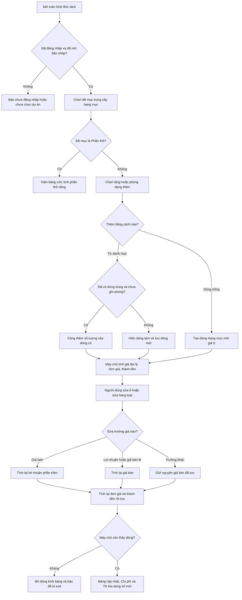

# [QT-10] Bóc tách khối lượng và tính giá từng dòng

| Mục | Giá trị |
|-----|---------|
| Dự án | QS Pro |
| Phiên bản | 1.0 - 2026-10-07 |
| Người yêu cầu | — |
| Ưu tiên | Bình thường |
| Loại | Mô tả hiện trạng |

## 1. Tóm tắt
Ở màn hình Bóc tách, người dùng chọn một đề mục trong cây hạng mục, rồi đưa sản phẩm từ danh mục vào bản nháp đang mở theo từng tầng hoặc phòng, hoặc thêm dòng trống để tự nhập. Mỗi dòng có số lượng và một chuỗi giá (giá bán lẻ, chiết khấu đại lý, lợi nhuận, giá bán, chiết khấu cho khách) để hệ thống tính ra đơn giá và thành tiền. Kết quả là bảng khối lượng có giá, làm nguồn cho Chi phí, Tờ bìa, Báo giá và Mua hàng.

## 2. Tác nhân & quyền
| Tác nhân | Vai trò hệ thống | Được làm gì trong quy trình |
|----------|-----------------|-----------------------------|
| Quản trị hệ thống | `super` | Mọi thao tác trên dòng bóc tách. |
| Quản trị công ty | `admin` | Mọi thao tác trên dòng bóc tách của công ty mình. |
| Nhân viên | `staff` | Mọi thao tác trên dòng bóc tách của công ty mình, nếu được cấp màn hình Bóc tách (`boc`) trong `users.perms`. |
| Người chưa đăng nhập | — | Không làm được gì. |

⚠ Máy chủ chỉ kiểm tra "đã đăng nhập" và "cùng công ty". Quyền vào màn hình Bóc tách chỉ kiểm tra ở giao diện; trong màn hình không có nút nào ẩn theo vai trò (Q-01).

## 3. Điều kiện trước
- Đã đăng nhập và đã mở một bản nháp (xem QT-09). Chưa mở thì bảng hiện "Chưa chọn dự án."
- Danh mục sản phẩm đã tải (để chọn sản phẩm và đối chiếu giá).
- Đề mục đang chọn không phải "Phần thô" (3.1) — đề mục này có bảng ước tính riêng, không dùng các dòng bóc tách mô tả ở đây.

## 4. Luồng chính
| Bước | Ai | Hành động | Hệ thống xử lý | Kết quả người dùng thấy | Đã có / Mới |
|------|----|-----------|----------------|--------------------------|-------------|
| 1 | Người dùng | Mở ô chọn hạng mục và chọn một đề mục trong cây (hoặc một hạng mục tự tạo) | Ghi nhớ đề mục đang bóc, lọc danh mục bên trái theo đề mục, đồng bộ lựa chọn sang các màn hình khác. | Bảng chỉ hiện các dòng thuộc đề mục đó và các đề mục con; số dòng hiện cạnh tên đề mục. | Đã có |
| 2 | Người dùng | Bấm "Thêm tầng", chọn tên có sẵn (tầng hoặc phòng) hoặc gõ tên khác | Viết hoa tên, thêm vào danh sách tầng của bản nháp nếu chưa có, đặt làm tầng đang thêm. | "Đã thêm tầng: …". Tên đã có thì "Tầng … đã có — chuyển sang đang thêm". | Đã có |
| 3 | Người dùng | Bấm dấu cộng trên một sản phẩm ở danh mục (hoặc kéo sản phẩm thả vào một tầng) | Lấy giá bán lẻ và chiết khấu đại lý của sản phẩm làm giá cho dòng. Nếu đã có dòng cùng đề mục, cùng tầng, cùng sản phẩm, cùng mô tả và chưa ghi phòng thì cộng thêm số lượng vào dòng đó. Nếu chưa có thì hiện ngay một dòng tạm rồi lưu lên máy chủ; máy chủ tính các cột giá và trả về dòng thật. | "Đã thêm: …" hoặc "+1 số lượng: …". Bảng cuộn tới dòng mới và nháy nhẹ. | Đã có |
| 4 | Người dùng | Bấm "Thêm hạng mục" ở một tầng để thêm dòng trống | Tạo dòng tên "Hạng mục mới", đơn vị "Cái", số lượng 1, giá 0, thuộc đề mục và tầng đang chọn. | "Đã thêm hạng mục vào … — sửa ngay trong bảng". Con trỏ nằm ở ô tên. | Đã có |
| 5 | Người dùng | Ở ô tên của dòng, bấm nút tìm để chọn sản phẩm từ danh mục, hoặc "Tạo sản phẩm mới" | Chọn: điền tên, thương hiệu, nhà cung cấp, mã, thông số, đơn vị, hình, giá bán lẻ, chiết khấu đại lý của sản phẩm vào dòng. Tạo mới: lưu sản phẩm vào danh mục rồi điền ngược vào dòng. | "Đã chọn: …" hoặc "Đã lưu … vào danh mục và điền vào dòng". | Đã có |
| 6 | Người dùng | Sửa một ô (phòng, tên, số lượng, giá bán lẻ, chiết khấu đại lý, lợi nhuận %, giá bán, chiết khấu khách, ghi chú...) | Cập nhật và tính lại dòng ngay trên màn hình, đồng thời gửi lên máy chủ. Máy chủ tính lại các cột giá và trả dòng đã lưu; chỉ phản hồi của lần sửa mới nhất trên dòng đó được dùng. | Số đổi ngay. Không có thông báo khi thành công. | Đã có |
| 7 | Người dùng | Gõ vào ô Markup %, Margin % hoặc Lợi nhuận (VND) | Tính ngược ra giá bán để đạt mức lợi nhuận đó, rồi lưu như sửa giá bán. | Giá bán, đơn giá, thành tiền đổi theo. | Đã có |
| 8 | Người dùng | Tích chọn nhiều dòng, dùng thanh hàng loạt: "Chuyển tầng", "Lợi nhuận", "Sửa hàng loạt" | Áp cùng một giá trị cho mọi dòng đã chọn, vẽ lại một lần, rồi gửi lên máy chủ theo từng nhóm 6 dòng. Trên 60 dòng thì hỏi lại trước. | "Đã đặt … · n dòng" (kèm "· k dòng lỗi" nếu có). | Đã có |
| 9 | Người dùng | Trong menu "⋯" của thanh hàng loạt: sao chép, nhân bản, hoặc xoá các dòng đã chọn | Nhân bản: tạo dòng mới giống từng dòng đã chọn. Xoá: hỏi lại rồi xoá theo nhóm 5 dòng. | "Đã nhân bản n dòng" / "Đã xoá n dòng". | Đã có |
| 10 | Người dùng | Kéo một dòng thả lên dòng khác hoặc lên tiêu đề tầng | Đổi vị trí và tầng của dòng, đánh lại số thứ tự cho mọi dòng bị dịch, lưu thứ tự và tầng của từng dòng đổi. | Dòng nằm ở vị trí mới. | Đã có |
| 11 | Người dùng | Kéo tiêu đề tầng lên / xuống để đổi thứ tự tầng | Lưu lại thứ tự danh sách tầng của bản nháp. | "Đã đổi thứ tự tầng". | Đã có |
| 12 | Người dùng | Đổi tên một tầng | Lưu tên mới vào danh sách tầng, rồi đổi tầng của mọi dòng thuộc tầng cũ, sau đó tải lại dòng. | "Đã đổi tên tầng". | Đã có |
| 13 | Người dùng | Bấm cột để sắp xếp, hoặc lọc theo giá trị của cột | Sắp xếp / lọc trên màn hình, không lưu. | Bảng hiện theo thứ tự / bộ lọc mới. | Đã có |
| 14 | Người dùng | Bấm nút xoá ở cuối một dòng | Xoá dòng trên máy chủ rồi bỏ khỏi bảng. ⚠ Không hỏi lại. | "Đã xoá". | Đã có |
| 15 | Người dùng | Bấm biểu tượng cập nhật cạnh tên dòng (dòng lệch so với danh mục), chọn phần muốn lấy | Ghi các phần đã chọn (giá bán lẻ, chiết khấu đại lý, tên, thương hiệu, thông số, hình...) từ danh mục vào dòng. | "Đã cập nhật n mục cho dòng …". | Đã có |
| 16 | Người dùng | Bấm nút "Cập nhật giá" trên thanh công cụ, bỏ chọn dòng không muốn đổi, xác nhận | Với từng dòng lệch giá: ghi giá bán lẻ và chiết khấu đại lý mới từ danh mục, giữ nguyên lợi nhuận %, giá bán tính lại theo đó. | "Đã cập nhật giá n dòng". Không có dòng lệch thì "Mọi dòng trong dự án đã khớp giá danh mục". | Đã có |
| 17 | Người dùng | Bật công tắc "Bảng tính" (mặc định) hoặc "Bảng thường" | Đổi cách hiển thị bảng và ghi nhớ trên máy. Bảng tính chỉ là lớp hiển thị: sửa ô, dán nhiều ô, điền xuống, chèn / nhân bản / xoá dòng đều đi qua đúng các bước 6–10 ở trên. | "Đã chuyển sang Bảng tính" / "Đã chuyển sang Bảng thường". | Đã có |
| 18 | Người dùng | Thêm hoặc xoá một hạng mục tự tạo trong cây | Lưu danh sách hạng mục tự tạo vào bản nháp. | "Đã thêm hạng mục: …" / "Đã xoá". | Đã có |

## 5. Sơ đồ

## 6. Luồng phụ & lỗi
| Mã | Tình huống | Hệ thống phản hồi | Thông báo cho người dùng |
|----|-----------|-------------------|--------------------------|
| E1 | Chưa đăng nhập / phiên hết hạn | Từ chối, mã `NOAUTH` | "Phiên đã hết, mời đăng nhập lại." |
| E2 | ⚠ Nhân viên không được cấp màn hình Bóc tách nhưng gọi thẳng chức năng | **Không bị chặn** ở máy chủ | Không có (Q-01) |
| E3 | Chưa mở bản nháp mà thêm sản phẩm | Không gửi | "Chưa chọn dự án — bấm Tạo dự án +" |
| E4 | Chưa mở bản nháp mà thêm tầng / dòng trống / hạng mục tự tạo | Không gửi | "Chưa chọn dự án" |
| E5 | Thêm sản phẩm lỗi ở máy chủ | Gỡ dòng tạm khỏi bảng | "Lỗi thêm: …" |
| E6 | Sửa ô nhưng dòng đã bị xoá ở nơi khác | Máy chủ trả rỗng; giao diện bỏ dòng khỏi bảng | "Dòng này không còn tồn tại (đã bị xoá) — đã cập nhật lại bảng" |
| E7 | Sửa ô lỗi ở máy chủ | Tải lại toàn bộ dòng của bản nháp | "Lỗi sửa: … — đã nạp lại số đang lưu" |
| E8 | Sửa dòng tạm chưa có mã thật | Gom thay đổi, gửi sau khi máy chủ trả mã thật | Không có |
| E9 | Xoá dòng tạm đang chờ lưu | Đánh dấu; khi máy chủ trả mã thật thì xoá luôn | "Đã xoá" |
| E10 | Xoá dòng lỗi | Giữ dòng | "Lỗi xoá: …" |
| E11 | ⚠ Xoá dòng có mã không tồn tại | Máy chủ vẫn trả thành công | "Đã xoá" |
| E12 | Gõ lợi nhuận khi dòng chưa có giá bán lẻ | Không lưu | "Nhập "Giá bán lẻ" (giá vốn nhà cung cấp) trước — chưa có giá vốn thì không tính ngược được lợi nhuận" |
| E13 | Gõ Margin từ 100% trở lên | Không lưu | "Margin phải nhỏ hơn 100%" |
| E14 | Gõ Lợi nhuận (VND) khi số lượng bằng 0 | Không lưu | "Nhập số lượng trước" |
| E15 | Chiết khấu khách từ 100% trở lên khi tính ngược giá bán | Không lưu | "Chiết khấu khách hàng phải nhỏ hơn 100%" |
| E16 | Lợi nhuận âm tới mức giá bán ra số âm | Không lưu | "Lợi nhuận âm quá mức — giá bán ra số âm" |
| E17 | Sửa hoặc dán vào cột tự tính (giá đại lý, đơn giá, thành tiền, hình, dòng sản phẩm, STT) | Không lưu | "Cột này tự tính — không sửa trực tiếp được" |
| E18 | Sửa hàng loạt nhưng chưa nhập giá trị | Không lưu | "Chưa nhập giá trị mới" |
| E19 | Đặt lợi nhuận hàng loạt nhưng chưa nhập % | Không lưu | "Chưa nhập % lợi nhuận" |
| E20 | Sửa hàng loạt nhưng không dòng nào nhận giá trị | Không lưu | "Không có ô nào sửa được" |
| E21 | Sửa hàng loạt trên 60 dòng | Hỏi lại | "Thao tác này sửa n dòng. Tiếp tục?" |
| E22 | Sửa hàng loạt có dòng lỗi | Tải lại dòng từ máy chủ | "… · n dòng · k dòng lỗi" |
| E23 | ⚠ Sửa hàng loạt / cập nhật giá / đổi tên tầng / đổi thứ tự gặp dòng đã bị xoá | Máy chủ trả rỗng, không báo lỗi | Vẫn tính là thành công (Q-04) |
| E24 | Kéo đổi thứ tự lỗi khi lưu | Thứ tự trên màn hình đã đổi, máy chủ có thể chỉ lưu một phần | "Lỗi lưu thứ tự: …" |
| E25 | Tạo sản phẩm mới thiếu tên hoặc nhóm | Không lưu | "Chưa có Tên sản phẩm" / "Chọn/nhập Nhóm — nhóm để lọc trong danh mục" |
| E26 | Tạo sản phẩm mới trùng sản phẩm đã có | Đóng hộp, không điền vào dòng | "Sản phẩm này đã có trong danh mục" |
| E27 | Dán vào ô nhưng trình duyệt chặn đọc bộ nhớ tạm | Không dán | "Trình duyệt chặn đọc clipboard — bấm vào ô rồi nhấn Ctrl+V" |
| E28 | Bảng tính gặp lỗi khi dựng | Tự chuyển về bảng thường tới khi tải lại trang | "Bảng tính lỗi — chuyển về bảng cũ" |
| E29 | ⚠ Nhập số âm, chiết khấu trên 100%, số lượng âm vào ô thường | Giao diện và máy chủ đều không chặn; giá và thành tiền có thể âm | Không có (Q-05) |
| E30 | ⚠ Thêm dòng vào mã bản nháp không tồn tại bằng cách gọi thẳng chức năng | Máy chủ vẫn tạo dòng (không kiểm tra bản nháp) | Không có (Q-06) |
| E31 | Số dòng của một bản nháp chạm 20.000 | Máy chủ chỉ ghi cảnh báo vào nhật ký máy chủ, vẫn trả 20.000 dòng đầu | Không có |

## 8. Quy tắc nghiệp vụ
**Tên cột trên màn hình và ý nghĩa:** Giá bán lẻ = giá niêm yết của nhà cung cấp. Giá đại lý = giá công ty thực mua. Giá bán = giá công ty đưa ra trước chiết khấu cho khách. Đơn giá = giá khách thực trả cho một đơn vị.

| Mã | Quy tắc |
|----|---------|
| BR-01 | **Giá đại lý** = Giá bán lẻ × (1 − Chiết khấu đại lý % / 100), làm tròn đồng. |
| BR-02 | **Giá bán** = Giá bán lẻ × (1 + Lợi nhuận dự kiến % / 100), làm tròn đồng — chỉ tính lại khi người dùng sửa Lợi nhuận % hoặc Giá bán lẻ. |
| BR-03 | Khi người dùng sửa thẳng **Giá bán**: Lợi nhuận dự kiến % = (Giá bán − Giá bán lẻ) / Giá bán lẻ × 100, làm tròn số nguyên; Giá bán lẻ bằng 0 thì Lợi nhuận % = 0. Nếu cùng lúc gửi cả Giá bán và Lợi nhuận % thì Giá bán thắng. |
| BR-04 | Sửa trường khác (phòng, ghi chú, số lượng, chiết khấu...) thì **giữ nguyên Giá bán đã lưu**, không tính lại từ Lợi nhuận %, để giá không trôi do Lợi nhuận % đã làm tròn. |
| BR-05 | **Đơn giá** = Giá bán × (1 − Chiết khấu cho khách % / 100), làm tròn đồng. |
| BR-06 | **Thành tiền** = Số lượng × Đơn giá, làm tròn đồng. **Thành tiền vốn** = Số lượng × Giá đại lý, làm tròn đồng. |
| BR-07 | **Lợi nhuận (VND)** = (Đơn giá − Giá đại lý) × Số lượng, làm tròn đồng. |
| BR-08 | **Markup %** = (Đơn giá − Giá đại lý) / Giá đại lý × 100, làm tròn số nguyên; Giá đại lý không dương thì bằng 0. |
| BR-09 | **Margin %** = (Đơn giá − Giá đại lý) / Đơn giá × 100, làm tròn số nguyên; Đơn giá không dương thì bằng 0. |
| BR-10 | Gõ Markup k%: Đơn giá mong muốn = Giá đại lý × (1 + k/100). Gõ Margin m%: Đơn giá mong muốn = Giá đại lý / (1 − m/100). Gõ Lợi nhuận L đồng: Đơn giá mong muốn = Giá đại lý + L / Số lượng. Sau đó Giá bán = Đơn giá mong muốn / (1 − Chiết khấu khách), làm tròn đồng, rồi áp BR-03. |
| BR-11 | ⚠ "Lợi nhuận dự kiến %" tính trên **Giá bán lẻ** (trước chiết khấu đại lý), còn Markup và Lợi nhuận (VND) tính trên **Giá đại lý**. Hai con số "lợi nhuận" vì thế khác gốc (Q-07). |
| BR-12 | Thêm sản phẩm từ danh mục: nếu sản phẩm có giá bán lẻ thì dòng nhận Giá bán lẻ = giá niêm yết, Chiết khấu đại lý = của sản phẩm, Giá bán = giá niêm yết (lợi nhuận 0%). Sản phẩm chưa có giá bán lẻ thì lấy giá vốn cũ làm Giá bán lẻ, chiết khấu 0, Giá bán = giá bán cũ hoặc bằng giá vốn. |
| BR-13 | Thêm sản phẩm chỉ cộng dồn số lượng khi trùng đề mục, trùng tầng, trùng mã (hoặc tên), trùng mô tả, cùng bảng con, và dòng cũ **chưa ghi phòng**. Ngược lại tạo dòng mới. |
| BR-14 | Số lượng khi thêm: nhỏ nhất là 1 (làm tròn số nguyên) khi thêm từ danh mục; dòng trống thêm ở tầng có số lượng 1. Máy chủ đổi mọi số lượng 0 hoặc không hợp lệ lúc thêm thành 1. ⚠ Vì vậy dòng trống chèn từ menu chuột phải (giao diện gửi số lượng 0) và bản nhân bản của một dòng có số lượng 0 đều ra số lượng 1 (Q-17). |
| BR-15 | Đề mục của dòng: ở màn hình Bóc tách luôn là đề mục người dùng đang chọn. Ở màn hình khác thì lấy theo ngành của sản phẩm, trừ khi đề mục đang chọn đã thuộc ngành đó. |
| BR-16 | Dòng thuộc một đề mục khi mã hạng mục của dòng bằng mã đề mục hoặc bắt đầu bằng mã đề mục + dấu chấm (3.2.6.1 thuộc 3.2.6). |
| BR-17 | Số thứ tự dòng mới = số thứ tự lớn nhất đang có của bản nháp + 1. |
| BR-18 | Tầng là văn bản tự do, viết hoa khi thêm. Dòng không có tầng nằm trong nhóm "CHƯA PHÂN TẦNG". Thứ tự tầng: danh sách tầng của bản nháp trước, rồi các tầng chỉ xuất hiện trên dòng. |
| BR-19 | Dòng trong bảng là **bản chụp** lúc thêm. Sửa sản phẩm trong danh mục không tự đổi dòng; người dùng phải bấm cập nhật (bước 15, 16). |
| BR-20 | Dòng "lệch giá" khi Giá bán lẻ hoặc Chiết khấu đại lý của dòng khác với sản phẩm cùng mã trong danh mục (nhiều sản phẩm cùng mã thì ưu tiên khớp thêm theo tên). |
| BR-21 | Cột chỉ đọc: STT, Hình ảnh, Dòng sản phẩm, Giá đại lý, Đơn giá, Thành tiền. |
| BR-22 | Mọi dòng chỉ thuộc công ty của người tạo; người công ty khác không đọc, sửa, xoá được. |
| BR-23 | Bảng tính và bảng thường dùng chung dữ liệu và chung quy tắc tính; lựa chọn kiểu bảng lưu trên máy người dùng. |

**Đối chiếu công thức máy chủ và giao diện:** BR-01 đến BR-09 được tính giống hệt nhau ở hai nơi (cùng phép làm tròn, cùng thứ tự). Chưa thấy lệch số trong công thức. Các điểm lệch tìm thấy nằm ở phần kiểm tra đầu vào và hành vi phụ — xem các dòng ⚠ ở mục 14.

## 9. Thông báo, realtime & nhật ký
Hệ thống không có realtime. Không thao tác nào trong quy trình này tạo thông báo trong ứng dụng, gửi Lark, hay ghi `audit_log`.

| Sự kiện | Ai nhận | Kênh | Nội dung | Ghi audit? |
|---------|---------|------|----------|:----------:|
| Thêm dòng (từ danh mục, dòng trống, nhân bản) | Không ai | — | — | Không |
| Sửa ô / sửa hàng loạt / đổi thứ tự / đổi tầng | Không ai | — | — | Không |
| Xoá dòng / xoá hàng loạt | Không ai | — | — | Không |
| Cập nhật giá theo danh mục | Không ai | — | — | Không |
| Thêm / đổi tên / sắp lại tầng, thêm / xoá hạng mục tự tạo | Không ai | — | — | Không |

Hai người cùng sửa một bản nháp không thấy thay đổi của nhau cho tới khi tải lại; người lưu sau ghi đè.

## 10. Dữ liệu
| Thông tin | Bắt buộc | Ràng buộc | Ví dụ |
|-----------|----------|-----------|-------|
| Mã bản nháp | Có | ⚠ Máy chủ không kiểm tra tồn tại | DA-20261007-093015K7 |
| Mã hạng mục (`nhom`) | Không | Mã cây hạng mục hoặc tên hạng mục tự tạo | 3.2.6.1 |
| Tầng (`tang`) | Không | Văn bản, trống = chưa phân tầng | TẦNG 1 |
| Phòng (`khuVuc`) | Không | Văn bản | PHÒNG KHÁCH |
| Mã sản phẩm (`maSP`) | Không | Dùng để đối chiếu với danh mục | AD-DL-9W |
| Tên (`ten`) | Không | Dòng trống mặc định "Hạng mục mới" | Đèn downlight 9W |
| Thương hiệu, nhà cung cấp, thông tin chính, thông số thiết kế, hình ảnh, mã số bản vẽ, trạng thái, ghi chú | Không | Văn bản | Ades Lighting |
| Đơn vị tính (`dvt`) | Không | Trống thì là "Cái" | Bộ |
| Số lượng (`soLuong`) | Không | Số; ⚠ không chặn số âm | 12 |
| Giá bán lẻ (`donGiaVon`) | Không | Số; ô tiền nhận kiểu gõ 1.234.567 | 1.200.000 |
| Chiết khấu đại lý % (`chietKhau`) | Không | Số; ⚠ không chặn ngoài 0–100 | 35 |
| Lợi nhuận dự kiến % (`lnPct`) | Không | Số, có thể lẻ khi gõ tay; số nguyên khi tính từ giá bán | 20 |
| Giá bán (`donGiaBan`) | Không | Số | 1.440.000 |
| Chiết khấu cho khách % (`ckKhach`) | Không | Số | 5 |
| Giá đại lý, Đơn giá, Thành tiền, Markup, Margin, Lợi nhuận (VND) | Tự tính | Không sửa trực tiếp được trên máy chủ | 780.000 |
| Giảm giá nhà cung cấp % (`giamGiaNcc`) | Không | Dùng ở màn hình Mua hàng | 3 |
| Tự nhập (`tuNhap`), đã lưu danh mục (`daLuuDM`) | Không | 0 hoặc 1 | 0 |
| Thông tin thêm (`extra`) | Không | Ví dụ ngành hàng, bảng con Nhân công / Vật tư | {"nganh":"Đèn rọi"} |
| Số thứ tự (`stt`) | Có | Tự sinh; đổi khi kéo thả | 14 |

## 11. Màn hình liên quan
- **Bóc tách** (`boc`): panel danh mục bên trái, ô chọn hạng mục kiểu cây, bảng theo tầng, thanh công cụ bảng, thanh hàng loạt, menu chuột phải, tìm và thay.
- **Chế độ Bảng tính** của Bóc tách (cùng dữ liệu, giao diện kiểu bảng tính).
- **Hộp "Cập nhật giá theo Danh sách sản phẩm"** và **hộp "Sản phẩm đã được cập nhật"**.
- **Hộp chọn sản phẩm / tạo sản phẩm mới** cho một dòng.
- Các bảng ở **Chi phí** và **Dự án** dùng chung dòng và chung cách sửa ô (xem QT-12).

## 12. Tiêu chí nghiệm thu
- **AC-01**: Cho bản nháp đang mở, đề mục 3.2.6.1, tầng "TẦNG 1" / Khi thêm sản phẩm có giá bán lẻ 1.000.000 và chiết khấu đại lý 35% / Thì có dòng mới với Giá bán lẻ 1.000.000, Giá đại lý 650.000, Lợi nhuận 0%, Giá bán 1.000.000, Đơn giá 1.000.000, số lượng 1, Thành tiền 1.000.000.
- **AC-02**: Cho người chưa đăng nhập / Khi gọi thêm, sửa hoặc xoá dòng / Thì bị từ chối với mã `NOAUTH`, không có gì thay đổi.
- **AC-03**: Cho người dùng công ty X / Khi sửa hoặc xoá dòng của công ty Y bằng mã dòng / Thì không dòng nào bị đổi.
- **AC-04**: Cho dòng có Giá bán lẻ 1.000.000 / Khi đặt Lợi nhuận 20% / Thì Giá bán = 1.200.000.
- **AC-05**: Cho dòng có Giá bán lẻ 1.000.000 / Khi sửa Giá bán thành 1.234.567 / Thì Lợi nhuận % = 23 và Giá bán vẫn là 1.234.567.
- **AC-06**: Cho dòng ở AC-05 / Khi chỉ sửa ghi chú / Thì Giá bán vẫn là 1.234.567 (không thành 1.230.000).
- **AC-07**: Cho dòng có Giá bán 1.200.000, chiết khấu khách 5%, số lượng 3 / Khi lưu / Thì Đơn giá = 1.140.000 và Thành tiền = 3.420.000.
- **AC-08**: Cho dòng có Giá đại lý 650.000, chiết khấu khách 0% / Khi gõ Margin 35 / Thì Giá bán = 1.000.000.
- **AC-09**: Cho dòng chưa có Giá bán lẻ / Khi gõ Markup 20 / Thì không lưu và hiện "Nhập "Giá bán lẻ" (giá vốn nhà cung cấp) trước — …".
- **AC-10**: Cho đã có dòng sản phẩm A ở TẦNG 1 chưa ghi phòng / Khi thêm sản phẩm A vào TẦNG 1 lần nữa / Thì số lượng dòng cũ tăng 1, không có dòng mới.
- **AC-11**: Cho dòng sản phẩm A ở TẦNG 1 đã ghi phòng "PHÒNG KHÁCH" / Khi thêm sản phẩm A vào TẦNG 1 / Thì có dòng mới.
- **AC-12**: Cho dòng đã bị người khác xoá / Khi sửa một ô của dòng đó / Thì dòng biến mất khỏi bảng và hiện "Dòng này không còn tồn tại (đã bị xoá) — đã cập nhật lại bảng".
- **AC-13**: Cho danh mục vừa đổi giá bán lẻ sản phẩm A / Khi bấm "Cập nhật giá" và xác nhận / Thì dòng của A nhận giá bán lẻ và chiết khấu đại lý mới, Lợi nhuận % giữ nguyên, Giá bán tính lại.
- **AC-14**: Cho 5 dòng đã chọn / Khi "Chuyển tầng" sang "TẦNG 2" / Thì cả 5 dòng thuộc TẦNG 2 và hiện "Đã chuyển sang TẦNG 2 · 5 dòng".
- **AC-15**: Cho đang ở Bảng tính / Khi sửa ô Giá bán / Thì kết quả giống hệt khi sửa ở Bảng thường.

## 13. Ảnh hưởng tới phần có sẵn
- **Chi phí** (QT-12), **Dự án**, **Mua hàng**, **Bảng điều khiển**: đọc cùng các dòng này; sửa ở đây đổi số ở đó.
- **Tờ bìa** (QT-11): cộng thành tiền các dòng theo mã hạng mục.
- **Xuất báo giá**: lấy giá đang lưu trên dòng (bản chụp); có cảnh báo khi dòng lệch giá danh mục.
- **Danh sách sản phẩm**: tạo sản phẩm mới từ dòng sẽ thêm vào danh mục.
- Đổi tên tầng đổi trường tầng trên mọi dòng thuộc tầng đó.

## 14. Giả định & câu hỏi mở
| Mã | Nội dung | Cần ai trả lời |
|----|----------|----------------|
| GD-01 | Giả định các dòng đang lưu có các cột tự tính khớp công thức hiện tại. Dòng nhập từ hệ thống cũ hoặc sao chép nguyên trạng khi nhân bản bản nháp không được tính lại, nên nếu số cũ lệch thì tổng do máy chủ cộng (tờ bìa, báo giá) có thể khác tổng trên màn hình (màn hình luôn tính lại từ các trường gốc). Chưa kiểm tra dữ liệu thật. | Dev |
| GD-02 | Chưa đọc chi tiết phần kéo thả sản phẩm từ danh mục vào tầng và phần vẽ bảng; mô tả dựa trên hàm thêm sản phẩm dùng chung và dòng hướng dẫn trên màn hình. | Dev |
| GD-03 | Phần "bảng con Nhân công / Vật tư" và bảng Phần thô không thuộc phạm vi tài liệu này. | — |
| GD-04 | Chưa đọc toàn bộ tệp bảng tính; kết luận "chỉ là lớp hiển thị" dựa trên ghi chú đầu tệp và các hàm ghi ô, chèn, nhân bản, xoá đã đọc. | Dev |
| Q-01 | ⚠ Thêm, sửa, xoá dòng chỉ cần đăng nhập; máy chủ không kiểm tra quyền màn hình Bóc tách của nhân viên. Có chủ ý không? | Chủ sản phẩm |
| Q-02 | ⚠ Tài liệu kỹ thuật ghi bộ kiểm thử có kiểm tra công thức giá, nhưng thực tế chỉ kiểm tra cách lấy giá từ sản phẩm vào dòng; **không có kiểm thử nào so công thức máy chủ với công thức giao diện**. Có cần bổ sung không? | Dev |
| Q-03 | ⚠ Xoá một dòng bằng nút ở cuối dòng không hỏi lại, trong khi xoá hàng loạt có hỏi. Có cần hỏi lại không? | Chủ sản phẩm |
| Q-04 | ⚠ Khi máy chủ không tìm thấy dòng, nó trả rỗng chứ không báo lỗi. Sửa từng ô thì giao diện xử lý được, nhưng sửa hàng loạt, cập nhật giá theo danh mục, đổi tên tầng, đổi thứ tự và chuyển dòng về đúng hạng mục đều tính trường hợp này là thành công. Có cần báo lỗi không? | Dev |
| Q-05 | ⚠ Không nơi nào chặn số lượng âm, chiết khấu trên 100% hay giá âm khi gõ vào ô thường (chỉ ô Markup / Margin / Lợi nhuận VND có kiểm tra). Có cần giới hạn không? | Chủ sản phẩm |
| Q-06 | ⚠ Thêm dòng không kiểm tra bản nháp có tồn tại; có thể tạo dòng không thuộc bản nháp nào. Có cần chặn không? | Dev |
| Q-07 | ⚠ Cột "Lợi nhuận dự kiến (%)" tính trên Giá bán lẻ, nhưng hộp đặt nhanh ghi "% lợi nhuận trên giá vốn", còn cột Markup ghi "LN/giá vốn" với giá vốn là Giá đại lý. "Giá vốn" đang chỉ hai thứ khác nhau. Ý nghĩa đúng là gì? | Chủ sản phẩm |
| Q-08 | ⚠ Tên trường trong mã nguồn `donGiaVon` thực chất là "Giá bán lẻ" chứ không phải giá vốn; thông báo lỗi E12 cũng gọi nó là "giá vốn nhà cung cấp". Có cần đổi tên cho khỏi nhầm không? | Dev |
| Q-09 | ⚠ Gõ Markup / Margin / Lợi nhuận VND ở một ô thì giá bán âm bị từ chối kèm thông báo; nhưng cùng thao tác qua sửa hàng loạt, dán hoặc bảng tính thì giá bán âm bị ép về 0 và các trường hợp không hợp lệ bị bỏ qua không báo. Có cần thống nhất không? | Dev |
| Q-10 | ⚠ Nhân bản dòng (từng dòng hoặc hàng loạt) không sao chép "Giảm giá nhà cung cấp %", dù ghi chú trong mã nguồn nói trường này lưu trên dòng "để copy theo". Nhân bản cả bản nháp thì có sao chép. Có phải thiếu sót không? | Dev |
| Q-11 | ⚠ Máy chủ có chức năng "thêm dòng trống" riêng nhưng giao diện không gọi; giao diện tự gửi một dòng trống qua chức năng thêm dòng thường. Bỏ chức năng thừa hay dùng lại? | Dev |
| Q-12 | ⚠ Số thứ tự dòng mới lấy theo số lớn nhất đang có; hai người thêm cùng lúc có thể trùng số thứ tự. Có cần xử lý không? | Dev |
| Q-13 | ⚠ Kéo một dòng làm đánh lại số thứ tự mọi dòng phía sau và gửi một yêu cầu cho từng dòng; lỗi giữa chừng để lại thứ tự lưu dở. Đổi tên tầng cũng tương tự (lưu tên trước, đổi từng dòng sau). Có chấp nhận được không? | Dev |
| Q-14 | ⚠ Đổi tên tầng thành tên một tầng đã có sẽ gộp hai tầng mà không hỏi. Có đúng ý không? | Chủ sản phẩm |
| Q-15 | ⚠ Dòng thuộc hạng mục tự tạo, hoặc gắn thẳng vào đề mục cha (3, 3.2, 4, 5), không được cộng vào mục nào của tờ bìa (xem QT-11). Có cần cảnh báo ở Bóc tách không? | Chủ sản phẩm |
| Q-16 | Không thao tác nào được ghi nhật ký, kể cả xoá hàng loạt và đổi giá hàng loạt. Có cần không? | Chủ sản phẩm |
| Q-17 | ⚠ Giao diện gửi số lượng 0 khi chèn dòng trống từ menu chuột phải, nhưng máy chủ đổi 0 thành 1 khi thêm dòng; nhân bản một dòng số lượng 0 cũng ra 1. Muốn dòng trống bắt đầu bằng 0 hay 1? | Chủ sản phẩm |

## 15. Ghi chú kỹ thuật cho dev
- Bảng `db_bao_gia`, lọc theo công ty tự động (`server/libraries/supa.js:19-25`). API khai báo ở `server/components/du-an/du-an.routes.js:17-21`: `getLines`, `addLine`, `addBlankLine`, `updateLine`, `deleteLine` — không có trong `actor`, `admin`, `super`.
- Công thức máy chủ `calc_`: `server/components/du-an/dong-boc-tach.repository.js:27-35`. `addLine` `:36-59` (số lượng 0 thành 1 `:38`, lợi nhuận suy từ giá bán `:40`, số thứ tự `:42-43`). `addBlankLine` `:60-63`. Trường văn bản sửa được `LINE_MAP` `:64-66`. `updateLine` `:67-93` (quy tắc giữ giá bán `:83-87`; trả `null` khi không thấy dòng `:70`). `deleteLine` `:94`. Giới hạn 20.000 dòng: `:23` và `server/libraries/utils.js:27-32`.
- Công thức giao diện: `giaDaiLy_`, `donGiaCK_` `public/app.js:1959-1960`; `ttVon_`, `ttBan_`, `lnVnd_`, `markup_`, `margin_` `:1962-1966`; `recalcLine_` `:1968-1975`. Lấy giá từ sản phẩm `giaDongTuSP_` `public/app.js:1951-1958`.
- Ô sửa: `cellInput` `public/app.js:2012-2045`; tính ngược lợi nhuận `editProfit_` `:2060-2080`; `editLine` (cập nhật lạc quan, chống phản hồi cũ, xử lý dòng đã xoá) `:2081-2104`.
- Cây hạng mục `TREE`: `public/app.js:92-103`; chọn đề mục `pickNode` `:1635-1640`; hạng mục tự tạo `:1641-1656`; đếm dòng theo đề mục `nodeCount` `:1367-1369`; nhãn cột `COLS` `:110-119`.
- Tầng: `floorsList` `public/boc.js:141-148`; thêm tầng `addFloorName` `:192-205`; thêm dòng trống `addItemToFloor` `:209-220`; đổi thứ tự tầng `moveFloor` `:658-662`; đổi tên tầng `renameFloor` `:665-677`.
- Thêm sản phẩm: `prodNode_` `public/boc.js:285-290`; `addProdObj` (cộng dồn, dòng tạm) `:291-340`. Chọn / tạo sản phẩm cho dòng: `pickProduct` `:733-737`, `submitCreateProduct` `:777-798`.
- Kéo dòng: `tkMoveLine_` `public/boc.js:804-821`. Xoá dòng: `delLine` `:822-828`.
- Hàng loạt: cột chỉ đọc và `tkFieldsFor_` `public/boc.js:951-969`; `tkApplyEdits_` `:971-987`; lợi nhuận `tkBulkLn_` `:1056-1060`; sửa cột `tkBulkEditRun_` `:1078-1087`; nhân bản `tkBulkDup_` `:1112-1123`; xoá `tkBulkDel_` `:1124-1135`. Nhân bản / chèn dòng từ menu: `:33-46`.
- Đồng bộ danh mục: so sánh `lnDiff_` `public/boc.js:1424-1436`; áp cho một dòng `lnUpdApply_` `:1481-1497`; danh sách lệch giá `giaLechList_` `:1513-1519`; áp hàng loạt `giaSyncApply_` `:1567-1584`.
- Vẽ bảng và nhánh Phần thô / bảng tính: `renderTable` `public/boc.js:454-497`.
- Bảng tính: công tắc chế độ `public/bangtinh.js:10-23`; chèn / nhân bản / xoá dòng `:219-236`; hiển thị ô `tkSheetO_` `:405-423`; ghi ô `btLineGhiO_` `:765-776`.
- Kiểm thử liên quan: lấy giá từ sản phẩm `scripts/test-core.js:19-23`; đọc số kiểu Việt Nam giống nhau ở hai phía `:13-18`. Không có kiểm thử cho `calc_` so với `recalcLine_`.
- Không có tham chiếu tới audit, thông báo hay Lark trong `server/components/du-an/`. Không realtime, không job nền.

## Lịch sử thay đổi
| Phiên bản | Ngày | Thay đổi |
|-----------|------|----------|
| 1.0 | 2026-10-07 | Tạo mới |
