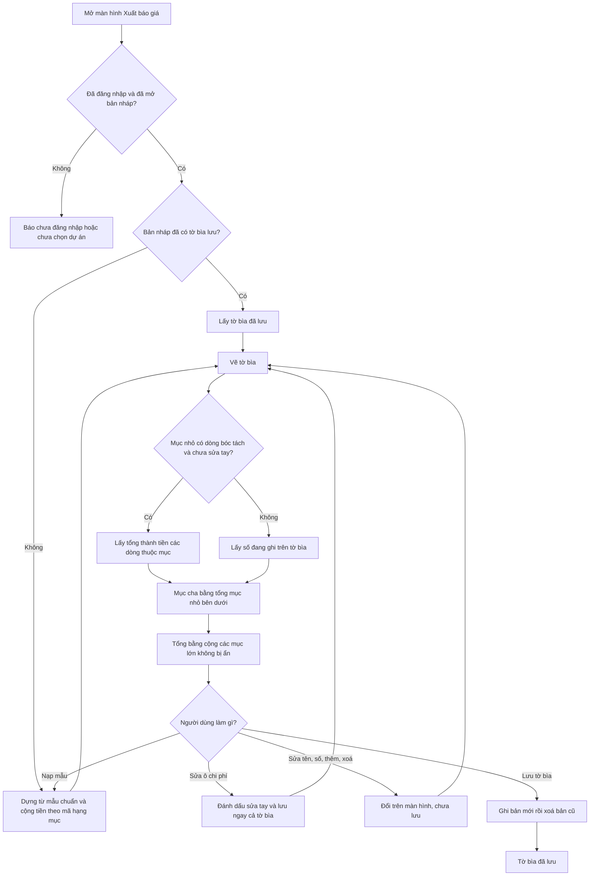

# [QT-11] Tờ bìa (khái toán chi phí dự án)

| Mục | Giá trị |
|-----|---------|
| Dự án | QS Pro |
| Phiên bản | 1.0 - 2026-10-07 |
| Người yêu cầu | — |
| Ưu tiên | Bình thường |
| Loại | Mô tả hiện trạng |

## 1. Tóm tắt
Tờ bìa là bảng ước tính chi phí của cả dự án, chia theo các mục lớn (tư vấn, thiết kế, xây dựng, nội thất, bảo dưỡng) và mục nhỏ bên dưới. Khi người dùng mở màn hình Xuất báo giá, hệ thống lấy tờ bìa đã lưu của bản nháp, hoặc dựng mới từ mẫu chuẩn. Các mục nhỏ tự cộng tiền từ dòng bóc tách có mã hạng mục tương ứng; người dùng có thể sửa tay, thêm bớt mục, ẩn mục lớn rồi lưu lại.

## 2. Tác nhân & quyền
| Tác nhân | Vai trò hệ thống | Được làm gì trong quy trình |
|----------|-----------------|-----------------------------|
| Quản trị hệ thống | `super` | Xem, nạp mẫu, sửa, lưu tờ bìa của mọi bản nháp. |
| Quản trị công ty | `admin` | Xem, nạp mẫu, sửa, lưu tờ bìa của bản nháp thuộc công ty mình. |
| Nhân viên | `staff` | Như `admin`, nếu được cấp màn hình Xuất báo giá (`export`) trong `users.perms`. |
| Người chưa đăng nhập | — | Không làm được gì. |

⚠ Máy chủ chỉ kiểm tra "đã đăng nhập" và "cùng công ty". Quyền vào màn hình Xuất báo giá chỉ kiểm tra ở giao diện (Q-01).

## 3. Điều kiện trước
- Đã đăng nhập và đã mở một bản nháp (QT-09). Chưa mở thì màn hình hiện "Chưa chọn dự án."
- Muốn sửa tờ bìa: chuyển màn hình Xuất báo giá sang chế độ chỉnh sửa (mặc định là chế độ xem trước tài liệu).
- Muốn có số tự cộng: bản nháp đã có dòng bóc tách (QT-10) mang mã hạng mục trùng hoặc nằm dưới mã mục tờ bìa.

## 4. Luồng chính
| Bước | Ai | Hành động | Hệ thống xử lý | Kết quả người dùng thấy | Đã có / Mới |
|------|----|-----------|----------------|--------------------------|-------------|
| 1 | Người dùng | Mở màn hình Xuất báo giá | Nếu chưa tải tờ bìa của bản nháp này: lấy tờ bìa đã lưu. Nếu chưa có dòng nào đã lưu thì dựng từ mẫu chuẩn 26 mục và cộng sẵn tiền từ dòng bóc tách vào các mục nhỏ (bước này **không lưu**, chỉ trả về để hiển thị). | "Đang tải tờ bìa…" rồi hiện tài liệu. | Đã có |
| 2 | Hệ thống | (mỗi lần vẽ tờ bìa) | Với từng mục nhỏ nhất: nếu bản nháp có dòng bóc tách thuộc mục và mục chưa bị đánh dấu "sửa tay" thì lấy tổng thành tiền các dòng đó; riêng mục Phần thô (3.1) cộng thêm tổng của bảng phần thô. Ngược lại lấy số đang ghi trên tờ bìa. Mục có mục con = tổng các mục nhỏ nhất bên dưới. Tổng = cộng các mục lớn không bị ẩn. | Cột chi phí và tỷ trọng % của từng mục; nhãn "tự động" hoặc "sửa tay ↺" cạnh mục có dòng bóc tách. | Đã có |
| 3 | Người dùng | Sửa ô chi phí của một mục nhỏ nhất | Ghi số mới, đánh dấu mục là "sửa tay" (lưu theo bản nháp), và **lưu ngay toàn bộ tờ bìa**. | Số mới hiện kèm nhãn "sửa tay ↺". Không có thông báo khi thành công. | Đã có |
| 4 | Người dùng | Bấm nhãn "sửa tay ↺" của một mục | Bỏ đánh dấu sửa tay của mục đó. | Mục trở về số tự cộng, nhãn thành "tự động". | Đã có |
| 5 | Người dùng | Bấm "Lấy lại số từ bóc tách" | Bỏ mọi đánh dấu sửa tay của bản nháp. | "Đã bỏ n số sửa tay — tờ bìa lấy lại số từ bóc tách" hoặc "Tờ bìa đang lấy đúng số từ bóc tách". | Đã có |
| 6 | Người dùng | Sửa số thứ tự, tên hoặc mô tả của một mục | Cập nhật trên màn hình. Số thứ tự chỉ giữ chữ số và dấu chấm; dòng tự xếp lại theo số. **Chưa lưu.** | Tờ bìa vẽ lại. | Đã có |
| 7 | Người dùng | Bấm "Thêm mục lớn" hoặc "Thêm mục nhỏ" | Thêm "Mục mới" với số kế tiếp, hoặc "Mục nhỏ" dưới mục lớn cuối cùng. **Chưa lưu.** | Dòng mới xuất hiện với chi phí 0. | Đã có |
| 8 | Người dùng | Bấm xoá một mục | Bỏ mục khỏi tờ bìa trên màn hình. ⚠ Không hỏi lại. **Chưa lưu.** | Dòng biến mất. | Đã có |
| 9 | Người dùng | Bấm chip một mục lớn ở "Chọn mục hiện trên tờ bìa" | Đánh dấu ẩn / hiện mục lớn đó (lưu theo bản nháp). Mục ẩn không tính vào tổng. | Chip mờ đi; mục và các mục con biến khỏi tờ bìa. | Đã có |
| 10 | Người dùng | Sửa ô thông tin đầu tờ bìa (mã báo giá, khách hàng, quy mô, diện tích, nhu cầu, phân khúc) | Ghi ngay từng ô vào thông tin bản nháp. | Không có thông báo khi thành công. | Đã có |
| 11 | Người dùng | Bấm "Nạp mẫu" | Dựng lại tờ bìa từ mẫu chuẩn và cộng tiền từ dòng bóc tách, thay tờ bìa đang hiện. ⚠ Không hỏi lại. **Chưa lưu.** | "Đã nạp mẫu + tự cộng chi phí". | Đã có |
| 12 | Người dùng | Bấm "Lưu tờ bìa" | Ghi toàn bộ các dòng đang có thành bản mới, sau đó xoá các dòng cũ, rồi trả lại tờ bìa vừa lưu. | "Đã lưu tờ bìa". | Đã có |
| 13 | Người dùng | Chọn "Mẫu 1" hoặc "Mẫu 2" | Đổi cách trình bày bảng tờ bìa, ghi nhớ trên máy. | Bảng đổi bố cục. | Đã có |
| 14 | Người dùng | Xuất báo giá ra Excel | Trước khi xuất, chép số đang hiện của mọi mục nhỏ nhất (kể cả số tự cộng) vào tờ bìa rồi lưu, để tệp xuất khớp màn hình. | Tệp Excel có tờ bìa đúng số đang xem. | Đã có |

## 5. Sơ đồ

## 6. Luồng phụ & lỗi
| Mã | Tình huống | Hệ thống phản hồi | Thông báo cho người dùng |
|----|-----------|-------------------|--------------------------|
| E1 | Chưa đăng nhập / phiên hết hạn | Từ chối, mã `NOAUTH` | "Phiên đã hết, mời đăng nhập lại." |
| E2 | ⚠ Nhân viên không được cấp màn hình Xuất báo giá nhưng gọi thẳng chức năng | **Không bị chặn** ở máy chủ | Không có (Q-01) |
| E3 | Chưa mở bản nháp | Không tải | "Chưa chọn dự án." |
| E4 | Tải tờ bìa lỗi | Không vẽ tờ bìa | "Lỗi tải tờ bìa: …" |
| E5 | Đổi sang bản nháp khác trong lúc đang tải tờ bìa | Bỏ kết quả của bản nháp cũ | Không có |
| E6 | ⚠ Mã bản nháp không tồn tại | Máy chủ không kiểm tra; trả tờ bìa mẫu với mọi mục bằng 0 | Không có (Q-08) |
| E7 | Lưu ngay sau khi sửa ô chi phí bị lỗi | Số trên màn hình đã đổi nhưng chưa lưu được | "Lỗi lưu tờ bìa: …" |
| E8 | Bấm "Lưu tờ bìa" bị lỗi | Giữ tờ bìa trên màn hình | "Lỗi: …" |
| E9 | Lưu hỏng sau khi đã ghi bản mới nhưng chưa xoá được bản cũ | Bản cũ còn nguyên (không mất dữ liệu). ⚠ Nhưng cả bản mới lẫn bản cũ cùng tồn tại nên lần tải sau thấy tờ bìa bị lặp dòng | "Lỗi: …" (Q-04) |
| E10 | "Nạp mẫu" bị lỗi | Giữ tờ bìa cũ | "Lỗi: …" |
| E11 | "Lấy lại số từ bóc tách" khi chưa có tờ bìa | Không làm gì | "Chưa có tờ bìa. Bấm ↻ Nạp mẫu trước." |
| E12 | Tờ bìa không có dòng nào | Bảng trống | "Chưa có dòng. Bấm ↻ Nạp lại mẫu." |
| E13 | Gõ chữ vào ô chi phí | Đọc thành số theo kiểu Việt Nam; không đọc được thì thành 0 | Không có |
| E14 | ⚠ Lưu tờ bìa khi đã xoá hết mọi dòng | Xoá hết dòng đã lưu; lần mở sau hệ thống dựng lại từ mẫu | "Đã lưu tờ bìa" |
| E15 | Người dùng rời bản nháp khi còn thay đổi chưa lưu (bước 6, 7, 8, 11) | Thay đổi mất, không cảnh báo | Không có (Q-05) |

## 8. Quy tắc nghiệp vụ
| Mã | Quy tắc |
|----|---------|
| BR-01 | Số thứ tự của mục tờ bìa chính là mã cây hạng mục ở màn hình Bóc tách. |
| BR-02 | Một dòng bóc tách thuộc mục tờ bìa khi mã hạng mục của dòng bằng số thứ tự mục, hoặc bắt đầu bằng số thứ tự mục + dấu chấm. Ví dụ dòng mã 3.2.6.1 cộng vào mục 3.2.6; dòng mã 3.2.60 không thuộc 3.2.6. |
| BR-03 | Chỉ **mục nhỏ nhất** (không có mục con) mới cộng tiền trực tiếp từ dòng bóc tách. |
| BR-04 | Mục có mục con = tổng các mục nhỏ nhất bên dưới nó (số ghi trên chính mục cha bị bỏ qua). |
| BR-05 | Tổng tờ bìa = cộng các mục cấp một (số thứ tự không có dấu chấm). Trên màn hình, mục lớn đã ẩn không được cộng. |
| BR-06 | Mẫu chuẩn có 26 mục: 1 Tư vấn dự án (1.1); 2 Tư vấn thiết kế (2.1–2.4); 3 Xây dựng (3.1 Phần thô, 3.2 Phần hoàn thiện cơ bản với 3.2.1–3.2.8); 4 Hoàn thiện nội thất (4.1–4.4); 5 Bảo dưỡng (5.1, 5.2). |
| BR-07 | Khi máy chủ dựng từ mẫu: chi phí mục nhỏ nhất = tổng thành tiền đã lưu của các dòng thuộc mục, làm tròn đồng; mục có con để 0. |
| BR-08 | Khi hiển thị: mục nhỏ nhất có ít nhất một dòng bóc tách và không bị đánh dấu sửa tay thì luôn hiện số tự cộng theo dòng hiện tại, bất kể số đã lưu. Mục không có dòng nào hoặc đã sửa tay thì hiện số đã ghi. |
| BR-09 | Mục Phần thô (3.1) được cộng thêm tổng của bảng ước tính phần thô khi hiển thị. ⚠ Máy chủ không biết bảng phần thô nên số do máy chủ dựng cho 3.1 không có phần này (Q-02). |
| BR-10 | Sửa ô chi phí của mục nào thì mục đó thành "sửa tay" cho tới khi người dùng bỏ đánh dấu. Đánh dấu sửa tay và danh sách mục ẩn lưu theo bản nháp trong phần cài đặt báo giá. |
| BR-11 | Lần đầu mở, tờ bìa dựng từ mẫu chỉ được hiển thị; nó chỉ được lưu khi người dùng sửa ô chi phí, bấm "Lưu tờ bìa" hoặc xuất Excel. |
| BR-12 | Lưu tờ bìa thay toàn bộ: ghi bản mới trước, xoá bản cũ sau, để lỗi giữa chừng không làm mất tờ bìa. Thứ tự dòng lưu theo thứ tự đang có trên màn hình. |
| BR-13 | Số thứ tự mục chỉ gồm chữ số và dấu chấm. ⚠ Không kiểm tra trùng số thứ tự. |
| BR-14 | Mỗi bản nháp có tờ bìa riêng; người công ty khác không đọc hay ghi được. |
| BR-15 | Tỷ trọng % của mục = chi phí mục / tổng tờ bìa × 100, hai số lẻ. |

**Các bất biến đang được kiểm thử tự động:**
- Mục cha = tổng mục nhỏ nhất bên dưới, tổng = cộng mục cấp một (kiểm tra: mục 3.2 = 12, mục 3 = 15, tổng = 25 với bộ số mẫu, bỏ qua số 999 ghi trên mục cha).
- Mọi mục của mẫu tờ bìa (trừ nhóm 5 Bảo dưỡng) phải có trong cây hạng mục Bóc tách.
- Mọi mã trong bảng nhà cung cấp gợi ý phần 3.2 phải có trong cây hạng mục.
- Quy tắc thuộc mục: 3.2.6.1 thuộc 3.2.6; 3.2.6 thuộc 3.2.6; 3.2.60 không thuộc 3.2.6.

## 9. Thông báo, realtime & nhật ký
Hệ thống không có realtime. Không thao tác nào trong quy trình này tạo thông báo trong ứng dụng, gửi Lark, hay ghi `audit_log`.

| Sự kiện | Ai nhận | Kênh | Nội dung | Ghi audit? |
|---------|---------|------|----------|:----------:|
| Dựng tờ bìa từ mẫu / nạp lại mẫu | Không ai | — | — | Không (và không ghi dữ liệu) |
| Sửa ô chi phí (lưu ngay) | Không ai | — | — | Không |
| Lưu tờ bìa | Không ai | — | — | Không |
| Đánh dấu / bỏ sửa tay, ẩn / hiện mục lớn | Không ai | — | Lưu trong dữ liệu rời của bản nháp, có tên người sửa lần cuối | Không |
| Sửa thông tin đầu tờ bìa | Không ai | — | — | Không |

## 10. Dữ liệu
| Thông tin | Bắt buộc | Ràng buộc | Ví dụ |
|-----------|----------|-----------|-------|
| Mã bản nháp | Có | ⚠ Máy chủ không kiểm tra tồn tại | DA-20261007-093015K7 |
| Số thứ tự mục (`stt`) | Có | Chữ số và dấu chấm; trùng mã cây hạng mục thì mới tự cộng được | 3.2.6 |
| Tên mục (`hangMuc`) | Không | Văn bản | Thiết bị điện |
| Mô tả (`moTa`) | Không | Văn bản | Đèn, công tắc - ổ cắm: cung cấp thiết bị và nhân công lắp đặt |
| Chi phí (`chiPhi`) | Không | Số; với mục có dòng bóc tách, số này chỉ được dùng khi mục ở trạng thái sửa tay | 185.000.000 |
| Thứ tự dòng | Có | Tự ghi theo vị trí khi lưu | 15 |
| Đánh dấu sửa tay (`bgCfg.tay`) | Không | Danh sách số thứ tự mục, lưu trong dữ liệu rời của bản nháp | {"3.2.6":1} |
| Mục lớn đã ẩn (`bgCfg.an`) | Không | Danh sách số thứ tự mục cấp một | {"5":1} |
| Thông tin đầu tờ bìa | Không | Lưu trên bản nháp: mã báo giá, khách hàng, quy mô, tổng diện tích, diện tích báo giá, nhu cầu, phân khúc | BG-2026-015 |
| Kiểu trình bày (Mẫu 1 / Mẫu 2) | Không | Lưu trên máy người dùng, mặc định Mẫu 2 | m2 |

## 11. Màn hình liên quan
- **Xuất báo giá** (`export`), chế độ chỉnh sửa: thẻ "Chọn mục hiện trên tờ bìa", thẻ "Tờ bìa — Ước tính chi phí dự án" (Mẫu 1 / Mẫu 2, Nạp mẫu, Lấy lại số từ bóc tách, Lưu tờ bìa), thẻ bảng tính diện tích.
- **Xuất báo giá**, chế độ xem trước tài liệu: trang đầu là tờ bìa của cả dự án.
- **Bóc tách** (QT-10): nơi tạo ra các dòng được cộng vào tờ bìa.

## 12. Tiêu chí nghiệm thu
- **AC-01**: Cho bản nháp chưa từng lưu tờ bìa / Khi mở màn hình Xuất báo giá / Thì thấy tờ bìa 26 mục theo mẫu chuẩn và chưa có dòng tờ bìa nào được lưu.
- **AC-02**: Cho người chưa đăng nhập / Khi gọi lấy, nạp mẫu hoặc lưu tờ bìa / Thì bị từ chối với mã `NOAUTH`.
- **AC-03**: Cho người dùng công ty X / Khi lấy tờ bìa của bản nháp công ty Y / Thì không nhận được dòng đã lưu nào của công ty Y.
- **AC-04**: Cho bản nháp có hai dòng bóc tách mã 3.2.6.1 thành tiền 1.000.000 và 2.000.000, một dòng mã 3.2.6.2 thành tiền 500.000 / Khi xem tờ bìa / Thì mục 3.2.6 = 3.500.000 với nhãn "tự động".
- **AC-05**: Cho tình huống AC-04 / Khi xem mục 3.2 và mục 3 / Thì mỗi mục bằng tổng các mục nhỏ nhất bên dưới nó, không cộng số ghi trên chính nó.
- **AC-06**: Cho mục 3.2.6 đang "tự động" / Khi sửa ô chi phí thành 4.000.000 / Thì mục hiện 4.000.000 với nhãn "sửa tay ↺" và tờ bìa được lưu ngay.
- **AC-07**: Cho mục 3.2.6 đang "sửa tay" / Khi bấm nhãn "sửa tay ↺" / Thì mục trở về 3.500.000.
- **AC-08**: Cho mục lớn 5 đang hiện / Khi bấm chip của mục 5 để ẩn / Thì mục 5 và mục con biến khỏi tờ bìa và tổng không còn cộng mục 5.
- **AC-09**: Cho dòng bóc tách mã 3.2.60 / Khi xem tờ bìa / Thì dòng đó không cộng vào mục 3.2.6.
- **AC-10**: Cho tờ bìa đã thêm một mục nhỏ / Khi bấm "Lưu tờ bìa" rồi tải lại trang / Thì mục nhỏ vẫn còn và hiện "Đã lưu tờ bìa".
- **AC-11**: Cho tờ bìa đã tuỳ chỉnh / Khi bấm "Nạp mẫu" / Thì tờ bìa trở về 26 mục chuẩn và hiện "Đã nạp mẫu + tự cộng chi phí".
- **AC-12**: Cho chưa mở bản nháp / Khi vào màn hình Xuất báo giá / Thì thấy "Chưa chọn dự án."

## 13. Ảnh hưởng tới phần có sẵn
- **Xuất báo giá** (xem trước, PDF, Excel) dùng tờ bìa làm trang đầu; tệp Excel đọc tờ bìa đã lưu nên hệ thống lưu lại trước khi xuất.
- **Nhân bản bản nháp** (QT-09) sao chép các dòng tờ bìa đã lưu và cài đặt báo giá (gồm đánh dấu sửa tay, mục ẩn).
- **Xoá bản nháp** (QT-09) xoá tờ bìa.
- Đổi mã hạng mục của dòng bóc tách (QT-10, QT-12) làm số tự cộng của tờ bìa đổi theo.
- Sửa thông tin đầu tờ bìa là sửa thẳng thông tin bản nháp (QT-09).

## 14. Giả định & câu hỏi mở
| Mã | Nội dung | Cần ai trả lời |
|----|----------|----------------|
| GD-01 | Chỉ đọc phần tờ bìa của tệp màn hình Xuất báo giá; phần xem trước tài liệu, in PDF, lịch sử phiên bản và chiết khấu tổng không thuộc tài liệu này. | — |
| GD-02 | Giả định thành tiền đã lưu của dòng bóc tách khớp công thức hiện tại (xem GD-01 của QT-10). Nếu không, số máy chủ dựng và số màn hình tự cộng có thể lệch nhau. | Dev |
| GD-03 | Chưa đọc cách tệp Excel dựng trang tờ bìa ngoài việc xác nhận nó lọc mục ẩn rồi mới tính tổng. | Dev |
| Q-01 | ⚠ Lấy, nạp mẫu và lưu tờ bìa chỉ cần đăng nhập; máy chủ không kiểm tra quyền màn hình Xuất báo giá của nhân viên. Có chủ ý không? | Chủ sản phẩm |
| Q-02 | ⚠ Số do máy chủ dựng từ mẫu cộng theo thành tiền **đã lưu** và không có Phần thô, còn màn hình tự cộng lại từ các trường của dòng và có cộng Phần thô vào mục 3.1. Hai cách tính cùng tồn tại; cái nào là chuẩn? | Dev |
| Q-03 | ⚠ "Lưu tờ bìa" lưu số đang ghi chứ không lưu số tự cộng đang hiện; chỉ khi xuất Excel hệ thống mới chép số đang hiện vào rồi lưu. Sau khi bấm "Lưu tờ bìa", số trong dữ liệu có thể khác số trên màn hình. Có đúng ý không? | Chủ sản phẩm |
| Q-04 | ⚠ Lưu tờ bìa không phải một thao tác trọn vẹn: ghi mới rồi mới xoá cũ. Sửa nhanh nhiều ô chi phí liên tiếp tạo nhiều lần lưu chạy song song, có thể để lại tờ bìa bị lặp dòng; lỗi ở bước xoá cũng gây lặp. Có cần khoá hoặc gom lần lưu không? | Dev |
| Q-05 | ⚠ Sửa tên, số thứ tự, thêm, xoá mục và "Nạp mẫu" chỉ đổi trên màn hình, mất khi chuyển bản nháp mà không cảnh báo; nhưng chỉ cần sửa một ô chi phí là mọi thay đổi chưa lưu đó bị lưu kèm theo. Hành vi nào là mong muốn? | Chủ sản phẩm |
| Q-06 | ⚠ Dòng bóc tách thuộc hạng mục tự tạo, hoặc gắn thẳng vào mục cha (ví dụ 3, 3.2, 4) hay nhóm 5, không khớp mục nhỏ nhất nào nên **không vào tờ bìa**, trong khi vẫn nằm trong tổng báo giá. Tổng tờ bìa có thể nhỏ hơn tổng báo giá. Có cần mục "Khác" hoặc cảnh báo không? | Chủ sản phẩm |
| Q-07 | ⚠ "Nạp mẫu" không xoá các đánh dấu sửa tay cũ, nên sau khi nạp, mục từng sửa tay vẫn hiện nhãn "sửa tay" dù số là số máy chủ vừa cộng. Có nên xoá đánh dấu khi nạp mẫu không? | Chủ sản phẩm |
| Q-08 | ⚠ Lấy hoặc lưu tờ bìa với mã bản nháp không tồn tại không báo lỗi; có thể lưu tờ bìa cho một mã không có bản nháp. Có cần chặn không? | Dev |
| Q-09 | ⚠ "Nạp mẫu" và xoá mục không hỏi lại. Có cần hỏi lại không? | Chủ sản phẩm |
| Q-10 | ⚠ Nếu người dùng thêm mục con dưới một mục đang tự cộng (ví dụ thêm 3.2.6.1 dưới 3.2.6), mục cha thôi tự cộng trực tiếp và chỉ còn tính các dòng khớp mục con; dòng mã 3.2.6.2 sẽ rơi khỏi tờ bìa. Có đúng ý không? | Chủ sản phẩm |
| Q-11 | ⚠ Tên mục trong mẫu tờ bìa khác tên trong cây hạng mục ở vài chỗ (ví dụ 3.2.1 "Trần thạch cao" so với "Thạch cao", 4.2 "Đồ rời (Loose furniture)" so với "Nội thất rời"). Có cần thống nhất không? | Chủ sản phẩm |
| Q-12 | Không thao tác nào được ghi nhật ký. Có cần ghi khi lưu tờ bìa không? | Chủ sản phẩm |

## 15. Ghi chú kỹ thuật cho dev
- Bảng `khai_toan` (cột `ma_da`, `stt`, `hang_muc`, `mo_ta`, `chi_phi`, `sort_no`), lọc theo công ty tự động (`server/libraries/supa.js:19-25`).
- API khai báo ở `server/components/du-an/du-an.routes.js:22-24`: `saveCover`, `buildCoverFromTemplate`, `getCoverOrInit` — không có trong `actor`, `admin`, `super`.
- `getCover` `server/components/du-an/khai-toan.repository.js:8-11`; `buildCoverFromTemplate` `:13-24` (xác định mục nhỏ nhất theo mẫu `:18`, cộng `thanhTienBan` `:21`); `getCoverOrInit` `:25-29`; `saveCover` (ghi mới rồi xoá cũ) `:30-37`.
- Mẫu `COVER_TEMPLATE` `server/components/du-an/cover-template.js:19-46`; `inCode` `:48`; `coverComputed_` (mục cha = tổng mục lá, tổng = cấp một) `:52-64`.
- Client: `coverCosts` `public/baogia.js:20-28`; mục ẩn `bgAn_` / `bgHidden` / `bgToggle` `:30-32`; sửa thông tin đầu tờ bìa `coverInfo` `:34`; `coverEdit` (ô chi phí lưu ngay) `:36-40`; xoá / thêm mục `:41-48`; `coverReload` `:49`; `coverSave` `:50`.
- Tự cộng phía client: `coverAutoOf_` (có cộng Phần thô cho 3.1) `public/baogia.js:1035-1039`; `coverLeafVal_` `:1040`; `coverTaySet_` `:1041`; nhãn `coverTag_` `:1042-1047`. Cài đặt lưu qua `bgOptSet_` `:1033` vào khoá `bgCfg` của `du_an_data` (QT-09).
- Bảng tờ bìa: Mẫu 2 `public/baogia.js:658-676`; Mẫu 1 `:678-701`. Tải tờ bìa khi mở tab: `renderExport` `:734-746`. "Lấy lại số từ bóc tách" `coverAutoFill` `:805-810`. Lưu trước khi xuất Excel `:843-847`.
- Xuất Excel lọc mục ẩn trước khi tính: `server/components/xuat-file/bao-gia.export.js:474`; trang tờ bìa dùng `coverComputed_` `:91-93`.
- Kiểm thử: mục cha / tổng `scripts/test-core.js:70-74`; mã mẫu thuộc cây hạng mục và `inCode` `:76-81`.
- Cây hạng mục `TREE`: `public/app.js:92-103`.
- Không có tham chiếu tới audit, thông báo hay Lark trong `server/components/du-an/`. Không realtime, không job nền.

## Lịch sử thay đổi
| Phiên bản | Ngày | Thay đổi |
|-----------|------|----------|
| 1.0 | 2026-10-07 | Tạo mới |
