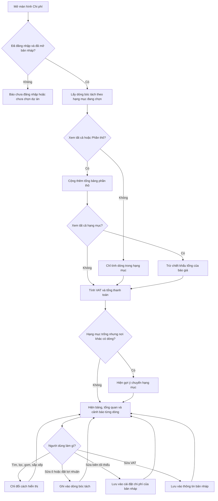

# [QT-12] Bảng chi phí (giá vốn, giá bán, lợi nhuận)

| Mục | Giá trị |
|-----|---------|
| Dự án | QS Pro |
| Phiên bản | 1.0 - 2026-10-07 |
| Người yêu cầu | — |
| Ưu tiên | Bình thường |
| Loại | Mô tả hiện trạng |

## 1. Tóm tắt
Màn hình Chi phí cho người dùng nhìn các dòng bóc tách của bản nháp đang mở dưới góc độ tiền: giá vốn, giá bán, lợi nhuận, biên, VAT và tổng thanh toán. Người dùng lọc theo hạng mục, tìm, gom nhóm, xem cảnh báo dòng lỗ hoặc biên thấp, và sửa giá ngay tại đây. Màn hình này không có dữ liệu riêng: mọi thay đổi về giá ghi thẳng vào dòng bóc tách.

## 2. Tác nhân & quyền
| Tác nhân | Vai trò hệ thống | Được làm gì trong quy trình |
|----------|-----------------|-----------------------------|
| Quản trị hệ thống | `super` | Xem và sửa mọi thứ trên màn hình. |
| Quản trị công ty | `admin` | Xem và sửa trên bản nháp của công ty mình. |
| Nhân viên | `staff` | Như `admin`, nếu được cấp màn hình Chi phí (`chiphi`) trong `users.perms`. |
| Người chưa đăng nhập | — | Không làm được gì. |

⚠ Màn hình này hiển thị giá vốn và lợi nhuận. Việc giấu màn hình với nhân viên không được cấp quyền chỉ làm ở giao diện; máy chủ trả đầy đủ giá vốn của mọi dòng cho bất kỳ ai đã đăng nhập cùng công ty (Q-01).

## 3. Điều kiện trước
- Đã đăng nhập và đã mở một bản nháp (QT-09). Chưa mở thì màn hình hiện "Chưa chọn dự án".
- Bản nháp có dòng bóc tách (QT-10). Chưa có thì bảng hiện "Chưa có hạng mục nào. Vào tab Bóc tách để thêm sản phẩm."
- Danh mục sản phẩm đã tải (để nhận biết dòng lệch giá).

## 4. Luồng chính
| Bước | Ai | Hành động | Hệ thống xử lý | Kết quả người dùng thấy | Đã có / Mới |
|------|----|-----------|----------------|--------------------------|-------------|
| 1 | Người dùng | Mở màn hình Chi phí | Lấy các dòng bóc tách đã tải của bản nháp, lọc theo hạng mục đang chọn chung cho mọi màn hình. Tính tổng vốn, giá bán, lợi nhuận, biên, VAT, tổng thanh toán trên phạm vi đó. | Dải số tổng ở đầu trang, thẻ "Tổng quan chi phí", thanh công cụ, bảng dòng. | Đã có |
| 2 | Hệ thống | (khi xem tất cả hạng mục, hoặc hạng mục Phần thô) | Cộng thêm tổng của bảng phần thô vào giá bán và giá vốn. Khi xem tất cả hạng mục còn trừ chiết khấu tổng của báo giá trước khi tính VAT. | Ô "CK báo giá" xuất hiện nếu có chiết khấu. | Đã có |
| 3 | Người dùng | Bấm ô hạng mục ở đầu trang và chọn một hạng mục (hoặc "Tất cả hạng mục") | Ghi nhớ hạng mục chung (nhớ cả cho lần mở sau), mọi màn hình khác đổi theo. Chỉ giữ dòng có mã hạng mục bằng hoặc nằm dưới hạng mục đó. | Bảng và mọi số tổng đổi theo hạng mục. | Đã có |
| 4 | Hệ thống | (đang lọc một hạng mục, không có dòng nào, trong khi bản nháp vẫn có dòng ở hạng mục khác) | Đếm dòng theo từng hạng mục và gợi ý nơi đang có dòng. | Dải thông báo: "Dự án đang có n sản phẩm nhưng không dòng nào thuộc …. Sản phẩm đang nằm ở: …" kèm nút "Xem …" và "Tất cả hạng mục". | Đã có |
| 5 | Hệ thống | (đang lọc hạng mục Phần thô) | Không có dòng bóc tách cho hạng mục này. | Dải thông báo: "Hạng mục Phần thô có bảng ước tính riêng — số tổng phía trên đã gồm Phần thô…" kèm nút "Mở Bóc tách". | Đã có |
| 6 | Người dùng | Gõ vào ô tìm (tên, mã, thương hiệu, nhà cung cấp, phòng) | Lọc bảng theo từ khoá, không phân biệt dấu. Số tổng đầu trang không đổi. | "x / n dòng" cạnh ô tìm. | Đã có |
| 7 | Người dùng | Bấm một chip cảnh báo: "Đang lỗ", "Biên < n%", "Chưa có giá bán", "Chưa có giá vốn" | Chỉ giữ các dòng có cảnh báo đó. Bấm lại để bỏ. | Bảng thu hẹp; chip sáng lên. | Đã có |
| 8 | Người dùng | Chọn "Gom theo": Hạng mục, Tầng, NCC, hoặc Không gom | Gom dòng theo tiêu chí, tính vốn, bán, lợi nhuận từng nhóm. Ghi nhớ trên máy. | Dòng tiêu đề nhóm kèm số tổng nhóm; dòng "Cộng …" cuối mỗi nhóm khi có từ hai nhóm. | Đã có |
| 9 | Người dùng | Bấm tiêu đề cột để sắp xếp | Sắp tăng, bấm lần nữa giảm, lần nữa bỏ sắp xếp. Không lưu. | Mũi tên ▲ / ▼ trên cột. | Đã có |
| 10 | Người dùng | Bật / tắt chip cột hiển thị | Ẩn hoặc hiện cột trong 14 cột của màn hình. | Bảng đổi cột. | Đã có |
| 11 | Người dùng | Sửa một ô trong bảng (tên, đơn vị, số lượng, giá bán lẻ, chiết khấu đại lý, lợi nhuận %, giá bán, chiết khấu khách, markup, margin, lợi nhuận VND) | Xử lý y như sửa ô ở Bóc tách (QT-10): tính lại dòng ngay, gửi lên máy chủ, ghi vào dòng bóc tách. | Số trong dòng, số nhóm và số tổng đổi ngay. | Đã có |
| 12 | Người dùng | Chọn vùng ô nhiều dòng hoặc tích nhiều dòng, rồi bấm một mức ở hàng "Đặt nhanh lợi nhuận" (5–45% hoặc "Khác…") | Hỏi lại nếu áp cho hơn một dòng. Đặt lợi nhuận % cho các dòng trong phạm vi, tính lại giá bán, ghi vào dòng bóc tách theo lô. | "Đã đặt lợi nhuận n% · k dòng". | Đã có |
| 13 | Người dùng | Bấm "Biên mục tiêu…", nhập biên % mong muốn | Ghi nhớ biên vừa dùng theo bản nháp. Với mỗi dòng có giá vốn trong phạm vi, tính lại giá bán để lợi nhuận bằng đúng biên đó trên giá bán sau chiết khấu khách; bỏ qua dòng chưa có giá vốn. Hỏi lại nếu hơn một dòng. | "Đã đặt biên n% · k dòng". | Đã có |
| 14 | Người dùng | Sửa ô "Biên tối thiểu" trong thẻ Tổng quan | Lưu mức biên tối thiểu theo bản nháp (gửi lên máy chủ sau 1,2 giây). | Các dòng có biên dưới mức mới được tô vàng; chip "Biên < n%" đổi số. | Đã có |
| 15 | Người dùng | Sửa ô VAT % ở đầu trang | Ghi VAT vào thông tin bản nháp. | VAT và tổng thanh toán đổi ngay. | Đã có |
| 16 | Người dùng | Bấm một thanh trong biểu đồ "Theo hạng mục" | Chuyển bộ lọc hạng mục sang hạng mục đó. | Trang chỉ còn hạng mục vừa bấm. | Đã có |
| 17 | Người dùng | Bấm "So sánh n bản nháp" (chỉ hiện khi dự án có từ hai bản nháp) | Tải dòng của các bản nháp khác trong dự án, tính số dòng, vốn, bán, lợi nhuận, biên, tổng gồm VAT từng bản. | Bảng so sánh; tô xanh tổng thấp nhất và biên cao nhất; nút "Mở" để chuyển bản nháp. | Đã có |
| 18 | Người dùng | Bấm "Xuất Excel" | Xuất đúng bảng đang xem (cột đang bật, bộ lọc, cách gom) kèm các dòng tổng. | Tệp `chi-phi-<mã bản nháp>.xlsx` và "Đã xuất n dòng ra Excel". | Đã có |
| 19 | Người dùng | Dùng thanh hàng loạt, nút cập nhật giá theo danh mục, hoặc chế độ Bảng tính | Dùng chung với Bóc tách (QT-10), tác động lên cùng các dòng. | Như QT-10. | Đã có |

**Về cảnh báo "dòng nằm sai hạng mục":** hệ thống có chức năng tìm các dòng đang ở đề mục Thiết bị vệ sinh / Thiết bị điện / Thiết bị đèn nhưng sản phẩm trong danh mục thuộc ngành khác, và nút "Chuyển n dòng về đúng hạng mục". ⚠ Phần này nằm trong mã nguồn của màn hình Chi phí nhưng **chỉ hiển thị ở màn hình Dự án**, không hiển thị ở màn hình Chi phí (Q-02). Khi người dùng bấm nút đó ở màn hình Dự án và đồng ý, hệ thống lần lượt đổi mã hạng mục và tên loại của từng dòng theo ngành của sản phẩm, rồi báo "Đã chuyển n dòng về đúng hạng mục".

## 5. Sơ đồ

## 6. Luồng phụ & lỗi
| Mã | Tình huống | Hệ thống phản hồi | Thông báo cho người dùng |
|----|-----------|-------------------|--------------------------|
| E1 | Chưa đăng nhập / phiên hết hạn khi sửa | Từ chối, mã `NOAUTH` | "Phiên đã hết, mời đăng nhập lại." |
| E2 | ⚠ Nhân viên không được cấp màn hình Chi phí | Giao diện chuyển sang màn hình đầu tiên được phép. Máy chủ **không chặn**: vẫn đọc được giá vốn và sửa được dòng nếu gọi thẳng | Không có (Q-01) |
| E3 | Chưa mở bản nháp | Không tính gì | "Chưa chọn dự án — Vào Bảng điều khiển chọn hoặc tạo một dự án để xem bảng chi phí." |
| E4 | Bản nháp chưa có dòng nào | Bảng trống | "Chưa có hạng mục nào. Vào tab Bóc tách để thêm sản phẩm." |
| E5 | Bộ lọc không còn dòng nào khớp | Bảng trống kèm nút "Xoá lọc" | "Không có dòng nào khớp bộ lọc." |
| E6 | Hạng mục đang lọc không có dòng, nơi khác có | Hiện dải gợi ý (bước 4) | "Dự án đang có n sản phẩm nhưng không dòng nào thuộc …" |
| E7 | Sửa ô lỗi / dòng đã bị xoá ở nơi khác | Như QT-10 (E6, E7) | "Lỗi sửa: … — đã nạp lại số đang lưu" / "Dòng này không còn tồn tại (đã bị xoá) — đã cập nhật lại bảng" |
| E8 | Đặt nhanh lợi nhuận khi không có dòng nào | Không làm gì | "Chưa có dòng nào" |
| E9 | Nhập % lợi nhuận không phải số | Không lưu | "% không hợp lệ" |
| E10 | Biên mục tiêu: không dòng nào trong phạm vi có giá vốn | Không làm gì | "Các dòng đang chọn chưa có giá vốn — nhập giá vốn trước" |
| E11 | Biên mục tiêu ngoài khoảng 0 đến dưới 100 | Không lưu | "Biên phải từ 0 đến dưới 100%" |
| E12 | Biên mục tiêu: không tính được giá bán cho dòng nào | Không lưu | "Không tính được giá bán cho dòng nào" |
| E13 | Biên tối thiểu ngoài khoảng 0 đến dưới 100 | Không lưu, vẽ lại số cũ | "Biên tối thiểu phải từ 0 đến dưới 100%" |
| E14 | Lưu biên tối thiểu / biên mục tiêu lên máy chủ lỗi | Giá trị còn trên màn hình tới khi tải lại | Thông báo lỗi lưu dữ liệu rời kèm "— dữ liệu vẫn còn trên máy này" (QT-09) |
| E15 | Lưu VAT lỗi | VAT trên màn hình đã đổi nhưng chưa lưu | Thông báo lỗi lưu "VAT của dự án" |
| E16 | So sánh bản nháp khi dự án chỉ có một bản | Không mở bảng | "Dự án này mới có 1 bản nháp" |
| E17 | So sánh: không tải được một bản nháp | Vẫn hiện các bản còn lại | Dòng "Không tải được bản nháp này" |
| E18 | Xuất Excel khi bảng không có dòng | Không xuất | "Không có dòng nào để xuất" |
| E19 | Xuất Excel lỗi | Không có tệp | "Lỗi xuất Excel: …" |
| E20 | Bảng tính gặp lỗi khi dựng | Tự chuyển về bảng thường | "Bảng tính lỗi — chuyển về bảng cũ" |
| E21 | Chuyển dòng về đúng hạng mục (ở màn hình Dự án): một số dòng lỗi | Bỏ qua dòng lỗi, tiếp tục dòng khác | "Đã chuyển k dòng về đúng hạng mục" hoặc "Không chuyển được dòng nào: …" |

## 8. Quy tắc nghiệp vụ
Công thức từng dòng (giá đại lý, đơn giá, thành tiền, markup, margin) xem QT-10, BR-01 đến BR-10.

| Mã | Quy tắc |
|----|---------|
| BR-01 | Màn hình Chi phí không có dữ liệu riêng về dòng; nó đọc và ghi cùng các dòng bóc tách của bản nháp đang mở. |
| BR-02 | Phạm vi của trang = các dòng có mã hạng mục bằng hạng mục đang chọn hoặc nằm dưới nó. Không chọn hạng mục = toàn bộ dòng. Lựa chọn hạng mục dùng chung cho mọi màn hình và được nhớ trên máy. |
| BR-03 | Số tổng đầu trang và thẻ Tổng quan tính trên **phạm vi hạng mục**, không đổi theo ô tìm hay chip cảnh báo. Dòng tổng cuối bảng tính trên **các dòng đang hiện**. |
| BR-04 | Vốn của một dòng = Số lượng × Giá đại lý. Bán của một dòng = Số lượng × Đơn giá (sau chiết khấu khách). Lợi nhuận = Bán − Vốn. |
| BR-05 | Khi xem tất cả hạng mục hoặc hạng mục Phần thô (3.1): Giá bán cộng thêm tổng báo giá phần thô, Vốn cộng thêm phần giá nhà thầu của bảng phần thô. |
| BR-06 | Chỉ khi xem tất cả hạng mục: trừ chiết khấu tổng của báo giá khỏi giá bán. Chiết khấu theo % thì = giá bán × % (tối đa 100%), theo số tiền thì không vượt quá giá bán. |
| BR-07 | Lợi nhuận = (Giá bán − Chiết khấu báo giá) − Vốn. Biên = Lợi nhuận / (Giá bán − Chiết khấu báo giá) × 100. VAT = (Giá bán − Chiết khấu báo giá) × VAT %, làm tròn đồng. Tổng thanh toán = (Giá bán − Chiết khấu) + VAT. |
| BR-08 | Cảnh báo của một dòng, xét theo thứ tự và chỉ lấy cái đầu tiên đúng: (1) "Chưa có giá bán" khi Giá bán không dương; (2) "Chưa có giá vốn" khi Giá bán lẻ không dương; (3) "Đang lỗ" khi lợi nhuận cả dòng âm; (4) "Biên thấp" khi (Đơn giá − Giá đại lý) / Đơn giá × 100 nhỏ hơn biên tối thiểu, so bằng số chưa làm tròn. |
| BR-09 | Biên tối thiểu mặc định 15%, lưu theo từng bản nháp. Biên mục tiêu dùng gần nhất cũng lưu theo bản nháp. |
| BR-10 | Phạm vi áp dụng của "Đặt nhanh lợi nhuận" và "Biên mục tiêu", theo thứ tự ưu tiên: vùng ô đang chọn trong bảng Chi phí; nếu không có thì các dòng đã tích; nếu không có thì mọi dòng đang hiện (sau tìm và lọc). |
| BR-11 | Hàng "Đặt nhanh lợi nhuận" chỉ hiện khi đang chọn vùng nhiều hơn một dòng hoặc đang tích ít nhất một dòng. Nút "Biên mục tiêu…" luôn hiện. |
| BR-12 | "Đặt nhanh lợi nhuận" đặt cột Lợi nhuận dự kiến % (tính trên Giá bán lẻ — xem QT-10 BR-02). "Biên mục tiêu" đặt Giá bán sao cho margin trên Đơn giá đạt mức mong muốn (QT-10 BR-10). |
| BR-13 | Gom nhóm giữ thứ tự xuất hiện của dòng. Dòng không có giá trị gom vào nhóm "Chưa xếp hạng mục" / "Chưa phân tầng" / "Chưa có nhà cung cấp". Mặc định gom theo hạng mục. |
| BR-14 | Biểu đồ "Theo hạng mục" hiện tối đa 8 hạng mục có giá bán lớn nhất; "Tỷ trọng giá vốn theo nhà cung cấp" hiện tối đa 6 nhà cung cấp. |
| BR-15 | So sánh bản nháp: mỗi bản tính trên toàn bộ dòng của bản đó; Tổng gồm VAT = Giá bán + Giá bán × VAT % của bản đó. Không cộng phần thô, không trừ chiết khấu báo giá. |
| BR-16 | Dòng "nằm sai hạng mục" (chỉ xét ở màn hình Dự án): dòng đang ở đúng một trong ba đề mục 3.2.5, 3.2.6, 3.2.6.1, có mã sản phẩm khớp một sản phẩm trong danh mục, và đề mục theo ngành của sản phẩm đó khác đề mục của dòng. Dòng ở hạng mục tự tạo hoặc đề mục khác không bị xét. |
| BR-17 | Gợi ý "không dòng nào thuộc hạng mục" chỉ hiện khi: đang lọc một hạng mục khác Phần thô, phạm vi không có dòng nào, và bản nháp có ít nhất một dòng. Gợi ý liệt kê tối đa 4 hạng mục đang có dòng và 2 nút chuyển nhanh. |
| BR-18 | Nơi lưu: sửa ô và đặt lợi nhuận → dòng bóc tách. VAT → thông tin bản nháp. Biên tối thiểu, biên mục tiêu → cài đặt chi phí trong dữ liệu rời của bản nháp. Cách gom, thứ tự cột, ẩn thẻ Tổng quan, kiểu bảng → nhớ trên máy người dùng. Ô tìm, chip cảnh báo, sắp xếp → không lưu. |

## 9. Thông báo, realtime & nhật ký
Hệ thống không có realtime. Không thao tác nào trong quy trình này tạo thông báo trong ứng dụng, gửi Lark, hay ghi `audit_log`.

| Sự kiện | Ai nhận | Kênh | Nội dung | Ghi audit? |
|---------|---------|------|----------|:----------:|
| Sửa ô giá / số lượng | Không ai | — | — | Không |
| Đặt nhanh lợi nhuận / biên mục tiêu cho nhiều dòng | Không ai | — | — | Không |
| Sửa VAT | Không ai | — | — | Không |
| Sửa biên tối thiểu | Không ai | — | Chỉ lưu tên người sửa lần cuối trên dữ liệu rời | Không |
| Chuyển dòng về đúng hạng mục | Không ai | — | — | Không |
| Xuất Excel | Không ai | — | — | Không (theo phần đã đọc; chưa đọc phía máy chủ của chức năng xuất) |

## 10. Dữ liệu
| Thông tin | Bắt buộc | Ràng buộc | Ví dụ |
|-----------|----------|-----------|-------|
| Dòng bóc tách | Có | Xem bảng dữ liệu ở QT-10 | — |
| Hạng mục đang chọn | Không | Mã cây hạng mục hoặc trống (tất cả); nhớ trên máy | 3.2.6 |
| VAT % | Không | Số, lưu trên bản nháp | 8 |
| Biên tối thiểu % (`cpCfg.minBien`) | Không | 0 đến dưới 100; mặc định 15 | 15 |
| Biên mục tiêu % (`cpCfg.bienMT`) | Không | 0 đến dưới 100 | 25 |
| Chiết khấu tổng báo giá | Không | Lấy từ cài đặt báo giá của bản nháp; % hoặc số tiền | 3% |
| Bảng phần thô | Không | Lấy từ dữ liệu rời của bản nháp | — |
| Từ khoá tìm, chip cảnh báo, cột sắp xếp | Không | Chỉ trong phiên làm việc | "downlight" |
| Cách gom | Không | `hm`, `tang`, `ncc` hoặc không gom; nhớ trên máy | hm |
| Cột hiển thị | Không | 14 cột: tên, đơn vị, số lượng, giá bán lẻ, chiết khấu đại lý, giá đại lý, lợi nhuận %, giá bán, chiết khấu khách, đơn giá, markup, margin, lợi nhuận VND, thành tiền | — |

## 11. Màn hình liên quan
- **Chi phí** (`chiphi`): dải tổng đầu trang, thẻ "Tổng quan chi phí", thanh tìm / lọc / gom, hàng "Đặt nhanh lợi nhuận", bảng dòng (bảng thường hoặc bảng tính).
- **Hộp "Biên lợi nhuận mục tiêu"**, **hộp "So sánh bản nháp"**.
- **Dự án** (`duan`): nơi hiện cảnh báo dòng nằm sai hạng mục và nút chuyển.
- **Bóc tách** (QT-10): cùng dữ liệu dòng; nơi xem bảng phần thô.
- **Mua hàng**: cũng hiện gợi ý "không dòng nào thuộc hạng mục".

## 12. Tiêu chí nghiệm thu
- **AC-01**: Cho bản nháp có dòng ở 3.2.6.1 và 3.2.5 / Khi chọn hạng mục 3.2.6 / Thì bảng và số tổng chỉ gồm các dòng 3.2.6.1.
- **AC-02**: Cho người chưa đăng nhập / Khi sửa một ô giá / Thì bị từ chối với mã `NOAUTH` và thấy "Phiên đã hết, mời đăng nhập lại."
- **AC-03**: Cho nhân viên không được cấp màn hình Chi phí / Khi bấm vào màn hình Chi phí / Thì giao diện chuyển sang màn hình đầu tiên được phép.
- **AC-04**: Cho dòng có Giá bán lẻ 1.000.000, chiết khấu đại lý 35%, Giá bán 1.000.000, chiết khấu khách 0%, số lượng 2 / Khi xem / Thì vốn dòng = 1.300.000, bán = 2.000.000, lợi nhuận = 700.000.
- **AC-05**: Cho dòng có Giá bán = 0 / Khi xem / Thì dòng được tính vào chip "Chưa có giá bán" và không tính vào "Đang lỗ".
- **AC-06**: Cho biên tối thiểu 15% và dòng có biên 14,6% / Khi xem / Thì dòng được tô vàng và nằm trong chip "Biên < 15%".
- **AC-07**: Cho đang gõ từ khoá tìm / Khi bảng thu hẹp còn 3 dòng / Thì dải tổng đầu trang không đổi, dòng tổng cuối bảng chỉ cộng 3 dòng đó.
- **AC-08**: Cho đang lọc hạng mục 3.2.5 không có dòng, bản nháp có 10 dòng ở 3.2.6.1 / Khi xem / Thì hiện gợi ý kèm nút "Xem Thiết bị đèn" và "Tất cả hạng mục".
- **AC-09**: Cho 4 dòng đã tích / Khi bấm "20%" ở hàng đặt nhanh và đồng ý / Thì cả 4 dòng có Lợi nhuận dự kiến 20%, Giá bán = Giá bán lẻ × 1,2 và hiện "Đã đặt lợi nhuận 20% · 4 dòng".
- **AC-10**: Cho dòng có Giá đại lý 650.000, chiết khấu khách 0% / Khi đặt biên mục tiêu 35% / Thì Giá bán = 1.000.000.
- **AC-11**: Cho nhập biên mục tiêu 100 / Khi xác nhận / Thì không dòng nào đổi và hiện "Biên phải từ 0 đến dưới 100%".
- **AC-12**: Cho sửa biên tối thiểu thành 20 / Khi tải lại trang và mở lại bản nháp / Thì biên tối thiểu vẫn là 20.
- **AC-13**: Cho đang xem tất cả hạng mục, báo giá có chiết khấu tổng 3% / Khi xem / Thì có ô "CK báo giá" và VAT tính trên giá bán sau chiết khấu.
- **AC-14**: Cho đang xem hạng mục 3.2.6 / Khi xem / Thì không trừ chiết khấu báo giá và không cộng phần thô.

## 13. Ảnh hưởng tới phần có sẵn
- Mọi sửa đổi giá ở đây đổi luôn dòng ở **Bóc tách**, **Dự án**, **Mua hàng**, số tổng ở **Bảng điều khiển**, số tự cộng của **Tờ bìa** (QT-11) và **báo giá**.
- Đổi hạng mục ở đây đổi luôn hạng mục đang chọn ở các màn hình khác (và đề mục đang bóc ở Bóc tách).
- Sửa VAT ở đây đổi VAT của bản nháp dùng cho báo giá.
- Chuyển dòng về đúng hạng mục đổi mã hạng mục của dòng, kéo theo số của tờ bìa.

## 14. Giả định & câu hỏi mở
| Mã | Nội dung | Cần ai trả lời |
|----|----------|----------------|
| GD-01 | Chưa đọc cách tính của bảng phần thô và nút bộ cột lưu sẵn; chỉ ghi nhận rằng Chi phí cộng tổng và phần giá nhà thầu của bảng phần thô. | Dev |
| GD-02 | Giả định lựa chọn cột hiển thị của Chi phí chỉ giữ trong phiên làm việc, vì trong tệp màn hình Chi phí không thấy chỗ nào lưu; có thể được lưu qua chức năng bộ cột lưu sẵn chưa đọc. | Dev |
| GD-03 | Chưa đọc phía máy chủ của chức năng xuất Excel bảng (quyền, nhật ký). | Dev |
| GD-04 | Cách xác định ngành của sản phẩm (để tìm dòng sai hạng mục) dựa trên tên mục của sản phẩm khớp tên trong cây hạng mục; chưa kiểm tra dữ liệu thật có khớp đều không. | Dev |
| Q-01 | ⚠ Giá vốn và lợi nhuận được trả cho mọi người đã đăng nhập cùng công ty; quyền xem màn hình Chi phí chỉ chặn ở giao diện. Nhân viên không được cấp Chi phí nhưng có Bóc tách vẫn thấy các cột giá vốn ở Bóc tách. Có cần giấu giá vốn ở máy chủ theo quyền không? | Chủ sản phẩm |
| Q-02 | ⚠ Cảnh báo "dòng nằm ở hạng mục không đúng ngành hàng" và nút chuyển được viết trong phần Chi phí nhưng chỉ hiện ở màn hình Dự án; màn hình Chi phí và Mua hàng không hiện. Có phải bỏ sót không? | Chủ sản phẩm |
| Q-03 | ⚠ Kiểm tra sai ngành chỉ xét ba đề mục 3.2.5, 3.2.6, 3.2.6.1; dòng sơn nước nằm nhầm chỗ, hoặc dòng nằm nhầm vào 3.2.2, không được phát hiện. Có cần mở rộng không? | Chủ sản phẩm |
| Q-04 | ⚠ Tệp Excel xuất từ Chi phí ghi "Tổng thanh toán" = giá bán các dòng + VAT, **không cộng phần thô và không trừ chiết khấu báo giá**, trong khi dải tổng trên màn hình (xem tất cả hạng mục) có cộng và có trừ. Tổng trong tệp có thể khác tổng trên màn hình. Số nào đúng? | Chủ sản phẩm |
| Q-05 | ⚠ Bảng so sánh bản nháp cũng không cộng phần thô và không trừ chiết khấu, nên "Tổng gồm VAT" của bản đang mở có thể khác "Tổng" ở đầu trang. Có đúng ý không? | Chủ sản phẩm |
| Q-06 | ⚠ Cảnh báo "Chưa có giá vốn" xét Giá bán lẻ bằng 0, không xét Giá đại lý; các nút đặt nhanh ghi "lợi nhuận n% trên giá vốn" nhưng thực tế tính trên Giá bán lẻ (xem QT-10 Q-07). Có cần sửa nhãn không? | Chủ sản phẩm |
| Q-07 | ⚠ Khi không chọn gì, "Biên mục tiêu…" áp cho **mọi dòng đang hiện** (có hỏi lại), còn hàng "Đặt nhanh lợi nhuận" thì ẩn. Nhãn phạm vi ghi "dòng đã tick bên Bóc tách" dù dòng có thể được tích ngay ở Chi phí. Có cần thống nhất không? | Chủ sản phẩm |
| Q-08 | ⚠ Chuyển dòng về đúng hạng mục coi việc máy chủ không tìm thấy dòng là thành công và vẫn đếm vào "Đã chuyển n dòng". Có cần báo lỗi không? | Dev |
| Q-09 | ⚠ Dòng bị cảnh báo "Chưa có giá bán" thì không bao giờ được báo "Đang lỗ" hay "Biên thấp", dù có giá vốn dương (tức đang bán 0 đồng). Có đúng ý không? | Chủ sản phẩm |
| Q-10 | Không thao tác nào được ghi nhật ký, kể cả đổi giá hàng loạt theo biên mục tiêu. Có cần không? | Chủ sản phẩm |

## 15. Ghi chú kỹ thuật cho dev
- Màn hình: `public/chiphi.js`. Không có API riêng. Các hàm API được gọi: `updateLine` (qua `editLine` / `tkApplyEdits_`, và trực tiếp ở `public/chiphi.js:204`), `getLines` (`public/chiphi.js:491`), `updateProject` cho VAT (`public/app.js:2046-2051`), `setProjData` khoá `cpCfg` (qua `projDataSet_`, `public/chiphi.js:385`), và đường xuất tệp `/export/bang` (`public/chiphi.js:527`).
- Vẽ trang `renderChiphi` `public/chiphi.js:82-118` (dải thông báo `:107` chỉ gọi `hmPTNote_` và `hmLacNote_`). Lọc / tìm / sắp xếp `cpRows_` `:120-138`. Cột `CP_KEYS` `:62`.
- Tổng: `cpTotOf_` `public/chiphi.js:278-281`; `cpTong_` (phần thô, chiết khấu báo giá, VAT) `:411-419`; thẻ Tổng quan `cpOverview_` `:420-458`. Chiết khấu báo giá `bgTong_` `public/baogia.js:1051-1055`.
- Cảnh báo dòng `cpWarn_` `public/chiphi.js:391-397`; biên tối thiểu `cpMinBien_` / `cpSetMinBien` `:386-389`; cài đặt `cpCfg_` / `cpCfgSet_` `:384-385`.
- Sai ngành: `NGANH_NODES` `public/chiphi.js:176`; `hmSaiNganh_` `:179-187`; `hmSaiNote_` `:188-194`; `hmSaiFix_` `:195-212`. Nơi duy nhất gọi `hmSaiNote_`: `public/duan.js:114`. Xác định ngành `spNodeCodeOf_` `public/sanpham.js:957`.
- Gợi ý hạng mục trống `hmLacNote_` `public/chiphi.js:216-227` (cũng dùng ở `public/duan.js:114`, `public/muahang.js:143`); ghi chú Phần thô `hmPTNote_` `:228-234`.
- Đặt nhanh lợi nhuận: điều kiện hiện `cpLnBulkHien_` `public/chiphi.js:340-344`; phạm vi `cpLnRows_` `:353-362`; áp dụng `cpQuickLn_` `:370-374`. Biên mục tiêu `cpBienMucTieu_` `:464-478` (dùng `tkFieldsFor_` `public/boc.js:953-969`, `tkApplyEdits_` `public/boc.js:971-987`).
- Gom nhóm `cpGroupsOf_` `public/chiphi.js:403-407`; cách gom nhớ ở `localStorage` khoá `qs_cpBy` `:166-167`; thứ tự cột `qs_cporder` `:64-67`.
- So sánh bản nháp `cpSoSanh_` `public/chiphi.js:480-510`. Xuất Excel `cpXuatExcel_` `:512-533` (dòng tổng `:524-528`).
- Hạng mục dùng chung: `hmGet_` `public/app.js:1402`; `hmSet_` `:1405-1434`. Quyền màn hình `canTab` `public/app.js:2576-2583`.
- Ô sửa và công thức: xem ghi chú kỹ thuật của QT-10 (`cellInput`, `editLine`, `recalcLine_` ở `public/app.js`; `calc_` ở `server/components/du-an/dong-boc-tach.repository.js:27-35`).
- Bảng tính của Chi phí: `cpSheetGrid_` / `cpSheetGan_` `public/bangtinh.js:782-800`.
- Bảng dữ liệu bị ghi: `db_bao_gia` (dòng), `du_an` (cột VAT), `du_an_data` (khoá `cpCfg`). Không có tham chiếu tới audit, thông báo hay Lark trong `server/components/du-an/`. Không realtime, không job nền.

## Lịch sử thay đổi
| Phiên bản | Ngày | Thay đổi |
|-----------|------|----------|
| 1.0 | 2026-10-07 | Tạo mới |
