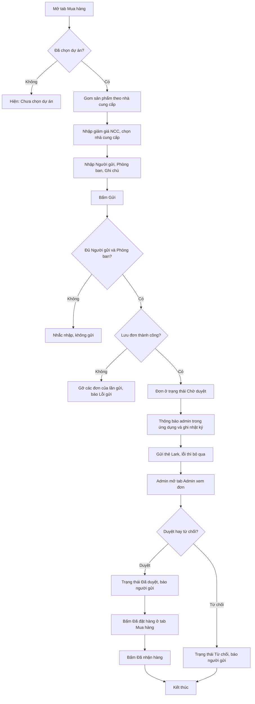
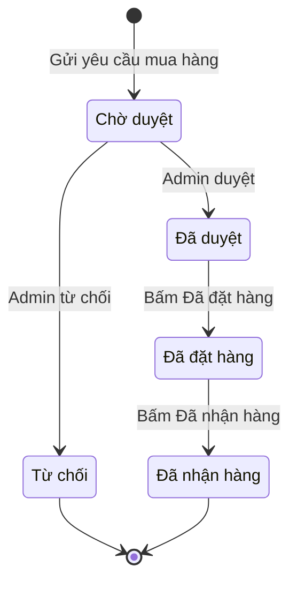

# [QT-13] Yêu cầu mua hàng (gửi - duyệt - đặt hàng - nhận hàng)

| Mục | Giá trị |
|-----|---------|
| Dự án | QS Pro |
| Phiên bản | 1.0 - 2026-10-07 |
| Người yêu cầu | — |
| Ưu tiên | — (tài liệu mô tả hiện trạng, không phải yêu cầu mới) |
| Loại | Mô tả hiện trạng |

> Ký hiệu ⚠ = chỗ mã nguồn và ghi chú / giao diện không khớp nhau, hoặc có dấu hiệu lỗi / thiếu. Mỗi ⚠ đều có một dòng `Q-xx` ở mục 14.

## 1. Tóm tắt
Người làm dự án mở tab **Mua hàng**, xem các sản phẩm đã bóc tách của dự án được gom theo từng nhà cung cấp, nhập mức giảm giá nhà cung cấp đã chốt rồi gửi yêu cầu mua hàng. Mỗi nhà cung cấp thành một đơn riêng, nằm ở trạng thái "Chờ duyệt"; admin công ty duyệt hoặc từ chối ở tab **Admin**. Đơn đã duyệt được người dùng ở tab Mua hàng đánh dấu lần lượt "Đã đặt hàng" rồi "Đã nhận hàng". Lúc gửi, hệ thống báo cho admin trong ứng dụng và bắn một thẻ tin nhắn vào nhóm Lark.

## 2. Tác nhân & quyền
| Tác nhân | Vai trò hệ thống | Được làm gì trong quy trình |
|----------|-----------------|-----------------------------|
| Người gửi yêu cầu | `staff` (nhân viên) được cấp quyền tab `muahang` trong `users.perms`; hoặc `admin`, `super` | Xem tab Mua hàng, nhập giảm giá NCC, chọn nhà cung cấp, gửi yêu cầu mua hàng, xem "Đơn đã gửi", chuyển đơn sang "Đã đặt hàng" / "Đã nhận hàng", tải Excel của đơn |
| Người duyệt | `admin` (admin công ty) | Xem danh sách và chi tiết mọi đơn của công ty ở tab Admin; duyệt hoặc từ chối đơn đang "Chờ duyệt". Nhận thông báo trong ứng dụng khi có đơn mới |
| Quản trị hệ thống | `super` | Làm được mọi việc của `admin`. Không thuộc công ty nào; có thể "xem như" một công ty. **Không** nhận thông báo đơn mới (chỉ tài khoản vai trò `admin` nhận) |
| Nhóm Lark | (ngoài hệ thống) | Nhận thẻ tin nhắn "YÊU CẦU MUA HÀNG" một lần lúc gửi. Không thao tác gì ngược lại vào hệ thống |

⚠ Việc ẩn tab Mua hàng với nhân viên không có quyền chỉ làm ở giao diện. Máy chủ chỉ kiểm tra "đã đăng nhập" cho các thao tác gửi đơn, xem đơn theo dự án và chuyển trạng thái đặt / nhận hàng (xem Q-01, Q-02).

## 3. Điều kiện trước
- Người dùng đã đăng nhập, tài khoản và công ty còn hoạt động.
- Công ty được cấp tính năng "Mua hàng" (hoặc gói tính năng để trống = mở hết); nhân viên được tick quyền "Mua hàng".
- Đã chọn một dự án. Chưa chọn thì tab chỉ hiện "Chưa chọn dự án."
- Dự án đã có sản phẩm trong bảng Bóc tách (ở hạng mục đang chọn). Dòng đang lưu dở chưa có mã thật không được đưa vào đơn.
- Người duyệt có vai trò `admin` hoặc `super`.

## 4. Luồng chính
| Bước | Ai | Hành động | Hệ thống xử lý | Kết quả người dùng thấy | Đã có / Mới |
|------|----|-----------|----------------|--------------------------|-------------|
| 1 | Người gửi | Mở tab **Mua hàng** của dự án đang chọn | Lấy các dòng bóc tách của dự án theo hạng mục đang chọn (để trống = tất cả hạng mục), gom theo nhà cung cấp (không có nhà cung cấp thì lấy thương hiệu, không có nữa thì "Khác"). Trong mỗi nhà cung cấp, các dòng cùng sản phẩm, đơn vị, giá và mức giảm được gộp thành một dòng, cộng số lượng. Tải thêm "Đơn đã gửi" và "Phiếu đề xuất đã gửi" của dự án | Mỗi nhà cung cấp một thẻ có bảng sản phẩm, VAT (theo % VAT của dự án), TỔNG; bên phải là khối "Tổng hợp đơn", "Đơn đã gửi", "Phiếu đề xuất đã gửi". Mặc định mọi nhà cung cấp đều được chọn | Đã có |
| 2 | Người gửi | Nhập % ở cột **Giảm giá NCC (%)** của một dòng, hoặc ở ô đầu cột để áp cho cả nhà cung cấp | Ép giá trị về khoảng 0–100, lưu ngay vào từng dòng bóc tách gốc, tính lại "Thành tiền sau CK", VAT và TỔNG | Số tiền cập nhật ngay; lưu lỗi thì hiện "Chưa lưu được giảm giá NCC: …" | Đã có |
| 3 | Người gửi | Bấm dấu tick trên thẻ (hoặc dòng trong "Tổng hợp đơn") để chọn / bỏ chọn nhà cung cấp | Ghi nhớ lựa chọn trong phiên làm việc; tính lại các số tổng chỉ theo nhà cung cấp đang chọn | Nút đổi thành "Gửi N đơn đã chọn"; dải số liệu đầu trang đổi theo | Đã có |
| 4 | Người gửi | Nhập **Người gửi**, **Phòng ban** (bắt buộc), **Ghi chú** (tuỳ chọn) | Ghi nhớ trong phiên làm việc | Ô đã nhập hết viền đỏ nhắc | Đã có |
| 5 | Người gửi | Bấm **Gửi mua hàng NCC này** (một nhà cung cấp) hoặc **Gửi N đơn đã chọn** (nhiều nhà cung cấp) | Kiểm tra đã nhập Người gửi và Phòng ban. Tạo cho mỗi nhà cung cấp một đơn có mã tự sinh dạng `MH-…`, trạng thái **Chờ duyệt**, kèm danh sách sản phẩm (giá đã trừ giảm giá NCC), tổng trước VAT, VAT, tổng cộng, người gửi, phòng ban, ghi chú | Nút hiện "Đang gửi…" và bị khoá trong lúc chờ | Đã có |
| 6 | Hệ thống | — | Gửi thông báo trong ứng dụng "Yêu cầu mua hàng" tới từng tài khoản `admin` đang hoạt động của công ty (mỗi đơn một thông báo) và ghi một dòng nhật ký hoạt động | Admin thấy số đỏ trên chuông (làm mới mỗi 30 giây) | Đã có |
| 7 | Hệ thống | — | Gửi một thẻ tin nhắn "🛒 YÊU CẦU MUA HÀNG" vào nhóm Lark, gom tất cả nhà cung cấp của lần gửi. Lỗi ở bước này không làm hỏng đơn đã lưu | Nhóm Lark nhận thẻ có dự án, người gửi, từng nhà cung cấp, từng sản phẩm, tổng thanh toán, nhãn "Chờ duyệt" | Đã có |
| 8 | Người gửi | — | Trả kết quả thành công, tải lại "Đơn đã gửi" | Thông báo "✔ Đã gửi yêu cầu mua hàng tới "<NCC>"" hoặc "✔ Đã gửi yêu cầu hàng loạt tới N nhà cung cấp"; đơn mới hiện trong "Đơn đã gửi" với nhãn Chờ duyệt | Đã có |
| 9 | Admin | Mở tab **Admin** (hoặc bấm vào thông báo trên chuông) | Tải 200 đơn mới nhất của công ty | Khối "Yêu cầu mua hàng" kèm nhãn "N chờ duyệt"; ô thống kê "Đơn mua hàng chờ duyệt". Bấm từ thông báo thì mở thẳng chi tiết đơn | Đã có |
| 10 | Admin | Bấm vào một đơn để xem chi tiết | Tải thông tin đơn và danh sách sản phẩm | Cửa sổ "Chi tiết đơn mua hàng": nhà cung cấp, dự án, người gửi, phòng ban, hạng mục, ngày gửi, bảng sản phẩm, tạm tính, VAT, tổng thanh toán | Đã có |
| 11 | Admin | Bấm **Duyệt** (ngay) hoặc **Từ chối** (phải xác nhận "Từ chối đơn mua hàng <mã>?") | Chỉ đổi trạng thái khi đơn còn "Chờ duyệt": sang **Đã duyệt** hoặc **Từ chối**. Gửi thông báo trong ứng dụng cho người gửi; ghi nhật ký | "Đã duyệt đơn <mã>" / "Đã từ chối đơn <mã>"; danh sách tải lại | Đã có |
| 12 | Người gửi (hoặc người dùng khác của công ty ở tab Mua hàng) | Ở "Đơn đã gửi", bấm **Đã đặt hàng** trên đơn đang "Đã duyệt", xác nhận "Chuyển đơn <mã> (<NCC>) sang "Đã đặt hàng"?" | Chỉ đổi khi đơn đang đúng "Đã duyệt"; ghi nhật ký. Không gửi thông báo cho ai | "Đơn <mã>: Đã đặt hàng"; nút tiếp theo đổi thành "Đã nhận hàng" | Đã có |
| 13 | Người gửi (hoặc người dùng khác của công ty ở tab Mua hàng) | Bấm **Đã nhận hàng** trên đơn đang "Đã đặt hàng", xác nhận | Chỉ đổi khi đơn đang đúng "Đã đặt hàng"; ghi nhật ký. Không gửi thông báo cho ai | "Đơn <mã>: Đã nhận hàng"; đơn không còn nút chuyển bước. Kết thúc | Đã có |

## 5. Sơ đồ

## 6. Luồng phụ & lỗi
| Mã | Tình huống | Hệ thống phản hồi | Thông báo cho người dùng |
|----|-----------|-------------------|--------------------------|
| E1 | Chưa đăng nhập / phiên hết hạn | Từ chối mọi thao tác (mã 401), xoá cookie phiên | Màn hình đăng nhập: "Phiên đã hết, mời đăng nhập lại." (máy chủ trả "Chưa đăng nhập") |
| E2 | Không phải `admin` / `super` mà gọi xem danh sách đơn của công ty, xem chi tiết đơn, duyệt / từ chối | Từ chối (mã 403) | "Không có quyền (chỉ Admin)". Ở tab Admin giao diện hiện "Bạn không có quyền truy cập." |
| E3 | Nhân viên không có quyền tab Mua hàng (hoặc công ty không có tính năng) | Giao diện ẩn tab và tự chuyển sang tab đầu tiên được phép; không có tab nào thì "Tài khoản chưa được cấp quyền vào phần nào". ⚠ Máy chủ không chặn nếu gọi thẳng (Q-01) | — |
| E4 | Tài khoản (không phải `super`) không gắn công ty | Máy chủ dừng | "Tài khoản chưa gắn với công ty nào" |
| E5 | Thiếu Người gửi hoặc Phòng ban khi bấm gửi | Giao diện dừng, không gọi máy chủ, tô viền ô thiếu | "Nhập "Người gửi" trước khi gửi đơn" / "Nhập "Phòng ban" trước khi gửi đơn" |
| E6 | Bấm "Gửi N đơn đã chọn" khi không chọn nhà cung cấp nào | Giao diện dừng | "Chưa chọn nhà cung cấp nào" |
| E7 | Lưu đơn lỗi giữa chừng (lỗi cơ sở dữ liệu) | Gỡ toàn bộ đơn và dòng hàng đã lưu của lần gửi này, không thông báo admin, không gửi Lark | "Lỗi gửi: <nội dung lỗi từ máy chủ>" |
| E8 | Thông báo admin hoặc ghi nhật ký lỗi | Bỏ qua (chỉ ghi cảnh báo trong nhật ký máy chủ), đơn vẫn được lưu | Người gửi vẫn thấy thông báo gửi thành công |
| E9 | Gửi thẻ Lark lỗi / Lark trả lỗi | Bỏ qua, đơn vẫn chờ duyệt trong ứng dụng; kết quả trả về có cờ `lark=false`. ⚠ Giao diện không đọc cờ này (Q-06) | Người gửi vẫn thấy "✔ Đã gửi yêu cầu mua hàng…" |
| E10 | Admin mở / duyệt mã đơn không tồn tại (hoặc đơn của công ty khác) | Dừng | "Không tìm thấy đơn mua hàng" (cửa sổ chi tiết: "Lỗi tải đơn: Không tìm thấy đơn mua hàng") |
| E11 | Duyệt / từ chối đơn không còn "Chờ duyệt" (bấm hai lần, hai admin cùng bấm) | Không đổi gì | "Lỗi: Đơn đã được xử lý" |
| E12 | Chuyển trạng thái tới giá trị khác "Đã đặt hàng" / "Đã nhận hàng" | Dừng | "Trạng thái không hợp lệ" |
| E13 | Chuyển trạng thái khi đơn không ở đúng bước liền trước (nhảy cóc, bấm trùng, đơn chưa duyệt, hoặc mã đơn không tồn tại) | Không đổi gì | "Lỗi: Đơn phải ở trạng thái "Đã duyệt" mới chuyển sang "Đã đặt hàng"" / "Lỗi: Đơn phải ở trạng thái "Đã đặt hàng" mới chuyển sang "Đã nhận hàng"" |
| E14 | Sản phẩm đã nằm trong một đơn chưa bị từ chối của cùng nhà cung cấp | Chỉ cảnh báo trên dòng, vẫn cho gửi lại | Nhãn "Đã có trong đơn <mã> · <trạng thái>" |
| E15 | Lưu % giảm giá NCC lỗi | Số trên màn hình vẫn đổi, dữ liệu chưa lưu | "Chưa lưu được giảm giá NCC: <lỗi>" |
| E16 | Tải "Đơn đã gửi" lỗi | Coi như danh sách rỗng | "Chưa gửi đơn nào cho dự án này." (không báo lỗi) |
| P1 | Tải Excel của một đơn (nút **Excel** ở "Đơn đã gửi") | Xuất bảng sản phẩm của đơn kèm Trước VAT, VAT, Tổng cộng | Tải file `<mã đơn>.xlsx`; lỗi thì "Lỗi xuất Excel: …" |
| P2 | Bấm nút tải lại ở "Đơn đã gửi" | Tải lại trạng thái đơn của dự án | Danh sách cập nhật (không tự làm mới khi admin duyệt) |

## 7. Trạng thái

| Từ | Sang | Khi nào | Ai được làm |
|----|------|---------|-------------|
| (chưa có) | Chờ duyệt | Gửi yêu cầu mua hàng thành công | Mọi người dùng đã đăng nhập (giao diện: người vào được tab Mua hàng) |
| Chờ duyệt | Đã duyệt | Bấm Duyệt ở tab Admin | `admin`, `super` |
| Chờ duyệt | Từ chối | Bấm Từ chối và xác nhận | `admin`, `super` |
| Đã duyệt | Đã đặt hàng | Bấm "Đã đặt hàng" ở "Đơn đã gửi" và xác nhận | ⚠ Mọi người dùng đã đăng nhập của công ty (máy chủ không kiểm tra vai trò hay người gửi — Q-02) |
| Đã đặt hàng | Đã nhận hàng | Bấm "Đã nhận hàng" và xác nhận | ⚠ Như trên |

Không có chuyển ngược, không có huỷ đơn, không có gửi lại đơn bị từ chối. "Từ chối" và "Đã nhận hàng" là trạng thái cuối.

## 8. Quy tắc nghiệp vụ
| Mã | Quy tắc |
|----|---------|
| BR-01 | Mỗi nhà cung cấp trong một lần gửi = một đơn riêng, mã tự sinh dạng `MH-<chuỗi thời gian>-<số ngẫu nhiên>`. Gửi nhiều nhà cung cấp cùng lúc tạo nhiều đơn nhưng chỉ một thẻ Lark. |
| BR-02 | Đơn chọn theo **nhà cung cấp**, không chọn từng dòng: gửi là gửi toàn bộ sản phẩm của nhà cung cấp đó trong hạng mục đang lọc. |
| BR-03 | Giá mua của dòng = giá đại lý (đơn giá vốn trừ chiết khấu); nếu bằng 0 thì lấy đơn giá vốn, rồi đơn giá bán. Giá trong đơn = giá mua × (1 − % giảm giá NCC), làm tròn đồng. |
| BR-04 | % giảm giá NCC nằm trong khoảng 0–100, lưu trên dòng bóc tách (không lưu trên đơn). Sửa trên dòng đã gộp áp cho mọi dòng gốc. |
| BR-05 | VAT của đơn = tổng sau giảm giá × % VAT của dự án, làm tròn. Tổng cộng = tổng sau giảm + VAT. Các số này do trình duyệt tính và gửi lên; máy chủ chỉ tính lại "thành tiền" từng dòng = số lượng × đơn giá. |
| BR-06 | Người gửi và Phòng ban bắt buộc (kiểm ở giao diện). Đây là chữ người dùng tự gõ, không lấy từ tài khoản đăng nhập. |
| BR-07 | Đơn mới luôn ở "Chờ duyệt". Duyệt / từ chối chỉ có hiệu lực khi đơn còn "Chờ duyệt" — người bấm trước thắng. |
| BR-08 | Sau khi duyệt chỉ đi đúng một bước mỗi lần: Đã duyệt → Đã đặt hàng → Đã nhận hàng. Không nhảy cóc, không lùi. |
| BR-09 | Lưu đơn là việc chính; thông báo admin và gửi Lark là phụ — lỗi ở hai việc phụ không làm hỏng đơn. Lưu đơn lỗi giữa chừng thì gỡ sạch các đơn của lần gửi đó. |
| BR-10 | Chỉ tài khoản vai trò `admin` đang hoạt động nhận thông báo đơn mới. Người gửi chỉ nhận thông báo khi đơn được duyệt hoặc bị từ chối. |
| BR-11 | Dữ liệu đơn, dòng hàng, thông báo, nhật ký đều tự lọc theo công ty của người đăng nhập. |
| BR-12 | Sản phẩm đã có trong đơn chưa bị từ chối của cùng nhà cung cấp chỉ được cảnh báo, không bị chặn gửi lại. |
| BR-13 | Dòng bóc tách đang lưu dở (chưa có mã thật) không được đưa vào đơn. |

## 9. Thông báo, realtime & nhật ký
Hệ thống không có realtime. Chuông thông báo tự hỏi số chưa đọc mỗi 30 giây.

| Sự kiện | Ai nhận | Kênh | Nội dung | Ghi audit? |
|---------|---------|------|----------|:----------:|
| Sửa % giảm giá NCC | Không ai | — | — | Không (trong phạm vi mã đã đọc của quy trình này) |
| Gửi yêu cầu mua hàng | Mọi tài khoản `admin` đang hoạt động của công ty | Trong ứng dụng (`notifications`, loại `purchase_request`) | Tiêu đề "Yêu cầu mua hàng"; nội dung "<người gửi> gửi đơn <mã> (<NCC>)"; mỗi đơn một thông báo | Có — `request_purchase`: "<người gửi> gửi N đơn mua hàng" (một dòng cho cả lần gửi) |
| Gửi yêu cầu mua hàng | Nhóm Lark gắn với `config.purchaseWebhook` | Lark (thẻ tương tác) | "🛒 YÊU CẦU MUA HÀNG": dự án, mã dự án, khách hàng / điện thoại (nếu có), người gửi, phòng ban, ghi chú; từng NCC với sản phẩm, số lượng × đơn giá, mức giảm, tạm tính, giảm giá NCC, VAT, tổng thanh toán; tổng cộng nếu nhiều NCC; "⏳ Chờ duyệt"; ngày gửi | (cùng dòng audit ở trên) |
| Admin duyệt | Người gửi (nếu đơn có lưu người gửi) | Trong ứng dụng (`purchase_approved`) | "Đơn mua hàng đã được duyệt" — "Đơn <mã> (<NCC>)" | Có — `approve_purchase`: "Đã duyệt đơn <mã> của <người gửi>" |
| Admin từ chối | Người gửi (nếu đơn có lưu người gửi) | Trong ứng dụng (`purchase_rejected`) | "Đơn mua hàng bị từ chối" — "Đơn <mã> (<NCC>)" | Có — `reject_purchase`: "Từ chối đơn <mã> của <người gửi>" |
| Chuyển "Đã đặt hàng" / "Đã nhận hàng" | Không ai | — | — | Có — `purchase_status`: "<trạng thái> — đơn <mã>" |

Lark **không** nhận tin khi duyệt, từ chối, đặt hàng, nhận hàng. Bấm vào thông báo đơn: admin được mở thẳng chi tiết đơn ở tab Admin; người khác được chuyển sang tab Mua hàng kèm dòng "Đơn <mã>".

## 10. Dữ liệu
| Thông tin | Bắt buộc | Ràng buộc | Ví dụ |
|-----------|----------|-----------|-------|
| Mã đơn | Tự sinh | Duy nhất, dạng `MH-…` | MH-M1ABCD2E-4821 |
| Mã dự án, tên dự án | Lấy từ dự án đang mở | — | DA-001, "Biệt thự A" |
| Hạng mục | Lấy từ hạng mục đang lọc | Để trống = tất cả hạng mục | "Thiết bị đèn" |
| Nhà cung cấp | Có | Lấy từ dòng bóc tách; thiếu thì thương hiệu, rồi "Khác" | "Công ty X" |
| Số sản phẩm | Tự tính | = số dòng hàng của đơn (sau khi gộp) | 12 |
| Tổng trước VAT, % VAT, VAT, tổng cộng | Có | Tổng trước VAT = tổng cộng − VAT; số do trình duyệt gửi lên | 10.000.000 / 8 / 800.000 / 10.800.000 |
| Trạng thái | Có | Chờ duyệt, Đã duyệt, Từ chối, Đã đặt hàng, Đã nhận hàng | Chờ duyệt |
| Kênh gửi, kết quả gửi | Tự ghi | Luôn ghi "Lark" và "pending" lúc tạo, không cập nhật lại | Lark / pending |
| Người gửi, phòng ban | Có (giao diện) | Chữ tự gõ | "Lan", "Mua hàng" |
| Ghi chú | Không | — | "Giao trước 15/10" |
| Tài khoản người gửi | Tự ghi | Dùng để báo lại khi duyệt / từ chối | (mã tài khoản) |
| Ngày gửi | Tự ghi | Thời điểm tạo | 07/10/2026 09:30 |
| Dòng hàng: mã SP, tên, thương hiệu, vị trí, ĐVT, số lượng, đơn giá, thành tiền, ảnh, thứ tự | Có | ĐVT trống thì "Cái"; thành tiền = số lượng × đơn giá; vị trí = các khu vực / tầng của dòng gộp; chụp lại tại thời điểm gửi | "Đèn âm trần 7W", 20 Cái × 150.000 |

## 11. Màn hình liên quan
- Tab **Mua hàng** (`muahang`): thẻ từng nhà cung cấp, khối "Tổng hợp đơn" (Người gửi, Phòng ban, Ghi chú, nút gửi), khối "Đơn đã gửi" (nút chuyển bước, Excel, tải lại), khối "Phiếu đề xuất đã gửi" (xem QT-14).
- Tab **Admin** (`admin`): ô thống kê "Đơn mua hàng chờ duyệt", khối "Yêu cầu mua hàng", cửa sổ "Chi tiết đơn mua hàng".
- Chuông thông báo trên thanh trên cùng.
- Tab **Bóc tách** (`boc`): nơi tạo ra các dòng sản phẩm đầu vào.
- Nhóm Lark nhận thẻ "YÊU CẦU MUA HÀNG".

## 12. Tiêu chí nghiệm thu
- **AC-01**: Cho dự án có sản phẩm của 2 nhà cung cấp, đã nhập Người gửi và Phòng ban / Khi bấm "Gửi 2 đơn đã chọn" / Thì có 2 đơn mới ở "Chờ duyệt" trong "Đơn đã gửi", mỗi admin của công ty nhận 2 thông báo "Yêu cầu mua hàng", nhóm Lark nhận 1 thẻ có cả 2 nhà cung cấp.
- **AC-02**: Cho nhân viên (`staff`) đã đăng nhập / Khi gọi duyệt một đơn / Thì bị từ chối với "Không có quyền (chỉ Admin)" và trạng thái đơn không đổi.
- **AC-03**: Cho người chưa đăng nhập / Khi gọi gửi yêu cầu mua hàng / Thì bị từ chối với "Chưa đăng nhập" và không có đơn nào được tạo.
- **AC-04**: Cho ô Người gửi để trống / Khi bấm "Gửi mua hàng NCC này" / Thì hiện "Nhập "Người gửi" trước khi gửi đơn" và không có đơn nào được tạo.
- **AC-05**: Cho đơn đang "Chờ duyệt" / Khi admin bấm Duyệt / Thì đơn sang "Đã duyệt", người gửi nhận thông báo "Đơn mua hàng đã được duyệt", nhật ký có dòng `approve_purchase`.
- **AC-06**: Cho đơn đã được admin A duyệt / Khi admin B bấm Từ chối trên cùng đơn / Thì B thấy "Lỗi: Đơn đã được xử lý" và đơn vẫn "Đã duyệt".
- **AC-07**: Cho đơn đang "Chờ duyệt" / Khi gọi chuyển sang "Đã đặt hàng" / Thì bị từ chối với "Đơn phải ở trạng thái "Đã duyệt" mới chuyển sang "Đã đặt hàng"".
- **AC-08**: Cho đơn "Đã duyệt" / Khi bấm "Đã đặt hàng" rồi "Đã nhận hàng" (xác nhận cả hai) / Thì đơn lần lượt qua hai trạng thái, nhật ký có 2 dòng `purchase_status`, không ai nhận thông báo.
- **AC-09**: Cho đường gửi Lark bị lỗi / Khi gửi yêu cầu mua hàng / Thì đơn vẫn được lưu ở "Chờ duyệt", admin vẫn nhận thông báo trong ứng dụng, người gửi vẫn thấy thông báo thành công.
- **AC-10**: Cho admin của công ty A / Khi mở chi tiết mã đơn của công ty B / Thì nhận "Không tìm thấy đơn mua hàng".
- **AC-11**: Cho dòng có giá mua 100.000 và giảm giá NCC 10%, số lượng 5 / Khi gửi đơn / Thì dòng hàng trong đơn có đơn giá 90.000 và thành tiền 450.000.

## 13. Ảnh hưởng tới phần có sẵn
- Sửa % giảm giá NCC ghi thẳng vào dòng bóc tách của dự án, nên ảnh hưởng dữ liệu dự án dùng chung với các tab khác.
- Dùng chung bảng thông báo và nhật ký hoạt động với các quy trình khác (yêu cầu xoá sản phẩm, đề xuất…).
- Dùng chung nhóm Lark (`config.purchaseWebhook`) với phiếu đề xuất (QT-14) và — nếu chưa đặt đường riêng — với báo cáo nhập sản phẩm (QT-15).
- Đơn đã gửi là bản chụp: sửa bóc tách sau khi gửi không làm đổi đơn.

## 14. Giả định & câu hỏi mở
| Mã | Nội dung | Cần ai trả lời |
|----|----------|----------------|
| GD-01 | Cơ sở dữ liệu đang chạy đã có các cột bổ sung cho đơn mua hàng (`requester_id` từ `db/notifications.sql`, `cong_ty_id` từ `db/multitenant.sql`). Không kiểm tra được trên cơ sở dữ liệu thật. | Dev / người quản trị DB |
| GD-02 | Nhóm Lark nhận thẻ là nhóm nội bộ của đơn vị vận hành; ai ở trong nhóm không xác định được từ mã nguồn. | Chủ sản phẩm |
| GD-03 | "Phòng mua hàng" trong ghi chú mã nguồn là cách gọi nghiệp vụ, không phải vai trò hệ thống; hệ thống không có vai trò riêng cho mua hàng ngoài quyền tab `muahang`. | Chủ sản phẩm |
| Q-01 | ⚠ Máy chủ không kiểm tra quyền tab `muahang` (`users.perms`) hay tính năng của công ty: mọi tài khoản đã đăng nhập đều gọi được gửi đơn (`sendPurchaseRequest`), xem đơn theo dự án (`getPurchaseOrders`) và chuyển trạng thái (`setPurchaseStatus`). Việc chặn chỉ nằm ở chỗ ẩn tab trên giao diện. Có cần chặn ở máy chủ không? | Chủ sản phẩm / Dev |
| Q-02 | ⚠ Ghi chú mã nguồn nói "phòng mua hàng bấm ở tab Mua hàng" để chuyển Đã đặt hàng / Đã nhận hàng, nhưng máy chủ cho bất kỳ người dùng đã đăng nhập nào của công ty chuyển, không cần là người gửi hay admin. Ai mới được phép chuyển hai bước này? | Chủ sản phẩm |
| Q-03 | ⚠ Ở danh sách "Yêu cầu mua hàng" của tab Admin, đơn có trạng thái "Đã đặt hàng", "Đã nhận hàng" (và trạng thái cũ "Đã gửi") bị tô như đơn chờ duyệt và vẫn hiện nút Duyệt / Từ chối, vì bảng ánh xạ trạng thái ở giao diện chỉ biết "Đã duyệt", "Từ chối", "Chờ duyệt", "Đã gửi". Bấm vào sẽ nhận "Đơn đã được xử lý". Đây có phải lỗi hiển thị cần sửa? | Dev |
| Q-04 | ⚠ Cửa sổ chi tiết đơn có chỗ hiện "Người duyệt" và "Ngày duyệt", máy chủ cũng đọc hai trường này, nhưng khi duyệt / từ chối đơn mua hàng máy chủ không ghi chúng và không file `db/*.sql` nào tạo hai cột này cho bảng đơn mua hàng (khác với phiếu đề xuất, có ghi). Người duyệt hiện chỉ truy được qua nhật ký. Có cần lưu người duyệt trên đơn không? | Chủ sản phẩm / Dev |
| Q-05 | ⚠ `db/schema.sql` khai báo trạng thái mặc định của đơn là "Đã gửi" với ghi chú "Đã gửi / Đã nhận / Huỷ", trong khi mã nguồn dùng bộ: Chờ duyệt, Đã duyệt, Từ chối, Đã đặt hàng, Đã nhận hàng. Có còn đơn cũ mang trạng thái "Đã gửi" trong dữ liệu thật không, và xử lý chúng thế nào? | Dev / người quản trị DB |
| Q-06 | ⚠ Trường "kết quả gửi" của đơn luôn được ghi "pending" và không bao giờ cập nhật theo kết quả Lark; giao diện cũng không đọc cờ `lark` máy chủ trả về nên người gửi luôn thấy "Đã gửi" kể cả khi thẻ Lark không tới nơi. Có cần báo cho người gửi khi Lark lỗi? | Chủ sản phẩm |
| Q-07 | Lark chỉ nhận tin lúc gửi yêu cầu (thẻ luôn ghi "Chờ duyệt"); không có tin khi duyệt, từ chối, đặt hàng, nhận hàng. Hai bước đặt hàng / nhận hàng cũng không thông báo trong ứng dụng cho ai. Có đúng ý muốn không? | Chủ sản phẩm |
| Q-08 | ⚠ Máy chủ tin các số tổng tiền, VAT do trình duyệt gửi lên và không kiểm tra dữ liệu đầu vào: không bắt buộc Người gửi / Phòng ban, không chặn lần gửi không có nhà cung cấp nào (khi đó không tạo đơn nhưng vẫn bắn một thẻ Lark trống và trả thành công), không chặn đơn không có sản phẩm. Có cần kiểm tra ở máy chủ? | Dev |
| Q-09 | ⚠ Khi `super` thao tác mà không "xem như" một công ty: đơn được lưu không gắn công ty, và thông báo đơn mới được gửi tới admin của **mọi** công ty (vì danh sách admin không còn bị lọc theo công ty). Có cần chặn `super` gửi đơn khi chưa chọn công ty? | Chủ sản phẩm / Dev |
| Q-10 | Không có chức năng huỷ, sửa hay gửi lại đơn (kể cả đơn bị từ chối); gửi trùng sản phẩm chỉ được cảnh báo "Đã có trong đơn…". Có cần bổ sung không? | Chủ sản phẩm |
| Q-11 | Đề bài mô tả "chọn dòng của dự án", nhưng thực tế chỉ chọn / bỏ chọn theo nhà cung cấp; không bỏ riêng từng sản phẩm ra khỏi đơn được (chỉ lọc được theo hạng mục). Có cần chọn tới từng dòng? | Chủ sản phẩm |
| Q-12 | Khi tải "Đơn đã gửi" bị lỗi, giao diện hiện như chưa có đơn nào và không báo lỗi; trạng thái đơn cũng không tự làm mới sau khi admin duyệt (phải bấm tải lại hoặc mở lại tab). Có chấp nhận được không? | Chủ sản phẩm |

## 15. Ghi chú kỹ thuật cho dev
- API (đều là `POST /api/<fn>`, body `{args:[...]}`), khai báo tại `server/components/mua-hang/mua-hang.routes.js:8-23`:
  - `sendPurchaseRequest(order)` — có actor, không nằm trong danh sách `admin`. `server/components/mua-hang/mua-hang.service.js:76-100`.
  - `getPurchaseOrders(maDA)` — không actor, chỉ cần đăng nhập. `server/components/mua-hang/mua-hang.repository.js:43-57`.
  - `setPurchaseStatus(maDon, status)` — có actor, không giới hạn vai trò; bảng bước `PO_BUOC` và cập nhật có điều kiện. `server/components/mua-hang/mua-hang.service.js:67-74`.
  - `listPurchaseRequests()`, `getPurchaseOrder(maDon)`, `resolvePurchaseRequest(maDon, approve)` — chỉ `admin` / `super`. `server/components/mua-hang/mua-hang.service.js:25-63`.
- Kiểm tra đăng nhập và vai trò: `server/libraries/rpc.js:54-62` (401 "Chưa đăng nhập", 403 "Không có quyền (chỉ Admin)").
- Lưu đơn + gỡ khi lỗi giữa chừng: `server/components/mua-hang/mua-hang.repository.js:8-41`; sinh mã `genMaDon_` tại dòng 6.
- Thông báo admin + audit `request_purchase`: `server/components/mua-hang/mua-hang.service.js:13-24`; danh sách admin `getAdmins_` và `notify_` (nuốt lỗi): `server/components/thong-bao/thong-bao.service.js:5-9`; `audit` (nuốt lỗi): `server/components/thong-bao/audit.js:9-19`.
- Thẻ Lark: `buildPurchaseCard` tại `server/components/mua-hang/lark-card.js:5-79`; đường gửi lấy từ `config.purchaseWebhook` (`server/config/index.js:14`, biến môi trường `PURCHASE_WEBHOOK`).
- Bảng dữ liệu: `don_mua_hang`, `chi_tiet_mua_hang` (`db/schema.sql:123-161`); cột `requester_id` thêm ở `db/notifications.sql:21`; `cong_ty_id` thêm ở `db/multitenant.sql:30-31`. Cả hai bảng nằm trong `TENANT_TABLES` (`server/libraries/supa.js:19-25`).
- Giao diện tab Mua hàng (`public/muahang.js`): tính giá / giảm giá `:6-11`, lưu giảm giá `mhSetDisc` `:13-16` và `mhSetDiscAll` `:30-31`, gộp dòng `mhGop_` `:19-29`, dựng trang `renderMuahang` `:115-148`, dựng dữ liệu đơn `mhOrderOf` / `mhBase` `:150-157`, kiểm tra Người gửi / Phòng ban `:158-163`, gửi `mhSend` `:164-172` và `mhSendBulk` `:173-182`, "Đơn đã gửi" `mhLoadDon_` `:474-480`, cảnh báo trùng `mhDaDat_` `:482-486`, khối đơn `mhDonPanel_` `:488-501`, chuyển bước `mhDonBuoc_` `:502-508`, Excel `mhDonXls_` `:509-518`.
- Giao diện tab Admin (`public/admin.js`): tải dữ liệu `renderAdmin` `:5-15`, chi tiết `purDetail` / `purDetailHtml_` `:66-113`, danh sách `admPurCard_` `:114-129` (bảng ánh xạ trạng thái gây Q-03 ở `:116-118` và `:125`), duyệt `purResolve` `:130-133`.
- Quyền tab phía giao diện: `canTab` tại `public/app.js:2576-2583`, chặn ở `showTab` `public/app.js:345`; bấm thông báo `notifClick` `public/app.js:2641-2651`; chu kỳ hỏi chuông 30 giây `public/app.js:2681`.
- Không có job nền, không có realtime trong quy trình này.

## Lịch sử thay đổi
| Phiên bản | Ngày | Thay đổi |
|-----------|------|----------|
| 1.0 | 2026-10-07 | Tạo mới (mô tả hiện trạng từ mã nguồn) |
