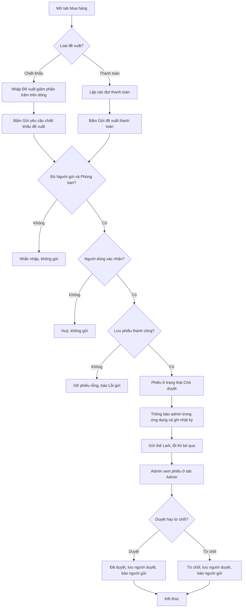
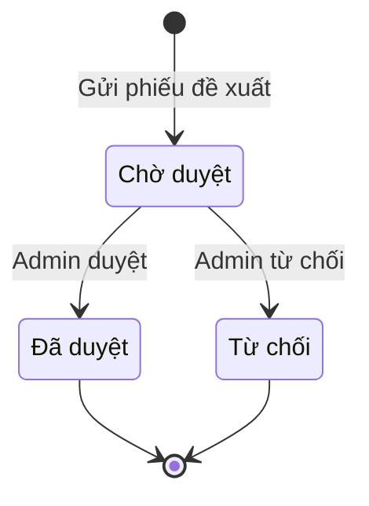

# [QT-14] Phiếu đề xuất mua hàng (chiết khấu / thanh toán theo đợt)

| Mục | Giá trị |
|-----|---------|
| Dự án | QS Pro |
| Phiên bản | 1.0 - 2026-10-07 |
| Người yêu cầu | — |
| Ưu tiên | — (tài liệu mô tả hiện trạng, không phải yêu cầu mới) |
| Loại | Mô tả hiện trạng |

> Ký hiệu ⚠ = chỗ mã nguồn và ghi chú / giao diện không khớp nhau, hoặc có dấu hiệu lỗi / thiếu. Mỗi ⚠ đều có một dòng `Q-xx` ở mục 14.

## 1. Tóm tắt
Ở tab **Mua hàng**, người làm dự án lập phiếu đề xuất cho từng nhà cung cấp theo một trong hai loại: **đề xuất chiết khấu** (mức giảm giá muốn đề nghị với nhà cung cấp) hoặc **đề xuất thanh toán** (chia tiền đơn hàng thành các đợt). Phiếu được gửi cho admin công ty duyệt hoặc từ chối ở tab **Admin**, đồng thời một thẻ tin nhắn được bắn vào nhóm Lark. Phiếu đề xuất chỉ là xin ý kiến: nó không tạo đơn mua hàng và sau khi duyệt hệ thống không tự làm gì thêm.

**Phiếu đề xuất khác yêu cầu mua hàng (QT-13) thế nào — theo đúng cách hệ thống đang chạy:**

| Điểm so sánh | Yêu cầu mua hàng (QT-13) | Phiếu đề xuất (QT-14) |
|--------------|--------------------------|------------------------|
| Bản chất | Đơn đặt hàng gửi đi mua | Phiếu xin ý kiến về giá hoặc về lịch trả tiền; không phải đơn đặt hàng |
| Nơi lưu | Bảng đơn mua hàng | Bảng phiếu đề xuất riêng, không lẫn vào hàng chờ duyệt của đơn mua hàng |
| Loại | Một loại | Hai loại: chiết khấu (`ck`), thanh toán (`tt`) |
| Mã | `MH-…` | `CK-…` hoặc `TT-…` |
| Phạm vi một lần gửi | Một hoặc nhiều nhà cung cấp (mỗi nhà cung cấp một đơn) | Mỗi lần đúng một nhà cung cấp, một phiếu |
| Con số dùng | Giá đã trừ **Giảm giá NCC (%)** — mức nhà cung cấp đã chốt | Chiết khấu: giá nếu áp **Đề xuất giảm (%)** — mức mới chỉ đề nghị. Thanh toán: các đợt tiền |
| Dòng sản phẩm | Gộp các dòng trùng sản phẩm, cộng số lượng | Chiết khấu: giữ nguyên từng dòng bóc tách, không gộp |
| Ai tính tổng tiền | Trình duyệt tính rồi gửi lên | Máy chủ tự tính lại từ dòng chi tiết |
| Hỏi xác nhận trước khi gửi | Không | Có (chiết khấu luôn hỏi; thanh toán hỏi khi tổng các đợt chưa khớp giá trị đơn) |
| Vòng đời | Chờ duyệt → Đã duyệt → Đã đặt hàng → Đã nhận hàng; hoặc Từ chối | Chỉ Chờ duyệt → Đã duyệt hoặc Từ chối |
| Lưu người duyệt, ngày duyệt | Không | Có |
| Thẻ Lark | "🛒 YÊU CẦU MUA HÀNG" (xanh dương) | "💬 ĐỀ XUẤT CHIẾT KHẤU" (cam) hoặc "💳 ĐỀ XUẤT THANH TOÁN" (xanh ngọc) |
| Sau khi duyệt | Tiếp tục theo dõi đặt hàng, nhận hàng | Không có bước tiếp theo trong hệ thống |

## 2. Tác nhân & quyền
| Tác nhân | Vai trò hệ thống | Được làm gì trong quy trình |
|----------|-----------------|-----------------------------|
| Người lập phiếu | `staff` (nhân viên) được cấp quyền tab `muahang` trong `users.perms`; hoặc `admin`, `super` | Nhập mức đề xuất giảm, lập các đợt thanh toán, gửi phiếu, xem danh sách và chi tiết phiếu của dự án đang mở |
| Người duyệt | `admin` (admin công ty) | Xem mọi phiếu của công ty ở tab Admin, xem chi tiết, duyệt hoặc từ chối phiếu đang "Chờ duyệt". Nhận thông báo trong ứng dụng khi có phiếu mới |
| Quản trị hệ thống | `super` | Làm được mọi việc của `admin`. **Không** nhận thông báo phiếu mới |
| Nhóm Lark | (ngoài hệ thống) | Nhận thẻ đề xuất một lần lúc gửi |

⚠ Máy chủ chỉ kiểm tra "đã đăng nhập" cho việc gửi phiếu và xem phiếu theo dự án; quyền tab `muahang` chỉ được áp ở giao diện (Q-01).

## 3. Điều kiện trước
- Người dùng đã đăng nhập, tài khoản và công ty còn hoạt động; vào được tab Mua hàng.
- Đã chọn dự án và dự án có sản phẩm bóc tách thuộc nhà cung cấp cần đề xuất.
- Đã nhập **Người gửi** và **Phòng ban** ở khối "Tổng hợp đơn".
- Đề xuất chiết khấu: ít nhất một dòng của nhà cung cấp có "Đề xuất giảm (%)" lớn hơn 0 (nếu không thì nút gửi không hiện).
- Đề xuất thanh toán: có ít nhất một đợt có số tiền lớn hơn 0.
- Cơ sở dữ liệu đã có bảng phiếu đề xuất (đã chạy `db/de_xuat.sql`).

## 4. Luồng chính
| Bước | Ai | Hành động | Hệ thống xử lý | Kết quả người dùng thấy | Đã có / Mới |
|------|----|-----------|----------------|--------------------------|-------------|
| 1 | Người lập phiếu | Mở tab **Mua hàng** của dự án | Gom sản phẩm theo nhà cung cấp; tải danh sách phiếu đề xuất đã gửi của dự án | Thẻ từng nhà cung cấp; khối "Phiếu đề xuất đã gửi" bên phải | Đã có |
| 2a | Người lập phiếu | (Chiết khấu) Nhập % ở cột **Đề xuất giảm (%)** của từng dòng, hoặc ô đầu cột để áp cho cả nhà cung cấp | Ép về 0–100, lưu ngay vào dòng bóc tách (tách riêng với "Giảm giá NCC") | Nút **Gửi yêu cầu chiết khấu đề xuất** xuất hiện dưới thẻ khi có dòng được nhập | Đã có |
| 2b | Người lập phiếu | (Thanh toán) Mở khối **Đề xuất thanh toán mục tiêu** của nhà cung cấp; chia nhanh 2 / 3 / 4 đợt hoặc thêm đợt; nhập %, số tiền, ngày, ghi chú từng đợt | Tính tiền đợt theo % × tổng đơn hiện tại (đã gồm giảm giá NCC và VAT); gõ tiền tay thì giữ số đã gõ và tính ngược %. Lưu bản nháp các đợt theo dự án | Dòng trạng thái "Đã phân bổ đủ 100% giá trị đơn hàng" hoặc "Còn thiếu … đ (…%)" / "Vượt … đ" | Đã có |
| 3 | Người lập phiếu | Nhập **Người gửi**, **Phòng ban**, **Ghi chú** ở khối "Tổng hợp đơn" | Ghi nhớ trong phiên làm việc | — | Đã có |
| 4 | Người lập phiếu | Bấm **Gửi yêu cầu chiết khấu đề xuất** hoặc **Gửi đề xuất thanh toán** | Kiểm tra Người gửi, Phòng ban. Chiết khấu: hỏi xác nhận kèm Giá gốc, Sau mức đề xuất, Giảm. Thanh toán: bỏ các đợt 0 đồng; nếu tổng đợt lệch giá trị đơn quá ngưỡng thì hỏi "…chưa khớp giá trị đơn… Vẫn gửi?" | Hộp xác nhận; sau khi đồng ý nút hiện "Đang gửi…" | Đã có |
| 5 | Hệ thống | — | Tạo phiếu có mã `CK-…` hoặc `TT-…`, trạng thái **Chờ duyệt**; tự tính tổng gốc, tổng đề xuất, tiền giảm, VAT (chỉ loại chiết khấu), tổng cộng; lưu các dòng chi tiết (sản phẩm hoặc đợt). Không tạo đơn mua hàng | — | Đã có |
| 6 | Hệ thống | — | Gửi thông báo trong ứng dụng "Đề xuất mua hàng" tới từng tài khoản `admin` đang hoạt động của công ty; ghi nhật ký | Admin thấy số đỏ trên chuông | Đã có |
| 7 | Hệ thống | — | Gửi thẻ Lark tương ứng loại phiếu vào nhóm. Lỗi ở bước này không làm hỏng phiếu | Nhóm Lark nhận thẻ có nhà cung cấp, dự án, mã phiếu, người gửi, chi tiết và nhãn "Chờ duyệt" | Đã có |
| 8 | Người lập phiếu | — | Trả kết quả, tải lại danh sách phiếu của dự án | "✔ Đã gửi đề xuất chiết khấu <mã> tới "<NCC>"" hoặc "✔ Đã gửi đề xuất thanh toán N đợt <mã> tới "<NCC>""; phiếu mới hiện trong "Phiếu đề xuất đã gửi" | Đã có |
| 9 | Admin | Mở tab **Admin** | Tải 200 phiếu mới nhất của công ty | Khối "Đề xuất mua hàng" (ghi chú "chiết khấu · thanh toán — tách khỏi đơn mua hàng"), nhãn "N chờ duyệt"; ô thống kê "Đề xuất chờ duyệt" | Đã có |
| 10 | Admin | Bấm vào một phiếu | Tải phiếu và dòng chi tiết | Cửa sổ "Chi tiết đề xuất": chiết khấu hiện đơn giá hiện tại, % đề xuất giảm, đơn giá đề xuất, Giá hiện tại / Sau đề xuất / TIẾT KIỆM; thanh toán hiện từng đợt, tỷ lệ, số tiền, ngày dự kiến, Giá trị đơn hàng / TỔNG ĐỀ XUẤT | Đã có |
| 11 | Admin | Bấm **Duyệt** (ngay) hoặc **Từ chối** (xác nhận "Từ chối phiếu <mã>?") | Chỉ đổi khi phiếu còn "Chờ duyệt": sang **Đã duyệt** hoặc **Từ chối**, ghi người duyệt và ngày duyệt. Gửi thông báo trong ứng dụng cho người gửi; ghi nhật ký | "Đã duyệt phiếu <mã>" / "Đã từ chối phiếu <mã>"; danh sách tải lại | Đã có |
| 12 | Người lập phiếu | Mở lại tab Mua hàng, bấm vào phiếu trong "Phiếu đề xuất đã gửi" | Hiện chi tiết từ danh sách đã tải | Thấy trạng thái mới, người duyệt, ngày duyệt. Kết thúc — hệ thống không làm gì thêm với phiếu đã duyệt | Đã có |

## 5. Sơ đồ

## 6. Luồng phụ & lỗi
| Mã | Tình huống | Hệ thống phản hồi | Thông báo cho người dùng |
|----|-----------|-------------------|--------------------------|
| E1 | Chưa đăng nhập / phiên hết hạn | Từ chối (mã 401) | "Phiên đã hết, mời đăng nhập lại." (máy chủ trả "Chưa đăng nhập") |
| E2 | Không phải `admin` / `super` mà gọi xem toàn bộ phiếu, xem chi tiết qua máy chủ, duyệt / từ chối | Từ chối (mã 403) | "Không có quyền (chỉ Admin)". ⚠ Nhân viên mở chi tiết phiếu ở tab Mua hàng vẫn thấy nút "Duyệt phiếu" / "Từ chối"; bấm vào nhận "Lỗi: Không có quyền (chỉ Admin)" (Q-03) |
| E3 | Tài khoản (không phải `super`) không gắn công ty | Dừng | "Tài khoản chưa gắn với công ty nào" |
| E4 | Thiếu Người gửi hoặc Phòng ban | Giao diện dừng, tô viền ô thiếu | "Nhập "Người gửi" trước khi gửi đơn" / "Nhập "Phòng ban" trước khi gửi đơn" |
| E5 | Đề xuất thanh toán không có đợt nào lớn hơn 0 đồng | Giao diện dừng | "Chưa nhập đợt thanh toán nào" |
| E6 | Xoá đợt khi chỉ còn một đợt | Giao diện không xoá | "Cần ít nhất 1 đợt" |
| E7 | Tổng các đợt lệch giá trị đơn quá ngưỡng (lớn hơn 1.000 đ và lớn hơn 0,5% giá trị đơn) | Hỏi xác nhận; không đồng ý thì không gửi | "Tổng đề xuất (… đ) chưa khớp giá trị đơn (… đ). Vẫn gửi?" |
| E8 | Người dùng không xác nhận hộp thoại gửi đề xuất chiết khấu | Không gửi | — |
| E9 | Cơ sở dữ liệu chưa có bảng phiếu đề xuất | Dừng khi gửi | "Lỗi gửi: Chưa có bảng "de_xuat" trong CSDL — mở Supabase → SQL Editor và chạy file db/de_xuat.sql một lần, rồi gửi lại." Khi xem danh sách thì coi như rỗng, không báo lỗi |
| E10 | Lưu dòng chi tiết lỗi sau khi đã lưu phần đầu phiếu | Gỡ phần đầu phiếu để không còn phiếu rỗng; không thông báo admin, không gửi Lark | "Lỗi gửi: <nội dung lỗi từ máy chủ>" |
| E11 | Thông báo admin hoặc ghi nhật ký lỗi | Bỏ qua, phiếu vẫn được lưu | Người gửi vẫn thấy thông báo thành công |
| E12 | Gửi thẻ Lark lỗi | Bỏ qua; kết quả có cờ `lark=false`. ⚠ Giao diện không đọc cờ này (Q-07) | Người gửi vẫn thấy "✔ Đã gửi đề xuất…" |
| E13 | Admin mở / duyệt mã phiếu không tồn tại (hoặc của công ty khác) | Dừng | "Không tìm thấy đề xuất" (cửa sổ chi tiết: "Lỗi tải phiếu: Không tìm thấy đề xuất") |
| E14 | Duyệt / từ chối phiếu không còn "Chờ duyệt" | Không đổi gì | "Lỗi: Đề xuất đã được xử lý" |
| E15 | Lưu % đề xuất giảm lỗi | Số trên màn hình vẫn đổi, dữ liệu chưa lưu | "Lưu đề xuất giảm giá lỗi" (từng dòng) hoặc "Chưa lưu được đề xuất giảm giá: …" (áp cả nhà cung cấp) |
| E16 | Tải danh sách phiếu của dự án lỗi | Coi như rỗng | "Chưa gửi đề xuất nào cho dự án này." (không báo lỗi) |
| E17 | Bấm vào thông báo về đề xuất trên chuông | Đánh dấu đã đọc, đóng danh sách. ⚠ Không mở phiếu hay chuyển tab (Q-04) | — |

## 7. Trạng thái

| Từ | Sang | Khi nào | Ai được làm |
|----|------|---------|-------------|
| (chưa có) | Chờ duyệt | Gửi phiếu thành công | Mọi người dùng đã đăng nhập (giao diện: người vào được tab Mua hàng) |
| Chờ duyệt | Đã duyệt | Bấm Duyệt / "Duyệt phiếu" | `admin`, `super` |
| Chờ duyệt | Từ chối | Bấm Từ chối và xác nhận | `admin`, `super` |

Không có chuyển ngược, không có huỷ, sửa hay gửi lại phiếu. "Đã duyệt" và "Từ chối" là trạng thái cuối.

## 8. Quy tắc nghiệp vụ
| Mã | Quy tắc |
|----|---------|
| BR-01 | Có hai loại phiếu: chiết khấu (`ck`) và thanh toán (`tt`). Loại không rõ được coi là chiết khấu. Mã phiếu tự sinh `CK-…` hoặc `TT-…`. |
| BR-02 | Mỗi phiếu thuộc đúng một nhà cung cấp của một dự án. Gửi phiếu không tạo đơn mua hàng. |
| BR-03 | "Đề xuất giảm (%)" là mức đề nghị, lưu riêng trên dòng bóc tách, tách biệt với "Giảm giá NCC (%)" là mức đã chốt. Giá trị 0–100; 0 nghĩa là xoá đề xuất của dòng. |
| BR-04 | Phiếu chiết khấu gồm **tất cả** dòng của nhà cung cấp trong hạng mục đang lọc, kể cả dòng không đề xuất giảm. Đơn giá đề xuất = giá mua × (1 − % đề xuất), tính từ giá mua gốc, không cộng dồn với giảm giá NCC đã chốt. |
| BR-05 | Phiếu chiết khấu: tổng gốc = Σ số lượng × đơn giá gốc; tổng đề xuất = Σ số lượng × đơn giá đề xuất; tiền giảm = tổng gốc − tổng đề xuất (không âm); VAT = tổng đề xuất × % VAT dự án; tổng cộng = tổng đề xuất + VAT. Máy chủ tự tính. |
| BR-06 | Phiếu thanh toán: tổng đề xuất = Σ tiền các đợt; tổng gốc = giá trị đơn (tổng đơn của nhà cung cấp sau giảm giá NCC, đã gồm VAT), nếu thiếu thì lấy tổng các đợt; không tính VAT riêng. Mỗi đợt có số thứ tự, %, số tiền, ngày dự kiến, ghi chú. |
| BR-07 | Tiền mỗi đợt = % × tổng đơn hiện tại; khi các đợt đều tính theo % và cộng đủ 100% thì đợt cuối gánh phần lẻ. Đợt gõ tiền tay giữ nguyên số đã gõ. Mặc định mỗi nhà cung cấp có một đợt 100%. |
| BR-08 | Chỉ gửi các đợt có số tiền lớn hơn 0. Tổng đợt lệch giá trị đơn vẫn gửi được nếu người dùng xác nhận. |
| BR-09 | Bản nháp các đợt thanh toán được lưu theo dự án (và lưu thêm trên trình duyệt), không phụ thuộc việc đã gửi phiếu hay chưa. |
| BR-10 | Phiếu mới luôn ở "Chờ duyệt". Duyệt / từ chối chỉ có hiệu lực khi phiếu còn "Chờ duyệt"; khi đó ghi tên người duyệt và thời điểm duyệt. |
| BR-11 | Lưu phiếu là việc chính; thông báo admin và gửi Lark là phụ — lỗi ở hai việc phụ không làm hỏng phiếu. Lưu chi tiết lỗi thì gỡ phiếu để không còn phiếu rỗng. |
| BR-12 | Chỉ tài khoản vai trò `admin` đang hoạt động nhận thông báo phiếu mới. Người gửi nhận thông báo khi phiếu được duyệt hoặc bị từ chối. |
| BR-13 | Dữ liệu phiếu và dòng chi tiết tự lọc theo công ty của người đăng nhập. |

## 9. Thông báo, realtime & nhật ký
Hệ thống không có realtime. Chuông thông báo tự hỏi số chưa đọc mỗi 30 giây.

| Sự kiện | Ai nhận | Kênh | Nội dung | Ghi audit? |
|---------|---------|------|----------|:----------:|
| Sửa % đề xuất giảm; sửa các đợt thanh toán (bản nháp) | Không ai | — | — | Không (trong phạm vi mã đã đọc của quy trình này) |
| Gửi phiếu đề xuất | Mọi tài khoản `admin` đang hoạt động của công ty | Trong ứng dụng (`notifications`, loại `de_xuat`) | Tiêu đề "Đề xuất mua hàng"; nội dung "<người gửi> gửi đề xuất chiết khấu / đề xuất thanh toán <mã> (<NCC>)" | Có — `request_de_xuat`: "<người gửi> gửi <loại> <mã>" |
| Gửi phiếu chiết khấu | Nhóm Lark gắn với `config.purchaseWebhook` | Lark (thẻ tương tác, màu cam) | "💬 ĐỀ XUẤT CHIẾT KHẤU": NCC, dự án, hạng mục, mã phiếu, người gửi, phòng ban; từng dòng với số lượng × giá gốc, "đề xuất giảm N% → giá mới"; Giá hiện tại, Nếu chấp nhận đề xuất, TIẾT KIỆM; ghi chú; "⏳ Chờ duyệt" | (cùng dòng audit ở trên) |
| Gửi phiếu thanh toán | Nhóm Lark gắn với `config.purchaseWebhook` | Lark (thẻ tương tác, màu xanh ngọc) | "💳 ĐỀ XUẤT THANH TOÁN": từng đợt với %, ngày, ghi chú, số tiền; Giá trị đơn hàng, TỔNG ĐỀ XUẤT; "⏳ Chờ duyệt" | (cùng dòng audit ở trên) |
| Admin duyệt | Người gửi (nếu phiếu có lưu người gửi) | Trong ứng dụng (`de_xuat_approved`) | "Đề xuất đã được duyệt" — "Phiếu <mã> (<NCC>)" | Có — `approve_de_xuat`: "Đã duyệt <loại> <mã> của <người gửi>" |
| Admin từ chối | Người gửi (nếu phiếu có lưu người gửi) | Trong ứng dụng (`de_xuat_rejected`) | "Đề xuất bị từ chối" — "Phiếu <mã> (<NCC>)" | Có — `reject_de_xuat`: "Từ chối <loại> <mã> của <người gửi>" |

Lark **không** nhận tin khi phiếu được duyệt hay bị từ chối.

## 10. Dữ liệu
| Thông tin | Bắt buộc | Ràng buộc | Ví dụ |
|-----------|----------|-----------|-------|
| Mã phiếu | Tự sinh | Duy nhất; `CK-…` hoặc `TT-…` | CK-M1ABCD2E-731 |
| Loại | Có | `ck` hoặc `tt`; mặc định `ck` | ck |
| Mã dự án, tên dự án, hạng mục | Lấy từ dự án và hạng mục đang lọc | — | DA-001, "Biệt thự A" |
| Nhà cung cấp | Có | Một nhà cung cấp mỗi phiếu | "Công ty X" |
| Số dòng | Tự tính | Số sản phẩm (ck) hoặc số đợt (tt) | 8 |
| Tổng gốc, tổng đề xuất, tiền giảm | Tự tính | Làm tròn đồng; tiền giảm không âm | 10.000.000 / 9.200.000 / 800.000 |
| % VAT, VAT, tổng cộng | Tự tính | VAT chỉ tính cho loại chiết khấu | 8 / 736.000 / 9.936.000 |
| Trạng thái | Có | Chờ duyệt, Đã duyệt, Từ chối | Chờ duyệt |
| Người gửi, phòng ban | Có (giao diện) | Chữ tự gõ | "Lan", "Mua hàng" |
| Ghi chú | Không | — | — |
| Người duyệt, ngày duyệt | Ghi khi duyệt / từ chối | Tên (hoặc tên đăng nhập) của người bấm | "Hưng", 07/10/2026 |
| Tài khoản người gửi, ngày gửi | Tự ghi | — | — |
| Dòng chi tiết (ck): mã SP, tên, thương hiệu, vị trí, ĐVT, số lượng, đơn giá gốc, % đề xuất, đơn giá đề xuất, thành tiền, ảnh | Có | ĐVT trống thì "Cái"; thành tiền = số lượng × đơn giá đề xuất | 20 Cái, 150.000 → giảm 8% → 138.000 |
| Dòng chi tiết (tt): tên "Đợt N", %, số tiền, ngày dự kiến, ghi chú | Có | Ngày có thể trống | Đợt 1, 30%, 3.000.000, 15/10/2026, "tạm ứng ký hợp đồng" |

## 11. Màn hình liên quan
- Tab **Mua hàng** (`muahang`): cột "Đề xuất giảm (%)" và nút "Gửi yêu cầu chiết khấu đề xuất" trên thẻ nhà cung cấp; khối "Đề xuất thanh toán mục tiêu" (Chia nhanh, Thêm đợt, nút "Gửi đề xuất thanh toán"); khối "Phiếu đề xuất đã gửi"; cửa sổ "Chi tiết đề xuất".
- Tab **Admin** (`admin`): ô thống kê "Đề xuất chờ duyệt", khối "Đề xuất mua hàng", cửa sổ "Chi tiết đề xuất".
- Chuông thông báo.
- Nhóm Lark nhận thẻ đề xuất.

## 12. Tiêu chí nghiệm thu
- **AC-01**: Cho nhà cung cấp X có 3 dòng, một dòng nhập "Đề xuất giảm" 10%, đã nhập Người gửi và Phòng ban / Khi bấm "Gửi yêu cầu chiết khấu đề xuất" và xác nhận / Thì có một phiếu `CK-…` ở "Chờ duyệt" gồm đủ 3 dòng, tiền giảm bằng 10% thành tiền gốc của dòng đó, và **không** có đơn mua hàng nào được tạo.
- **AC-02**: Cho nhân viên (`staff`) đã đăng nhập / Khi gọi duyệt một phiếu (kể cả bấm nút "Duyệt phiếu" trong cửa sổ chi tiết ở tab Mua hàng) / Thì bị từ chối với "Không có quyền (chỉ Admin)" và phiếu vẫn "Chờ duyệt".
- **AC-03**: Cho người chưa đăng nhập / Khi gọi gửi phiếu đề xuất / Thì bị từ chối với "Chưa đăng nhập" và không có phiếu nào được tạo.
- **AC-04**: Cho nhà cung cấp X không có dòng nào nhập "Đề xuất giảm" / Khi xem thẻ của X / Thì không có nút "Gửi yêu cầu chiết khấu đề xuất".
- **AC-05**: Cho đơn của X trị giá 10.000.000 đ, chia nhanh 3 đợt / Khi bấm "Gửi đề xuất thanh toán" / Thì có phiếu `TT-…` với 3 dòng "Đợt 1", "Đợt 2", "Đợt 3" có tổng tiền đúng 10.000.000 đ và không bị hỏi xác nhận lệch tổng.
- **AC-06**: Cho các đợt cộng lại 6.000.000 đ trên đơn 10.000.000 đ / Khi bấm "Gửi đề xuất thanh toán" / Thì hiện câu hỏi "Tổng đề xuất (6.000.000 đ) chưa khớp giá trị đơn (10.000.000 đ). Vẫn gửi?"; không đồng ý thì không tạo phiếu.
- **AC-07**: Cho phiếu "Chờ duyệt" / Khi admin bấm Duyệt / Thì phiếu sang "Đã duyệt", lưu người duyệt và ngày duyệt, người gửi nhận "Đề xuất đã được duyệt", nhật ký có `approve_de_xuat`.
- **AC-08**: Cho phiếu đã được xử lý / Khi admin khác bấm Duyệt hoặc Từ chối / Thì nhận "Lỗi: Đề xuất đã được xử lý" và phiếu không đổi.
- **AC-09**: Cho đường gửi Lark bị lỗi / Khi gửi phiếu / Thì phiếu vẫn được lưu, admin vẫn nhận thông báo trong ứng dụng.
- **AC-10**: Cho admin công ty A / Khi mở mã phiếu của công ty B / Thì nhận "Không tìm thấy đề xuất".
- **AC-11**: Cho phiếu chiết khấu đã "Đã duyệt" / Khi mở lại tab Mua hàng / Thì cột "Giảm giá NCC (%)" của các dòng **không** tự đổi theo mức đề xuất (hiện trạng).

## 13. Ảnh hưởng tới phần có sẵn
- Mức "Đề xuất giảm" ghi vào phần thông tin mở rộng của dòng bóc tách; bản nháp đợt thanh toán ghi vào dữ liệu kèm theo dự án.
- Dùng chung bảng thông báo, nhật ký và nhóm Lark (`config.purchaseWebhook`) với yêu cầu mua hàng (QT-13).
- Không ảnh hưởng tới đơn mua hàng: phiếu được duyệt không tạo đơn, không đổi giá trong đơn, không đổi "Giảm giá NCC".

## 14. Giả định & câu hỏi mở
| Mã | Nội dung | Cần ai trả lời |
|----|----------|----------------|
| GD-01 | Cơ sở dữ liệu đang chạy đã có hai bảng phiếu đề xuất theo `db/de_xuat.sql`. Không kiểm tra được trên cơ sở dữ liệu thật. | Dev / người quản trị DB |
| GD-02 | Nhóm Lark nhận thẻ là nhóm nội bộ; mã nguồn không có bước nào gửi phiếu trực tiếp cho nhà cung cấp. | Chủ sản phẩm |
| GD-03 | Việc áp mức chiết khấu đã được duyệt (nhập vào "Giảm giá NCC") và việc thực hiện lịch thanh toán được làm thủ công ngoài quy trình này. | Chủ sản phẩm |
| Q-01 | ⚠ Máy chủ không kiểm tra quyền tab `muahang` hay tính năng của công ty: mọi tài khoản đã đăng nhập đều gọi được gửi phiếu (`sendDeXuat`) và xem phiếu theo dự án (`getDeXuatList`). Có cần chặn ở máy chủ không? | Chủ sản phẩm / Dev |
| Q-02 | ⚠ Chữ trên giao diện ("Gửi đề xuất chiết khấu tới "<NCC>"?", "✔ Đã gửi đề xuất … tới "<NCC>"", chú thích nút "Gửi mức chiết khấu phòng mua hàng đề xuất cho nhà cung cấp") khiến người dùng hiểu là phiếu được gửi cho nhà cung cấp, nhưng thực tế phiếu chỉ tới admin công ty (trong ứng dụng) và nhóm Lark nội bộ. Ý định đúng là gì? | Chủ sản phẩm |
| Q-03 | ⚠ Cửa sổ "Chi tiết đề xuất" mở từ tab Mua hàng hiện nút "Duyệt phiếu" / "Từ chối" cho mọi người xem khi phiếu đang "Chờ duyệt", kể cả nhân viên; máy chủ từ chối với "Không có quyền (chỉ Admin)". Có nên ẩn nút với người không phải admin? | Dev |
| Q-04 | ⚠ Ghi chú mã nguồn nói bấm vào thông báo sẽ "mở thẳng chi tiết của đúng đối tượng đó", nhưng với thông báo về đề xuất (`de_xuat`, `de_xuat_approved`, `de_xuat_rejected`) không có xử lý nào: chỉ đánh dấu đã đọc, không mở phiếu, không chuyển tab. Có cần bổ sung? | Dev |
| Q-05 | ⚠ Sau khi phiếu được duyệt, hệ thống không làm gì thêm: không tự đưa mức đề xuất vào "Giảm giá NCC", không tạo đơn, không khoá phiếu với lần gửi sau. Phiếu đã duyệt có cần tác động gì tới giá / đơn mua hàng không? | Chủ sản phẩm |
| Q-06 | ⚠ `db/de_xuat.sql` khai báo cột công ty của bảng dòng chi tiết phiếu là kiểu số nguyên lớn, trong khi cột công ty của bảng phiếu và mã công ty ở các bảng khác là kiểu uuid. Nếu cơ sở dữ liệu thật đúng như file thì việc lưu dòng chi tiết có thể lỗi, làm mọi lần gửi phiếu thất bại (phiếu bị gỡ, báo "Lỗi gửi"). Chưa xác minh được trên cơ sở dữ liệu thật — cần kiểm tra. | Dev / người quản trị DB |
| Q-07 | ⚠ Giao diện không đọc cờ `lark` máy chủ trả về, nên người gửi luôn thấy "Đã gửi" kể cả khi thẻ Lark không tới nơi. Có cần báo? | Chủ sản phẩm |
| Q-08 | ⚠ Khi tải danh sách phiếu ở tab Admin, máy chủ coi **mọi** lỗi đọc bảng phiếu là "chưa có bảng" và trả danh sách rỗng (điều kiện nhận diện lỗi quá rộng); giao diện cũng nuốt lỗi. Lỗi thật (mất kết nối, sai cấu trúc) sẽ hiện thành "Chưa có đề xuất nào." Có cần phân biệt? | Dev |
| Q-09 | ⚠ Máy chủ không kiểm tra dữ liệu phiếu: không bắt buộc Người gửi / Phòng ban / nhà cung cấp, cho phép phiếu không có dòng hay đợt nào, không chặn gửi nhiều phiếu giống nhau cho cùng nhà cung cấp. Có cần kiểm tra ở máy chủ? | Dev |
| Q-10 | ⚠ Khi `super` thao tác mà không "xem như" một công ty: phiếu được lưu không gắn công ty và thông báo phiếu mới được gửi tới admin của mọi công ty. Có cần chặn? | Chủ sản phẩm / Dev |
| Q-11 | Phiếu chiết khấu gửi kèm cả các dòng không có đề xuất giảm, và mức đề xuất tính trên giá mua gốc chứ không cộng dồn với "Giảm giá NCC" đã chốt. Có đúng ý muốn? | Chủ sản phẩm |
| Q-12 | Với phiếu thanh toán, trường "tiền giảm" được ghi bằng phần giá trị đơn chưa phân bổ vào đợt nào (giá trị đơn − tổng các đợt). Trường này có ý nghĩa nghiệp vụ gì với loại thanh toán không, hay chỉ là hệ quả của công thức dùng chung? | Dev |
| Q-13 | Không có chức năng sửa, huỷ, gửi lại phiếu; danh sách phiếu ở tab Mua hàng không tự làm mới khi admin duyệt. Có cần bổ sung? | Chủ sản phẩm |

## 15. Ghi chú kỹ thuật cho dev
- API (đều là `POST /api/<fn>`, body `{args:[...]}`), khai báo tại `server/components/mua-hang/mua-hang.routes.js:15-23`:
  - `sendDeXuat(dx)` — có actor, không nằm trong danh sách `admin`. `server/components/mua-hang/de-xuat.service.js:56-73`.
  - `getDeXuatList(maDA)` — không actor, chỉ cần đăng nhập; tối đa 300 phiếu / dự án. `server/components/mua-hang/de-xuat.repository.js:79-90`.
  - `listDeXuat(loai?)` (tối đa 200, giao diện không truyền `loai`), `getDeXuat(ma)`, `resolveDeXuat(ma, approve)` — chỉ `admin` / `super`. `server/components/mua-hang/de-xuat.service.js:25-53`.
- Kiểm tra đăng nhập và vai trò: `server/libraries/rpc.js:54-62`.
- Lưu phiếu, tính tổng, gỡ phiếu rỗng: `saveDeXuat` tại `server/components/mua-hang/de-xuat.repository.js:17-64`; sinh mã `:12-14`; nhận diện thiếu bảng `dxThieuBang_` `:8-11`; ánh xạ dữ liệu `dxHead_` / `dxItem_` `:65-77`.
- Điều kiện nuốt lỗi quá rộng của `listDeXuat` (Q-08): `server/components/mua-hang/de-xuat.service.js:28-29`.
- Thông báo admin + audit `request_de_xuat`: `server/components/mua-hang/de-xuat.service.js:14-24`; duyệt, ghi `nguoi_duyet` / `ngay_duyet`, audit: `:38-53`.
- Thẻ Lark: `buildDeXuatCard` tại `server/components/mua-hang/lark-card.js:81-139`; đường gửi `config.purchaseWebhook` (`server/config/index.js:14`).
- Bảng dữ liệu: `de_xuat` (`db/de_xuat.sql:8-32`), `chi_tiet_de_xuat` (`db/de_xuat.sql:37-55`; cột `cong_ty_id bigint` ở dòng 54 — xem Q-06; `de_xuat.cong_ty_id uuid` ở dòng 30). Cả hai nằm trong `TENANT_TABLES` (`server/libraries/supa.js:19-25`).
- Giao diện (`public/muahang.js`): đề xuất giảm `mhDx_` / `mhSetDx` / `mhSetDxAll` `:187-204`, giá theo đề xuất `mhPriceDx_` `:206`, gửi chiết khấu `mhSendDx` `:207-224`, điều kiện hiện nút gửi chiết khấu `:84`; đợt thanh toán `mhPayAll_` … `mhPayChia` `:227-287`, khối đợt `mhPayHtml_` `:288-327`, gửi thanh toán `mhSendPay` `:328-345`; khối duyệt ở tab Admin `admDxCard_` `:359-382`, `dxResolve` `:383-391`, chi tiết `dxDetail` / `dxDetailHtml_` `:392-450` (nút duyệt không kiểm vai trò ở `:446-449` — Q-03); danh sách theo dự án `mhLoadDx_` / `mhDxInner_` `:452-472`, khối `mhDxPanel_` `:519-524`.
- Tab Admin gọi `listDeXuat` tại `public/admin.js:11`, thống kê chờ duyệt `public/admin.js:19`.
- Bấm thông báo: `notifClick` tại `public/app.js:2641-2661` chỉ xử lý loại bắt đầu bằng `purchase_`, `delete_`, `sp_edit` (Q-04).
- Bản nháp đợt thanh toán lưu qua `projDataSet_('mhPay', …)` (`public/muahang.js:237`, `public/app.js:2453`) và `localStorage` khoá `qs_mhtt_<mã dự án>`.
- Không có job nền, không có realtime trong quy trình này.

## Lịch sử thay đổi
| Phiên bản | Ngày | Thay đổi |
|-----------|------|----------|
| 1.0 | 2026-10-07 | Tạo mới (mô tả hiện trạng từ mã nguồn) |
