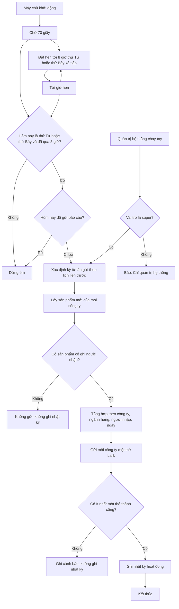

# [QT-15] Báo cáo nhập sản phẩm gửi Lark (tự động theo lịch và chạy tay)

| Mục | Giá trị |
|-----|---------|
| Dự án | QS Pro |
| Phiên bản | 1.0 - 2026-10-07 |
| Người yêu cầu | — |
| Ưu tiên | — (tài liệu mô tả hiện trạng, không phải yêu cầu mới) |
| Loại | Mô tả hiện trạng |

> Ký hiệu ⚠ = chỗ mã nguồn và ghi chú / giao diện không khớp nhau, hoặc có dấu hiệu lỗi / thiếu. Mỗi ⚠ đều có một dòng `Q-xx` ở mục 14.

## 1. Tóm tắt
Hai lần mỗi tuần — 8 giờ sáng thứ Tư và thứ Bảy, giờ Việt Nam — hệ thống tự thống kê các sản phẩm mới được nhập vào danh mục kể từ lần báo cáo trước và gửi vào nhóm Lark, mỗi công ty một thẻ tin nhắn. Thẻ cho biết ai nhập, ngày nào, bao nhiêu sản phẩm, của bao nhiêu nhà cung cấp, thuộc ngành hàng nào. Quản trị hệ thống có thể chạy tay cùng báo cáo này, kể cả chạy thử chỉ để xem số liệu mà không gửi.

## 2. Tác nhân & quyền
| Tác nhân | Vai trò hệ thống | Được làm gì trong quy trình |
|----------|-----------------|-----------------------------|
| Hệ thống (lịch tự động) | Không phải tài khoản; chạy ngầm trong máy chủ | Tự kiểm tra lịch, thống kê, gửi thẻ Lark, ghi nhật ký |
| Quản trị hệ thống | `super` | Chạy tay báo cáo (gửi thật hoặc chạy thử), có thể chỉ định mốc bắt đầu kỳ thống kê |
| Admin công ty | `admin` | Không được chạy báo cáo. Sản phẩm họ nhập là dữ liệu đầu vào |
| Nhân viên | `staff` | Không được chạy báo cáo. Sản phẩm họ nhập là dữ liệu đầu vào |
| Nhóm Lark | (ngoài hệ thống) | Nhận các thẻ "Sản phẩm nhập mới" |

## 3. Điều kiện trước
- Máy chủ đang chạy vào thời điểm theo lịch (hoặc được đánh thức trong chính ngày thứ Tư / thứ Bảy đó sau 8 giờ).
- Có đường gửi tin vào nhóm Lark: dùng đường riêng cho báo cáo nếu đã cấu hình, nếu chưa thì dùng chung đường của yêu cầu mua hàng.
- Trong kỳ có ít nhất một sản phẩm mới **có ghi nhận người nhập**.
- Chạy tay: người gọi đã đăng nhập với vai trò `super`.

## 4. Luồng chính
Luồng chính là lần chạy **tự động theo lịch**. Chạy tay xem mục 6 (P1–P3).

| Bước | Ai | Hành động | Hệ thống xử lý | Kết quả người dùng thấy | Đã có / Mới |
|------|----|-----------|----------------|--------------------------|-------------|
| 1 | Hệ thống | Máy chủ khởi động | Chờ 70 giây rồi chạy một lượt "gửi bù" (đi từ bước 3) và đặt hẹn tới 8:00 của ngày thứ Tư / thứ Bảy kế tiếp | Nhật ký máy chủ ghi "lần gửi kế tiếp sau …h…p (thứ 4 & thứ 7, 8h00 giờ VN)" | Đã có |
| 2 | Hệ thống | Tới giờ hẹn | Chạy một lượt "đúng giờ" (bước 3) và đặt ngay hẹn cho lần kế tiếp | — | Đã có |
| 3 | Hệ thống | Kiểm tra lịch | Chỉ đi tiếp nếu hôm nay (giờ Việt Nam) là thứ Tư hoặc thứ Bảy **và** đã từ 8 giờ trở đi; không thì dừng êm | — | Đã có |
| 4 | Hệ thống | Chống gửi trùng | Xem nhật ký hoạt động: nếu hôm nay (giờ Việt Nam) đã có dòng báo cáo nhập sản phẩm thì dừng | — | Đã có |
| 5 | Hệ thống | Xác định kỳ báo cáo | Kỳ bắt đầu từ 8:00 của ngày gửi theo lịch liền trước (thứ Tư lấy từ thứ Bảy trước — 4 ngày; thứ Bảy lấy từ thứ Tư — 3 ngày) và kéo tới thời điểm chạy | — | Đã có |
| 6 | Hệ thống | Lấy dữ liệu | Lấy mọi sản phẩm của **tất cả công ty** có ngày tạo từ mốc bắt đầu kỳ (tối đa 5.000 sản phẩm). Bỏ ra các sản phẩm không ghi nhận người nhập và đếm riêng số bị bỏ | — | Đã có |
| 7 | Hệ thống | Tổng hợp theo công ty | Tra tên đầy đủ và phòng ban của người nhập theo tên đăng nhập, tra tên công ty. Với mỗi công ty: đếm sản phẩm, nhà cung cấp, người nhập; lập bảng theo ngành hàng (Thiết bị đèn / Thiết bị vệ sinh / Sơn nước) và bảng theo người nhập × ngày. Sắp công ty nhiều sản phẩm lên trước | — | Đã có |
| 8 | Hệ thống | Gửi Lark | Gửi lần lượt mỗi công ty một thẻ "📦 Sản phẩm nhập mới · <tên công ty>" vào cùng một nhóm Lark. Thẻ nào lỗi thì ghi cảnh báo rồi gửi tiếp thẻ sau | Nhóm Lark nhận các thẻ: số sản phẩm, số nhà cung cấp, số người nhập, kỳ báo cáo, bảng ngành hàng, bảng người nhập theo ngày, dòng "Tổng cộng" | Đã có |
| 9 | Hệ thống | Ghi nhật ký | Nếu có ít nhất một thẻ gửi thành công: ghi một dòng nhật ký hoạt động với người thực hiện "hệ thống" (dòng này cũng là dấu "hôm nay đã gửi") | Nhật ký máy chủ ghi "đã gửi Lark: N sản phẩm" | Đã có |

## 5. Sơ đồ

## 6. Luồng phụ & lỗi
| Mã | Tình huống | Hệ thống phản hồi | Thông báo cho người dùng |
|----|-----------|-------------------|--------------------------|
| P1 | `super` chạy thử (không gửi) | Làm các bước 5–7 rồi trả về số sản phẩm, số thẻ, số sản phẩm thiếu người nhập, mốc bắt đầu và toàn bộ số liệu từng công ty. Không gửi Lark, không ghi nhật ký | Kết quả trả về cho người gọi. ⚠ Không có màn hình nào trong ứng dụng để gọi (Q-01) |
| P2 | `super` chạy tay gửi thật | Làm các bước 5–9. **Bỏ qua** kiểm tra ngày / giờ và kiểm tra "hôm nay đã gửi" — chạy lúc nào cũng gửi | Kết quả trả về: có gửi được không, số sản phẩm, từng công ty gửi thành công hay không |
| P3 | `super` chạy tay với mốc bắt đầu tự chọn | Dùng mốc đó thay cho mốc tính theo lịch; phần còn lại như P1 / P2 | Như P1 / P2 |
| E1 | Chưa đăng nhập mà gọi chạy tay | Từ chối (mã 401) | "Chưa đăng nhập" |
| E2 | `admin` hoặc `staff` gọi chạy tay | Từ chối (mã 403) | "Chỉ quản trị hệ thống" |
| E3 | Mốc bắt đầu tự chọn không phải ngày giờ hợp lệ | Không gửi | Kết quả: "Mốc thời gian không hợp lệ" |
| E4 | Không đọc được danh sách sản phẩm | Không gửi, không ghi nhật ký | Kết quả: "Không đọc được danh sách sản phẩm: <lỗi>" (lần tự động: chỉ ghi vào nhật ký máy chủ) |
| E5 | Kỳ này không có sản phẩm mới | Không gửi, không ghi nhật ký | Kết quả: "Kỳ này chưa có sản phẩm mới" |
| E6 | Có sản phẩm mới nhưng không cái nào ghi nhận người nhập | Không gửi, không ghi nhật ký | Kết quả: "Kỳ này chưa có sản phẩm mới có ghi nhận người nhập" kèm số sản phẩm bị bỏ |
| E7 | Một phần sản phẩm của công ty không ghi nhận người nhập | Không tính các sản phẩm đó; thẻ của công ty thêm dòng cảnh báo | Trên thẻ: "⚠️ N sản phẩm cũ trong kỳ chưa ghi nhận người nhập — không tính vào báo cáo." |
| E8 | Không đọc được danh sách tài khoản | Vẫn gửi; người nhập hiện bằng tên đăng nhập, phòng ban hiện "Chưa có phòng ban" | — |
| E9 | Không đọc được danh sách công ty / công ty không còn tồn tại | Vẫn gửi; tên công ty hiện "Công ty khác" | — |
| E10 | Sản phẩm không gắn công ty nào | Gom vào một thẻ riêng tên "Chưa gắn công ty", tiêu đề thẻ màu cam | — |
| E11 | Gửi một thẻ lên Lark lỗi (mất mạng, Lark trả lỗi) | Ghi cảnh báo, đánh dấu công ty đó chưa gửi, gửi tiếp các thẻ khác. Không tự gửi lại thẻ lỗi | Chạy tay: kết quả ghi rõ công ty nào `sent=false` |
| E12 | Mọi thẻ đều gửi lỗi | Không ghi nhật ký nên không tính là "đã gửi hôm nay". Không có vòng thử lại; chỉ gửi lại nếu máy chủ khởi động lại trong cùng ngày thứ Tư / thứ Bảy đó, hoặc có người chạy tay | Lần tự động: nhật ký máy chủ ghi "không gửi" |
| E13 | Ghi nhật ký lỗi sau khi đã gửi thành công | Ghi cảnh báo, vẫn coi là gửi xong. Hệ quả: máy chủ khởi động lại trong ngày có thể gửi trùng | — |
| E14 | Không đọc được nhật ký khi kiểm tra "hôm nay đã gửi" | Coi như chưa gửi và gửi tiếp (có thể trùng) | — |
| E15 | Máy chủ khởi động lại trong ngày thứ Tư / thứ Bảy sau khi đã gửi | Lượt "gửi bù" thấy nhật ký hôm nay đã có nên dừng | — |
| E16 | Máy chủ khởi động vào ngày khác thứ Tư / thứ Bảy, hoặc trước 8 giờ | Lượt "gửi bù" dừng êm; chỉ đặt hẹn lần kế | — |
| E17 | Lỗi bất ngờ trong lượt tự động | Ghi cảnh báo vào nhật ký máy chủ; hẹn lần kế vẫn giữ | — |

## 8. Quy tắc nghiệp vụ
| Mã | Quy tắc |
|----|---------|
| BR-01 | Lịch tự động: thứ Tư và thứ Bảy, 8:00 giờ Việt Nam (UTC+7). Lịch được ghi cứng trong mã, không cấu hình được qua giao diện. |
| BR-02 | Kỳ báo cáo tính ngược tới 8:00 của ngày gửi theo lịch liền trước và kéo tới thời điểm chạy thực tế; không có mốc kết thúc cố định. |
| BR-03 | Mỗi ngày (giờ Việt Nam) lượt tự động chỉ gửi một lần; dấu "đã gửi" là dòng nhật ký hoạt động của báo cáo. Chạy tay không bị quy tắc này chặn. |
| BR-04 | Chỉ tính sản phẩm có ghi nhận người nhập. Sản phẩm thiếu người nhập chỉ được nêu số lượng trong dòng cảnh báo trên thẻ của đúng công ty đó. |
| BR-05 | Báo cáo tách theo công ty — mỗi công ty một thẻ; nhưng mọi thẻ đều gửi vào cùng một nhóm Lark. Công ty nhiều sản phẩm nhất gửi trước. |
| BR-06 | Thống kê lấy dữ liệu của mọi công ty, không lọc theo công ty của người chạy (kể cả khi `super` đang "xem như" một công ty). |
| BR-07 | Ngành hàng của sản phẩm lấy theo ngành đã ghi trên sản phẩm; nếu trống thì đoán theo tên hạng mục; không xác định được thì tính là "Thiết bị đèn". |
| BR-08 | Ngày trong bảng là ngày tạo sản phẩm quy về giờ Việt Nam, dạng ngày/tháng. Người nhập sắp theo số sản phẩm giảm dần; ngày của mỗi người sắp mới trước. |
| BR-09 | Số nhà cung cấp là số tên nhà cung cấp khác nhau (bỏ qua sản phẩm không có nhà cung cấp). |
| BR-10 | Dòng "Tổng cộng" chỉ hiện khi công ty có nhiều hơn một người nhập hoặc nhiều hơn một ngày. |
| BR-11 | Thẻ của nhóm "Chưa gắn công ty" có tiêu đề màu cam; các thẻ khác màu xanh dương. |
| BR-12 | Đường gửi Lark: dùng `config.reportWebhook`; nếu chưa cấu hình riêng thì tự dùng `config.purchaseWebhook` (chung với yêu cầu mua hàng và phiếu đề xuất). |
| BR-13 | Nhật ký chỉ được ghi khi có ít nhất một thẻ gửi thành công. Chạy thử không gửi và không ghi gì. |
| BR-14 | Chạy tay chỉ dành cho `super`. |

## 9. Thông báo, realtime & nhật ký
Hệ thống không có realtime. Quy trình này không tạo thông báo trong ứng dụng cho bất kỳ ai.

| Sự kiện | Ai nhận | Kênh | Nội dung | Ghi audit? |
|---------|---------|------|----------|:----------:|
| Gửi báo cáo (tự động hoặc chạy tay gửi thật), có ít nhất một thẻ thành công | Nhóm Lark gắn với `config.reportWebhook` | Lark (thẻ tương tác, mỗi công ty một thẻ) | Tiêu đề "📦 Sản phẩm nhập mới · <công ty>"; dòng phụ "N sản phẩm · M nhà cung cấp · dd/mm → dd/mm"; khối số liệu (Sản phẩm nhập mới, Nhà cung cấp, Người nhập, Kỳ báo cáo); bảng NGÀNH HÀNG · SP · NCC; bảng NGƯỜI NHẬP (kèm phòng ban) · NGÀY · SP · NCC; Tổng cộng; cảnh báo sản phẩm thiếu người nhập (nếu có); chân thẻ "Dezon Pro · Báo cáo tự động thứ 4 & thứ 7 lúc 8h00" | Có — hành động `bao_cao_nhap_sp`, người thực hiện "hệ thống", nội dung "Báo cáo Lark: N sản phẩm nhập mới / M công ty, kỳ dd/mm → dd/mm"; dòng nhật ký không gắn công ty |
| Mọi thẻ đều gửi lỗi | Không ai | — | — | Không |
| Không có sản phẩm mới / không đọc được dữ liệu | Không ai | — | — | Không |
| Chạy thử (không gửi) | Không ai (chỉ người gọi nhận kết quả) | — | — | Không |

## 10. Dữ liệu
| Thông tin | Bắt buộc | Ràng buộc | Ví dụ |
|-----------|----------|-----------|-------|
| Ngày tạo sản phẩm | Có | Quyết định sản phẩm có thuộc kỳ hay không | 05/10/2026 14:20 |
| Người nhập (tên đăng nhập ghi trên sản phẩm) | Có để được tính | Trống thì bị loại khỏi báo cáo | "lan.nt" |
| Nhà cung cấp | Không | Trống thì không đếm vào số nhà cung cấp | "Công ty X" |
| Công ty của sản phẩm | Không | Trống thì gom vào "Chưa gắn công ty" | — |
| Ngành, hạng mục của sản phẩm | Không | Dùng để xếp ngành hàng | "vs" → Thiết bị vệ sinh |
| Họ tên, phòng ban của người nhập | Không | Tra theo tên đăng nhập (không phân biệt hoa thường); thiếu thì hiện tên đăng nhập và "Chưa có phòng ban" | "Nguyễn Thị Lan", "Mua hàng" |
| Tên công ty | Không | Lấy tên, thiếu thì lấy mã; không tìm thấy thì "Công ty khác" | "Dezon" |
| Tuỳ chọn chạy tay: chạy thử | Không | Bật thì không gửi, không ghi nhật ký | bật |
| Tuỳ chọn chạy tay: mốc bắt đầu kỳ | Không | Phải là ngày giờ hợp lệ | 2026-10-01 08:00 |
| Dòng nhật ký báo cáo | Tự ghi | Dùng làm dấu chống gửi trùng trong ngày | "Báo cáo Lark: 42 sản phẩm nhập mới / 2 công ty, kỳ 03/10 → 07/10" |

## 11. Màn hình liên quan
- Không có màn hình nào trong ứng dụng cho quy trình này (⚠ Q-01).
- Nhóm Lark nhận thẻ báo cáo.
- Tab **Admin** → khối nhật ký hoạt động: nơi có thể thấy dòng nhật ký của báo cáo (chỉ `super` chưa chọn công ty mới thấy, vì dòng này không gắn công ty — xem GD-03).
- Tab **Nhập dữ liệu** (`import`) và **Danh sách sản phẩm** (`sanpham`): nơi tạo ra sản phẩm là dữ liệu đầu vào.

## 12. Tiêu chí nghiệm thu
- **AC-01**: Cho hôm nay là thứ Tư, 8:00 giờ Việt Nam, máy chủ đang chạy, từ 8:00 thứ Bảy trước có 10 sản phẩm mới có người nhập thuộc 2 công ty / Khi tới giờ hẹn / Thì nhóm Lark nhận 2 thẻ (mỗi công ty một thẻ) và nhật ký có một dòng `bao_cao_nhap_sp` của "hệ thống".
- **AC-02**: Cho tài khoản `admin` công ty đã đăng nhập / Khi gọi chạy tay báo cáo / Thì bị từ chối với "Chỉ quản trị hệ thống", không có thẻ nào được gửi.
- **AC-03**: Cho người chưa đăng nhập / Khi gọi chạy tay báo cáo / Thì bị từ chối với "Chưa đăng nhập".
- **AC-04**: Cho báo cáo hôm nay đã gửi / Khi máy chủ khởi động lại trong cùng ngày / Thì lượt "gửi bù" không gửi thêm thẻ nào.
- **AC-05**: Cho `super` đã đăng nhập / Khi chạy thử / Thì nhận về số liệu từng công ty, nhóm Lark không nhận gì và nhật ký không có dòng mới.
- **AC-06**: Cho kỳ không có sản phẩm mới / Khi chạy (tự động hoặc tay) / Thì không gửi thẻ, không ghi nhật ký, kết quả là "Kỳ này chưa có sản phẩm mới".
- **AC-07**: Cho công ty A có 5 sản phẩm mới, trong đó 2 sản phẩm không ghi nhận người nhập / Khi gửi báo cáo / Thì thẻ của A ghi 3 sản phẩm và có dòng "⚠️ 2 sản phẩm cũ trong kỳ chưa ghi nhận người nhập — không tính vào báo cáo."
- **AC-08**: Cho 2 công ty có sản phẩm mới và thẻ của công ty thứ nhất gửi lỗi / Khi gửi báo cáo / Thì thẻ của công ty thứ hai vẫn được gửi, nhật ký vẫn được ghi, và thẻ lỗi không được tự gửi lại.
- **AC-09**: Cho hôm nay là thứ Năm / Khi máy chủ khởi động / Thì không có báo cáo nào được gửi; lần gửi kế tiếp được hẹn vào 8:00 thứ Bảy.
- **AC-10**: Cho `super` chạy tay với mốc bắt đầu là chữ không phải ngày giờ / Khi gọi / Thì kết quả là "Mốc thời gian không hợp lệ" và không gửi gì.

## 13. Ảnh hưởng tới phần có sẵn
- Nếu chưa cấu hình đường gửi riêng cho báo cáo, thẻ báo cáo đi chung nhóm Lark và chung tên bot với yêu cầu mua hàng (QT-13) và phiếu đề xuất (QT-14).
- Dùng chung bảng nhật ký hoạt động; dòng nhật ký báo cáo vừa là lịch sử vừa là dấu chống gửi trùng — xoá dòng này trong ngày sẽ khiến báo cáo có thể bị gửi lại.
- Chỉ đọc danh mục sản phẩm, tài khoản, công ty; không sửa dữ liệu nghiệp vụ nào.
- Lịch chạy nằm trong tiến trình máy chủ: mỗi lần triển khai / khởi động lại đều đặt lại hẹn.

## 14. Giả định & câu hỏi mở
| Mã | Nội dung | Cần ai trả lời |
|----|----------|----------------|
| GD-01 | Máy chủ thật chạy gói miễn phí của Render (theo `render.yaml`) nên có thể "ngủ" khi không có truy cập; đây là lý do mã nguồn có lượt "gửi bù sau khi server thức". Hành vi ngủ / thức thực tế không kiểm tra được từ mã. | Dev / người vận hành |
| GD-02 | Biến `REPORT_WEBHOOK` đã hay chưa được đặt trên máy chủ thật là không biết; nếu chưa đặt thì báo cáo đi chung nhóm với yêu cầu mua hàng. | Người vận hành |
| GD-03 | Dòng nhật ký báo cáo không gắn công ty nên admin công ty không thấy trong nhật ký của mình; chỉ `super` chưa chọn công ty thấy. Suy ra từ cách lọc theo công ty, chưa thử trên hệ thống thật. | Dev |
| GD-04 | Tên đăng nhập là duy nhất trên toàn hệ thống. Nếu hai công ty có trùng tên đăng nhập, họ tên / phòng ban trên thẻ có thể lấy nhầm của người kia (bảng tra chỉ dùng tên đăng nhập làm khoá). | Dev |
| Q-01 | ⚠ Ghi chú mã nguồn ghi "super chạy tay / dryRun báo cáo nhập SP", nhưng trong thư mục `public/` không có chỗ nào gọi `baoCaoNhapSP` — không có nút hay màn hình nào để chạy tay. Hiện chỉ gọi được bằng cách gửi lệnh trực tiếp tới máy chủ (hoặc qua trang Swagger ở môi trường phát triển). Có cần làm nút cho `super` không? | Chủ sản phẩm |
| Q-02 | ⚠ Ghi chú mã nguồn khẳng định kỳ tính ngược tới lần gửi trước "nên server có ngủ dậy muộn cũng không sót sản phẩm nào". Điều này chỉ đúng khi máy chủ thức trong chính ngày thứ Tư / thứ Bảy đó. Nếu máy chủ ngủ suốt cả ngày gửi (hoặc mọi thẻ đều lỗi), ngày hôm sau không gửi bù, và lần gửi kế tiếp chỉ tính từ 8:00 của ngày gửi theo lịch vừa bị lỡ — sản phẩm của cả kỳ bị lỡ không bao giờ được báo cáo. Có chấp nhận không? | Chủ sản phẩm / Dev |
| Q-03 | ⚠ Báo cáo tách thẻ theo công ty nhưng mọi thẻ của mọi công ty đều gửi vào **cùng một** nhóm Lark (một đường gửi duy nhất cho toàn hệ thống). Người trong nhóm thấy số liệu nhập hàng của tất cả công ty. Với mô hình nhiều công ty, đây có phải ý muốn? | Chủ sản phẩm |
| Q-04 | ⚠ Khi chỉ một phần thẻ gửi thành công, hệ thống vẫn ghi nhật ký "đã gửi hôm nay" nên các công ty có thẻ lỗi không được gửi lại trong lần nào nữa (kỳ sau tính từ mốc mới). Có cần gửi lại riêng thẻ lỗi? | Dev |
| Q-05 | ⚠ Chạy tay gửi thật cũng ghi dòng nhật ký dùng làm dấu chống trùng. Nếu `super` chạy tay vào thứ Tư / thứ Bảy **trước** 8 giờ, lượt tự động lúc 8:00 hôm đó sẽ bị bỏ qua (coi như đã gửi), và sản phẩm nhập từ lúc chạy tay tới 8:00 rơi khỏi mọi báo cáo. Chạy tay **sau** khi lượt tự động đã gửi thì nhóm Lark nhận trùng nội dung. Có cần tách dấu chống trùng của chạy tay và tự động? | Dev |
| Q-06 | ⚠ Chạy tay không ghi lại ai đã chạy: dòng nhật ký luôn mang tên "hệ thống", kể cả khi do một tài khoản `super` bấm; chân thẻ Lark cũng luôn ghi "Báo cáo tự động thứ 4 & thứ 7 lúc 8h00" dù là chạy tay với kỳ tuỳ chọn. Có cần phân biệt? | Chủ sản phẩm |
| Q-07 | Mỗi lần chỉ đọc tối đa 5.000 sản phẩm mới nhất trong kỳ (và tối đa 5.000 tài khoản, 500 công ty). Vượt ngưỡng thì số liệu thiếu mà không có cảnh báo. Ngưỡng này có đủ cho đợt nhập hàng loạt lớn? | Dev |
| Q-08 | Khi kỳ không có sản phẩm mới, nhóm Lark không nhận gì (không có tin "kỳ này không có sản phẩm mới"), và nếu không đọc được nhật ký thì hệ thống chọn gửi (chấp nhận trùng) thay vì không gửi. Có đúng ý muốn? | Chủ sản phẩm |
| Q-09 | Mốc bắt đầu tự chọn khi chạy tay được hiểu theo quy ước nội bộ (giờ Việt Nam viết dưới dạng giờ UTC), lệch 7 tiếng so với cách hiểu thông thường của chuỗi ngày giờ chuẩn. Cần ghi rõ quy ước này ở đâu cho người chạy tay? | Dev |

## 15. Ghi chú kỹ thuật cho dev
- Job nền: `server/index.js:10` gọi `start()` của `server/components/bao-cao/bao-cao.job.js:30-35` (chờ 70 giây, chạy "gửi bù", rồi `scheduleBaoCaoSP_`). Kiểm tra ngày / giờ / chống trùng và gọi báo cáo: `autoBaoCaoSP_` `:5-16`; tính thời gian tới lần kế: `msToNextBaoCao_` `:17-23`; đặt hẹn bằng `setTimeout` tự nối: `:24-29`. Job gọi `baoCaoNhapSP({ r: 'super' }, {})` ngoài ngữ cảnh công ty (`:11`).
- Hằng số lịch: `BAO_CAO_GIO_VN = 8`, `BAO_CAO_THU = [3, 6]`, `BAO_CAO_ACTION = 'bao_cao_nhap_sp'` tại `server/components/bao-cao/bao-cao.service.js:16-18`; giờ Việt Nam `nowVN_` `:7-8`.
- Mốc bắt đầu kỳ: `moBaoCaoTruoc_` tại `server/components/bao-cao/bao-cao.service.js:35-42`; quy đổi mốc về UTC `vnToUtcIso_` `:43` (liên quan Q-09: `opts.tuVN` được đọc ở `:138`).
- Hàm chính `baoCaoNhapSP(actor, opts)` tại `server/components/bao-cao/bao-cao.service.js:134-235`: đọc `db_san_pham` với `noScope` và `limit: 5000` `:143-144`; loại sản phẩm thiếu `nguoi_tao` `:149-152`; đọc `users`, `cong_ty` `:154-162`; tách theo công ty `:166-209`; nhánh `opts.dryRun` `:211`; vòng gửi Lark `:213-226`; ghi `audit_log` (username "hệ thống", `noScope`) `:227-233`.
- Chống gửi trùng: `daGuiBaoCaoHomNay_` tại `server/components/bao-cao/bao-cao.service.js:237-247` (đọc 5 dòng `audit_log` mới nhất có action `bao_cao_nhap_sp`; lỗi đọc thì trả `false`).
- Thẻ Lark: `buildSpReportCard` tại `server/components/bao-cao/bao-cao.service.js:50-132`; tên ngành `tenNganh_` `:27-32`, dùng `nganhCua_` và `MUC_NGANH` ở `server/components/san-pham/san-pham.mapper.js:12-19`.
- Đường gửi: `REPORT_WEBHOOK = config.reportWebhook` (`server/components/bao-cao/bao-cao.service.js:23`); `reportWebhook` lấy biến môi trường `REPORT_WEBHOOK`, thiếu thì dùng `purchaseWebhook` (`server/config/index.js:16`). `render.yaml:26-27` khai báo `REPORT_WEBHOOK` là biến nhập tay; `render.yaml:8` là gói `free`.
- API chạy tay: `POST /api/baoCaoNhapSP`, body `{args:[{dryRun?: boolean, tuVN?: string}]}`; khai báo `actor` + `super` tại `server/components/bao-cao/bao-cao.routes.js:4-10`; kiểm tra vai trò `super` tại `server/libraries/rpc.js:62` (403 "Chỉ quản trị hệ thống"), chưa đăng nhập tại `server/libraries/rpc.js:55-58`.
- Phía giao diện: đã tìm `baoCaoNhapSP` trong toàn bộ `public/` — không có kết quả (Q-01).
- Bảng dữ liệu: đọc `db_san_pham`, `users`, `cong_ty`; ghi `audit_log`. Không có bảng riêng cho báo cáo.

## Lịch sử thay đổi
| Phiên bản | Ngày | Thay đổi |
|-----------|------|----------|
| 1.0 | 2026-10-07 | Tạo mới (mô tả hiện trạng từ mã nguồn) |
