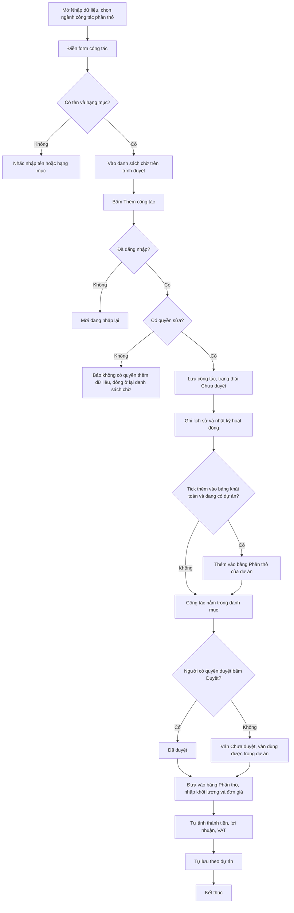
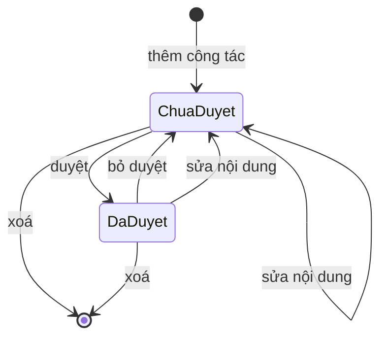

# [QT-16] Công tác xây dựng và bảng Phần thô (đề mục 3.1)

| Mục | Giá trị |
|-----|---------|
| Dự án | QS Pro |
| Phiên bản | 1.0 - 2026-10-07 |
| Người yêu cầu | — |
| Ưu tiên | Bình thường |
| Loại | Mô tả hiện trạng |

## 1. Tóm tắt
Người dùng của một công ty xây dựng danh mục "công tác xây dựng" (ép cọc, xây thô, sơn…) kèm đơn vị tính, đơn giá, ảnh và ghi chú. Danh mục này có thể sửa, xoá, duyệt, đánh dấu yêu thích, xem lịch sử và tải ra Excel.
Khi làm một dự án, người dùng lấy công tác từ danh mục đưa vào bảng Phần thô (đề mục 3.1), nhập diện tích / hệ số / khối lượng, hệ thống tự tính thành tiền, lợi nhuận và thuế VAT.
⚠ Việc "nhập công tác hàng loạt từ file mẫu" hiện KHÔNG có trong ứng dụng: file mẫu có sẵn trên máy chủ nhưng không màn hình nào dùng tới (xem Q-01).

## 2. Tác nhân & quyền
| Tác nhân | Vai trò hệ thống | Được làm gì trong quy trình |
|----------|-----------------|-----------------------------|
| Quản trị hệ thống | `super` | Mọi việc của admin. Không thuộc công ty nào; muốn làm việc trong một công ty phải chọn "xem như" công ty đó (xem Q-06). |
| Admin công ty | `admin` | Thêm, sửa, xoá, duyệt / bỏ duyệt, yêu thích, xem lịch sử, tải Excel; dùng công tác trong dự án. |
| Nhân viên có quyền duyệt | `staff` + quyền `sp_duyet` | Thêm, sửa, xoá, duyệt / bỏ duyệt, yêu thích, xem lịch sử, tải Excel. |
| Nhân viên có quyền sửa | `staff` + quyền `sp_edit` | Thêm, sửa, xoá, yêu thích, xem lịch sử, tải Excel. KHÔNG được duyệt. |
| Nhân viên chưa được cấu hình quyền sản phẩm | `staff` không có cả `sp_edit` lẫn `sp_duyet` | ⚠ Được coi như có CẢ quyền sửa và quyền duyệt (xem Q-03). |
| Mọi người đã đăng nhập | `super` / `admin` / `staff` | Xem danh mục công tác, xem lịch sử, bật / tắt yêu thích, tải Excel, đưa công tác vào bảng Phần thô của dự án. |

Ghi chú: công tác dùng CHUNG bộ quyền với sản phẩm (`sp_edit`, `sp_duyet`); không có quyền riêng cho công tác. Hiện tại không có cách nào cấu hình một nhân viên "chỉ xem, không sửa" (xem Q-03).

## 3. Điều kiện trước
- Người dùng đã đăng nhập và tài khoản đã gắn với một công ty (trừ `super`).
- Bảng dữ liệu công tác đã được tạo trên cơ sở dữ liệu (người quản trị đã chạy các file cài đặt công tác). Nếu chưa, danh mục hiện trống và việc lưu báo lỗi hướng dẫn cài đặt.
- Muốn đưa công tác vào bảng Phần thô: phải đang chọn một dự án.
- Muốn thêm ảnh: máy chủ lưu ảnh hoạt động (xem QT-18).

## 4. Luồng chính
| Bước | Ai | Hành động | Hệ thống xử lý | Kết quả người dùng thấy | Đã có / Mới |
|------|----|-----------|----------------|--------------------------|-------------|
| 1 | Người có quyền sửa | Mở tab Nhập dữ liệu, ở ô "Ngành hàng" chọn "Xây dựng · công tác phần thô" | Hiện form nhập công tác, số liệu tổng (số công tác đã có, số chờ duyệt, số hạng mục) và khung "Công tác vừa nhập (phiên này)" | Form trống sẵn sàng nhập | Đã có |
| 2 | Người có quyền sửa | Điền tên công tác, hạng mục, phân loại đề mục, nhà cung cấp, giá bán lẻ, % chiết khấu, giá đại lý, đơn vị tính, loại báo giá, cách tính, số hạng mục, khối lượng / diện tích / hệ số mẫu, ghi chú, phạm vi, thông số kỹ thuật, link tài liệu; thêm ảnh | Tự tính qua lại giữa giá bán lẻ, % chiết khấu và giá đại lý; ô "Phân loại" gợi ý đề mục tự nhận theo tên hạng mục | Form đã có dữ liệu, có dòng xem trước cách tính | Đã có |
| 3 | Người có quyền sửa | Bấm "Đưa vào danh sách chờ" | Đợi ảnh tải xong (tối đa 15 giây); kiểm có tên và có hạng mục; đưa công tác vào danh sách chờ trong trình duyệt. CHƯA lưu vào cơ sở dữ liệu | Thẻ công tác xuất hiện ở mục "Chờ lưu", có nút Sửa / Xoá | Đã có |
| 4 | Người có quyền sửa | (Tuỳ chọn) Bấm Sửa hoặc Xoá trên thẻ đang chờ | Sửa: nạp lại vào form, lưu lại bằng "Cập nhật vào danh sách chờ". Xoá: hỏi xác nhận rồi bỏ khỏi danh sách chờ | Danh sách chờ được cập nhật | Đã có |
| 5 | Người có quyền sửa | Bấm "Thêm công tác" | Lưu lần lượt từng công tác đang chờ. Máy chủ kiểm đăng nhập, kiểm quyền sửa, kiểm có tên; lưu với trạng thái "Chưa duyệt", ghi người tạo và ngày tạo; ghi lịch sử "TẠO CÔNG TÁC"; ghi nhật ký hoạt động | Thông báo "Đã lưu N công tác vào Database"; công tác chuyển sang mục "Đã lưu vào Database". Dòng lỗi ở lại danh sách chờ kèm lý do | Đã có |
| 6 | Hệ thống | — | Nếu đã tick "Thêm luôn vào bảng khái toán của dự án đang chọn" và đang có dự án: thêm các công tác vừa lưu vào bảng Phần thô của dự án đó | Thông báo có thêm "· thêm N vào bảng khái toán" | Đã có |
| 7 | Mọi người đã đăng nhập | Mở tab Danh sách sản phẩm, chọn hạng mục 3.1 Phần thô | Hiện danh mục công tác với 4 thẻ lọc: Tất cả, Chưa duyệt, Đã duyệt, Yêu thích; có tìm kiếm và bộ lọc (loại báo giá, đơn vị tính, hạng mục, khoảng đơn giá, đã có trong bảng, đã sửa giá) | Bảng công tác | Đã có |
| 8 | Người có quyền sửa | Bấm nút sửa trên một dòng, chỉnh trong cửa sổ "Cập nhật công tác", bấm "Lưu thay đổi" | Kiểm có tên và hạng mục; máy chủ kiểm quyền sửa; chỉ ghi các ô được gửi lên; đưa công tác về "Chưa duyệt" và xoá người duyệt / ngày duyệt; ghi người sửa và giờ sửa; ghi lịch sử từng ô thay đổi; ghi nhật ký hoạt động | Thông báo "Đã lưu công tác"; nhãn chuyển về "Chưa duyệt" | Đã có |
| 9 | Người có quyền sửa | Sửa nhanh một ô ngay trên bảng (đơn vị tính, khối lượng, diện tích, hệ số, đơn giá, ghi chú) hoặc chọn nhiều dòng rồi "Sửa hàng loạt" một trường | Với công tác đã lưu: gọi máy chủ sửa từng công tác, quy tắc như bước 8. Với công tác mẫu dựng sẵn: chỉ lưu phần sửa trên chính trình duyệt đó | "Đã lưu vào cơ sở dữ liệu" hoặc "Đã sửa N công tác" | Đã có |
| 10 | Người có quyền duyệt | Bấm Duyệt / Bỏ duyệt trên một dòng, trong cửa sổ sửa, hoặc cho nhiều dòng đã chọn | Máy chủ kiểm quyền duyệt; đổi trạng thái, ghi người duyệt và giờ duyệt (bỏ duyệt thì xoá); ghi lịch sử "TRẠNG THÁI DUYỆT"; ghi nhật ký hoạt động | "Đã duyệt công tác" / "Đã bỏ duyệt" / "Đã duyệt N công tác" | Đã có |
| 11 | Mọi người đã đăng nhập | Bấm biểu tượng yêu thích trên một dòng, hoặc chọn nhiều dòng rồi "Yêu thích" / "Bỏ yêu thích" | Đổi dấu yêu thích ngay trên màn hình rồi gửi máy chủ; nếu máy chủ báo lỗi thì trả dấu về như cũ. Dấu yêu thích dùng chung cho cả công ty. Không ghi lịch sử, không ghi nhật ký | "Đã thêm vào công tác yêu thích" / "Đã bỏ khỏi công tác yêu thích" | Đã có |
| 12 | Người có quyền sửa | Bấm xoá một công tác (hoặc chọn nhiều dòng rồi "Xoá công tác"), xác nhận | Máy chủ kiểm quyền sửa; xoá hẳn từng công tác; ghi lịch sử "XOÁ CÔNG TÁC"; ghi nhật ký hoạt động số công tác đã xoá | "Đã xoá công tác" / "Đã xoá N công tác" | Đã có |
| 13 | Mọi người đã đăng nhập | Mở cửa sổ "Cập nhật công tác" | Tải tối đa 200 dòng lịch sử mới nhất của công tác đó | Cột phải hiện người tạo, người sửa cuối, trạng thái duyệt và danh sách "trường — giá trị cũ → giá trị mới — ai — lúc nào" | Đã có |
| 14 | Mọi người đã đăng nhập | Bấm "Tải Excel" (toàn bộ danh sách đang lọc, hoặc chỉ các dòng đã chọn) | Trình duyệt gửi các dòng đang xem lên máy chủ; máy chủ kiểm đăng nhập và dựng file Excel 11 cột | Trình duyệt tải file `cong-tac-xay-dung.xlsx`; thông báo "Đã tải N công tác ra Excel" | Đã có |
| 15 | Người dùng dự án | Chọn dự án, vào tab Bóc tách, chọn đề mục 3.1 Phần thô | Nạp bảng Phần thô đã lưu của dự án; hiện thư viện công tác bên trái theo loại báo giá đang chọn (Khái toán chi tiết, Khái toán sơ bộ, Dự toán · Nhân công, Dự toán · Vật tư) | Bảng Phần thô và thư viện công tác | Đã có |
| 16 | Người dùng dự án | Thêm công tác vào bảng: bấm dấu cộng ở một công tác, kéo thả vào bảng, bấm dấu cộng ở cả nhóm, chọn "Dự án mẫu" (khái toán sơ bộ), dùng cả bộ dự toán, hoặc chọn nhiều dòng ở Danh sách sản phẩm rồi "Thêm vào bảng khái toán" | Sao chép tên, đơn vị tính, khối lượng / diện tích / hệ số mẫu, đơn giá và ghi chú của công tác vào bảng của dự án. Thêm cả nhóm thì bỏ qua công tác đã có trong bảng | Dòng mới xuất hiện và nháy sáng; thư viện đánh dấu "✓ đã thêm" | Đã có |
| 17 | Người dùng dự án | Nhập diện tích, hệ số, khối lượng, đơn giá nhà thầu, % lợi nhuận hoặc đơn giá bán trên từng dòng | Tính khối lượng, thành tiền nhà thầu, thành tiền bán, lợi nhuận theo quy tắc BR-12 đến BR-15; cộng tổng từng hạng mục và tổng bảng | Các ô và thanh tổng cập nhật ngay | Đã có |
| 18 | Người dùng dự án | Sửa % VAT của bảng Phần thô | Lưu VAT vào dự án (dùng chung cho mọi tab và file báo giá) | Tiền thuế và tổng sau thuế đổi theo | Đã có |
| 19 | Hệ thống | — | Sau mỗi thay đổi, bảng Phần thô được lưu vào trình duyệt ngay và gửi lên máy chủ sau khoảng 1,2 giây, lưu theo dự án | Không có thông báo khi lưu thành công; lỗi thì có thông báo | Đã có |
| 20 | Người dùng dự án | Ở một đề mục hoàn thiện (ví dụ 3.2.2 Sơn nước), bấm dấu cộng trên công tác thuộc đề mục đó | Thêm công tác thành một dòng thường của bảng bóc tách đề mục đó (tên, đơn vị tính, giá vốn = đơn giá nhà thầu, giá bán = đơn giá, ảnh đầu tiên) | Dòng mới trong bảng bóc tách; thẻ công tác hiện "✓ đã thêm" | Đã có |

## 5. Sơ đồ

## 6. Luồng phụ & lỗi
| Mã | Tình huống | Hệ thống phản hồi | Thông báo cho người dùng |
|----|-----------|-------------------|--------------------------|
| E1 | Chưa đăng nhập hoặc phiên hết hạn khi gọi bất kỳ thao tác công tác nào | Từ chối, mã 401, xoá phiên cũ | Màn hình đăng nhập với dòng "Phiên đã hết, mời đăng nhập lại." |
| E2 | Không có quyền sửa khi thêm | Từ chối (⚠ mã trả về là 500, không phải 403) | "Tài khoản không có quyền thêm dữ liệu" — hiện ngay trên thẻ đang chờ |
| E3 | Không có quyền sửa khi sửa | Từ chối | "Lỗi lưu: Tài khoản không có quyền sửa dữ liệu" |
| E4 | Không có quyền sửa khi xoá | Từ chối | "Lỗi: Tài khoản không có quyền xoá dữ liệu" |
| E5 | Không có quyền duyệt khi duyệt / bỏ duyệt | Từ chối | "Lỗi: Tài khoản không có quyền duyệt" |
| E6 | Tài khoản không phải `super` mà chưa gắn công ty | Từ chối mọi thao tác đọc / ghi công tác | "Tài khoản chưa gắn với công ty nào" |
| E7 | Bấm "Đưa vào danh sách chờ" khi thiếu tên | Không đưa vào danh sách | "Nhập tên hạng mục / nội dung công việc" |
| E8 | Thiếu hạng mục (form nhập hoặc cửa sổ sửa) | Không lưu | "Nhập hạng mục" |
| E9 | Cửa sổ sửa thiếu tên | Không lưu | "Nhập nội dung công việc" |
| E10 | Máy chủ nhận lệnh thêm mà không dòng nào có tên | Từ chối | "Chưa có công tác nào để lưu (thiếu tên công việc)" |
| E11 | Sửa mà không có mã công tác | Từ chối | "Thiếu id công tác" |
| E12 | Sửa công tác không còn tồn tại (đã bị xoá, hoặc thuộc công ty khác) | Không ghi gì | "Lỗi lưu: Không tìm thấy công tác để sửa" |
| E13 | Xoá công tác không còn tồn tại | Bỏ qua dòng đó, các dòng khác vẫn xoá; trả danh sách lỗi (tối đa 5 dòng) | "Lỗi: Không tìm thấy công tác" |
| E14 | Duyệt / yêu thích công tác không còn tồn tại | Không đếm dòng đó; nếu không dòng nào đổi được thì trình duyệt coi là lỗi | "Lỗi: Máy chủ không đổi trạng thái duyệt được dòng nào" / "Lỗi: Máy chủ không đánh dấu yêu thích được dòng nào" |
| E15 | Chưa tạo bảng công tác trên cơ sở dữ liệu | Xem danh mục: trả danh sách trống, không báo lỗi. Ghi: từ chối | "Chưa có bảng cong_tac trong Supabase — chạy file db/cong_tac.sql rồi thử lại." |
| E16 | Bảng công tác bị khoá ghi | Từ chối | "Bảng cong_tac đang bật RLS nên không ghi được — chạy lại db/cong_tac.sql." |
| E17 | Cơ sở dữ liệu thiếu một cột mới của công tác | Tự bỏ cột đó ra và lưu lại lần nữa; chỉ ghi cảnh báo trong nhật ký máy chủ | Không có thông báo — dữ liệu của cột thiếu bị bỏ qua âm thầm |
| E18 | Cơ sở dữ liệu thiếu cột yêu thích | Từ chối | "Chưa có cột "yêu thích" trong bảng cong_tac — chạy lại db/cong_tac.sql rồi thử lại." |
| E19 | Chưa có bảng lịch sử công tác | Thao tác chính vẫn thành công; không ghi lịch sử; xem lịch sử trả danh sách trống | "Chưa có lịch sử cập nhật." |
| E20 | Không tải được danh mục công tác | Giữ danh sách cũ trên màn hình | "Không tải được công tác: …" |
| E21 | Lưu nhiều công tác, một số lỗi | Dòng thành công rời danh sách chờ; dòng lỗi ở lại với nhãn "Lỗi — sửa lại" | Hộp báo "N công tác chưa lưu được" kèm từng dòng và lý do |
| E22 | Bấm "Thêm công tác" khi danh sách chờ trống | Không làm gì | "Chưa có công tác nào chờ lưu" |
| E23 | Đóng / tải lại trang khi danh sách chờ còn công tác | Trình duyệt hỏi lại trước khi rời trang | "Còn dữ liệu chưa lưu vào Database" |
| E24 | Chọn dòng là công tác mẫu dựng sẵn rồi duyệt / yêu thích / sửa / xoá hàng loạt | Không gọi máy chủ | "Chỉ duyệt được công tác đã lưu trong cơ sở dữ liệu" (tương tự cho "đánh dấu", "sửa", "xoá") |
| E25 | Sửa hàng loạt mà chưa nhập giá trị | Không làm gì | "Chưa nhập giá trị mới" / "Nhập giá trị mới" |
| E26 | Thêm công tác vào bảng khi chưa chọn dự án | Không thêm | "Chọn dự án trước khi thêm công tác vào bảng" |
| E27 | Kéo thả công tác vào hạng mục có cách tính khác | Thêm vào hạng mục đúng theo mẫu thay vì chỗ thả | "Đã thêm vào "…" — hạng mục bạn thả vào nhập theo kiểu khác nên không chèn vào đó được" |
| E28 | Thêm cả nhóm mà nhóm đã có đủ trong bảng | Không thêm gì | "Nhóm này đã có đủ trong bảng" |
| E29 | Máy chủ không lưu được bảng Phần thô của dự án | Dữ liệu vẫn nằm trong trình duyệt | "… — dữ liệu vẫn còn trên máy này" (ví dụ "Mất kết nối tới máy chủ — dữ liệu vẫn còn trên máy này") |
| E30 | Tải Excel khi không có dòng nào | Trình duyệt không gọi máy chủ; nếu gọi thẳng máy chủ với danh sách rỗng thì mã 400 "Không có dòng nào để xuất" | "Không có công tác nào để tải" |
| E31 | Tải Excel khi chưa đăng nhập | Từ chối, mã 401 "Chưa đăng nhập" | "Không tải được Excel: Lỗi 401" |
| E32 | Tải Excel hơn 5.000 dòng | ⚠ Máy chủ chỉ lấy 5.000 dòng đầu, không báo | Vẫn báo "Đã tải N công tác ra Excel" với N là số dòng đã gửi |
| E33 | Tải ảnh công tác lỗi | Bỏ qua ảnh đó, các ảnh khác vẫn tải | "Không đọc được ảnh …" / "Lỗi tải ảnh: …" |
| E34 | Muốn nhập công tác hàng loạt từ file mẫu | ⚠ Không có nút tải file mẫu, không có nút chọn file, không có xử lý trên máy chủ | Không có gì trên màn hình (xem Q-01) |

## 7. Trạng thái

| Từ | Sang | Khi nào | Ai được làm |
|----|------|---------|-------------|
| (chưa có) | Chưa duyệt | Lưu công tác mới | `admin`, `super`, `staff` có quyền sửa |
| Chưa duyệt | Đã duyệt | Bấm Duyệt | `admin`, `super`, `staff` có quyền `sp_duyet` (hoặc chưa cấu hình quyền) |
| Đã duyệt | Chưa duyệt | Bấm Bỏ duyệt | Như trên |
| Đã duyệt | Chưa duyệt | Sửa bất kỳ ô nào của công tác (kể cả sửa nhanh trên bảng, sửa hàng loạt) | Người có quyền sửa — kể cả khi chính người đó có quyền duyệt |
| Bất kỳ | (đã xoá) | Xoá công tác | Người có quyền sửa |

Dấu yêu thích là một cờ riêng, không nằm trong vòng đời này.

## 8. Quy tắc nghiệp vụ
| Mã | Quy tắc |
|----|---------|
| BR-01 | Công tác thuộc về một công ty. Người của công ty nào chỉ thấy và sửa được công tác của công ty đó. |
| BR-02 | Quyền thêm / sửa / xoá công tác = quyền sửa sản phẩm. Quyền duyệt công tác = quyền duyệt sản phẩm. `admin` và `super` có cả hai. Người có quyền duyệt cũng có quyền sửa. |
| BR-03 | ⚠ Nhân viên chưa được cấu hình cả `sp_edit` lẫn `sp_duyet` được coi là có cả hai quyền. |
| BR-04 | Công tác mới luôn ở trạng thái "Chưa duyệt". Sửa nội dung công tác luôn đưa về "Chưa duyệt" và xoá người duyệt, ngày duyệt. |
| BR-05 | Máy chủ chỉ bắt buộc "tên công tác". Màn hình bắt buộc thêm "hạng mục". Các ô đánh dấu sao khác (giá bán lẻ, % chiết khấu, giá đại lý, đơn vị tính, loại báo giá) ⚠ không được kiểm (xem Q-04). |
| BR-06 | Không kiểm trùng: hai công tác cùng tên, cùng hạng mục vẫn lưu được. |
| BR-07 | Khi sửa, chỉ những ô được gửi lên mới bị ghi đè; các ô khác giữ nguyên. |
| BR-08 | Có 4 loại báo giá: Khái toán chi tiết, Khái toán sơ bộ, Dự toán · Nhân công, Dự toán · Vật tư. Mặc định là Khái toán chi tiết. |
| BR-09 | Có 4 cách tính: Khối lượng × đơn giá; Diện tích × hệ số (đơn giá chung cho cả hạng mục); Chỉ tính khối lượng (chưa có đơn giá); Chỉ liệt kê. Mặc định là Khối lượng × đơn giá. |
| BR-10 | Mọi công tác luôn hiện ở 3.1 Phần thô. Ô "Phân loại (đề mục bóc tách)": để trống = tự nhận theo tên hạng mục (thạch cao → 3.2.1, sơn → 3.2.2, xây / trát tường → 3.2.3, ốp lát / đá / sàn gỗ → 3.2.4, nhôm / kính / sắt / cửa → 3.2.8); chọn "Chỉ nằm ở 3.1 Phần thô" = không hiện ở đề mục khác; chọn một đề mục = hiện thêm ở đề mục đó khi bóc tách. |
| BR-11 | Loại báo giá nào đã có công tác do công ty tự nhập thì toàn bộ công tác mẫu dựng sẵn của loại đó bị ẩn. Công tác mẫu dựng sẵn không duyệt, không yêu thích, không xoá được; sửa giá của chúng chỉ lưu trên trình duyệt đang dùng. |
| BR-12 | Khối lượng = Diện tích × Hệ số khi dòng có diện tích lớn hơn 0 (hệ số bỏ trống hiểu là 1; gõ 0 thì là 0), làm tròn 2 chữ số thập phân. Dòng không có diện tích thì khối lượng nhập tay. |
| BR-13 | Hạng mục "Khối lượng × đơn giá": Thành tiền = Khối lượng × Đơn giá; Thành tiền nhà thầu = Khối lượng × Đơn giá nhà thầu; làm tròn đồng. Hạng mục "Diện tích × hệ số": Thành tiền hạng mục = Tổng khối lượng × đơn giá chung của hạng mục, không có tiền nhà thầu. Hai cách tính còn lại: thành tiền = 0. |
| BR-14 | Đơn giá bán = Đơn giá nhà thầu ÷ (1 − % lợi nhuận), làm tròn tới nghìn đồng; % lợi nhuận tính trên giá bán và bị chặn dưới 100%. Gõ đơn giá bán thì % lợi nhuận tự tính lại; gõ đơn giá nhà thầu thì giữ % lợi nhuận nếu đã có, nếu chưa thì tính lại % lợi nhuận. |
| BR-15 | Tổng bảng = tổng thành tiền các hạng mục. Lợi nhuận = Tổng bảng − Tổng tiền nhà thầu. VAT = Tổng bảng × % VAT (làm tròn đồng). Tổng sau thuế = Tổng bảng + VAT. |
| BR-16 | VAT của bảng Phần thô là VAT của dự án; sửa ở bảng Phần thô là sửa VAT của dự án. |
| BR-17 | Công tác đưa vào dự án là BẢN SAO tại thời điểm thêm. Sửa hoặc xoá công tác trong danh mục sau đó không đổi các dòng đã nằm trong dự án. |
| BR-18 | Công tác "Chưa duyệt" vẫn đưa được vào dự án và lên báo giá; hệ thống không chặn (xem Q-05). |
| BR-19 | Thêm cả nhóm / bộ mẫu / bộ dự toán: bỏ qua công tác đã có trong hạng mục cùng tên và cùng loại báo giá. Thêm lẻ một công tác: luôn thêm dòng mới, kể cả đã có. |
| BR-20 | Dấu yêu thích dùng chung cho cả công ty (không riêng từng người); ai đăng nhập cũng bật / tắt được. |
| BR-21 | Xoá là xoá hẳn, không có thùng rác và không cần duyệt xoá (khác với sản phẩm: nhân viên phải gửi yêu cầu xoá). |
| BR-22 | Lịch sử và nhật ký hoạt động ghi "cố gắng tối đa": lỗi khi ghi lịch sử / nhật ký không làm hỏng thao tác chính. |
| BR-23 | Xem lịch sử: tối đa 200 dòng mới nhất mỗi công tác. Danh mục: tối đa 20.000 công tác mỗi lần tải. File Excel: tối đa 5.000 dòng. |
| BR-24 | File Excel chứa đúng các dòng đang xem trên màn hình (kể cả công tác mẫu dựng sẵn và giá đã sửa trên trình duyệt), do trình duyệt gửi lên; máy chủ không đọc lại cơ sở dữ liệu. |

## 9. Thông báo, realtime & nhật ký
Hệ thống không có realtime. Không thao tác nào của công tác gửi thông báo trong ứng dụng hay tin nhắn Lark.

| Sự kiện | Ai nhận | Kênh | Nội dung | Ghi audit? |
|---------|---------|------|----------|:----------:|
| Thêm công tác | Không ai | — | Lịch sử công tác: "TẠO CÔNG TÁC" = tên công tác | Có — `them_cong_tac`: "Thêm N công tác: tên 1, tên 2…" (tối đa 6 tên) |
| Sửa công tác (cửa sổ sửa, sửa ô nhanh, sửa hàng loạt) | Không ai | — | Lịch sử công tác: mỗi ô thay đổi một dòng (kể cả "TRẠNG THÁI DUYỆT" khi bị đưa về chưa duyệt) | Có — `sua_cong_tac`: "Sửa công tác: tên" (mỗi công tác một dòng) |
| Duyệt | Không ai | — | Lịch sử: "TRẠNG THÁI DUYỆT" Chưa duyệt → Đã duyệt | Có — `duyet_cong_tac`: "Duyệt N công tác" |
| Bỏ duyệt | Không ai | — | Lịch sử: "TRẠNG THÁI DUYỆT" Đã duyệt → Chưa duyệt | Có — `bo_duyet_cong_tac`: "Bỏ duyệt N công tác" |
| Xoá công tác | Không ai | — | Lịch sử: "XOÁ CÔNG TÁC" tên → "đã xoá" | Có — `xoa_cong_tac`: "Xoá N công tác" (không ghi tên) |
| Bật / tắt yêu thích | Không ai | — | Không ghi lịch sử | Không |
| Tải Excel danh sách công tác | Không ai | — | — | Không |
| Thêm / sửa / xoá dòng trong bảng Phần thô của dự án | Không ai | — | Chỉ ghi tên người sửa cuối và giờ cập nhật trên bản lưu của dự án | Không |
| Sửa VAT ở bảng Phần thô | Không ai | — | — | Chưa xác minh (thuộc quy trình sửa dự án, xem GD-03) |

## 10. Dữ liệu
| Thông tin | Bắt buộc | Ràng buộc | Ví dụ |
|-----------|----------|-----------|-------|
| Tên công tác (nội dung công việc) | Có | Không rỗng | Giàn tải, máy ép cọc Pmax 90T |
| Hạng mục | Có (chỉ màn hình kiểm) | Chữ tự do, có danh sách gợi ý | Công tác ép cọc |
| Phân loại (đề mục bóc tách) | Không | Trống / "0" (chỉ ở 3.1) / một trong 3.2.1, 3.2.2, 3.2.3, 3.2.4, 3.2.5, 3.2.6, 3.2.6.1, 3.2.6.2, 3.2.7, 3.2.8, 3.2.8.1, 3.2.8.2 | 3.2.2 |
| Số hạng mục | Không | Chữ tự do | II |
| Loại báo giá | Có (mặc định) | `kt_chitiet`, `kt_sobo`, `dt_nhancong`, `dt_vattu`; trống = `kt_chitiet` | Khái toán sơ bộ |
| Cách tính | Có (mặc định) | `item`, `area`, `area0`, `none`; trống = `item` | Khối lượng × đơn giá |
| Nhà thầu · nhà cung cấp | Không | Chữ tự do; gợi ý H77, Decox, TTP, Unicons | H77 |
| Đơn vị tính | Không (màn hình đánh dấu sao nhưng không kiểm) | Chữ tự do; gợi ý m, m2, m3, md, tim, cái, bộ, gói… | gói |
| Khối lượng mẫu, Diện tích mẫu, Hệ số | Không | Số; bỏ trống = không có giá trị | 1 · 178,56 · 1,7 |
| Giá bán lẻ (đơn giá) | Không (đánh dấu sao nhưng không kiểm) | Số nguyên đồng; không kiểm số âm | 450.000 |
| Giá đại lý · giá vốn (đơn giá nhà thầu) | Không | Số nguyên đồng | 405.000 |
| % Chiết khấu | Không | Chỉ dùng để tính qua lại trên form, KHÔNG được lưu | 10 |
| Ghi chú · điều kiện áp dụng | Không | Chữ tự do | Đơn giá cho trên 20m/tim cọc |
| Phạm vi ứng dụng | Không | Mỗi dòng một ý | Nhà phố, biệt thự |
| Thông số kỹ thuật | Không | Văn bản gồm các "đề mục lớn" và cặp tên – giá trị | Lực ép tối đa (Pmax): 90 tấn |
| Ảnh công tác | Không | Nhiều ảnh, mỗi dòng một đường dẫn | (đường dẫn ảnh trên kho) |
| Link tài liệu kỹ thuật | Không | Chữ tự do, không kiểm định dạng | https://… |
| Trạng thái duyệt, người duyệt, ngày duyệt | Hệ thống ghi | — | Đã duyệt · an.nguyen · 07/10/2026 |
| Yêu thích | Hệ thống ghi | Có / không | Có |
| Người tạo, ngày tạo, người sửa, ngày cập nhật | Hệ thống ghi | Lấy tên đăng nhập | — |
| Thứ tự | Không | Số; mặc định 0; không màn hình nào nhập | 0 |
| Lịch sử công tác | Hệ thống ghi | Trường, giá trị cũ, giá trị mới, người sửa, thời điểm | ĐƠN GIÁ: 450000 → 480000 |
| Bảng Phần thô của dự án | — | Lưu theo dự án: danh sách hạng mục (tên, cách tính, loại báo giá, đơn giá chung) và các dòng (nội dung, đơn vị tính, diện tích, hệ số, khối lượng, đơn giá nhà thầu, % lợi nhuận, đơn giá, ghi chú); kèm % VAT | — |
| File Excel danh sách công tác | — | 11 cột: STT, LOẠI BÁO GIÁ, HẠNG MỤC, NỘI DUNG CÔNG VIỆC, ĐVT, KHỐI LƯỢNG, DIỆN TÍCH, HỆ SỐ, ĐƠN GIÁ (NHÀ THẦU), ĐƠN GIÁ, GHI CHÚ | `cong-tac-xay-dung.xlsx` |
| File mẫu nhập công tác (⚠ chưa được dùng) | — | 1 trang tính "Cong tac", 16 cột: Nội dung công việc, Hạng mục, Số hạng mục, Loại báo giá, Cách tính, ĐVT, Khối lượng, Diện tích, Hệ số, Nhà thầu, Giá bán lẻ, Đơn giá nhà thầu, Ghi chú, Thông số kỹ thuật, Phạm vi ứng dụng, Ảnh | `mau-nhap-cong-tac.xlsx` |

## 11. Màn hình liên quan
- Tab Nhập dữ liệu (`import`) → ngành hàng "Xây dựng · công tác phần thô": form nhập, danh sách chờ, danh sách đã lưu trong phiên.
- Tab Danh sách sản phẩm (`sanpham`) → hạng mục 3.1 Phần thô: bảng công tác, thẻ lọc trạng thái, bộ lọc, thanh thao tác hàng loạt, nút Tải Excel, cửa sổ "Cập nhật công tác" kèm lịch sử.
- Tab Bóc tách (`boc`) → đề mục 3.1 Phần thô: thư viện công tác bên trái (chọn loại báo giá, nhà thầu, dự án mẫu, bộ dự toán), bảng Phần thô, thanh tổng, bảng thông tin công tác.
- Tab Bóc tách (`boc`) → đề mục 3.2.x: khối "Công tác …" trong danh sách bên trái.
- Tab Xuất báo giá (`export`): bảng Phần thô lên báo giá (xem QT-17).

## 12. Tiêu chí nghiệm thu
- **AC-01**: Cho người dùng `admin` đã đăng nhập / Khi nhập công tác có tên "Ép cọc D300" và hạng mục "Công tác ép cọc", bấm "Đưa vào danh sách chờ" rồi "Thêm công tác" / Thì công tác xuất hiện trong Danh sách sản phẩm (3.1) với trạng thái "Chưa duyệt", lịch sử có dòng "TẠO CÔNG TÁC", nhật ký hoạt động có dòng `them_cong_tac`.
- **AC-02**: Cho nhân viên `staff` chỉ có quyền `sp_edit` / Khi gọi duyệt một công tác / Thì bị từ chối với thông báo "Tài khoản không có quyền duyệt" và trạng thái công tác không đổi.
- **AC-03**: Cho người chưa đăng nhập (hoặc phiên đã hết) / Khi gọi thêm, sửa, xoá, duyệt, yêu thích, xem danh mục hoặc tải Excel công tác / Thì bị từ chối với "Chưa đăng nhập" và không có dữ liệu nào thay đổi hay được trả về.
- **AC-04**: Cho một công tác đang "Đã duyệt" / Khi người có quyền sửa đổi đơn giá của nó (trong cửa sổ sửa hoặc ngay trên bảng) / Thì công tác về "Chưa duyệt", người duyệt và ngày duyệt bị xoá, lịch sử có dòng đơn giá cũ → mới.
- **AC-05**: Cho form nhập công tác để trống tên / Khi bấm "Đưa vào danh sách chờ" / Thì không có thẻ mới và hiện "Nhập tên hạng mục / nội dung công việc".
- **AC-06**: Cho công tác A của công ty X / Khi người dùng công ty Y gửi lệnh sửa với mã của A / Thì nhận "Không tìm thấy công tác để sửa" và A không đổi.
- **AC-07**: Cho 3 công tác đang chờ, trong đó người dùng mất quyền sửa giữa chừng / Khi bấm "Thêm công tác" / Thì các dòng không lưu được ở lại danh sách chờ với nhãn "Lỗi — sửa lại" kèm lý do, và có hộp báo số công tác chưa lưu được.
- **AC-08**: Cho dự án đang mở và hạng mục "Khối lượng × đơn giá" / Khi nhập diện tích 100, hệ số 1,2, đơn giá nhà thầu 900.000 và % lợi nhuận 10 / Thì khối lượng = 120, đơn giá bán = 1.000.000, thành tiền nhà thầu = 108.000.000, thành tiền = 120.000.000.
- **AC-09**: Cho chưa chọn dự án / Khi bấm dấu cộng trên một công tác trong thư viện / Thì không có dòng nào được thêm và hiện "Chọn dự án trước khi thêm công tác vào bảng".
- **AC-10**: Cho một công tác đã đưa vào bảng Phần thô của dự án / Khi xoá công tác đó khỏi danh mục / Thì dòng trong bảng Phần thô của dự án vẫn còn nguyên.
- **AC-11**: Cho danh sách công tác đang lọc còn 12 dòng / Khi bấm "Tải Excel" / Thì tải về file `cong-tac-xay-dung.xlsx` có 12 dòng dữ liệu và 11 cột đúng tên ở mục 10.
- **AC-12**: Cho hai người cùng công ty / Khi người thứ nhất bật yêu thích một công tác / Thì người thứ hai tải lại danh mục cũng thấy công tác đó trong thẻ "Yêu thích".

## 13. Ảnh hưởng tới phần có sẵn
- Dùng chung quyền `sp_edit` / `sp_duyet` với Danh sách sản phẩm: đổi quyền sản phẩm của một nhân viên là đổi luôn quyền công tác.
- Bảng Phần thô là nguồn số liệu cho mục 3.1 của tờ bìa và cho trang "3.1 Phần thô" của file báo giá (QT-17).
- VAT sửa ở bảng Phần thô là VAT chung của dự án, ảnh hưởng tab Chi phí, Xuất báo giá.
- Công tác có đề mục 3.2.x xuất hiện trong danh sách chọn của tab Bóc tách ở đề mục đó, bên cạnh sản phẩm.
- Ảnh công tác dùng chung kho ảnh và cách tải ảnh với sản phẩm (QT-18).
- Khi một loại báo giá có công tác tự nhập đầu tiên, toàn bộ công tác mẫu dựng sẵn của loại đó biến mất khỏi thư viện và khỏi Danh sách sản phẩm.

## 14. Giả định & câu hỏi mở
| Mã | Nội dung | Cần ai trả lời |
|----|----------|----------------|
| GD-01 | Tài liệu mô tả đúng theo mã nguồn nhánh `refactor/Dung` ngày 2026-10-07; chưa chạy thử ứng dụng. | — |
| GD-02 | Chi tiết giao diện của bảng Phần thô (lọc cột, cố định cột, sao chép / dán ô, tô màu theo điều kiện, kéo đổi thứ tự dòng) và nội dung chi tiết các bộ "dự toán theo định mức" không được mô tả ở đây; chỉ mô tả việc đưa công tác vào bảng và cách tính tiền. | — |
| GD-03 | Việc sửa VAT gọi quy trình sửa dự án (`updateProject`); quyền và nhật ký của quy trình đó chưa được xác minh trong tài liệu này. | Dev |
| GD-04 | Bảng Phần thô lưu qua `setProjData` (khoá `phanTho`, `ptVat`); hàm này không kiểm quyền riêng ngoài đăng nhập và không ghi nhật ký hoạt động (đã đọc mã hàm; chưa xác minh có lớp kiểm quyền dự án nào khác). | Dev |
| Q-01 | ⚠ File mẫu `public/mau-nhap-cong-tac.xlsx` tồn tại (1 trang tính "Cong tac", 16 cột) nhưng không có nút tải, không có nút chọn file, không có xử lý đọc file cho công tác; trong `public/app.js` chỉ còn một dòng chú thích "Nhập hàng loạt công tác từ Excel/CSV" không có mã. Danh sách chờ `S._ctPending` chỉ nhận công tác từ form nhập tay. Tính năng nhập công tác hàng loạt đã bị gỡ, hay chưa làm xong? | Chủ sản phẩm |
| Q-02 | ⚠ Nút xoá trên từng dòng công tác chỉ hiện cho `admin` / `super`, nhưng mục "Xoá công tác" trong menu hàng loạt hiện cho mọi người và máy chủ cho phép bất kỳ ai có quyền sửa xoá hẳn công tác (không qua yêu cầu xoá như sản phẩm). Ý định là chỉ admin được xoá, hay ai có quyền sửa cũng được xoá? | Chủ sản phẩm |
| Q-03 | ⚠ Nhân viên chưa được cấu hình `sp_edit` / `sp_duyet` mặc định có cả quyền sửa và quyền duyệt (mã nguồn ghi "giữ như cũ, tránh khoá tài khoản đang dùng"). Như vậy không thể cấu hình nhân viên "chỉ xem". Có giữ quy tắc này không? | Chủ sản phẩm |
| Q-04 | ⚠ Form đánh dấu sao bắt buộc cho Giá bán lẻ, % Chiết khấu, Giá đại lý, Đơn vị tính, Loại báo giá nhưng chỉ kiểm Tên và Hạng mục; máy chủ chỉ kiểm Tên (Hạng mục cũng không kiểm ở máy chủ). Những ô nào thật sự bắt buộc? | Chủ sản phẩm |
| Q-05 | Công tác "Chưa duyệt" vẫn đưa được vào dự án và lên báo giá. Việc duyệt chỉ để đánh dấu, hay phải chặn công tác chưa duyệt? | Chủ sản phẩm |
| Q-06 | Tài khoản `super` không chọn "xem như" công ty: xem danh mục sẽ thấy công tác của mọi công ty, và công tác do `super` tạo không gắn công ty nào. Có cần chặn `super` tạo công tác khi chưa chọn công ty? | Chủ sản phẩm / Dev |
| Q-07 | ⚠ Chọn "Tên nhà thầu" ở thư viện Phần thô hiện thông báo "Đơn giá theo nhà thầu: …" nhưng mã nguồn không đổi đơn giá nào theo nhà thầu (chỉ lưu tên và hiển thị trong bảng thông tin). Đơn giá theo nhà thầu là tính năng chưa làm? | Chủ sản phẩm |
| Q-08 | ⚠ Nút sửa công tác (và nút "Edit" của bảng ở chế độ công tác) hiện cho cả người không có quyền sửa; chỉ khi lưu máy chủ mới từ chối. Có cần ẩn nút theo quyền? | Dev |
| Q-09 | ⚠ Tải Excel danh sách công tác: máy chủ cắt còn 5.000 dòng mà không báo, trong khi thông báo trên màn hình ghi số dòng đã gửi đi. Có cần báo khi bị cắt? | Dev |
| Q-10 | ⚠ Bật / tắt yêu thích không ghi lịch sử, không ghi nhật ký hoạt động (dù bảng nhãn lịch sử có sẵn nhãn "YÊU THÍCH"). Có cần ghi? | Chủ sản phẩm |
| Q-11 | ⚠ Lỗi "không có quyền" của công tác trả mã 500 (lỗi máy chủ) thay vì 403; thông báo vẫn đúng nội dung. Có cần chuẩn hoá? | Dev |
| Q-12 | ⚠ Trong cửa sổ "Cập nhật công tác", nút Duyệt / Bỏ duyệt đổi trạng thái rồi đóng cửa sổ mà KHÔNG lưu các ô đang sửa dở. Có đúng ý? | Chủ sản phẩm |
| Q-13 | ⚠ Chú thích của route tải Excel ghi "cần token trong body", nhưng thực tế xác thực bằng cookie phiên; không có token nào trong nội dung gửi lên. Chú thích cũ cần sửa? | Dev |
| Q-14 | Khi cơ sở dữ liệu thiếu một cột mới, máy chủ lặng lẽ bỏ cột đó và lưu phần còn lại — người dùng không biết dữ liệu ô đó bị mất. Có cần báo? | Dev |

## 15. Ghi chú kỹ thuật cho dev
- **API (đều qua `POST /api/<fn>`, cần đăng nhập, chạy trong ngữ cảnh công ty):** `ctList`, `ctSave`, `ctUpdate`, `ctDelete`, `ctDuyet`, `ctFav`, `ctHistory` — `server/components/cong-tac/cong-tac.routes.js:6`. Chỉ 5 hàm ghi nhận `actor` (`cong-tac.routes.js:15`); `ctList` và `ctHistory` gọi thẳng repository, không kiểm quyền gì ngoài đăng nhập.
- **Kiểm quyền:** `server/components/cong-tac/cong-tac.service.js:8` (`ctSaveGated`), `:13`, `:18`, `:23` (`ctDuyetGated`), `:28` (`ctFavGated` — không kiểm quyền). Quyền lấy từ `spPerms_` — `server/components/san-pham/san-pham.service.js:17` (dòng 23: chưa cấu hình → cả hai quyền).
- **Repository:** `server/components/cong-tac/cong-tac.repository.js` — ánh xạ `ctToObj:10`, `ctToRow_:31`; bỏ cột thiếu `ctTry_:51`; dịch lỗi `ctErr_:63`; `ctList:71` (giới hạn `LIM` = 20000, `server/libraries/utils.js:27`); `ctSave:81`; nhãn lịch sử `CT_FIELD_LBL:104`; `ctDiff_:126`; `ctGetHistory:139` (limit 200); `ctUpdate:149`; `ctDelete:166`; `ctDuyet:182`; `ctFav:203`.
- **Bảng:** `cong_tac`, `cong_tac_history` — `db/cong_tac.sql:7`, `db/cong_tac.sql:61`; cột `de_muc` — `db/cong_tac_de_muc.sql:10`; cột bổ sung `nha_cung_cap`, `yeu_thich` — `db/cong_tac.sql:37`. Cả hai bảng nằm trong `TENANT_TABLES` — `server/libraries/supa.js:19`. Bảng Phần thô của dự án lưu ở `du_an_data` (khoá `phanTho`, `ptVat`) — `server/components/du-an/du-an.repository.js:131`, `:132`.
- **Nhật ký:** `logAudit_` — `server/components/thong-bao/audit.js:21`. Không có lời gọi thông báo / Lark trong component công tác.
- **Xuất Excel:** `POST /export/cong-tac` — `server/components/xuat-file/xuat-file.routes.js:11` (có `actorOf_`, KHÔNG `tenant.run` vì không đọc DB; cắt 5000 dòng ở dòng 15); dựng file `exportCongTacXlsx` — `server/components/xuat-file/danh-sach.export.js:53`, cột `CT_COLS:47`. Client: `public/sanpham.js:1297` (`ptXlsRows_`), `:1306` (`ptExportXlsx`).
- **Client — danh mục:** `public/phantho.js:623` (`ctSyncTemplate_`, ẩn bản mẫu), `:644` (`ctLoad_`), `:663`–`:719` (yêu thích / duyệt / xoá / sửa hàng loạt), `:729` và `:821` (hai form), `:1086` (`ctFormRead_`), `:1101` (`ctEditModal_`), `:1144` (`ctLoadHistory_`), `:1151` (`ctSaveModal_`); quy tắc đề mục `:524`–`:581`; thêm vào bóc tách `:583` (`ctAddToBoc_`).
- **Client — nhập & danh sách chờ:** `public/nhap.js:836` (`renderImportPT_`), `:924` (`ctImpSave`), `:952` (`ctPendCommit_`), `:960` (`ctPendCommitRun_`), cảnh báo rời trang `:552`.
- **Client — Danh sách sản phẩm (chế độ công tác):** nút theo dòng `public/sanpham.js:1485` (xoá chỉ hiện cho admin ở dòng 1494), thanh hàng loạt `:1690`, menu khác `:1752` (xoá hàng loạt không phân vai trò, dòng 1763), sửa ô nhanh `:1206` (`ptOvrSave`), `ctPatchOf_:1227`, kiểm kết quả hàng loạt `batKq_:365`, quyền phía client `:323`–`:326`, nút Edit `:509`.
- **Client — bảng Phần thô:** lưu / nạp `public/phantho.js:1934` (`ptEnsure`), `:1949` (`ptPersist`); tính tiền `:1959` (`ptSecTotals`), `:1974` (`ptComputeAll`); công thức giá `:2007`–`:2014`; sửa ô `:2016` (`ptEdit`); VAT `:2036`; thêm từ thư viện `:1662` (`ptAddToSec_`), `:1679` (`ptApplyMau`), `:1690` (`ptAddFromLib`); bộ dự toán `:455` (`dtApply`); nhà thầu `:1650` (`ptSetContractor`, chỉ lưu tên). Đồng bộ lên server: `public/app.js:2453` (`projDataSet_`, trễ 1200 ms), `:2473`, `:2483`.
- **File mẫu chưa dùng:** `public/mau-nhap-cong-tac.xlsx`; chú thích rỗng ở `public/app.js:2445`.
- Không có job nền, không có sự kiện realtime.

## Lịch sử thay đổi
| Phiên bản | Ngày | Thay đổi |
|-----------|------|----------|
| 1.0 | 2026-10-07 | Tạo mới |
