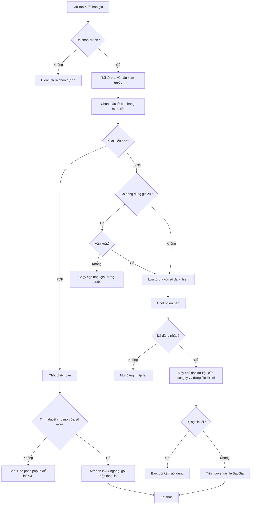

# [QT-17] Xuất báo giá (xem trước, Excel, PDF) và các nút xuất Excel khác

| Mục | Giá trị |
|-----|---------|
| Dự án | QS Pro |
| Phiên bản | 1.0 - 2026-10-07 |
| Người yêu cầu | — |
| Ưu tiên | Bình thường |
| Loại | Mô tả hiện trạng |

## 1. Tóm tắt
Sau khi bóc tách xong một dự án, người dùng vào tab Xuất báo giá để xem trước bộ báo giá (trang đầu là tờ bìa, các trang sau là bảng chi tiết), chọn hạng mục và cột muốn đưa vào, rồi xuất ra file Excel hoặc in / lưu PDF để gửi khách.
Mỗi lần xuất, hệ thống tự lưu lại một "phiên bản" báo giá để xem lại và so sánh.
Tài liệu này cũng liệt kê các nút "xuất Excel" ở những tab khác vì chúng dùng chung một nhóm đường xuất file trên máy chủ.

## 2. Tác nhân & quyền
| Tác nhân | Vai trò hệ thống | Được làm gì trong quy trình |
|----------|-----------------|-----------------------------|
| Quản trị hệ thống | `super` | Mọi việc của admin; muốn xuất báo giá của một công ty phải đang "xem như" công ty đó. |
| Admin công ty | `admin` | Mở tab Xuất báo giá, sửa và lưu tờ bìa, chọn hạng mục / cột, xuất Excel, in PDF, chốt phiên bản. |
| Nhân viên | `staff` | Như admin NẾU được cấp tab Xuất báo giá (quyền tab `export` trong danh sách quyền của tài khoản) và công ty có tính năng này. |
| Mọi người đã đăng nhập | `super` / `admin` / `staff` | ⚠ Máy chủ không kiểm quyền tab: bất kỳ tài khoản đã đăng nhập nào cũng gọi được lệnh xuất báo giá của dự án thuộc công ty mình (xem Q-05). |
| Người chưa đăng nhập | — | Chỉ tải được các file mẫu nhập liệu (không chứa dữ liệu công ty). |

## 3. Điều kiện trước
- Đã đăng nhập; tài khoản gắn với một công ty (trừ `super`).
- Đang chọn một dự án. Chưa chọn thì tab hiện "Chưa chọn dự án."
- Muốn có trang chi tiết: dự án đã có dòng bóc tách hoặc đã có bảng Phần thô. Chưa có thì báo giá chỉ có tờ bìa.
- Muốn in / lưu PDF: trình duyệt cho phép mở cửa sổ mới.

## 4. Luồng chính
| Bước | Ai | Hành động | Hệ thống xử lý | Kết quả người dùng thấy | Đã có / Mới |
|------|----|-----------|----------------|--------------------------|-------------|
| 1 | Người dùng | Mở tab Xuất báo giá khi đang chọn một dự án | Tải tờ bìa đã lưu của dự án; chưa có thì dựng từ mẫu và tự cộng tiền theo các dòng bóc tách | Chế độ "Xem trước & Xuất": trang 1 là tờ bìa, từ trang 2 là bảng chi tiết; có số trang, số dòng và tổng tiền từng trang | Đã có |
| 2 | Người dùng | Chọn kiểu tờ bìa "Mẫu 1" hoặc "Mẫu 2" | Vẽ lại trang 1; nhớ lựa chọn trên trình duyệt | Trang 1 đổi bố cục | Đã có |
| 3 | Người dùng | Bấm nút chọn hạng mục ("Tất cả hạng mục đã bóc" / "N hạng mục"), tích các hạng mục muốn in | Chỉ liệt kê hạng mục đã có dòng bóc tách (và 3.1 Phần thô nếu bảng Phần thô có dòng). Không tích gì = in tất cả | Trang 2 trở đi chỉ còn các hạng mục đã chọn; nút hiện tổng số dòng sẽ lên báo giá | Đã có |
| 4 | Người dùng | Bật / tắt các thẻ cột ở khối "Cột xuất" | Dùng chung bộ cột với bảng Bóc tách. Cột "Tài liệu" không bao giờ lên báo giá. Các cột nội bộ (giá bán lẻ nhà cung cấp, chiết khấu đại lý, giá đại lý, % lợi nhuận, markup, margin, lợi nhuận) mặc định KHÔNG in | Bảng chi tiết đổi cột; nếu có cột nội bộ đang bật thì hiện dải cảnh báo | Đã có |
| 5 | Người dùng | (Tuỳ chọn) Bấm "Xuất kèm (bản nội bộ)" trên dải cảnh báo | Lưu lựa chọn theo dự án; từ đó báo giá in kèm cột nội bộ | Dải cảnh báo đổi thành "Đang xuất kèm cột nội bộ… KHÔNG gửi khách" | Đã có |
| 6 | Người dùng | (Tuỳ chọn) Chỉnh trình bày: "Mỗi phần 1 trang", số dòng mỗi trang, mức phóng, kéo đổi thứ tự / độ rộng cột, sửa % VAT | Vẽ lại bản xem trước. VAT sửa ở đây là VAT của dự án. Mức phóng không ảnh hưởng file xuất | Bản xem trước cập nhật | Đã có |
| 7 | Người dùng | (Tuỳ chọn) Chuyển sang chế độ "Chỉnh sửa": sửa thông tin dự án trên tờ bìa, sửa / thêm / xoá mục tờ bìa, ẩn mục lớn, bấm "Lưu tờ bìa" | Lưu tờ bìa vào dự án. Mục có dòng bóc tách thì tiền tự cộng, trừ khi người dùng sửa tay | "Đã lưu tờ bìa" | Đã có |
| 8 | Người dùng | Bấm "Xuất Excel" | Kiểm tra các dòng đang dùng giá cũ so với danh mục sản phẩm; nếu có thì hỏi "Vẫn xuất" hay "Để tôi cập nhật trước" | Hộp hỏi (nếu có dòng lệch giá) hoặc nút chuyển "Đang xuất…" | Đã có |
| 9 | Hệ thống | — | Tự lưu tờ bìa với đúng các con số đang hiện trên màn hình (ghi đè bản đã lưu) | Không có thông báo riêng | Đã có |
| 10 | Hệ thống | — | Tự chốt một phiên bản báo giá (lý do "Xuất Excel") nếu nội dung khác phiên bản gần nhất; giữ tối đa 20 phiên bản | Số phiên bản trên thanh công cụ tăng lên | Đã có |
| 11 | Hệ thống | — | Máy chủ kiểm đăng nhập, đọc dự án, dòng bóc tách và tờ bìa của đúng công ty, rồi dựng file Excel nhiều trang tính (xem mục 10); tải ảnh sản phẩm để nhúng vào cột Hình ảnh | — | Đã có |
| 12 | Hệ thống | — | Trả file về trình duyệt | Trình duyệt tải file `BaoGia_<tên dự án>.xlsx`; thông báo "Đã xuất Excel · N cột · M hạng mục · kèm phần thô" | Đã có |
| 13 | Người dùng | Bấm "Xuất PDF / In" | Tự chốt một phiên bản (lý do "Xuất PDF / In"); mở cửa sổ mới chứa toàn bộ các trang, khổ A4 ngang, rồi gọi hộp thoại in của trình duyệt | Hộp thoại in; người dùng chọn máy in hoặc "Lưu thành PDF" | Đã có |
| 14 | Người dùng | (Tuỳ chọn) Bấm "Chốt vN" hoặc "Lịch sử" | Chốt tay một phiên bản; hoặc mở danh sách phiên bản để xem lại / so sánh | "Đã chốt <mã> · vN" hoặc cửa sổ lịch sử phiên bản | Đã có |
| 15 | Người dùng | Ở tab khác, bấm nút xuất Excel của bảng đang xem: bảng tính Bóc tách / Dự án, bảng Chi phí, danh sách sản phẩm trong Dự án, đơn Mua hàng | Trình duyệt tự dựng bảng (tiêu đề, cột, dòng, dòng tổng) và gửi lên máy chủ; máy chủ kiểm đăng nhập rồi đóng thành file Excel một trang tính | Trình duyệt tải file Excel | Đã có |
| 16 | Người dùng | Ở tab Danh sách sản phẩm bấm "Tải Excel" (sản phẩm) | Máy chủ kiểm đăng nhập, đọc danh mục sản phẩm của đúng công ty, lọc theo các sản phẩm đang chọn / đang lọc, dựng file | File `danh-sach-san-pham-<ngày>.xlsx`; "Đã tải N sản phẩm ra Excel" | Đã có |
| 17 | Bất kỳ ai | Bấm "Tải file mẫu" thiết bị vệ sinh hoặc sơn nước ở tab Nhập dữ liệu | Máy chủ dựng file mẫu theo bộ thông số của ngành (không đọc dữ liệu công ty, không kiểm đăng nhập) | File mẫu Excel | Đã có |

## 5. Sơ đồ

## 6. Luồng phụ & lỗi
| Mã | Tình huống | Hệ thống phản hồi | Thông báo cho người dùng |
|----|-----------|-------------------|--------------------------|
| E1 | Chưa đăng nhập / phiên hết hạn khi bấm "Xuất Excel" của báo giá | Từ chối, mã 401 | Màn hình đăng nhập "Phiên đã hết, mời đăng nhập lại." |
| E2 | Chưa đăng nhập khi gọi xuất bảng, xuất danh sách sản phẩm, xuất danh sách công tác | Từ chối, mã 401, nội dung "Chưa đăng nhập" | "Lỗi xuất Excel: Chưa đăng nhập" (bảng) / "Lỗi tải Excel: Chưa đăng nhập" (sản phẩm) / "Không tải được Excel: Lỗi 401" (công tác) |
| E3 | Nhân viên không được cấp tab Xuất báo giá | Giao diện ẩn tab. ⚠ Máy chủ KHÔNG từ chối nếu gọi thẳng lệnh xuất (xem Q-05) | Không thấy tab |
| E4 | Tài khoản không phải `super` mà chưa gắn công ty | Từ chối khi đọc dữ liệu | "Lỗi: Tài khoản chưa gắn với công ty nào" |
| E5 | Chưa chọn dự án | Không xuất | Tab hiện "Chưa chọn dự án."; bấm xuất thì "Chưa chọn dự án" |
| E6 | Mã dự án không tồn tại, hoặc thuộc công ty khác | ⚠ Máy chủ KHÔNG báo lỗi "không tìm thấy": vẫn trả một file có tờ bìa theo mẫu, thông tin dự án để trống, không có dòng chi tiết. Không lộ dữ liệu công ty khác (xem Q-06) | File `BaoGia_<mã dự án>.xlsx` gần như trống |
| E7 | Không tải được tờ bìa khi mở tab | Dừng vẽ | "Lỗi tải tờ bìa: …" |
| E8 | Có dòng đang dùng giá cũ, người dùng chọn "Để tôi cập nhật trước" | Dừng xuất, chạy cập nhật giá | Hộp "N dòng đang dùng giá cũ" liệt kê tối đa 30 dòng |
| E9 | Lưu tờ bìa trước khi xuất bị lỗi, hoặc máy chủ dựng file lỗi | Dừng xuất; máy chủ trả mã 500 kèm nội dung lỗi | "Lỗi: …" |
| E10 | Ảnh sản phẩm không tải được, quá 5 MB, tải lâu hơn 8 giây, hoặc là ảnh WebP / GIF / SVG | Bỏ qua ảnh đó, file vẫn xuất | Không có thông báo — ô Hình ảnh của dòng đó để trống |
| E11 | Dự án chưa bóc hạng mục nào | Bản xem trước chỉ có tờ bìa; file Excel có một trang tính "Báo giá" chỉ có tiêu đề | Trong ô chọn hạng mục: "Chưa bóc hạng mục nào — báo giá chỉ có tờ bìa." |
| E12 | Trình duyệt chặn cửa sổ mới khi in | Không in | "Cho phép popup để in/PDF" |
| E13 | Tổng tờ bìa khác tổng trang cuối quá 1.000 đ | Vẫn cho xuất | Dải cảnh báo "Tổng tờ bìa … khác tổng trang cuối … — Kiểm tra trước khi gửi khách." |
| E14 | Xuất bảng mà không có cột nào | Từ chối, mã 400 | "Lỗi xuất Excel: Không có cột nào để xuất" |
| E15 | Xuất bảng quá 60 cột hoặc quá 20.000 dòng (hoặc hơn 20 dòng tổng) | ⚠ Máy chủ cắt phần vượt, không báo | Không có thông báo; file thiếu phần bị cắt |
| E16 | Xuất danh sách công tác không có dòng nào | Từ chối, mã 400 "Không có dòng nào để xuất" | "Không có công tác nào để tải" (trình duyệt chặn trước) |
| E17 | Xuất danh sách công tác quá 5.000 dòng | ⚠ Cắt còn 5.000 dòng, không báo | Vẫn báo số dòng đã gửi |
| E18 | Xuất danh sách sản phẩm khi không có sản phẩm nào | Trình duyệt không gọi máy chủ | "Không có sản phẩm nào để tải" |
| E19 | Máy chủ lỗi khi dựng file bảng / sản phẩm / công tác | Mã 500 kèm nội dung lỗi | "Lỗi xuất Excel: …" / "Lỗi tải Excel: …" / "Không tải được Excel: Lỗi 500" |
| E20 | Dựng file mẫu lỗi | Mã 500 | Trang chữ "Lỗi tạo file mẫu: …" |
| E21 | Nội dung gửi lên lớn hơn 30 MB (ví dụ bảng Phần thô rất lớn) | Máy chủ từ chối nội dung | Thông báo lỗi chung (chưa xác minh nội dung chính xác, xem GD-03) |

## 8. Quy tắc nghiệp vụ
| Mã | Quy tắc |
|----|---------|
| BR-01 | Trang 1 của báo giá luôn là tờ bìa của CẢ dự án, không phụ thuộc hạng mục đã chọn. Hạng mục đã chọn chỉ ảnh hưởng từ trang 2. |
| BR-02 | Không tích hạng mục nào = xuất tất cả dòng bóc tách và cả bảng Phần thô. Tích một hạng mục = lấy cả các hạng mục con của nó. Bảng Phần thô chỉ lên khi không tích gì hoặc có tích 3.1. |
| BR-03 | Cột trên báo giá = các thẻ cột đang bật, dùng chung với bảng Bóc tách; luôn có cột STT và cột Tên sản phẩm. Cột "Tài liệu" không lên báo giá. |
| BR-04 | Cột nội bộ mặc định không in; chỉ in khi bật "Xuất kèm (bản nội bộ)" — lựa chọn này lưu theo dự án. Đơn giá nhà thầu của Phần thô cũng chỉ lên khi đang xuất kèm cột nội bộ và có bật cột giá bán lẻ hoặc giá đại lý. |
| BR-05 | Tên cột trong file Excel lấy đúng tên cột trên màn hình (viết hoa). Với đề mục Sơn nước, cột "Thông số thiết kế" mang tên "Tính năng sản phẩm". |
| BR-06 | Nội dung cột "Thông tin chính" và "Thông số thiết kế" là chữ đã ghép sẵn theo ngành khi lấy sản phẩm vào dự án: Thiết bị đèn ghép dòng sản phẩm, chip LED, CRI, công suất, nhiệt độ màu, góc chiếu, quang thông (thông tin chính) và chất liệu, chiều cao, đường kính, góc nghiêng (thông số thiết kế); Thiết bị vệ sinh và Sơn nước ghép theo bộ thông số của từng hạng mục. File xuất in đúng chữ đang lưu trên dòng. |
| BR-07 | File xuất dùng GIÁ ĐANG LƯU TRÊN DÒNG của dự án (bản chụp lúc thêm), không tự lấy giá mới nhất của danh mục; vì vậy có bước cảnh báo "dòng đang dùng giá cũ". |
| BR-08 | Trước khi xuất Excel, tờ bìa đang hiện trên màn hình được lưu đè lên tờ bìa đã lưu của dự án. Các mục lớn đã ẩn khỏi tờ bìa cũng bị bỏ khỏi file Excel. |
| BR-09 | Tổng cuối báo giá: Cộng chưa VAT (dòng thuộc hạng mục đang xuất + Phần thô nếu đang xuất) → trừ Chiết khấu tổng (theo % hoặc số tiền, không vượt quá tổng) → cộng VAT của dự án trên số sau chiết khấu → Tổng thanh toán. |
| BR-10 | Mỗi lần xuất Excel hoặc in PDF tạo một phiên bản nếu nội dung khác phiên bản gần nhất. Giữ tối đa 20 phiên bản; chỉ 10 phiên bản mới nhất còn bản chụp đầy đủ để xem lại / so sánh. Mã báo giá = mã người dùng nhập, nếu trống thì "BG-" + mã dự án. |
| BR-11 | Ảnh trong file Excel: chỉ nhúng khi cột Hình ảnh được chọn; chỉ ảnh PNG / JPEG, tối đa 5 MB, chờ tối đa 8 giây mỗi ảnh; ảnh lỗi bị bỏ qua. |
| BR-12 | Trong file Excel, mỗi nhóm bóc tách thành một trang tính; trong mỗi trang tính các dòng gom theo Tầng (dòng không có tầng vào nhóm "CHƯA PHÂN TẦNG"), có dòng cộng từng tầng và dòng tổng của nhóm. |
| BR-13 | PDF được tạo bằng chức năng in của trình duyệt, khổ A4 ngang; máy chủ không tạo PDF. |
| BR-14 | Các nút "xuất Excel" ở tab khác (bước 15): nội dung file do trình duyệt dựng; máy chủ không đọc lại cơ sở dữ liệu, chỉ đóng thành file. Giới hạn 60 cột, 20.000 dòng, 20 dòng tổng. |
| BR-15 | Xuất danh sách sản phẩm: máy chủ tự đọc danh mục của công ty đang đăng nhập (hoặc công ty mà `super` đang "xem như"). Cột của file trùng bộ nhãn của file mẫu nhập hàng loạt để sửa xong nạp ngược lại được. |
| BR-16 | Mọi đường xuất file có dữ liệu đều yêu cầu đăng nhập. Chỉ các file mẫu nhập liệu là tải được khi chưa đăng nhập. |

## 9. Thông báo, realtime & nhật ký
Hệ thống không có realtime. Không thao tác nào trong quy trình này gửi thông báo trong ứng dụng hay tin nhắn Lark.

| Sự kiện | Ai nhận | Kênh | Nội dung | Ghi audit? |
|---------|---------|------|----------|:----------:|
| Xuất Excel báo giá | Không ai | — | Tạo phiên bản báo giá trong dữ liệu dự án (người chốt, thời điểm, lý do, tổng tiền) | Không |
| Tự lưu tờ bìa trước khi xuất Excel | Không ai | — | — | Không |
| Bấm "Lưu tờ bìa" | Không ai | — | — | Không |
| In / lưu PDF | Không ai | — | Tạo phiên bản báo giá | Không |
| Chốt phiên bản tay | Không ai | — | Tạo phiên bản báo giá | Không |
| Bật / tắt "xuất kèm cột nội bộ", ẩn mục tờ bìa, sửa chiết khấu / điều khoản | Không ai | — | Lưu vào cấu hình báo giá của dự án (ghi tên người sửa cuối) | Không |
| Xuất bảng, xuất danh sách sản phẩm, xuất danh sách công tác | Không ai | — | — | Không |
| Tải file mẫu | Không ai | — | — | Không |

## 10. Dữ liệu
| Thông tin | Bắt buộc | Ràng buộc | Ví dụ |
|-----------|----------|-----------|-------|
| Dự án đang chọn | Có | Phải thuộc công ty đang đăng nhập | DA-0012 |
| Hạng mục cần xuất | Không | Danh sách mã đề mục; trống = tất cả | 3.2.5, 3.2.6.1 |
| Cột cần xuất | Không | Danh sách khoá cột + nhãn; trống = toàn bộ cột chuẩn | STT, TÊN SẢN PHẨM, SỐ LƯỢNG, ĐƠN GIÁ, THÀNH TIỀN |
| Mục lớn đã ẩn khỏi tờ bìa | Không | Danh sách số mục lớn | 1, 2 |
| Bảng Phần thô gửi kèm | Không | Danh sách hạng mục; mỗi hạng mục có tên, thành tiền và các dòng (nội dung, đơn vị tính, khối lượng, đơn giá nhà thầu, thành tiền nhà thầu, đơn giá, thành tiền, ghi chú) | — |
| Các dòng tổng | Không | Tối đa 20 cặp nhãn – số | Cộng (chưa VAT) · VAT 8% · TỔNG THANH TOÁN |
| Tờ bìa | — | Mỗi mục: số thứ tự, tên hạng mục, mô tả, chi phí; tối đa 2.000 mục | 3.2.5 · Thiết bị vệ sinh · 120.000.000 |
| Phiên bản báo giá | Hệ thống ghi | Số phiên bản, mã, thời điểm, người chốt, lý do (chốt tay / PDF / Excel), tổng tiền, số dòng, bản chụp | v3 · BG-0012 |
| **File Excel báo giá** — trang tính "Tờ bìa" | — | Tiêu đề "BẢNG ƯỚC TÍNH CHI PHÍ DỰ ÁN", mã báo giá, khách hàng, quy mô, tổng diện tích, nhu cầu, diện tích báo giá, phân khúc; bảng NO / HẠNG MỤC / CHI PHÍ DỰ KIẾN / TỶ TRỌNG; dòng "TỔNG CHI PHÍ DỰ KIẾN (VNĐ)" | — |
| Trang tính "Tổng cộng" | — | Chỉ có khi có dòng tổng gửi lên; dòng cuối tô đậm | — |
| Trang tính "3.2 Phần hoàn thiện" | — | Luôn có: NO, HẠNG MỤC, MÔ TẢ CHI TIẾT, DVT, KHỐI LƯỢNG, ĐƠN GIÁ, CHI PHÍ DỰ KIẾN, TỶ TRỌNG, NHÀ CUNG CẤP | — |
| Trang tính "3.1 Phần thô" | — | Chỉ có khi có bảng Phần thô gửi kèm: STT, NỘI DUNG CÔNG VIỆC, ĐVT, KHỐI LƯỢNG, ĐƠN GIÁ (NHÀ THẦU), THÀNH TIỀN (NHÀ THẦU), ĐƠN GIÁ, THÀNH TIỀN, GHI CHÚ; dòng "TỔNG PHẦN THÔ" | — |
| Các trang tính chi tiết | — | Mỗi nhóm bóc tách một trang; tên trang lấy theo mã nhóm (tối đa 30 ký tự, trùng thì thêm số); không có dòng nào thì một trang "Báo giá" | 3.2.6.1 |
| Tên file | — | `BaoGia_<tên dự án bỏ dấu>.xlsx` | BaoGia_Nha_pho_Q7.xlsx |
| **File xuất bảng** (bước 15) | — | Tiêu đề (tuỳ chọn), tên trang tính, tối đa 60 cột (nhãn, có phải số), tối đa 20.000 dòng (dòng dữ liệu hoặc dòng nhóm), tối đa 20 dòng tổng | du-an-DA-0012.xlsx |
| **File danh sách sản phẩm** | — | STT + toàn bộ cột theo nhãn file mẫu + ẢNH SẢN PHẨM | danh-sach-san-pham-2026-10-07.xlsx |

## 11. Màn hình liên quan
- Tab Xuất báo giá (`export`): chế độ "Xem trước & Xuất" (thanh điều khiển, khối Cột xuất, khung xem trang, phân trang) và chế độ "Chỉnh sửa" (chọn mục tờ bìa, tờ bìa, bảng diện tích, bảng báo giá chi tiết).
- Ô chọn hạng mục đã bóc; cửa sổ lịch sử phiên bản; bảng "Tổng kết & điều khoản".
- Cửa sổ in của trình duyệt (PDF).
- Tab Bóc tách / Dự án (nút xuất Excel của bảng tính và danh sách sản phẩm trong dự án), tab Chi phí, tab Mua hàng (đơn mua hàng), tab Danh sách sản phẩm (Tải Excel), tab Nhập dữ liệu (Tải file mẫu).

## 12. Tiêu chí nghiệm thu
- **AC-01**: Cho dự án có dòng bóc tách ở 3.2.5 và 3.2.6.1, không tích hạng mục nào / Khi bấm "Xuất Excel" / Thì tải về file `BaoGia_….xlsx` có trang tính "Tờ bìa", "Tổng cộng", "3.2 Phần hoàn thiện" và mỗi nhóm bóc tách một trang tính.
- **AC-02**: Cho người chưa đăng nhập / Khi gọi lệnh xuất báo giá, xuất bảng, xuất danh sách sản phẩm hoặc xuất danh sách công tác / Thì bị từ chối với "Chưa đăng nhập" (mã 401) và không nhận được file nào.
- **AC-03**: Cho người dùng công ty Y / Khi gọi xuất báo giá với mã dự án của công ty X / Thì file trả về không chứa dòng bóc tách, thông tin khách hàng hay tờ bìa đã lưu của công ty X.
- **AC-04**: Cho cột "Giá đại lý" đang bật ở Bóc tách và chưa bật "Xuất kèm (bản nội bộ)" / Khi xuất Excel hoặc in PDF / Thì file không có cột Giá đại lý, và màn hình có dải cảnh báo cột nội bộ không in.
- **AC-05**: Cho chỉ tích hạng mục 3.2.5 / Khi xuất Excel / Thì các trang tính chi tiết chỉ chứa dòng thuộc 3.2.5 (và hạng mục con), không có trang tính "3.1 Phần thô", còn "Tờ bìa" vẫn là của cả dự án.
- **AC-06**: Cho dự án có bảng Phần thô và không tích hạng mục nào / Khi xuất Excel / Thì file có trang tính "3.1 Phần thô" với dòng "TỔNG PHẦN THÔ" bằng tổng thành tiền các hạng mục phần thô.
- **AC-07**: Cho một dòng có ảnh JPEG nhỏ hơn 5 MB và một dòng có ảnh WebP, cột Hình ảnh đang bật / Khi xuất Excel / Thì dòng thứ nhất có ảnh trong ô, dòng thứ hai ô trống, file vẫn mở được.
- **AC-08**: Cho danh mục vừa đổi giá một sản phẩm đang có trong dự án / Khi bấm "Xuất Excel" / Thì hiện hộp "N dòng đang dùng giá cũ"; chọn "Để tôi cập nhật trước" thì không có file nào được tải.
- **AC-09**: Cho nội dung báo giá không đổi so với lần xuất trước / Khi xuất Excel lần nữa / Thì không có phiên bản mới nào được thêm.
- **AC-10**: Cho chưa chọn dự án / Khi mở tab Xuất báo giá / Thì thấy "Chưa chọn dự án." và không có nút xuất.
- **AC-11**: Cho yêu cầu xuất bảng không có cột / Khi gửi lên máy chủ / Thì nhận mã 400 "Không có cột nào để xuất".
- **AC-12**: Cho `super` đang "xem như" công ty X / Khi tải Excel danh sách sản phẩm / Thì file chỉ gồm sản phẩm công ty X được thấy.

## 13. Ảnh hưởng tới phần có sẵn
- Dùng chung bộ thẻ cột với bảng Bóc tách: bật / tắt cột ở tab này cũng đổi cột ở Bóc tách và ngược lại.
- Xuất Excel ghi đè tờ bìa đã lưu của dự án bằng số đang hiện.
- Sửa VAT ở tab này là sửa VAT của dự án (ảnh hưởng Bóc tách, Chi phí, Phần thô).
- Phiên bản báo giá, cấu hình báo giá và thông tin công ty in trên báo giá lưu trong dữ liệu rời của dự án, cùng chỗ với bảng Phần thô (QT-16).
- Ảnh trong file lấy từ kho ảnh và từ đường dẫn ảnh cũ (QT-18).

## 14. Giả định & câu hỏi mở
| Mã | Nội dung | Cần ai trả lời |
|----|----------|----------------|
| GD-01 | Tài liệu mô tả đúng theo mã nguồn nhánh `refactor/Dung` ngày 2026-10-07; chưa chạy thử, chưa mở file Excel thật để đối chiếu. | — |
| GD-02 | Chi tiết bố cục từng trang của bản xem trước / PDF (đầu trang, chân trang, hộp tổng kết, đợt thanh toán, ghi chú điều khoản) và cửa sổ so sánh phiên bản không được mô tả đầy đủ; chỉ đọc phần chọn hạng mục / cột và phần xuất. | — |
| GD-03 | Giới hạn 30 MB cho nội dung gửi lên là giới hạn chung của máy chủ; thông báo người dùng thấy khi vượt chưa được xác minh. | Dev |
| GD-04 | Nội dung ghép chữ "Thông tin chính / Thông số thiết kế" của Sơn nước chỉ đọc phần đầu của hàm ghép; quy tắc chi tiết từng hạng mục nằm trong bộ thông số ngành (`public/vs-spec.js`, `public/son-spec.js`) chưa đối chiếu từng dòng. | Dev |
| GD-05 | Các nút xuất ở tab Chi phí, Mua hàng, bảng tính chỉ xác minh là có gọi `/export/bang`; cấu trúc cột / dòng cụ thể của từng nút chưa đọc (riêng nút ở tab Dự án đã đọc). | Dev |
| Q-01 | ⚠ Nút "Xuất Excel" của tab Xuất báo giá KHÔNG dùng `/export/bang` mà gọi lệnh `exportBaoGia` qua `/api`, file trả về dạng chuỗi mã hoá trong JSON. `/export/bang` chỉ phục vụ các tab khác. Tài liệu / yêu cầu nào đang coi `/export/bang` là đường xuất báo giá cần sửa lại? | Dev |
| Q-02 | ⚠ Trang tính chi tiết của file Excel ghi cứng dòng đầu "CÔNG TY THIẾT KẾ & THI CÔNG DEZON" cho MỌI công ty, trong khi bản xem trước / PDF dùng tên, logo, địa chỉ riêng của từng công ty. Có cần đổi theo công ty? | Chủ sản phẩm |
| Q-03 | ⚠ Trang tính "3.2 Phần hoàn thiện" luôn có trong file Excel và cột NHÀ CUNG CẤP lấy từ một danh sách thương hiệu ghi cứng trong mã (Boral, Vĩnh Tường, Dulux, Boen, Eurostone…), không theo dữ liệu dự án hay công ty; bản xem trước / PDF không có trang này. Có giữ không? | Chủ sản phẩm |
| Q-04 | ⚠ File Excel không theo lựa chọn "Mẫu 1 / Mẫu 2" của tờ bìa và không theo thứ tự / độ rộng cột người dùng đã kéo ở bản xem trước (Excel lấy thứ tự cột của bảng Bóc tách). Excel và PDF vì thế có thể khác bố cục. Có chấp nhận? | Chủ sản phẩm |
| Q-05 | ⚠ Quyền tab Xuất báo giá chỉ kiểm ở giao diện. Máy chủ chỉ yêu cầu đăng nhập cho lệnh `exportBaoGia`, `saveCover`, `getCoverOrInit`: nhân viên không được cấp tab vẫn gọi thẳng được và nhận file có cả giá vốn nếu tự chọn cột nội bộ. Có cần kiểm quyền ở máy chủ? | Chủ sản phẩm / Dev |
| Q-06 | ⚠ Gọi xuất báo giá với mã dự án không tồn tại không báo lỗi "không tìm thấy" mà trả file trống theo mẫu. Có cần báo lỗi rõ? | Dev |
| Q-07 | ⚠ Máy chủ tự tải ảnh từ BẤT KỲ đường dẫn http nào người dùng nhập ở ô ảnh của dòng (có giới hạn 8 giây và 5 MB nhưng không giới hạn địa chỉ đích, kể cả địa chỉ nội bộ của máy chủ). Cần đánh giá rủi ro bảo mật. | Dev |
| Q-08 | ⚠ Bản xem trước chỉ lấy ảnh ĐẦU TIÊN của dòng, còn máy chủ dùng nguyên chuỗi ảnh của dòng làm một đường dẫn; nếu một dòng lưu nhiều ảnh (mỗi ảnh một dòng chữ) thì ảnh có thể không lên file Excel. Dòng bóc tách có khi nào lưu nhiều ảnh không? | Dev |
| Q-09 | ⚠ Hai đường tải file mẫu (`/mau-nhap-thiet-bi-ve-sinh.xlsx`, `/mau-nhap-son-nuoc.xlsx`) không kiểm đăng nhập. Chúng không chứa dữ liệu công ty (dựng từ bộ thông số ngành), giống các file mẫu tĩnh khác. Có chủ ý để công khai? | Dev |
| Q-10 | ⚠ `/export/bang` và `/export/cong-tac` có kiểm đăng nhập nhưng KHÔNG chạy trong ngữ cảnh công ty. Hiện không rò dữ liệu vì hai đường này không đọc cơ sở dữ liệu (chỉ đóng gói dữ liệu trình duyệt gửi lên); nếu sau này thêm đọc dữ liệu vào đây thì sẽ thiếu lọc theo công ty. Có cần thêm sẵn cho đồng nhất với `/export/san-pham`? | Dev |
| Q-11 | ⚠ Các giới hạn 60 cột / 20.000 dòng / 20 dòng tổng (xuất bảng) và 5.000 dòng (xuất công tác) cắt dữ liệu trong im lặng. Có cần báo người dùng? | Dev |
| Q-12 | ⚠ Xuất Excel tự ghi đè tờ bìa đã lưu và tạo phiên bản mà không ghi nhật ký hoạt động; không có nhật ký "ai đã xuất báo giá nào, lúc nào" ngoài lịch sử phiên bản trong dữ liệu dự án. Có cần ghi nhật ký? | Chủ sản phẩm |
| Q-13 | ⚠ Tên trang tính chi tiết và tiêu đề "BÁO GIÁ CHI TIẾT — …" trong Excel dùng MÃ nhóm của dòng (ví dụ "3.2.6.1") chứ không phải tên hạng mục ("Thiết bị đèn"). Có đúng ý? | Chủ sản phẩm |
| Q-14 | ⚠ Lệnh `exportBaoGia` có tham số "định dạng" nhưng không dùng (luôn ra Excel); phần mô tả đầu file ghi PDF xử lý phía trình duyệt. Có thể bỏ tham số thừa? | Dev |
| Q-15 | Dự án có quá 20.000 dòng bóc tách thì máy chủ chỉ đọc 20.000 dòng đầu và chỉ ghi cảnh báo trong nhật ký máy chủ. Có cần báo người dùng? | Dev |

## 15. Ghi chú kỹ thuật cho dev
- **Xuất báo giá (tab `export`):** RPC `exportBaoGia(maDA, cols, format, nodes, phanTho, anMuc, tong)` — khai báo `server/components/xuat-file/xuat-file.routes.js:87` (không nằm trong `actor` / `admin` / `super` → chỉ cần đăng nhập; chạy trong `tenant.run` nhờ `server/libraries/rpc.js:71`). Hàm chính `server/components/xuat-file/bao-gia.export.js:451`; trả `{name, mimeType, base64}` (dòng 501).
- **Dựng trang tính:** tờ bìa `bao-gia.export.js:91`; "3.2 Phần hoàn thiện" `:169` (NCC từ `S32_SUPPLIERS` — `server/components/du-an/cover-template.js:8`); chi tiết theo nhóm `:228` (dòng công ty ghi cứng ở `:245`, gom theo tầng `:237`); Phần thô `:352`; Tổng cộng `:437`; bảng kiểu cột `EXPORT_STY:23`; giá trị cột dẫn xuất `cellOfLine_:59`; lọc hạng mục `:455`; nhãn cột lấy theo client `:462`; bỏ mục ẩn `:473`.
- **Ảnh:** `fetchImage` — `bao-gia.export.js:321`, giới hạn `IMG_MAX:319` (5 MB), timeout 8000 ms `:330`, loại WebP/GIF/SVG `:336`; ảnh cũ đi qua `lark.mediaDownload` `:326`; chỉ nhúng khi có cột `hinhAnh` `:305`.
- **Dữ liệu đọc:** `getQuote` — `server/components/du-an/du-an.service.js:8`; `getLines` — `server/components/du-an/dong-boc-tach.repository.js:22` (limit `LIM` = 20000); `getCoverOrInit` / `saveCover` — `server/components/du-an/khai-toan.repository.js:25`, `:30` (bảng `khai_toan`, limit 2000). Khai báo quyền của các hàm dự án: `server/components/du-an/du-an.routes.js:26` (chỉ `setProjData` nhận `actor`).
- **Route lẻ (tự kiểm đăng nhập):** `server/components/xuat-file/xuat-file.routes.js`
  | Route | `actorOf_` | `tenant.run` | Ghi chú |
  |-------|:----------:|:------------:|---------|
  | `POST /export/cong-tac` (`:11`) | Có (`:12`) | Không | Không đọc DB; cắt 5000 dòng (`:15`); 400 nếu rỗng (`:16`) |
  | `POST /export/san-pham` (`:27`) | Có (`:28`) | Có (`:34`) | Hỗ trợ `x-view-company` cho `super` (`:30`) |
  | `POST /export/bang` (`:46`) | Có (`:47`) | Không | Không đọc DB; 400 nếu không có cột (`:51`); tên file cố định `bang.xlsx` (`:54`) |
  | `GET /mau-nhap-thiet-bi-ve-sinh.xlsx` (`:63`) | ⚠ Không | Không | Không đọc DB |
  | `GET /mau-nhap-son-nuoc.xlsx` (`:73`) | ⚠ Không | Không | Không đọc DB; tham số `hm` |
- **Dựng file bảng:** `buildBangXlsx` — `bao-gia.export.js:511` (60 cột, 20000 dòng ở `:512`; 20 dòng tổng `:544`). Danh sách sản phẩm / công tác: `server/components/xuat-file/danh-sach.export.js:8`, `:53`.
- **Kiểm đăng nhập dùng chung:** `actorOf_` — `server/libraries/rpc.js:35` (kiểm cùng nguồn gốc + cookie phiên). Giới hạn JSON 30 MB — `server/app.js:28`. Router gắn sau `/api` — `server/app.js:42`.
- **Client (tab Xuất báo giá):** `public/baogia.js:734` (`renderExport`), `:747` (`drawBaogia`), `:813` (`bgExportCols_`), `:821` (`doExport` — kiểm giá lệch `:825`, lưu tờ bìa `:846`, chốt phiên bản `:848`, gọi RPC `:853`), `:858` (`dl`), chọn hạng mục `:862`–`:942`, cột nội bộ `:948`–`:957`, cảnh báo lệch tổng `:959`, thanh điều khiển `:972`, tổng `:1050`–`:1053`, phiên bản `:1157`–`:1191`, in PDF `:639` (`printDoc`), cột tài liệu `:281`, ô tài liệu `:392`, Phần thô trên báo giá `:428`–`:462`.
- **Client (dùng chung):** `taiFile_` — `public/app.js:49`; header `x-view-company` — `public/app.js:41`; `COLS` — `public/app.js:110`; `visCols` (đổi nhãn Sơn nước) — `public/app.js:1942`; quyền tab phía client `canTab` — `public/app.js:2576`.
- **Nơi gọi `/export/bang`:** `public/duan.js:27`, `public/chiphi.js:527`, `public/muahang.js:512`, `public/bangtinh.js:1021`. `/export/san-pham`: `public/sanpham.js:440`. `/export/cong-tac`: `public/sanpham.js:1311`.
- **Ghép "Thông tin chính / Thông số thiết kế":** `server/components/san-pham/san-pham.mapper.js:27`–`:64` (`prodToObj`); lưu xuống dòng bóc tách ở cột `mo_ta`, `kich_thuoc` — `dong-boc-tach.repository.js:49`.
- Không có job nền, không có sự kiện realtime, không ghi `audit_log` trong component `xuat-file`.

## Lịch sử thay đổi
| Phiên bản | Ngày | Thay đổi |
|-----------|------|----------|
| 1.0 | 2026-10-07 | Tạo mới |
