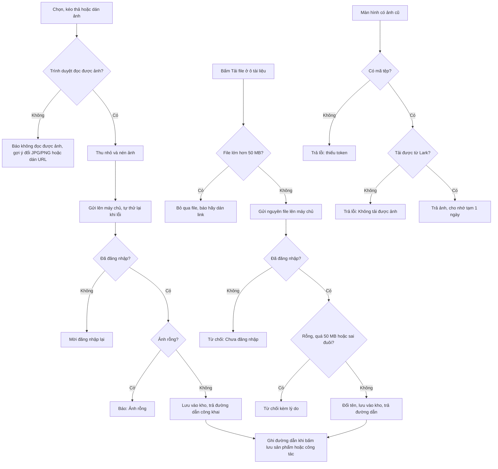

# [QT-18] Tải ảnh và tài liệu lên kho, hiển thị ảnh cũ

| Mục | Giá trị |
|-----|---------|
| Dự án | QS Pro |
| Phiên bản | 1.0 - 2026-10-07 |
| Người yêu cầu | — |
| Ưu tiên | Bình thường |
| Loại | Mô tả hiện trạng |

## 1. Tóm tắt
Khi nhập hoặc sửa sản phẩm, công tác, logo công ty, người dùng tải ảnh lên kho lưu trữ của hệ thống; với sản phẩm còn tải được tài liệu (PDF, bản vẽ, file nén, Word, Excel…). Hệ thống trả về một đường dẫn công khai, đường dẫn này được ghi vào sản phẩm / công tác / công ty khi người dùng bấm lưu.
Các ảnh cũ từ thời dữ liệu còn nằm trên Lark vẫn xem được nhờ một đường trung chuyển ảnh riêng.

## 2. Tác nhân & quyền
| Tác nhân | Vai trò hệ thống | Được làm gì trong quy trình |
|----------|-----------------|-----------------------------|
| Quản trị hệ thống | `super` | Tải ảnh, tải tài liệu; tải logo cho công ty. |
| Admin công ty | `admin` | Tải ảnh, tải tài liệu. |
| Nhân viên | `staff` | Tải ảnh, tải tài liệu — ⚠ máy chủ chỉ yêu cầu đăng nhập, KHÔNG kiểm quyền sửa sản phẩm (`sp_edit`) hay quyền tab (xem Q-04). |
| Bất kỳ ai, kể cả chưa đăng nhập | — | ⚠ Xem ảnh cũ qua đường trung chuyển (không kiểm đăng nhập, xem Q-01). Xem / tải mọi ảnh và tài liệu đã lên kho nếu có đường dẫn (kho công khai, xem Q-02). |

## 3. Điều kiện trước
- Đã đăng nhập (để tải lên).
- Kho lưu trữ đang hoạt động và cho phép ghi.
- Để xem ảnh cũ: máy chủ đã được cấu hình tài khoản ứng dụng Lark. Chưa cấu hình thì ảnh cũ không hiện.
- Ảnh phải là loại trình duyệt đọc được (ảnh HEIC của iPhone thường không đọc được).

## 4. Luồng chính
| Bước | Ai | Hành động | Hệ thống xử lý | Kết quả người dùng thấy | Đã có / Mới |
|------|----|-----------|----------------|--------------------------|-------------|
| 1 | Người dùng | Ở khối ảnh (tab Nhập dữ liệu hoặc cửa sổ sửa sản phẩm): bấm chọn ảnh, kéo thả ảnh, hoặc dán ảnh bằng Ctrl+V vào "Hình đại diện" / "Hình chi tiết" | Hình đại diện chỉ nhận 1 ảnh (chọn nhiều thì lấy ảnh đầu); hình chi tiết nhận nhiều ảnh, tải lần lượt từng ảnh | Ảnh xem trước hiện ngay; "Đang tải ảnh lên…" | Đã có |
| 2 | Hệ thống | — | Trình duyệt thu nhỏ ảnh sao cho cạnh dài nhất tối đa 1600 điểm ảnh và chuyển thành JPEG chất lượng 82% (nén mạnh hơn nếu kết quả vẫn quá lớn) | — | Đã có |
| 3 | Hệ thống | — | Gửi ảnh lên máy chủ; nếu lỗi thì tự thử lại tối đa 4 lần nữa, nghỉ 1 – 2,5 – 5 – 8 giây giữa các lần | — | Đã có |
| 4 | Hệ thống | — | Máy chủ kiểm đăng nhập, kiểm ảnh không rỗng, đặt tên mới (thời điểm + số ngẫu nhiên) trong thư mục ảnh sản phẩm của kho, lưu và trả đường dẫn công khai | "Đã tải ảnh lên"; ảnh xem trước được thay bằng ảnh trên kho | Đã có |
| 5 | Người dùng | (Thay cho bước 1–4) Dán đường dẫn ảnh có sẵn vào ô URL | Không tải gì lên kho; dùng thẳng đường dẫn đó | Ảnh hiện trong khung | Đã có |
| 6 | Người dùng | Bấm lưu sản phẩm / công tác | Nếu còn ảnh đang tải thì đợi (tối đa 15 giây) rồi mới lưu; đường dẫn ảnh được ghi vào sản phẩm / công tác (nhiều ảnh: mỗi ảnh một dòng) | Sản phẩm / công tác có ảnh | Đã có |
| 7 | Người dùng | Ở ô tài liệu của sản phẩm (Tài liệu kỹ thuật, Thông số kỹ thuật, Hướng dẫn cài đặt, File bản vẽ): bấm "Tải file" và chọn một hoặc nhiều file | Trình duyệt kiểm từng file: lớn hơn 50 MB thì bỏ qua và báo; còn lại gửi nguyên file lên máy chủ, từng file một | Nút hiện "Đang tải 1/3…" | Đã có |
| 8 | Hệ thống | — | Máy chủ kiểm đăng nhập; kiểm file không rỗng; kiểm không quá 50 MB; kiểm đuôi file thuộc danh sách cho phép; đổi tên file thành dạng không dấu (tối đa 60 ký tự) kèm thời điểm; lưu vào thư mục tài liệu của kho; trả đường dẫn công khai và tên gốc | File xuất hiện trong danh sách của ô tài liệu, có nhãn loại file và nút bỏ | Đã có |
| 9 | Người dùng | (Thay cho bước 7–8) Dán một đường dẫn vào ô "Dán link rồi Enter" và bấm "Thêm link" | Tự thêm "https://" nếu thiếu; không thêm trùng; không tải gì lên kho | Link xuất hiện trong danh sách | Đã có |
| 10 | Người dùng | Bấm "Lưu cập nhật" (hoặc lưu sản phẩm mới) | Danh sách đường dẫn của từng ô tài liệu được ghi vào sản phẩm (mỗi đường dẫn một dòng) | Sản phẩm có tài liệu; cột Tài liệu ở bảng Bóc tách mở được các file này | Đã có |
| 11 | Người dùng | Ở cửa sổ sửa công tác bấm "Thêm ảnh"; hoặc ở trang Công ty chọn / kéo thả logo | Cùng cách xử lý như bước 2–4 (logo thu nhỏ còn tối đa 512 điểm ảnh, chất lượng 90%) | "Đã tải xong ảnh" / "Đã tải logo lên" | Đã có |
| 12 | Bất kỳ ai | Mở một màn hình có ảnh cũ (giá trị ảnh là mã tệp, không phải đường dẫn) | Trình duyệt gọi đường trung chuyển ảnh kèm mã tệp; máy chủ dùng tài khoản ứng dụng Lark tải ảnh rồi trả về, cho trình duyệt nhớ tạm 1 ngày | Ảnh cũ hiện bình thường | Đã có |

## 5. Sơ đồ

## 6. Luồng phụ & lỗi
| Mã | Tình huống | Hệ thống phản hồi | Thông báo cho người dùng |
|----|-----------|-------------------|--------------------------|
| E1 | Tải ảnh khi chưa đăng nhập / phiên hết hạn | Từ chối, mã 401 | Màn hình đăng nhập "Phiên đã hết, mời đăng nhập lại."; ⚠ trình duyệt vẫn tự thử lại đủ các lần rồi mới báo "Tải ảnh lỗi: Chưa đăng nhập — hoặc dán URL ảnh." |
| E2 | Tải tài liệu khi chưa đăng nhập | Từ chối, mã 401, "Chưa đăng nhập" | "Tải "<tên file>" lỗi: Chưa đăng nhập" |
| E3 | Không có quyền sửa sản phẩm nhưng vẫn tải ảnh / tài liệu | ⚠ KHÔNG bị từ chối — máy chủ chỉ kiểm đăng nhập (xem Q-04) | Tải thành công |
| E4 | Ảnh rỗng (không có nội dung) | Từ chối | "Tải ảnh lỗi: Ảnh rỗng. — hoặc dán URL ảnh." |
| E5 | Trình duyệt không đọc được ảnh (ví dụ HEIC) | Không gửi lên máy chủ | "Không đọc được ảnh — có thể ảnh iPhone (.HEIC). Hãy đổi sang JPG/PNG hoặc dán URL ảnh." / "Không đọc được ảnh — hãy thử ảnh khác hoặc dán URL." |
| E6 | Mất mạng khi tải ảnh | Thử lại; hết lượt thì gỡ ảnh xem trước | "Tải ảnh lỗi: mất kết nối, thử lại — hoặc dán URL ảnh." |
| E7 | Kho lưu trữ từ chối ảnh | Trả lỗi kèm mã của kho | "Tải ảnh lỗi: Storage upload -> <mã> … — hoặc dán URL ảnh." |
| E8 | Thả file vào ngoài khung ảnh | Chặn trình duyệt mở file | "Thả ảnh vào đúng khung "Hình đại diện" hoặc "Hình chi tiết" nhé" |
| E9 | Chọn nhiều ảnh cho hình đại diện | Chỉ lấy ảnh đầu | "Hình đại diện chỉ 1 ảnh — lấy ảnh đầu." |
| E10 | Bấm thêm URL ảnh khi ô trống | Không làm gì | "Nhập URL ảnh" |
| E11 | Tài liệu lớn hơn 50 MB (trình duyệt phát hiện) | Không gửi file đó, tiếp tục file khác | ""<tên>" nặng <x>MB — quá giới hạn 50MB, hãy dán link" |
| E12 | Tài liệu lớn hơn 50 MB (máy chủ phát hiện, trong khoảng 50–51 MB) | Từ chối, mã 400 | "File <x>MB quá lớn (tối đa 50MB) — hãy dán link thay vì tải lên." |
| E13 | Nội dung gửi lên vượt 51 MB | Từ chối, mã 413 | "File quá lớn (tối đa 50MB) — hãy dán link thay vì tải lên." |
| E14 | Tài liệu rỗng | Từ chối, mã 400 | "File rỗng." |
| E15 | Đuôi file không được hỗ trợ | Từ chối, mã 400 | "Định dạng .<đuôi> chưa hỗ trợ (PDF, ảnh, DWG/DXF, SKP, ZIP/RAR, Word, Excel)." |
| E16 | Kho lưu trữ từ chối vì file quá lớn | Từ chối, mã 400 | "Kho file từ chối: file <x>MB vượt giới hạn — hãy dán link thay vì tải lên." |
| E17 | Lỗi khác khi lưu tài liệu vào kho | Từ chối, mã 400 kèm nội dung lỗi | "Tải "<tên>" lỗi: …" |
| E18 | Một số file trong lượt tải bị lỗi hoặc bị bỏ qua | Các file khác vẫn tải | ⚠ Cuối lượt vẫn hiện "Đã tải lên N file — bấm "Lưu cập nhật" để gắn vào sản phẩm" với N là số file đã CHỌN, không phải số file thành công (xem Q-07) |
| E19 | Tải file xong nhưng không bấm lưu sản phẩm | File vẫn nằm trên kho, không gắn vào sản phẩm nào | Không có cảnh báo |
| E20 | Xem ảnh cũ mà thiếu mã tệp | Mã 400 | Chữ "thiếu token" (ảnh không hiện) |
| E21 | Xem ảnh cũ: mã tệp không tồn tại, Lark lỗi, hoặc máy chủ chưa cấu hình tài khoản Lark | Mã 502 | Chữ "Không tải được ảnh" (ảnh không hiện / bị ẩn) |
| E22 | Tải logo: ảnh không đọc được hoặc tải lỗi | Giữ logo cũ | "Không đọc được ảnh — thử PNG/JPG khác" / "Lỗi tải logo: …" |
| E23 | Tải ảnh công tác: ảnh không đọc được hoặc lỗi | Bỏ qua ảnh đó | "Không đọc được ảnh <tên>" / "Lỗi tải ảnh: …" |

## 8. Quy tắc nghiệp vụ
| Mã | Quy tắc |
|----|---------|
| BR-01 | Tải ảnh và tải tài liệu đều yêu cầu đăng nhập; không yêu cầu vai trò hay quyền chi tiết nào khác. |
| BR-02 | Ảnh luôn được trình duyệt thu nhỏ (cạnh dài tối đa 1600 điểm ảnh; logo 512) và chuyển sang JPEG trước khi gửi. Máy chủ không tự thu nhỏ, không kiểm kích thước. |
| BR-03 | ⚠ Máy chủ KHÔNG giới hạn dung lượng riêng cho ảnh và KHÔNG kiểm loại nội dung của ảnh: loại file lấy theo khai báo của bên gửi, mặc định JPEG. Giới hạn thực tế duy nhất là giới hạn chung 30 MB cho một lần gửi (xem Q-03). |
| BR-04 | Tài liệu: tối đa 50 MB mỗi file. Đuôi được phép: pdf, png, jpg, jpeg, webp, gif, dwg, dxf, skp, zip, rar, 7z, doc, docx, xls, xlsx, ppt, pptx (không phân biệt hoa thường). Chỉ kiểm theo ĐUÔI tên file, không kiểm nội dung bên trong. |
| BR-05 | Tên file trên kho: ảnh = thời điểm + số ngẫu nhiên + đuôi; tài liệu = thời điểm + tên gốc đã bỏ dấu, thay ký tự lạ bằng gạch nối, cắt 60 ký tự + đuôi gốc. Tên trống thì dùng "tai-lieu". |
| BR-06 | Mọi file lên kho đều có đường dẫn công khai: ai có đường dẫn cũng xem / tải được, không cần đăng nhập. Kho dùng chung cho mọi công ty, không tách thư mục theo công ty. |
| BR-07 | Tải lên chỉ tạo file trên kho và trả đường dẫn. Việc gắn vào sản phẩm / công tác / công ty chỉ xảy ra khi người dùng bấm lưu ở màn hình tương ứng. |
| BR-08 | Bỏ ảnh / tài liệu khỏi sản phẩm chỉ xoá đường dẫn khỏi sản phẩm; file trên kho KHÔNG bị xoá. Hệ thống không có chức năng xoá file trên kho. |
| BR-09 | Mỗi ô tài liệu chứa được nhiều đường dẫn (mỗi dòng một đường dẫn, hoặc cách nhau bằng dấu chấm phẩy); có thể là file đã tải lên hoặc link dán vào. |
| BR-10 | Hình đại diện: đúng 1 ảnh. Hình chi tiết: nhiều ảnh. Với công tác, ảnh là tuỳ chọn. |
| BR-11 | Cách hiển thị một giá trị ảnh: bắt đầu bằng "http" → dùng thẳng; ảnh xem trước tạm trong trình duyệt → dùng thẳng; còn lại coi là mã tệp cũ → đi qua đường trung chuyển ảnh. |
| BR-12 | Ảnh cũ qua đường trung chuyển được phép nhớ tạm công khai 1 ngày. Máy chủ giữ sẵn chứng thực Lark trong bộ nhớ và tự xin lại khi gần hết hạn. |
| BR-13 | Còn một đường tải tài liệu kiểu cũ (gửi file dạng chữ mã hoá) được giữ cho các trang mở từ trước khi cập nhật; áp cùng quy tắc 50 MB và đuôi file, nhưng thực tế bị chặn sớm hơn bởi giới hạn 30 MB mỗi lần gửi. |

## 9. Thông báo, realtime & nhật ký
Hệ thống không có realtime. Không thao tác nào trong quy trình này gửi thông báo trong ứng dụng hay tin nhắn Lark.

| Sự kiện | Ai nhận | Kênh | Nội dung | Ghi audit? |
|---------|---------|------|----------|:----------:|
| Tải ảnh lên kho | Không ai | — | — | Không |
| Tải tài liệu lên kho | Không ai | — | Lỗi (nếu có) chỉ ghi vào nhật ký máy chủ | Không |
| Xem ảnh cũ qua đường trung chuyển | Không ai | — | — | Không |
| Gắn ảnh / tài liệu vào sản phẩm, công tác | — | — | Thuộc quy trình lưu sản phẩm / công tác (lịch sử sản phẩm, lịch sử công tác — xem QT-16) | Theo quy trình lưu tương ứng |

Hệ thống không lưu lại "ai đã tải file nào lên, lúc nào".

## 10. Dữ liệu
| Thông tin | Bắt buộc | Ràng buộc | Ví dụ |
|-----------|----------|-----------|-------|
| Ảnh gửi lên | Có | Dạng chữ mã hoá kèm khai báo loại; không rỗng; không quá giới hạn 30 MB mỗi lần gửi | ảnh JPEG đã thu nhỏ |
| Tên ảnh gửi kèm | Không | ⚠ Máy chủ nhận nhưng không dùng | image.jpg |
| Kết quả tải ảnh | — | Đường dẫn công khai (trả ở hai tên: `token` và `url`, cùng giá trị) | …/products/sp%2F1759800000000-123456.jpg |
| File tài liệu gửi lên | Có | Nguyên file; không rỗng; tối đa 50 MB | catalogue.pdf |
| Tên gốc của tài liệu | Có (để biết đuôi) | Đuôi thuộc danh sách cho phép | Bản vẽ lắp đặt.dwg |
| Kết quả tải tài liệu | — | Đường dẫn công khai + tên gốc | …/products/docs%2F1759800000000-Ban-ve-lap-dat.dwg |
| Mã tệp ảnh cũ | Có (khi xem ảnh cũ) | Chữ; không kiểm định dạng | boxcnAbC… |
| Ảnh của sản phẩm / công tác | Không | Nhiều đường dẫn, mỗi dòng một đường dẫn | — |
| Tài liệu kỹ thuật | Không | Nhiều đường dẫn | — |
| Thông số kỹ thuật (file) | Không | Nhiều đường dẫn | — |
| Hướng dẫn cài đặt | Không | Nhiều đường dẫn | — |
| File bản vẽ | Không | Nhiều đường dẫn | — |
| Logo công ty | Không | Một đường dẫn | — |

## 11. Màn hình liên quan
- Tab Nhập dữ liệu (`import`): khối "Ảnh sản phẩm" / "Ảnh công tác" (hình đại diện, hình chi tiết, ô dán URL), các ô tài liệu của sản phẩm, ảnh cho từng dòng khi nhập hàng loạt sản phẩm.
- Tab Danh sách sản phẩm (`sanpham`): cửa sổ sửa sản phẩm (khối ảnh và các ô tài liệu dùng chung với tab Nhập dữ liệu); cửa sổ "Cập nhật công tác" (nút "Thêm ảnh").
- Tab Công ty (`congty`): khung logo công ty.
- Mọi màn hình có hiện ảnh sản phẩm (Bóc tách, Danh sách sản phẩm, Xuất báo giá…): ảnh cũ đi qua đường trung chuyển.
- File Excel báo giá: ảnh cũ cũng được lấy qua cùng cách để nhúng vào file (xem QT-17).

## 12. Tiêu chí nghiệm thu
- **AC-01**: Cho người dùng đã đăng nhập ở tab Nhập dữ liệu / Khi kéo thả một ảnh JPG 4000×3000 vào "Hình đại diện" / Thì ảnh được thu nhỏ còn cạnh dài 1600, tải lên kho, khung hiện ảnh từ đường dẫn công khai và có thông báo "Đã tải ảnh lên".
- **AC-02**: Cho người chưa đăng nhập / Khi gửi một file tới đường tải tài liệu / Thì nhận mã 401 "Chưa đăng nhập" và không có file nào được tạo trên kho.
- **AC-03**: Cho người chưa đăng nhập / Khi gọi lệnh tải ảnh / Thì nhận mã 401 "Chưa đăng nhập" và không có file nào được tạo trên kho.
- **AC-04**: Cho người dùng đã đăng nhập / Khi tải lên file `huong-dan.exe` / Thì bị từ chối với "Định dạng .exe chưa hỗ trợ (PDF, ảnh, DWG/DXF, SKP, ZIP/RAR, Word, Excel)."
- **AC-05**: Cho người dùng đã đăng nhập / Khi chọn một file PDF 60 MB ở ô tài liệu / Thì file không được gửi đi và hiện "… quá giới hạn 50MB, hãy dán link".
- **AC-06**: Cho người dùng đã đăng nhập / Khi tải lên file `Bản vẽ lắp đặt.dwg` 2 MB / Thì nhận đường dẫn công khai có tên file dạng "<thời điểm>-Ban-ve-lap-dat.dwg" và tên gốc "Bản vẽ lắp đặt.dwg".
- **AC-07**: Cho người dùng đã tải một tài liệu ở cửa sổ sửa sản phẩm / Khi đóng cửa sổ mà không bấm "Lưu cập nhật" / Thì sản phẩm không có tài liệu mới.
- **AC-08**: Cho một sản phẩm có ảnh là mã tệp cũ / Khi mở Danh sách sản phẩm / Thì ảnh hiện ra qua đường trung chuyển; nếu mã tệp sai thì ô ảnh trống và máy chủ trả "Không tải được ảnh" (mã 502).
- **AC-09**: Cho yêu cầu tới đường trung chuyển ảnh không kèm mã tệp / Khi gửi / Thì nhận mã 400 "thiếu token".
- **AC-10**: Cho người dùng gửi một file rỗng tới đường tải tài liệu / Khi máy chủ xử lý / Thì nhận mã 400 "File rỗng."
- **AC-11**: Cho mạng chập chờn / Khi tải ảnh lần đầu thất bại / Thì hệ thống tự thử lại và báo thành công nếu một trong các lần sau thành công, không cần người dùng bấm lại.

## 13. Ảnh hưởng tới phần có sẵn
- Nhập / sửa sản phẩm, nhập hàng loạt sản phẩm, nhập / sửa công tác (QT-16), quản lý công ty đều dùng chung lệnh tải ảnh.
- Cột "Tài liệu" của bảng Bóc tách và bảng chi tiết sản phẩm đọc các đường dẫn tài liệu này.
- File Excel báo giá (QT-17) tải ảnh từ các đường dẫn này để nhúng; ảnh WebP / GIF / SVG không nhúng được.
- Đổi giới hạn dung lượng phải sửa cả hai nơi (máy chủ và trình duyệt) vì con số 50 MB được ghi ở cả hai.

## 14. Giả định & câu hỏi mở
| Mã | Nội dung | Cần ai trả lời |
|----|----------|----------------|
| GD-01 | Tài liệu mô tả đúng theo mã nguồn nhánh `refactor/Dung` ngày 2026-10-07; chưa chạy thử, chưa gọi kho lưu trữ hay Lark. | — |
| GD-02 | Kho lưu trữ là "công khai" được suy ra từ dạng đường dẫn trả về (`/storage/v1/object/public/…`) và chú thích trong mã; cấu hình thật của kho trên Supabase chưa kiểm. | Dev |
| GD-03 | Giới hạn 50 MB được chú thích trong mã là "giới hạn 1 file của Supabase Storage (gói free)"; giới hạn thật của kho chưa kiểm. | Dev |
| GD-04 | Thông báo người dùng thấy khi ảnh vượt giới hạn 30 MB mỗi lần gửi chưa được xác minh (ảnh đã thu nhỏ nên khó xảy ra). | Dev |
| GD-05 | Cửa sổ sửa sản phẩm dùng chung khối ảnh với tab Nhập dữ liệu theo chú thích trong mã và việc nó cùng gọi hàm chờ ảnh tải xong; phần dựng giao diện ảnh của cửa sổ sửa chưa đọc chi tiết. | Dev |
| Q-01 | ⚠ Đường trung chuyển ảnh cũ `/media` KHÔNG kiểm đăng nhập: ai biết (hoặc đoán được) một mã tệp đều lấy được tệp đó bằng quyền của ứng dụng Lark, và kết quả được phép nhớ tạm công khai 1 ngày. Có cần bắt đăng nhập? (Lưu ý: thẻ ảnh trên trang vẫn gửi kèm cookie phiên nên bắt đăng nhập không làm hỏng hiển thị.) | Chủ sản phẩm / Dev |
| Q-02 | ⚠ Mọi ảnh và tài liệu tải lên đều có đường dẫn công khai, dùng chung một kho cho tất cả công ty, không tách theo công ty. Tài liệu nội bộ (bản vẽ, bảng giá) có được phép công khai theo đường dẫn không? | Chủ sản phẩm |
| Q-03 | ⚠ Lệnh tải ảnh không kiểm loại nội dung và không giới hạn dung lượng riêng: người đã đăng nhập có thể gửi nội dung bất kỳ (ví dụ trang HTML) khai là ảnh và nhận về đường dẫn công khai với đúng loại nội dung đã khai. Trong khi đó giao diện ghi "JPG · PNG · WEBP · tối đa 5MB" nhưng không có đoạn mã nào kiểm 5 MB hay kiểm 3 loại này. Có cần kiểm ở máy chủ? | Dev |
| Q-04 | ⚠ Tải ảnh / tài liệu chỉ cần đăng nhập, không cần quyền sửa sản phẩm (`sp_edit`). Nhân viên không có quyền sửa vẫn đẩy được file lên kho. Có cần kiểm quyền? | Chủ sản phẩm |
| Q-05 | ⚠ Chú thích trên nút "Tải file" ghi "mỗi file tối đa 20MB", trong khi giới hạn thật ở cả trình duyệt và máy chủ là 50 MB. Con số nào đúng? | Chủ sản phẩm |
| Q-06 | ⚠ Thông báo lỗi sai đuôi liệt kê "(PDF, ảnh, DWG/DXF, SKP, ZIP/RAR, Word, Excel)" nhưng danh sách cho phép thật còn có PowerPoint và 7z; ô chọn file của trình duyệt lại không liệt kê GIF dù máy chủ cho phép. Cần thống nhất danh sách? | Dev |
| Q-07 | ⚠ Sau một lượt tải nhiều tài liệu, thông báo "Đã tải lên N file" dùng số file đã chọn, kể cả file bị lỗi hoặc bị bỏ qua vì quá lớn. Có cần sửa cho đúng số file thành công? | Dev |
| Q-08 | ⚠ Đường tải tài liệu đọc hết nội dung gửi lên (tới 51 MB) vào bộ nhớ TRƯỚC khi kiểm đăng nhập; người chưa đăng nhập vẫn bắt máy chủ nhận trọn file rồi mới bị từ chối. Có cần kiểm đăng nhập trước? | Dev |
| Q-09 | File bị bỏ khỏi sản phẩm, hoặc đã tải mà không lưu, vẫn nằm vĩnh viễn trên kho (không có chức năng xoá, không có danh sách file đã tải). Có cần dọn dẹp? | Chủ sản phẩm |
| Q-10 | ⚠ File cài đặt cơ sở dữ liệu ghi "Mỗi cột lưu 1 link", nhưng giao diện lưu NHIỀU đường dẫn trong một cột (mỗi dòng một đường dẫn). Chú thích cũ cần sửa? | Dev |
| Q-11 | ⚠ Khi phiên hết hạn, lệnh tải ảnh vẫn tự thử lại đủ 4 lần (khoảng 16 giây) dù lỗi là "chưa đăng nhập" — thử lại không có tác dụng. Có cần dừng thử lại với lỗi quyền / đăng nhập? | Dev |
| Q-12 | ⚠ Khi Lark không trả loại nội dung, máy chủ gán loại mặc định là `application/.octet-stream` (có dấu chấm thừa — có vẻ gõ nhầm). Cần sửa? | Dev |
| Q-13 | Còn bao nhiêu sản phẩm đang dùng ảnh cũ (mã tệp Lark)? Nếu không còn, đường trung chuyển `/media` và cấu hình Lark có thể bỏ. | Chủ sản phẩm / Dev |
| Q-14 | Đường tải tài liệu kiểu cũ (`uploadFile` qua `/api`) được giữ "cho tab mở từ trước khi deploy". Đến khi nào thì gỡ được? | Dev |

## 15. Ghi chú kỹ thuật cho dev
- **API:**
  - `POST /api/uploadImage` — args `[dataUrl, fileName]` → `{token, url}`. Khai báo `server/components/tep-tin/tep-tin.routes.js:43` (không thuộc `public` → cần đăng nhập; không thuộc `actor` / `admin`). Xử lý `server/components/tep-tin/tep-tin.service.js:6` ("Ảnh rỗng." ở `:9`; loại nội dung lấy từ data URL ở `:10`; đường dẫn `sp/<time>-<rand>.<ext>` ở `:12`).
  - `POST /api/uploadFile` (bản cũ, base64) — `tep-tin.routes.js:44`, `tep-tin.service.js:21`.
  - `POST /upload/file?name=<tên gốc>` — thân là nội dung nhị phân → `{url, name}`. `server/components/tep-tin/tep-tin.routes.js:24` (`express.raw` mọi loại nội dung, limit 51mb — chạy TRƯỚC khi kiểm `actorOf_` ở `:25`); lỗi nghiệp vụ trả 400 (`:32`); quá cỡ trả 413 (`:36`–`:39`). Không gọi `tenant.run` (không đọc / ghi bảng nào).
  - `GET /media?token=<file_token>` — `tep-tin.routes.js:10`. ⚠ Không gọi `actorOf_`, không `tenant.run`. 400 "thiếu token" (`:12`), 502 "Không tải được ảnh" (`:19`), `Cache-Control: public, max-age=86400` (`:16`).
- **Quy tắc tài liệu:** `DOC_EXT` — `tep-tin.service.js:18`; `DOC_MAX_MB = 50` — `:19`; `uploadFileBuf` — `:26` (rỗng `:27`, quá cỡ `:28`, sai đuôi `:32`, chuẩn hoá tên `:33`, đường dẫn `docs/<time>-<tên>.<ext>` `:35`, kho từ chối `:39`).
- **Kho:** `uploadToStorage` — `server/libraries/supa.js:103` (bucket `BUCKET` mặc định `products` ở `:14`, header `x-upsert: true` ở `:106`, trả URL `/storage/v1/object/public/…` ở `:110`). Dùng publishable key; không có hàm xoá file.
- **Lark:** `server/libraries/lark.js:9` (`tenantToken`, cache trong bộ nhớ, thiếu `LARK_APP_ID` / `LARK_APP_SECRET` thì ném lỗi ở `:12`), `:25` (`mediaDownload`, loại mặc định `application/.octet-stream` ở `:31`). Cấu hình: `server/config/index.js:11`–`:13`.
- **Giới hạn chung:** `express.json({limit:'30mb'})` — `server/app.js:28`; router lẻ gắn ở `server/app.js:42`. Kiểm đăng nhập `actorOf_` — `server/libraries/rpc.js:35`; cổng `/api` trả 401 `NOAUTH` — `server/libraries/rpc.js:57`.
- **Bảng / cột:** `db_san_pham.thong_so_file`, `huong_dan_lap_dat`, `file_ban_ve` — `db/tai_lieu_sp.sql:7`–`:10` (cùng `link_datasheet` có sẵn); đăng ký cột thiếu → gợi ý chạy file SQL: `server/libraries/db-errors.js:16`; ánh xạ đọc: `server/components/san-pham/san-pham.mapper.js:96`–`:97`, nhãn nhập: `:148`. Ảnh công tác: cột `cong_tac.hinh_anh` — `db/cong_tac.sql:22`. Không có bảng theo dõi file đã tải.
- **Client — ảnh:** `public/nhap.js:252` (`imgUrlOf`: http / data / blob dùng thẳng, còn lại `/media?token=`), `:317` (`imgSrc1_`), `:391` (`imgSection`, dòng gợi ý "tối đa 5MB" ở `:392`), `:395` (`imgUpBlock_`), `:992` (dán ảnh), `:1018` (chặn thả ngoài khung), `:1031` (`upFilesSeq_`), `:1046` (`downscaleImage_`), `:1071` (`uploadImg_`, backoff 1000/2500/5000/8000 ms), `:1081` (`waitUploads_`), `:1082` (`upFile`), `:1104` (`upAddUrl`), `:1197` (`impUploadFiles_` — ảnh khi nhập hàng loạt).
- **Client — tài liệu:** `public/nhap.js:133` (`DOC_GROUPS`), `:135` (`docList_`), `:175` (`docInput_`, chú thích "20MB" ở `:180`), `:194` (`docAddUrl_`), `:199` (`DOC_MAX_MB=50`), `:200` (`upDoc_`), `:207` (`docPick_`, thông báo cuối lượt ở `:221`).
- **Client — nơi dùng khác:** ô tài liệu trong cửa sổ sửa sản phẩm `public/sanpham.js:1973`; chờ ảnh trước khi lưu `public/sanpham.js:2428`; ảnh công tác `public/phantho.js:1068` (`ctPickImg_`); logo công ty `public/congty.js:179` (`ctLogoUpload_`).
- Không có job nền, không có sự kiện realtime, không ghi `audit_log`, không gửi thông báo.

## Lịch sử thay đổi
| Phiên bản | Ngày | Thay đổi |
|-----------|------|----------|
| 1.0 | 2026-10-07 | Tạo mới |
